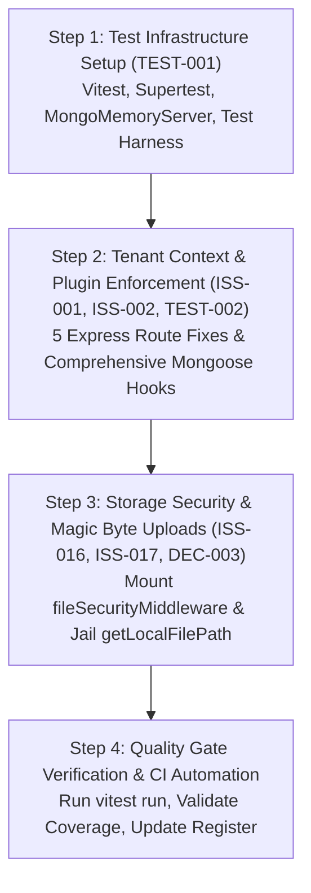

# Fleet Flow — Batch 1 Preflight Audit Report (No Code Changes)

**Document Version:** 1.0.0  
**Audit Date:** October 2026  
**Status:** Complete — Ready for Review & Implementation Approval  
**Audit Scope:** Batch 1 — Core Tenant Isolation, Security Gates & Test Foundations  
**Included IDs:**
- [`ISS-001`](../issues/ISS-001-tenant-context-enforcement.md): Tenant Context Resolution Middleware Bypass in Express Routes
- [`ISS-002`](../issues/ISS-002-tenant-plugin-interception.md): Incomplete Mongoose Tenant Interception Plugin
- [`ISS-016`](../issues/ISS-016-unmounted-file-security-middleware.md): Unmounted File Security Magic Byte Middleware on Uploads
- [`ISS-017`](../issues/ISS-017-local-storage-path-traversal.md): Local Storage Service Lacks Path Normalization Check (Directory Traversal Risk)
- [`TEST-001`](../testing/TEST-001-automated-http-integration-suite.md): Automated HTTP Integration Test Suite with Vitest & Supertest
- [`TEST-002`](../testing/TEST-002-cross-tenant-isolation-suite.md): Cross-Tenant Data Isolation & Mutation Boundary Test Suite
- [`DEC-003`](../decisions/DEC-003-storage-architecture-s3-vs-local.md): File Storage Architecture: Cloud S3 Object Storage vs Secured Local Disk

---

## 1. Executive Summary & Audit Methodology

This preflight report provides a **source-code verified inspection** of Fleet Flow prior to executing any implementation changes for **Batch 1**. 

### Strict Boundaries Adhered To During Preflight
- **Zero code changes executed:** No application files, tests, configurations, or database schemas were modified.
- **Zero package installations executed:** No npm packages were added or updated.
- **Zero migrations or destructive commands executed:** No database commands or migrations were triggered.
- **No resolved claims:** No issue has been marked resolved.

### Static Inspection vs. Executed Tests
> [!IMPORTANT]
> **Clear Distinction**: All findings documented in this report are based on **static code inspection, AST verification, and grep pattern matching** across the live codebase (`backend/src/`).
> Because the current repository lacks an automated HTTP test runner (`npm test` does not exist; Vitest and Supertest are not installed), **no automated HTTP integration tests were run**. We do NOT claim the application is secure merely because middleware or legacy test scripts exist.

---

## 2. Specification-by-Specification Source Verification

The table below summarizes the exact, source-verified status of every specification in Batch 1:

| ID | Specification Title | Documented Severity / Priority | Actual Source Code Status | Summary of Verification Findings |
| :--- | :--- | :--- | :--- | :--- |
| **`ISS-001`** | Tenant Context Resolution Middleware Bypass in Express Routes | `P0` / Blocker | **Defect Confirmed Active in Source** | Exactly 5 route files define authenticated tenant endpoints without mounting `resolveTenantContext`. Controllers evaluate `getTenantId(req)` to `undefined`, querying un-scoped records or throwing HTTP 403 on role checks. |
| **`ISS-002`** | Incomplete Mongoose Tenant Interception Plugin | `P0` / Blocker | **Defect Confirmed Active in Source** | `tenantPlugin.ts` only hooks 6 query methods. Mutations (`updateOne`, `deleteOne`, `deleteMany`, `findOneAndDelete`, `aggregate`, `distinct`) are not intercepted, allowing cross-tenant mutations and un-scoped aggregations. |
| **`ISS-016`** | Unmounted File Security Magic Byte Middleware on Uploads | `P1` / High | **Defect Confirmed Active in Source** | `fileSecurityMiddleware.ts` is implemented but **never imported or mounted anywhere in the application**. File uploads rely solely on client-supplied `Content-Type`. |
| **`ISS-017`** | Local Storage Service Lacks Path Normalization Check | `P1` / High | **Defect Confirmed Active in Source** | `storageService.ts:getLocalFilePath` uses `path.join(LOCAL_STORAGE_DIR, key)` without verifying that the resolved path resides within the storage root. Traversal sequences (`../../`) allow Arbitrary File Read (AFR). |
| **`TEST-001`**| Automated HTTP Integration Test Suite with Vitest & Supertest | `P0` / Blocker | **Missing Test Infrastructure** | `package.json` contains no test runner, no Vitest, and no Supertest. Existing scripts are ad-hoc direct Mongoose runners that bypass the Express HTTP pipeline. |
| **`TEST-002`**| Cross-Tenant Data Isolation & Mutation Boundary Test Suite | `P0` / Blocker | **Missing Test Infrastructure** | Zero automated tests verify cross-tenant read/write isolation or assertion of tenant boundaries. |
| **`DEC-003`**| Cloud S3 Object Storage vs Secured Local Disk | `P1` / Architecture | **Pending Formal Approval** | Architectural decision specifying S3 cloud storage in production and sandboxed disk storage in dev is documented but unchecked and pending formal sign-off. |

---

## 3. Detailed Source Code Findings

### 3.1. `ISS-001`: Tenant Context Resolution Middleware Bypass

#### Inspected Inventory of Express Route Files
A complete scan of all 27 route files registered in `backend/src/server.ts` identified exactly **5 route files** where authenticated tenant routes omit `resolveTenantContext`:

```
backend/src/routes/
├── approvalRoutes.ts          ❌ Missing resolveTenantContext (Line 20)
├── branchRoutes.ts            ❌ Missing resolveTenantContext (Line 15)
├── commercialReportRoutes.ts  ❌ Missing resolveTenantContext (Line 22)
├── supportRoutes.ts           ❌ Missing resolveTenantContext (Line 15)
├── trackingRoutes.ts          ❌ Missing resolveTenantContext (Lines 25-28)
```
*(All other 22 route files either correctly mount `resolveTenantContext`, are unauthenticated public/webhook endpoints, or represent platform superadmin routes `superAdminRoutes.ts` using `requireSuperAdmin`).*

#### Detailed Impact per Affected Route

1. **`backend/src/routes/branchRoutes.ts` (Line 15)**:
   - **Current Code**:
     ```typescript
     router.use(requireAuth);
     router.get('/', listBranches);
     router.post('/', requireRole(['admin']), createBranch);
     router.put('/:id', requireRole(['admin']), updateBranch);
     router.delete('/:id', requireRole(['admin']), deleteBranch);
     ```
   - **Root Cause & Behavior**:
     - `requireAuth` populates `req.user`, but NOT `req.member`, `req.tenant`, or `tenantStorage` context.
     - In `branchController.ts:16`, `listBranches` calls `const companyId = getTenantId(req);`. Because `tenantStorage.run()` was never called and `req.tenant` is absent, `companyId` evaluates to `undefined`.
     - The query `Branch.find({ company_id: undefined })` queries documents where `company_id` is null or missing.
     - In `createBranch`, `Branch.create({ company_id: undefined, ... })` crashes schema validation.
     - Furthermore, `requireRole(['admin'])` inspects `req.member.role`. Since `req.member` is `undefined`, it unconditionally returns `HTTP 403 Forbidden: Access denied. Your role: none`.

2. **`backend/src/routes/approvalRoutes.ts` (Line 20)**:
   - **Current Code**:
     ```typescript
     router.use(requireAuth);
     router.get('/rules', listApprovalRules);
     router.post('/rules', requireRole(['admin']), createApprovalRule);
     router.get('/pending', listPendingApprovals);
     router.post('/:id/process', requireRole(['admin']), processApproval);
     ```
   - **Root Cause & Behavior**:
     - `req.member` is `undefined`, blocking legitimate company admins with HTTP 403 on rule creation and approval processing.
     - `listApprovalRules` and `listPendingApprovals` call `getTenantId(req)` which returns `undefined`.

3. **`backend/src/routes/commercialReportRoutes.ts` (Line 22)**:
   - **Current Code**:
     ```typescript
     router.use(requireAuth);
     router.get('/aging', getArAgingReport);
     router.get('/profitability', getTripProfitabilityReport);
     router.get('/export/tally', exportToTallyXml);
     router.get('/credit-notes', listCreditNotes);
     router.post('/credit-notes', createCreditNote);
     ```
   - **Root Cause & Behavior**:
     - `getArAgingReport` and `getTripProfitabilityReport` query financial aggregates with `company_id: undefined`, resulting in empty reports or global aggregation scans.
     - In `createCreditNote`, credit notes are created with `company_id: undefined`.

4. **`backend/src/routes/supportRoutes.ts` (Line 15)**:
   - **Current Code**:
     ```typescript
     router.use(requireAuth);
     router.get('/', listTickets);
     router.post('/', createTicket);
     router.get('/:id', getTicket);
     router.post('/:id/reply', replyToTicket);
     ```
   - **Root Cause & Behavior**:
     - Support tickets are saved without valid tenant scoping (`company_id: undefined`), leaking tickets across tenants or failing required schema validation.

5. **`backend/src/routes/trackingRoutes.ts` (Lines 25-28)**:
   - **Current Code**:
     ```typescript
     // Public tracking — no auth required
     router.get('/:lrNumber', publicTrackConsignment);

     // Authenticated telematics routes
     router.post('/ping', requireAuth, ingestGpsPing);
     router.get('/live/fleet', requireAuth, getFleetLiveMap);
     router.get('/live/:truckId', requireAuth, getLiveTruckLocation);
     router.post('/incident', requireAuth, reportTripIncident);
     ```
   - **Root Cause & Behavior**:
     - `ingestGpsPing` (Line 25): Ingests GPS locations with `company_id: undefined`, disassociating telemetry logs from the tenant fleet.
     - `getFleetLiveMap` (Line 26): Queries `Truck.find({ company_id: undefined, is_active: true })`, resulting in an empty live map.
     - `reportTripIncident` (Line 28): Ingests incident logs with `company_id: undefined`.

---

### 3.2. `ISS-002`: Incomplete Mongoose Tenant Interception Plugin

#### Inspected Implementation in `backend/src/plugins/tenantPlugin.ts`
Lines 79-88 define the intercepted query methods:
```typescript
const queryMethods = [
  'find',
  'findOne',
  'findOneAndUpdate',
  'updateMany',
  'countDocuments',
  'estimatedDocumentCount',
] as const;
```

#### Vulnerabilities Uncovered in Source Code
1. **Unintercepted `updateOne`**:
   - In `backend/src/controllers/commercialReportController.ts:298-301`:
     ```typescript
     await Invoice.updateOne(
       { _id: original_invoice_id },
       { $inc: { amount_paid_paise: total_adjustment_paise } }
     );
     ```
     Because `tenantPlugin.ts` does not intercept `updateOne`, this query executes without `{ company_id: currentTenantId }`. If an attacker passes an `original_invoice_id` belonging to Tenant B, Tenant A successfully mutates Tenant B's invoice balance!
   - Additional un-scoped `updateOne` instances identified in:
     - `truckController.ts` (Lines 346, 395, 408, 474)
     - `driverController.ts` (Line 309)
     - `settlementController.ts` (Line 516)
     - `portalController.ts` (Line 268)

2. **Unintercepted `deleteOne` & `deleteMany`**:
   - In `backend/src/controllers/branchController.ts:113`:
     ```typescript
     await Branch.deleteOne({ _id: id });
     ```
     Because `deleteOne` is not intercepted, any authenticated user can delete any branch record in the entire database by ID, regardless of tenant ownership!

3. **Unintercepted `findOneAndDelete` & `findOneAndReplace`**:
   - Completely bypasses tenant scoping, risking cross-tenant destruction.

4. **Unintercepted `distinct`**:
   - Allows cross-tenant data harvesting (e.g., harvesting distinct phone numbers or GST numbers across all tenants).

5. **Unintercepted `aggregate`**:
   - Over **19 aggregation pipelines** exist in `backend/src/controllers/` (`vehicleEntryController.ts`, `settlementController.ts`, `ledgerController.ts`, `invoiceController.ts`, `dashboardController.ts`, `journeyController.ts`, etc.).
   - Mongoose query middleware does not intercept `Model.aggregate()`.
   - Without an aggregate hook (`schema.pre('aggregate')`), any aggregation stage that omits explicit `$match: { company_id }` scans the entire physical database across all companies.
   - **Crucial Technical Consideration**: If `$geoNear` is used as the first stage, MongoDB strictly requires `$geoNear` to remain at stage index 0. Prepending `$match` before `$geoNear` causes MongoDB execution failure. Prepending must inspect and insert after `$geoNear` if present.
   - **Type Casting Consideration**: In aggregation pipelines, Mongoose does NOT automatically cast string IDs to `mongoose.Types.ObjectId`. The tenant filter must use `new mongoose.Types.ObjectId(currentCompanyId)`.

#### Model Adoption Audit
- **20 Schemas Attach `tenantPlugin`**: `Truck`, `Driver`, `TruckJourney`, `Entry`, `VehicleEntry`, `Invoice`, `Settlement`, `Ledger`, `Branch`, `ApprovalRule`, `ApprovalRequest`, `CreditNote`, `MaintenanceOrder`, `TyreRecord`, `BalanceParty`, `BillingParty`, `SupportTicket`, `TripIncident`, `VehicleLocationLog`, `IdempotencyKey`.
- **Tenant-scoped models with `company_id` omitting `tenantPlugin`**:
  - `CustomFieldDefinition.ts` (has indexed `company_id`, but does not call `schema.plugin(tenantPlugin)`).
  - Note: `Subscription.ts` and `PaymentTransaction.ts` are tenant-associated billing records managed at the platform level.

---

### 3.3. `ISS-016`: Unmounted File Security Magic Byte Middleware

#### Inspected Source Files
- `backend/src/middleware/fileSecurityMiddleware.ts` (Lines 1-71)
- `backend/src/routes/documentRoutes.ts` (Lines 1-39)
- `backend/src/controllers/documentController.ts` (Lines 1-161)
- `backend/src/utils/cryptoService.ts` (Lines 97-129)

#### Verified Defects
1. **Orphaned Security Middleware**:
   `grep` search across the entire `backend/src/` tree reveals that `fileSecurityMiddleware` is **imported 0 times**.
2. **Current Upload Chain in `documentRoutes.ts:30`**:
   ```typescript
   router.post('/upload', documentUploadMiddleware, uploadDocument);
   ```
   `fileSecurityMiddleware` is completely omitted from the route pipeline.
3. **MIME Spoofing Vulnerability**:
   `documentUploadMiddleware` relies on Multer's `fileFilter` in `documentController.ts:45-51`:
   ```typescript
   fileFilter: (_req, file, cb) => {
     if (ALLOWED_MIME_TYPES.includes(file.mimetype)) {
       cb(null, true);
     } else {
       cb(new Error('Invalid file format. Only PDF, JPEG, PNG, and WebP are allowed.'));
     }
   }
   ```
   `file.mimetype` is parsed directly from the incoming HTTP request header `Content-Type`. An attacker uploading an executable script or HTML payload with `Content-Type: application/pdf` bypasses Multer validation entirely.
4. **Buffer Validation Availability**:
   `cryptoService.ts` contains `validateFileMagicBytes(buffer, mimeType)` which validates signatures for PDF (`%PDF`), JPEG (`\xFF\xD8\xFF`), PNG (`\x89PNG`), and WebP (`RIFF`). Because Multer uses `multer.memoryStorage()`, `req.file.buffer` is available in-memory, making integration straightforward.

---

### 3.4. `ISS-017`: Local Storage Service Path Traversal Vulnerability

#### Inspected Source Files
- `backend/src/utils/storageService.ts` (Lines 1-190)
- `backend/src/controllers/documentController.ts` (Lines 136-160)

#### Verified Defects & Exploit Vector
1. **Flawed Path Validation in `storageService.ts:178-189`**:
   ```typescript
   export function getLocalFilePath(companyId: string, key: string): string {
     const expectedPrefix = `tenants/${companyId}/`;
     if (!key.startsWith(expectedPrefix)) {
       throw new Error('FORBIDDEN: Unauthorized tenant key access.');
     }

     const filePath = path.join(LOCAL_STORAGE_DIR, key);
     if (!fs.existsSync(filePath)) {
       throw new Error('File not found.');
     }
     return filePath;
   }
   ```
2. **Directory Escape Vulnerability**:
   `key.startsWith(expectedPrefix)` only verifies that the string begins with `tenants/{companyId}/`.
   If a client requests:
   `GET /api/documents/file?key=tenants/64f1a2b3c4d5e6f7a8b9c0d1/../../../../Windows/win.ini`
   or
   `GET /api/documents/file?key=tenants/64f1a2b3c4d5e6f7a8b9c0d1/../../../../etc/passwd`
   - `key.startsWith(expectedPrefix)` returns `true`!
   - `path.join(LOCAL_STORAGE_DIR, key)` resolves the `..` tokens and traverses completely out of `LOCAL_STORAGE_DIR`.
   - In `documentController.ts:152`, `res.sendFile(filePath)` streams the arbitrary host file directly to the client.
3. **Required Fix**:
   The path must be resolved via `path.resolve(LOCAL_STORAGE_DIR, normalizedKey)` and strictly verified:
   ```typescript
   const resolvedPath = path.resolve(LOCAL_STORAGE_DIR, normalizedKey);
   const tenantBaseDir = path.resolve(LOCAL_STORAGE_DIR, 'tenants', companyId);
   if (!resolvedPath.startsWith(tenantBaseDir + path.sep)) {
     throw new Error('FORBIDDEN: Illegal path traversal sequence detected.');
   }
   ```
   Additionally, null bytes (`\0`) and raw traversal sequences must be rejected upfront with HTTP 403.

---

### 3.5. `TEST-001` & `TEST-002`: Test Infrastructure Readiness

#### Inspected Files
- `backend/package.json`
- `backend/src/server.ts`
- `backend/src/scripts/` (15 scripts: `verifyPhase1.ts` to `verifyPhase6.ts`, `verifyIssue01.ts` to `verifyIssue07.ts`)

#### Verified Infrastructure State
1. **Zero Test Framework Configured**:
   - `package.json` contains:
     - No `"test"` script.
     - No Vitest, Jest, Mocha, or test runner.
     - No Supertest.
     - No `mongodb-memory-server`.
2. **Existing Scripts are Not Automated Tests**:
   - Scripts in `src/scripts/` are one-off manual verification scripts run via `tsx src/scripts/verifyIssue01.ts`.
   - They connect directly to a live MongoDB instance (`mongodb://127.0.0.1:27017/transport_management`) and manipulate Mongoose models directly.
   - They completely bypass Express routing, HTTP authentication, middleware chains, and route parameter extraction.
3. **Server Export Readiness for Supertest**:
   - In `backend/src/server.ts:230-235`:
     ```typescript
     if (process.env.NODE_ENV !== 'test') {
       startServer();
     }
     export default app;
     ```
     `app` is cleanly exported and does NOT listen on port 5000 when `NODE_ENV === 'test'`. This allows Supertest to test `app` in-memory without port collision.

---

### 3.6. `DEC-003`: File Storage Strategy Approval Status

#### Inspected File
- `docs/decisions/DEC-003-storage-architecture-s3-vs-local.md`

#### Current Status
- **Status in Document:** `Pending Infrastructure & Security Approval`.
- **Sign-Off Checkboxes:** Unchecked (all 4 checkboxes pending).
- **Specific Unresolved Decision:**
  > **Architectural Decision Pending Sign-Off**:
  > Enforce **Option A**:
  > 1. **Production (`NODE_ENV === 'production'`)**: Require S3-compatible cloud object storage (AWS S3, Cloudflare R2, MinIO) with pre-signed download URLs (15-min TTL) and SSE-S3 encryption. Block application startup if AWS S3 credentials are missing or point to local disk.
  > 2. **Local Development (`NODE_ENV === 'development'`)**: Permit sandboxed local disk storage strictly jailed within `LOCAL_STORAGE_DIR`, or local MinIO container via Docker Compose.
  > 
  > **Until approved**: Production code cannot assert that local disk storage is blocked at startup, but local path traversal jailing (`ISS-017`) and magic byte verification (`ISS-016`) can and must be implemented immediately.

---

## 4. Minimum Safe Setup for Test Infrastructure (`TEST-001` & `TEST-002`)

To implement `TEST-001` and `TEST-002` without disrupting existing developer workflows:

### Required `devDependencies`
```json
{
  "devDependencies": {
    "vitest": "^3.0.5",
    "supertest": "^7.0.0",
    "@types/supertest": "^6.0.2",
    "mongodb-memory-server": "^10.1.4"
  }
}
```

### Test Configuration Architecture
1. **Config File:** `backend/vitest.config.ts`:
   - Configured with `globals: true`, `environment: 'node'`, `setupFiles: ['./src/tests/setup.ts']`, and `testTimeout: 30000`.
2. **Global Setup Harness (`backend/src/tests/setup.ts`)**:
   - Spins up an in-memory MongoDB replica set via `MongoMemoryReplSet.create()`.
   - Connects Mongoose via `mongoose.connect(uri)`.
   - Before each test, clears all database collections.
   - In `afterAll`, disconnects Mongoose and stops the in-memory MongoDB server.
3. **NPM Scripts to Add in `backend/package.json`**:
   ```json
   "scripts": {
     "test": "vitest run",
     "test:watch": "vitest",
     "test:coverage": "vitest run --coverage"
   }
   ```
4. **Zero Impact on Existing Workflows**:
   - `npm run dev` (`tsx watch src/server.ts`) remains 100% unaffected.
   - `npm run build` (`tsc`) remains unaffected.
   - Legacy scripts (`npm run test:phase1` ... `npm run test:issue07`) remain functional.

---

## 5. Dependencies, Migration Risks & Regression Analysis

### 5.1. Database Schema & Data Migration Risks
- **Migrations Required:** **Zero (0)**.
- **Breaking Schema Changes:** **Zero (0)**.
- All models already contain `company_id` in their schema definitions.

### 5.2. Potential Regressions & Mitigations

| Risk Area | Potential Failure Mode | Prevention / Mitigation Mechanism |
| :--- | :--- | :--- |
| **`tenantPlugin.ts` Aggregate Hook** | Prepending `$match` breaks `$geoNear` aggregation pipelines | In `schema.pre('aggregate')`, check `this.pipeline()[0]`. If `$geoNear` is present, insert the `$match` stage at index 1 instead of index 0. |
| **`tenantPlugin.ts` String vs ObjectId in Aggregation** | MongoDB aggregation `$match` fails to match string `companyId` | Wrap `currentCompanyId` in `new mongoose.Types.ObjectId(currentCompanyId)` within the aggregate hook. |
| **Superadmin Queries** | Superadmin analytics queries fail due to forced tenant filter | Honor `{ skipTenantCheck: true }` on queries and sanitize the filter to prevent querying non-existent fields. |
| **Multer Error Handling** | File upload with invalid MIME type triggers unhandled 500 | Ensure Multer `fileFilter` errors and magic byte mismatches are formatted cleanly as HTTP 400 or HTTP 415. |
| **Background Workers** | Workers running without HTTP context crash on `tenantPlugin` | If `getCurrentTenantId()` returns `undefined`, `tenantPlugin` must no-op and let query pass normally. |

---

## 6. Recommended Implementation Scope Split

To ensure safe, reviewable progress, Batch 1 should be implemented in **4 discrete, sequential PR-sized steps**:



### Step 1: Test Infrastructure Setup (`TEST-001`)
- Add `vitest`, `supertest`, `@types/supertest`, `mongodb-memory-server` to `devDependencies`.
- Create `backend/vitest.config.ts`.
- Create test database harness `backend/src/tests/setup.ts` and test helper utilities `backend/src/tests/helpers.ts` (tenant seeding, JWT token generators).
- Add `"test"` and `"test:watch"` scripts to `package.json`.
- **Validation**: Run `npm test` verifying that test runner boots and cleans up properly.

### Step 2: Tenant Context Resolution & Mongoose Plugin Hardening (`ISS-001`, `ISS-002`, `TEST-002`)
- Mount `resolveTenantContext` in:
  - `branchRoutes.ts`
  - `approvalRoutes.ts`
  - `commercialReportRoutes.ts`
  - `supportRoutes.ts`
  - `trackingRoutes.ts` (authenticated telematics endpoints)
- Update `tenantPlugin.ts`:
  - Add mutation hooks: `updateOne`, `deleteOne`, `deleteMany`, `findOneAndDelete`, `findOneAndReplace`, `distinct`.
  - Add aggregate hook: `schema.pre('aggregate')` with `$geoNear` safety and `ObjectId` casting.
- Attach `tenantPlugin` to `CustomFieldDefinition.ts`.
- Create automated test suites:
  - `backend/src/tests/integration/tenantRoutes.test.ts` (verifies the 5 route files with Supertest).
  - `backend/src/tests/integration/tenantIsolation.test.ts` (verifies cross-tenant read/update/delete/aggregate isolation).
- **Validation**: Execute `npm test` and assert 100% pass rate.

### Step 3: Storage Traversal Defense & Magic Byte Validation (`ISS-016`, `ISS-017`, `DEC-003`)
- Mount `fileSecurityMiddleware` in `backend/src/routes/documentRoutes.ts` on `POST /upload`.
- Update `backend/src/utils/storageService.ts:getLocalFilePath` with strict path normalization and root boundary assertion:
  - Reject null bytes (`\0`) and `..` traversal tokens.
  - Assert that `path.resolve(LOCAL_STORAGE_DIR, key)` resides strictly within `path.resolve(LOCAL_STORAGE_DIR, 'tenants', companyId)`.
- Enforce sanitized extensions in `generateTenantKey`.
- Create security test suite `backend/src/tests/integration/fileStorageSecurity.test.ts`:
  - Test MIME spoofing rejection (renamed `.exe` rejected with HTTP 415).
  - Test path traversal injection (`../../etc/passwd` rejected with HTTP 403).
  - Test cross-tenant storage access (Tenant A cannot download Tenant B key).

### Step 4: Batch 1 Verification & Register Update
- Run full automated test suite: `npm test`.
- Verify statement coverage exceeds 80% on affected files.
- Submit `DEC-003` for formal architectural sign-off.
- Update `docs/FLEET_FLOW_MASTER_REGISTER.md` and `docs/IMPLEMENTATION_READINESS_BACKLOG.md` reflecting completed status.

---

## 7. Acceptance Criteria Checklists

### For `ISS-001`:
- [ ] `GET /api/branches` returns HTTP 200 with tenant-scoped branches for an authenticated tenant admin.
- [ ] `POST /api/branches` successfully creates branches with `company_id` populated from tenant context.
- [ ] `GET /api/commercial/aging` returns HTTP 200 with tenant-scoped accounts receivable.
- [ ] `GET /api/approvals/rules` and `GET /api/approvals/pending` return HTTP 200 for authenticated tenant users.
- [ ] `POST /api/telematics/ping` saves telemetry logs with active `company_id`.
- [ ] `GET /api/telematics/live/fleet` returns active trucks for the authenticated tenant.
- [ ] Requests without valid tenant association return HTTP 401 or 403 with descriptive error.

### For `ISS-002`:
- [ ] Calling `Model.updateOne({ _id })` as Tenant A cannot modify a document belonging to Tenant B.
- [ ] Calling `Model.deleteOne({ _id })` as Tenant A cannot delete a document belonging to Tenant B.
- [ ] Calling `Model.deleteMany({})` only deletes documents matching the caller's `company_id`.
- [ ] Calling `Model.aggregate()` automatically scopes results to `company_id: ObjectId(currentTenantId)` without requiring manual `$match`.
- [ ] Aggregation pipelines starting with `$geoNear` preserve `$geoNear` as stage 0 and inject tenant `$match` at stage 1.
- [ ] Queries with `{ skipTenantCheck: true }` can execute cross-tenant only when caller has superadmin authorization.

### For `ISS-016`:
- [ ] Legitimate PDFs, JPEGs, PNGs, and WebPs upload successfully with HTTP 201.
- [ ] Files with mismatched binary magic bytes (e.g., shell script disguised with `Content-Type: application/pdf`) are rejected with HTTP 415.
- [ ] Files with empty or truncated buffers (< 8 bytes) are rejected with HTTP 415.

### For `ISS-017`:
- [ ] Storage keys containing `../`, `..\`, or null bytes throw HTTP 403 Forbidden.
- [ ] File retrieval paths are constrained within the storage root directory.
- [ ] Requests attempting to download another tenant's files throw HTTP 403 Forbidden.

### For `TEST-001` & `TEST-002`:
- [ ] `npm test` runs via Vitest against an in-memory MongoDB replica set.
- [ ] Automated tests cover all 5 routes updated in `ISS-001`.
- [ ] Automated cross-tenant tests prove isolation for read, update, delete, and aggregate operations.
- [ ] Test suite executes in under 60 seconds.

---

## 8. Preflight Sign-Off & Halt Statement

In accordance with the preflight instructions:
- **No application code, tests, or configurations have been changed.**
- **No packages have been installed.**
- **No migrations have been executed.**
- **No issues have been marked resolved.**

This preflight report is complete. We await user review and approval before proceeding with Batch 1 code implementation.
