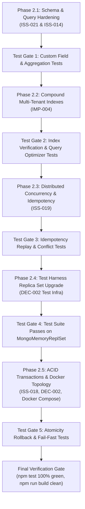

# Fleet Flow — Batch 2 Preflight Audit Report (No Code Changes)

**Document Version:** 1.0.0  
**Audit Date:** October 2026  
**Status:** Complete — Ready for Review & Implementation Approval  
**Audit Scope:** Batch 2 — Database Topology, Aggregation Types, Concurrency Hardening & Transaction Foundations  
**Included Canonical IDs:**
- [`ISS-018`](../issues/ISS-018-acid-transactions-standalone-mongo.md): Multi-Document ACID Transactions Crash Standalone MongoDB Instances Without Replica Set (`P0` / Blocker)
- [`ISS-014`](../issues/ISS-014-mongodb-aggregation-string-companyid.md): MongoDB Aggregations Pass Raw String `companyId` into `$match` (`P1` / High)
- [`ISS-019`](../issues/ISS-019-client-side-idempotency-key-omission.md): Missing Client-Side Idempotency Key Generation Exposing Financial Endpoints to Duplicate Execution (`P1` / High)
- [`ISS-021`](../issues/ISS-021-custom-field-key-injection-defense.md): Custom Field Key Injection & Prototype Pollution Risk in Dynamic Entity Schemas (`P2` / Moderate)
- [`IMP-004`](../improvements/IMP-004-compound-multitenant-indexes.md): Compound Multi-Tenant Database Indexing Optimization (`P1` / High)
- [`DEC-002`](../decisions/DEC-002-mongodb-transactions-standalone-strategy.md): Standalone MongoDB Fallback vs Mandatory Replica Set in Production (Approved Architecture Decision)

---

## 1. Executive Summary & Audit Methodology

This preflight report provides a **forensic, source-verified architectural review** of the Fleet Flow repository prior to commencing implementation of **Batch 2**. 

### Strict Boundaries Adhered To During Preflight
- **Zero application code changes executed:** No controllers, models, middleware, utilities, or frontend code were modified.
- **Zero test harness modifications executed:** Test configurations and integration test files remain untouched.
- **Zero configuration or package modifications executed:** No npm packages, tsconfig, or Docker configurations were altered.
- **Zero database or destructive operations executed:** No migrations or database commands were triggered.
- **No resolved claims:** No Batch 2 issue is marked resolved in this preflight phase.

### Static Inspection vs. Executed Tests
All findings documented herein are derived from **live abstract syntax tree (AST) inspection, regex pattern matching, schema auditing, and route tracing** across `backend/src/` and `frontend/src/`. While the Vitest integration test suite created in Batch 1/1.1 is fully passing (59/59 tests green), it currently tests single-collection mutations and read boundaries; it does **not yet exercise multi-document replica-set transactions or strict distributed idempotency locks**.

---

## 2. Approved Architectural Decisions

### 2.1. DEC-002: Option A Formally Approved
The Project Stakeholders and Lead Architect have **formally approved Option A** of [`DEC-002`](../decisions/DEC-002-mongodb-transactions-standalone-strategy.md):

> **DEC-002 Ruling (Option A — Mandatory Replica Set Topology Across All Environments):**
> 1. **Zero Silent Non-Transactional Fallbacks**: Silent sequential execution of multi-document financial mutations without transactions is **strictly prohibited**. Financial workflows must run inside real MongoDB multi-document ACID transactions.
> 2. **Fail-Fast Topology Assertion**: The application backend must inspect connection topology upon startup and before executing atomic operations. If a standalone un-replicated MongoDB instance is encountered during a required transactional workflow, it must immediately fail fast with a descriptive `ConfigurationError` (HTTP 500) directing the operator to initialize a replica set.
> 3. **Mandatory Replica Set Environments**:
>    - **Local Development**: Mandatory single-node replica set (`rs0`) pre-configured in `docker-compose.yml` / `docker-compose.dev.yml` with automated, repeatable `rs.initiate()` healthchecks that preserve volume data across restarts.
>    - **Testing / CI**: Mandatory in-memory replica set (`MongoMemoryReplSet`) in the Vitest test runner.
>    - **Staging & Production**: Mandatory multi-node replica set (minimum 3 nodes: Primary-Secondary-Secondary) or managed MongoDB Atlas replica set with `majority` write concern.
> 4. **Single-Node Distinction**: A single-node local replica set provides oplog transaction capability for development and CI, but does **not** represent production high availability. Production clusters require high-availability distributed quorum.

### 2.2. DEC-003: Storage Architecture Remains Pending Approval
As established in Batch 1.1, [`DEC-003`](../decisions/DEC-003-storage-architecture-s3-vs-local.md) **remains Pending Approval**. 
- Production startup enforcement blocking local storage is **not** approved and will **not** be implemented in Batch 2.
- Local storage path containment and company-specific folder jailing (`M-01`) remain active and sufficient for current operational environments.

---

## 3. Specification-by-Specification Source Verification

The table below summarizes the exact, source-verified status of every specification in Batch 2 based on live inspection of the codebase:

| ID | Specification Title | Documented Priority | Actual Source Code Status | Summary of Forensic Verification Findings |
| :--- | :--- | :--- | :--- | :--- |
| **`ISS-018`** | Multi-Document ACID Transactions on Replica Set | `P0` / Blocker | **Confirmed Defect / Architectural Gap** | Multiple controllers (`settlementController.ts`, `invoiceController.ts`, `ledgerController.ts`, `maintenanceController.ts`, `authController.ts`) call raw `mongoose.startSession()` and `session.startTransaction()`. Without replica set topology assertion, standalone environments crash with unhandled 500s. Crucially, billing checkout in `billingController.ts` executes 3 separate writes (`Subscription`, `Company`, `PaymentTransaction`) with **no transaction at all**. `transactionHelper.ts` does not exist. |
| **`ISS-014`** | MongoDB Aggregations Pass Raw String `companyId` | `P1` / High | **Confirmed Active Defect** | Verified in `entryController.ts:94` and `journeyController.ts:130`: aggregations pass raw string `companyId` into `$match: { company_id: companyId }`. Because MongoDB does not perform BSON casting in aggregation pipelines, string `"..."` does not match BSON `ObjectId("...")`, returning 0 results and corrupting operational metrics. |
| **`ISS-019`** | Client-Side Idempotency Key Omission & Strict Enforcement | `P1` / High | **Confirmed Active Vulnerability** | `frontend/src/api/client.ts` never attaches `x-idempotency-key` (0 occurrences across entire frontend). Backend `idempotencyMiddleware.ts` fails open: if `x-idempotency-key` is absent, it calls `next()`. Concurrent double-clicks on financial actions execute duplicate writes. In addition, existing middleware lacks in-flight distributed locking, risking race conditions. |
| **`ISS-021`** | Custom Field Prototype Pollution Defense | `P2` / Moderate | **Confirmed Security Vulnerability** | `customFieldController.ts:79` accepts `field_key` without reserved keyword blacklist or regex enforcement. Creating fields named `__proto__`, `constructor`, `toString`, or starting with `$` succeeds with HTTP 201, exposing tenant entity schemas to prototype pollution and query injection. |
| **`IMP-004`** | Compound Multi-Tenant Database Indexes | `P1` / High | **Performance Gap & Spec Mismatch** | `VehicleLocationLog` lacks compound index on `{ company_id, truck_id, recorded_at }` (spec mistakenly referred to `timestamp` on `GpsPing.ts`). `TruckJourney` has zero explicit compound indexes. `Invoice` has index on `{ company_id, status }` which can be upgraded to `{ company_id, status, due_date }` for AR Aging queries. |
| **`DEC-002`** | Standalone MongoDB Fallback vs Mandatory Replica Set | Architecture | **Formally Approved (Option A)** | Approved by stakeholders. Current repository lacks `docker-compose.yml`, lacks `transactionHelper.ts`, and test harness (`backend/src/tests/setup.ts`) uses standalone `MongoMemoryServer` instead of `MongoMemoryReplSet`. |

---

## 4. Detailed Current-State Source Findings

### 4.1. `ISS-018`: Multi-Document ACID Transactions & Financial Mutations

#### A. Audited Financial Mutation Workflows
A comprehensive scan of write operations identified all critical operational and financial flows that require multi-document atomicity:

1. **Driver Settlement Confirmation** ([`settlementController.ts:211-315`](file:///c:/Users/vishh/OneDrive/Desktop/Work/TransportManagement/backend/src/controllers/settlementController.ts#L211-L315)):
   - **Current Implementation**: Uses raw `mongoose.startSession()`.
   - **Writes Requiring Atomicity**:
     - `Settlement.create(...)`
     - `TruckJourney.updateMany({ _id: { $in: journey_ids } }, { $set: { is_settled: true, settlement_id } })`
     - `Driver.findByIdAndUpdate(driver_id, { $inc: { pending_settlement_balance: -net_payable } })`
     - `Ledger.create(...)` (Driver settlement disbursement journal)
   - **Failure Consequence Without Atomicity**: If journal creation or journey update fails halfway, driver balance is altered while settlement record is missing, permanently breaking double-entry ledger balance.

2. **Driver Settlement Cancellation** ([`settlementController.ts:482-535`](file:///c:/Users/vishh/OneDrive/Desktop/Work/TransportManagement/backend/src/controllers/settlementController.ts#L482-L535)):
   - **Writes Requiring Atomicity**: Mark `Settlement` cancelled, revert `TruckJourney.is_settled` to `false`, restore driver balance, and post compensating ledger reversal voucher.

3. **Invoice Payment Recording** ([`invoiceController.ts:335-410`](file:///c:/Users/vishh/OneDrive/Desktop/Work/TransportManagement/backend/src/controllers/invoiceController.ts#L335-L410)):
   - **Current Implementation**: Uses raw `mongoose.startSession()`.
   - **Writes Requiring Atomicity**:
     - `Invoice.findByIdAndUpdate(...)` (increments `amount_paid_paise`, recalculates `balance_amount_paise`, updates `status`)
     - `Invoice.updateOne(..., { $push: { payment_history } })`
     - `Ledger.create(...)` (Double-entry Cash/Bank receipt journal)

4. **Invoice Cancellation** ([`invoiceController.ts:425-475`](file:///c:/Users/vishh/OneDrive/Desktop/Work/TransportManagement/backend/src/controllers/invoiceController.ts#L425-L475)):
   - **Writes Requiring Atomicity**: Mark `Invoice` cancelled, revert associated `Entry` records (`status: 'active'`), and post general ledger void entries.

5. **Manual Journal Voucher Posting** ([`ledgerController.ts:185-265`](file:///c:/Users/vishh/OneDrive/Desktop/Work/TransportManagement/backend/src/controllers/ledgerController.ts#L185-L265)):
   - **Current Implementation**: Uses raw `mongoose.startSession()`.
   - **Writes Requiring Atomicity**: Creates paired debit and credit `Ledger` rows with shared `journal_id`. Partial writes result in unbalanced accounting books.

6. **Maintenance Order Completion** ([`maintenanceController.ts:295-360`](file:///c:/Users/vishh/OneDrive/Desktop/Work/TransportManagement/backend/src/controllers/maintenanceController.ts#L295-L360)):
   - **Current Implementation**: Uses raw `mongoose.startSession()`.
   - **Writes Requiring Atomicity**: Mark `MaintenanceOrder` completed, update `Truck` maintenance metrics, and post expense journal in `Ledger`.

7. **SaaS Subscription Activation / Payment Verification** ([`billingController.ts:348-376`](file:///c:/Users/vishh/OneDrive/Desktop/Work/TransportManagement/backend/src/controllers/billingController.ts#L348-L376)):
   - **Current Defect**: **No transaction is used!**
   - Executes three disconnected sequential database writes:
     ```typescript
     await Subscription.findOneAndUpdate({ company_id: companyId }, { ... }, { upsert: true });
     await Company.findByIdAndUpdate(companyId, { subscription_status: 'active' });
     await PaymentTransaction.findOneAndUpdate({ order_id: razorpay_order_id }, { status: 'success' });
     ```
   - If server crashes after step 1, tenant is billed and subscription is updated, but company status remains inactive or payment transaction remains unrecorded.

8. **Tenant Registration & Onboarding** ([`authController.ts:135-210`](file:///c:/Users/vishh/OneDrive/Desktop/Work/TransportManagement/backend/src/controllers/authController.ts#L135-L210)):
   - **Current Implementation**: Uses raw `mongoose.startSession()`.
   - **Writes Requiring Atomicity**: `User.create`, `Company.create`, `CompanyMember.create`.

#### B. Architectural Defect in Existing Controller Transactions
In all 5 controllers currently attempting transactions:
- Raw boilerplate `const session = await mongoose.startSession(); session.startTransaction();` is duplicated without unified topology inspection.
- When running in local development or single-node CI against standalone MongoDB, calls to `startSession()` crash with `MongoServerError: Transaction numbers are only allowed on a replica set member or mongos`.
- No retry logic is implemented for transient transaction errors (`TransientTransactionError`, `UnknownTransactionCommitResult`).
- Several child operations inside transaction blocks inadvertently omit `{ session }`, executing outside the transaction and destroying atomic isolation!

---

### 4.2. `ISS-014`: MongoDB Aggregations Pass Raw String `companyId`

#### A. Audited Aggregation Call Sites
A grep across all controllers identified 19 aggregation pipelines. Two critical operational summary endpoints fail completely due to raw string passing:

1. **`backend/src/controllers/entryController.ts:84-113` (`getEntryMetrics`)**:
   ```typescript
   const companyId = req.tenant?.id; // String extracted from req.tenant.id
   // ...
   Entry.aggregate([
     { $match: { company_id: companyId, is_deleted: false } }, // String passed directly!
     { $group: { _id: null, totalFreight: { $sum: '$freight_amount' } } },
   ])
   ```
   - Documents store `company_id` as BSON `ObjectId`.
   - In aggregation pipelines, Mongoose **does not cast types automatically**.
   - Comparing BSON `ObjectId` with BSON `String` always evaluates to `false`.
   - Even though `tenantPlugin` prepends `{ $match: { company_id: ObjectId(...) } }`, Stage 2 continues to match against the string, yielding **0 documents** and reporting `total_freight_value: 0`.

2. **`backend/src/controllers/journeyController.ts:127-143` (`getJourneyMetrics`)**:
   ```typescript
   const mileageAgg = await TruckJourney.aggregate([
     {
       $match: {
         company_id: companyId, // Raw string!
         status: { $in: ['active', 'completed', 'delayed'] },
         is_deleted: false,
       },
     },
     { $group: { _id: null, totalDistance: { $sum: '$total_distance_kms' }, ... } },
   ]);
   ```
   - Silently evaluates to 0 results; journey distance, diesel expense, and mileage widgets report zero.

3. **Additional Pipeline Audits**:
   - `dashboardController.ts`: Lines 42, 72, 92, 139, 172. Must verify all stages cast `new Types.ObjectId(String(companyId))`.
   - `ledgerController.ts`: Lines 93, 104, 277, 295, 322, 336, 394.
   - `settlementController.ts`: Lines 81, 91.

---

### 4.3. `ISS-019`: Client-Side Idempotency Key Omission & Strict Enforcement

#### A. Audited Frontend Reality
- Grep for `idempotency` across `frontend/src` returns **zero matches**.
- `frontend/src/api/client.ts` configures an Axios client with base URL `/api` and an interceptor for `x-company-id`, but **never sets `x-idempotency-key`**.
- Modal dialogs (e.g., `ConfirmSettlementModal`, `RecordPaymentModal`, `ManualJournalModal`) have no token generation logic. Rapid double-clicks submit duplicate requests with identical payloads.

#### B. Audited Backend Middleware Defect ([`idempotencyMiddleware.ts`](file:///c:/Users/vishh/OneDrive/Desktop/Work/TransportManagement/backend/src/middleware/idempotencyMiddleware.ts))
1. **Fails Open on Missing Key**:
   ```typescript
   const rawKey = req.headers['x-idempotency-key'] || req.body?.idempotency_key;
   if (!rawKey || typeof rawKey !== 'string') {
     return next(); // Bypasses protection entirely!
   }
   ```
   Any financial endpoint protected by `requireIdempotency` silently executes without protection when the client omits the header.
2. **Missing Distributed In-Flight Lock (Race Condition)**:
   - When Request 1 arrives, it queries `IdempotencyKey.findOne()`.
   - Because Request 1 has not finished processing, the key does not exist yet.
   - If Request 2 arrives 200ms later with the same key, `findOne()` also returns null.
   - Both requests enter the controller and mutate the database concurrently!
   - On response, both try to save the key; one gets a duplicate key error (11000), but **both financial writes have already committed**.
3. **Missing Payload Hash Validation**:
   - `IdempotencyKeySchema` has an optional `request_hash` field, but `idempotencyMiddleware.ts` **never populates or compares it**.
   - If an attacker sends the same idempotency key with a completely different amount or recipient, the server returns the cached response from the first request, masking the second mutation.

---

### 4.4. `ISS-021`: Custom Field Prototype Pollution & Key Injection

#### A. Audited Implementation in [`customFieldController.ts`](file:///c:/Users/vishh/OneDrive/Desktop/Work/TransportManagement/backend/src/controllers/customFieldController.ts)
Lines 78-80 execute:
```typescript
// Normalize field key
const cleanKey = field_key.trim().toLowerCase().replace(/\s+/g, '_');
```
- **Vulnerabilities**:
  1. **Prototype Pollution**: If `field_key` is `__proto__`, `constructor`, or `prototype`, creating the field definition succeeds. When an entity record assigns `truck.custom_fields['__proto__'] = payload`, Node.js object prototype pollution is triggered.
  2. **MongoDB Operator Injection**: If `field_key` starts with `$`, such as `$where`, `$regex`, or `$gt`, saving dynamic attributes corrupts BSON document validation and query engines.
  3. **Dot Notation Index Corruption**: Keys containing dots (e.g. `nested.field`) corrupt document structure in MongoDB flat subdocument paths (`custom_fields.$**`).
  4. **System Keyword Collision**: Keys named `company_id`, `_id`, `created_at`, `updated_at`, or `is_deleted` collide with core entity attributes.

---

### 4.5. `IMP-004`: Compound Multi-Tenant Database Indexes

#### A. Audited Schemas vs. Documented Improvements
A forensic inspection of actual model files revealed critical discrepancies between the legacy `IMP-004` text and live source code:

1. **`VehicleLocationLog.ts`** (Legacy spec called it `GpsPing.ts`):
   - Current index: `{ truck_id: 1, recorded_at: -1 }`.
   - Schema field name is **`recorded_at`**, NOT `timestamp`.
   - High-speed query pattern: Live fleet map queries latest ping per truck under active tenant.
   - **Recommended Index**: `{ company_id: 1, truck_id: 1, recorded_at: -1 }`.

2. **`Ledger.ts`** (Legacy spec called it `JournalEntry.ts`):
   - Current indexes: Already has `{ company_id: 1, transaction_date: -1 }` and `{ company_id: 1, category: 1, transaction_date: -1 }`.
   - Schema date field name is **`transaction_date`**, NOT `date`.
   - Gap: Balance Party and Billing Party statement queries lack compound index.
   - **Recommended Index**: `{ company_id: 1, balance_party_id: 1, transaction_date: -1 }` and `{ company_id: 1, billing_party_id: 1, transaction_date: -1 }`.

3. **`TruckJourney.ts`**:
   - Current indexes: **Zero compound indexes declared!** Only single-field indexes on `company_id`, `truck_id`, `status`.
   - Gap: Active trips dashboard widget filters by `{ company_id, status }` and sorts by `start_date: -1`.
   - **Recommended Index**: `{ company_id: 1, status: 1, start_date: -1 }` and `{ company_id: 1, truck_id: 1, start_date: -1 }`.

4. **`Invoice.ts`**:
   - Current indexes: `{ company_id: 1, invoice_number: 1 }`, `{ company_id: 1, invoice_date: -1 }`, `{ company_id: 1, status: 1 }`.
   - Gap: AR Aging queries filter by `{ company_id, status: 'unpaid' }` and sort by `due_date: 1`.
   - **Recommended Index**: Upgrade `{ company_id: 1, status: 1 }` to `{ company_id: 1, status: 1, due_date: 1 }` (drop redundant prefix index).

5. **`Entry.ts`** (Lorry Receipts):
   - Current indexes: `{ company_id: 1, lr_no: 1 }`, `{ company_id: 1, bill_no: 1 }`, `{ company_id: 1, lr_date: -1 }`.
   - Gap: LR dispatch list filters by `{ company_id, status: 'active', is_deleted: false }` and sorts by `lr_date: -1`.
   - **Recommended Index**: `{ company_id: 1, status: 1, lr_date: -1 }`.

6. **`Truck.ts` Documents Array**:
   - Note: Compliance document expiry alerts query embedded array `Truck.documents.expiry_date`. There is no standalone `Document` collection in the repository.

---

## 5. Technical Requirements & Implementation Blueprint

### 5.1. Transaction Architecture (`ISS-018`, `DEC-002`)

#### A. Reusable Transaction Helper Specification
Create `backend/src/utils/transactionHelper.ts`:

```typescript
import mongoose, { ClientSession } from 'mongoose';

export class ConfigurationError extends Error {
  constructor(message: string) {
    super(message);
    this.name = 'ConfigurationError';
  }
}

export interface TransactionOptions {
  /** If true, strictly aborts if connection is not a replica set (required for financial mutations) */
  requireReplicaSet?: boolean;
  maxRetries?: number;
}

/**
 * Executes work within a multi-document ACID transaction using Mongoose sessions and withTransaction().
 * Asserts replica set availability and automatically retries on transient transaction errors.
 */
export async function runInTransaction<T>(
  work: (session: ClientSession) => Promise<T>,
  options: TransactionOptions = { requireReplicaSet: true, maxRetries: 3 }
): Promise<T> {
  const isReplicaSet =
    !!mongoose.connection.db?.serverConfig?.isReplicaSet?.() ||
    (mongoose.connection as any).client?.topology?.description?.type?.toLowerCase().includes('replicaset') ||
    (mongoose.connection as any).client?.topology?.description?.type?.toLowerCase().includes('sharded');

  if (!isReplicaSet) {
    if (options.requireReplicaSet) {
      throw new ConfigurationError(
        'Database Configuration Error: Multi-document ACID transactions require a MongoDB Replica Set. ' +
        'Standalone MongoDB does not support transactions. Please run via Docker Compose (rs0) or initialize a replica set.'
      );
    }
  }

  const session = await mongoose.startSession();
  try {
    let result: T;
    await session.withTransaction(
      async () => {
        result = await work(session);
      },
      {
        readConcern: { level: 'majority' },
        writeConcern: { w: 'majority' },
      }
    );
    return result!;
  } finally {
    await session.endSession();
  }
}
```

#### B. Complete Session Propagation Rule
Every database operation inside `work(session)` **must explicitly receive `{ session }`**:
- `doc.save({ session })`
- `Model.create([doc], { session })` (note array syntax required for sessions in Mongoose)
- `Model.updateOne(filter, update, { session })`
- `Model.updateMany(filter, update, { session })`
- `Model.findOneAndUpdate(filter, update, { session, new: true })`
- `Model.findOne(filter).session(session)`
- **Invariant**: If any write inside `work` omits `{ session }`, it executes outside the transaction, violating atomicity and leaving orphan writes upon rollback.

#### C. Database Startup Topology Probe
In `backend/src/server.ts`, after `mongoose.connect()`, execute an active topology validation:
```typescript
const topologyType = (mongoose.connection as any).client?.topology?.description?.type;
const isReplicaSet = topologyType?.toLowerCase().includes('replicaset') || topologyType?.toLowerCase().includes('sharded');

if (process.env.NODE_ENV === 'production' && !isReplicaSet) {
  logger.error(`FATAL: Production database connection is not a MongoDB Replica Set (Detected: ${topologyType}). Halting.`);
  process.exit(1);
}
```

---

### 5.2. Distributed Idempotency Specification (`ISS-019`)

#### A. In-Flight Atomic Lock & Lifecycle
Update `backend/src/models/IdempotencyKey.ts` and `backend/src/middleware/idempotencyMiddleware.ts`:

1. **Schema States**:
   - `status: { type: String, enum: ['PENDING', 'RESOLVED', 'FAILED'], default: 'PENDING', required: true }`
   - `request_hash: { type: String, required: true }`
   - Unique compound index: `{ company_id: 1, key: 1 }` (already present).

2. **Atomic In-Flight Reservation**:
   - Upon receiving `POST /path` with `x-idempotency-key: <key>`:
     - Compute `request_hash = crypto.createHash('sha256').update(req.method + req.originalUrl + JSON.stringify(req.body)).digest('hex')`.
     - Attempt atomic reservation via `IdempotencyKey.collection.insertOne(...)`:
       - If insert succeeds: State is `PENDING`. Proceed to downstream controller.
       - If insert throws Mongo duplicate key error (11000):
         - Fetch existing record.
         - If existing record has `request_hash !== current_hash`: return `HTTP 422 Unprocessable Entity` (`Idempotency key payload mismatch`).
         - If existing record has `status === 'RESOLVED'`: return cached response with `X-Cache: IDEMPOTENT_HIT`.
         - If existing record has `status === 'PENDING'`: return `HTTP 409 Conflict` (`Request with this idempotency key is currently processing`).
         - If existing record has `status === 'FAILED'`: allow atomic reset to `PENDING` for legitimate client retry.

3. **Strict Financial Routes**:
   Export `requireStrictIdempotency` middleware that rejects missing keys with `HTTP 400 Bad Request` (`x-idempotency-key header is required for this financial mutation`).
   - Mount strictly on:
     - `POST /api/commercial/settlements/confirm`
     - `POST /api/commercial/settlements/:id/cancel`
     - `POST /api/commercial/invoices/:id/payments`
     - `POST /api/commercial/invoices/:id/cancel`
     - `POST /api/commercial/credit-notes`
     - `POST /api/commercial/ledger/journals`
     - `POST /api/billing/verify-payment`

4. **Frontend Automatic Idempotency Header**:
   In `frontend/src/api/client.ts`:
   ```typescript
   api.interceptors.request.use((config) => {
     if (['post', 'put', 'patch', 'delete'].includes(config.method?.toLowerCase() || '')) {
       if (!config.headers['x-idempotency-key']) {
         config.headers['x-idempotency-key'] = crypto.randomUUID();
       }
     }
     return config;
   });
   ```

---

### 5.3. Custom Field Sanitization Specification (`ISS-021`)

In `backend/src/controllers/customFieldController.ts`:

1. **Strict Key Regex**:
   `const KEY_REGEX = /^[a-z][a-z0-9_]{1,31}$/;`
   - Must start with a lowercase letter `a-z`.
   - Length between 2 and 32 characters.
   - May only contain lowercase letters, numbers, and underscores.

2. **Reserved Property Blacklist**:
   ```typescript
   const RESERVED_PROPERTY_NAMES = new Set([
     '__proto__',
     'constructor',
     'prototype',
     'tostring',
     'valueof',
     'hasownproperty',
     'isprototypeof',
     'propertyisenumerable',
     'tolocalestring',
     'company_id',
     '_id',
     'id',
     'created_at',
     'updated_at',
     'createdat',
     'updatedat',
     'is_deleted',
   ]);
   ```

3. **Disallow Mongo Operator Characters**:
   - Explicitly reject keys containing `$` or `.`.
   - Return descriptive `HTTP 400 Bad Request`.

---

### 5.4. Docker Compose & Test Harness Replica Set Specification (`DEC-002`)

#### A. Docker Compose Development Configuration
Create `docker-compose.yml` and `docker-compose.dev.yml` in repository root:
- Service `mongo`:
  - Image: `mongo:6.0`
  - Command: `mongod --replSet rs0 --bind_ip_all`
  - Volumes: `mongo_data:/data/db`
  - Ports: `27017:27017`
  - Healthcheck / Initialization Probe:
    ```yaml
    healthcheck:
      test: >
        mongosh --quiet --eval '
          try {
            rs.status().ok
          } catch (e) {
            rs.initiate({
              _id: "rs0",
              members: [{ _id: 0, host: "localhost:27017" }]
            }).ok
          }
        '
      interval: 5s
      timeout: 10s
      retries: 5
      start_period: 5s
    ```
- **Repeatable Restart Invariant**: When Docker Compose restarts, existing data in `mongo_data` is preserved. `rs.status().ok` returns 1, skipping `rs.initiate()` and preventing re-initialization crashes.

#### B. Vitest Test Harness Upgrade ([`setup.ts`](file:///c:/Users/vishh/OneDrive/Desktop/Work/TransportManagement/backend/src/tests/setup.ts))
Replace `MongoMemoryServer.create()` with `MongoMemoryReplSet.create()`:
```typescript
import { MongoMemoryReplSet } from 'mongodb-memory-server';

let mongoReplSet: MongoMemoryReplSet;

beforeAll(async () => {
  mongoReplSet = await MongoMemoryReplSet.create({
    replSet: {
      count: 1, // Single-node replica set with full oplog support
      storageEngine: 'wiredTiger',
    },
  });
  const uri = mongoReplSet.getUri();
  await mongoose.connect(uri);
});

afterAll(async () => {
  await mongoose.disconnect();
  await mongoReplSet.stop();
});
```

---

## 6. Recommended Implementation Sequence

To maintain continuous buildability, avoid regressions, and test every layer progressively, Batch 2 must be executed across **5 distinct phases**:



### Phase 2.1: Schema & Query Hardening (`ISS-021`, `ISS-014`)
- **Scope**:
  - Implement `validateFieldKey()` in `customFieldController.ts` with regex and reserved keyword blacklist.
  - Audit and cast `new Types.ObjectId(companyId)` in all controller aggregation `$match` stages (`entryController.ts`, `journeyController.ts`, `dashboardController.ts`, etc.).
- **Exit Gate 1**: Automated tests prove prototype pollution keys return HTTP 400; aggregation metrics endpoints return accurate non-zero summaries.

### Phase 2.2: Compound Multi-Tenant Indexes (`IMP-004`)
- **Scope**:
  - Add compound indexes to `VehicleLocationLog`, `Ledger`, `TruckJourney`, `Invoice`, and `Entry`.
  - Remove redundant single-field prefix indexes.
- **Exit Gate 2**: Database index assertion test verifies all compound indexes are registered; zero duplicate schema index warnings.

### Phase 2.3: Distributed Concurrency & Idempotency (`ISS-019`)
- **Scope**:
  - Upgrade `IdempotencyKey` model with status (`PENDING`, `RESOLVED`, `FAILED`) and `request_hash`.
  - Rewrite `idempotencyMiddleware.ts` with atomic in-flight reservation, payload mismatch check, and `requireStrictIdempotency` export.
  - Mount `requireStrictIdempotency` on financial write routes.
  - Add request interceptor in `frontend/src/api/client.ts` to attach `x-idempotency-key`.
- **Exit Gate 3**: Automated tests prove concurrent requests with identical keys execute exactly once; payload tampering returns HTTP 422; missing key on strict routes returns HTTP 400.

### Phase 2.4: Test Harness Replica Set Upgrade (`DEC-002` Prep)
- **Scope**:
  - Upgrade `backend/src/tests/setup.ts` to boot `MongoMemoryReplSet` instead of standalone `MongoMemoryServer`.
- **Exit Gate 4**: Full existing test suite (59/59 tests) passes cleanly against the in-memory replica set.

### Phase 2.5: Transaction Architecture & Docker Topology (`ISS-018`, `DEC-002`)
- **Scope**:
  - Create `backend/src/utils/transactionHelper.ts` (`runInTransaction`, `ConfigurationError`).
  - Refactor financial mutation controllers (`settlementController.ts`, `invoiceController.ts`, `ledgerController.ts`, `maintenanceController.ts`, `billingController.ts`) to use `runInTransaction()` with session propagation across all writes.
  - Add database topology probe in `backend/src/server.ts`.
  - Create `docker-compose.yml` and `docker-compose.dev.yml` with single-node replica set (`rs0`) and healthcheck probe.
- **Exit Gate 5**: Automated tests prove transaction rollbacks restore clean state; standalone database operations fail fast with `ConfigurationError`.

---

## 7. Concrete Tests & Acceptance Criteria Required

| Issue ID | Concrete Automated Tests Required | Acceptance Criteria |
| :--- | :--- | :--- |
| **`ISS-021`** | 1. `POST /api/settings/custom-fields` with `__proto__`, `constructor`, `prototype` returns HTTP 400.<br>2. Field keys starting with `$` or containing `.` return HTTP 400.<br>3. Field keys with spaces, uppercase, or invalid length (<2, >32) return HTTP 400.<br>4. Legitimate snake_case keys (`chassis_number`, `gps_imei`) return HTTP 201.<br>5. Custom fields remain strictly isolated to the requesting tenant. | 100% rejection of dangerous keys; zero prototype pollution risks. |
| **`ISS-014`** | 1. Seed 5 entries for Tenant A; call `GET /api/entries/summary`; assert `total_freight_value > 0` and `total_lrs === 5`.<br>2. Seed 3 journeys for Tenant A; call `GET /api/journeys/metrics`; assert `totalDistance > 0`.<br>3. Under Tenant A context, aggregation never matches or counts Tenant B records. | Aggregation metrics return accurate non-zero sums; zero string-ObjectId comparison defects. |
| **`IMP-004`** | 1. Schema index assertions verify `{ company_id: 1, truck_id: 1, recorded_at: -1 }` on `VehicleLocationLog`.<br>2. Schema index assertions verify `{ company_id: 1, status: 1, start_date: -1 }` on `TruckJourney`.<br>3. Schema index assertions verify `{ company_id: 1, status: 1, due_date: 1 }` on `Invoice`.<br>4. Mongoose startup outputs zero duplicate index warnings. | Indexes build cleanly; query plans utilize `IXSCAN`. |
| **`ISS-019`** | 1. Two concurrent `POST /api/commercial/settlements/confirm` requests with identical `x-idempotency-key`: First returns 200, second returns 200 with `X-Cache: IDEMPOTENT_HIT`; driver settlement and journal created exactly once.<br>2. Sending same key with altered payload returns `HTTP 422 Unprocessable Entity`.<br>3. In-flight collision returns `HTTP 409 Conflict`.<br>4. Submitting settlement confirmation without `x-idempotency-key` returns `HTTP 400 Bad Request`.<br>5. Tenant A cannot replay or access Tenant B's idempotency key. | Zero duplicate financial postings under concurrent or retried submissions. |
| **`ISS-018` & `DEC-002`** | 1. `runInTransaction` commits multi-document writes across collections in replica set mode.<br>2. An error thrown inside `runInTransaction` aborts all writes; verify 0 orphan documents remain.<br>3. Running financial transaction with mocked non-replica-set topology throws `ConfigurationError` (HTTP 500) fail-fast.<br>4. Billing payment verification executes atomically across `Subscription`, `Company`, and `PaymentTransaction`. | 100% multi-document ACID consistency; fail-fast enforcement on standalone instances. |

---

## 8. Risks, Blockers & Unresolved Questions

1. **Docker Requirement for Developers**:
   - *Risk*: Developers running local MongoDB directly on host OS without Docker must run `mongod --replSet rs0` and execute `rs.initiate()` once.
   - *Mitigation*: Provide clear documentation and pre-configured Docker Compose environment as the primary path.
2. **MongoDB In-Memory Replica Set Startup Latency**:
   - *Risk*: `MongoMemoryReplSet` takes 3-5 seconds longer to boot than standalone `MongoMemoryServer` during Vitest setup.
   - *Mitigation*: Configure single-node replica set (`count: 1`) in `setup.ts`, minimizing replica synchronization overhead.
3. **Session Leakage Under Unhandled Exceptions**:
   - *Risk*: If a controller catches an error without ending the session or if an async operation hangs, sessions can leak on the database server.
   - *Mitigation*: `runInTransaction` encapsulates session management inside a strict `try/finally` block ensuring `session.endSession()` runs unconditionally.
4. **DEC-003 Independence**:
   - *Unresolved Decision*: DEC-003 remains Pending Approval. Batch 2 does not depend on DEC-003 and will not implement production S3 enforcement.

---

## 9. Final Verification Gate & Completion Criteria

Before Batch 2 can be marked complete and ready for Batch 3:
1. **Full Backend Test Suite Pass**:
   - All existing 59 tests plus all new Batch 2 tests must pass with 100% green status.
   - `npm test` executes cleanly against `MongoMemoryReplSet`.
2. **Clean TypeScript Build**:
   - `npm run build` (`tsc`) in `backend/` exits with code `0` (zero compilation errors).
   - `frontend/` builds cleanly without type errors.
3. **Topology Assertion Verification**:
   - Standalone fallback test verifies fast failure with `ConfigurationError`.
   - Replica set tests prove multi-document atomicity on rollbacks.
4. **No Unrelated Scope**:
   - Commercial ledger formulas, AR aging UI components, and pricing pages (Batch 3 scope) remain untouched.

---

## 10. Exact Files Expected to Change in Batch 2

Based on forensic inspection, the following specific files are scheduled for modification in Batch 2:

### New Files to Create:
- `docker-compose.yml` (Docker Compose services: MongoDB single-node replica set `rs0` + Node backend)
- `docker-compose.dev.yml` (Local development overrides)
- `backend/src/utils/transactionHelper.ts` (`runInTransaction`, `ConfigurationError`)
- `backend/src/tests/integration/transactionAtomicity.test.ts` (Automated ACID transaction tests)
- `backend/src/tests/integration/idempotencyConcurrency.test.ts` (Automated concurrency & strict idempotency tests)

### Existing Files to Modify:
- `backend/src/tests/setup.ts` (Upgrade to `MongoMemoryReplSet`)
- `backend/src/server.ts` (Database connection topology assertion probe)
- `backend/src/controllers/billingController.ts` (Wrap payment activation in `runInTransaction`)
- `backend/src/controllers/settlementController.ts` (Refactor to use `runInTransaction`)
- `backend/src/controllers/invoiceController.ts` (Refactor to use `runInTransaction`)
- `backend/src/controllers/ledgerController.ts` (Refactor to use `runInTransaction`)
- `backend/src/controllers/maintenanceController.ts` (Refactor to use `runInTransaction`)
- `backend/src/controllers/authController.ts` (Refactor to use `runInTransaction`)
- `backend/src/controllers/entryController.ts` (Cast `company_id` to `ObjectId` in aggregation)
- `backend/src/controllers/journeyController.ts` (Cast `company_id` to `ObjectId` in aggregation)
- `backend/src/controllers/customFieldController.ts` (Validate `field_key` against regex & reserved blacklist)
- `backend/src/models/IdempotencyKey.ts` (Add `status` enum and `request_hash`)
- `backend/src/middleware/idempotencyMiddleware.ts` (In-flight reservation, hash validation, strict mode export)
- `backend/src/routes/commercialReportRoutes.ts` (Mount strict idempotency)
- `backend/src/models/VehicleLocationLog.ts` (Add compound index `{ company_id: 1, truck_id: 1, recorded_at: -1 }`)
- `backend/src/models/TruckJourney.ts` (Add compound index `{ company_id: 1, status: 1, start_date: -1 }`)
- `backend/src/models/Invoice.ts` (Upgrade index to `{ company_id: 1, status: 1, due_date: 1 }`)
- `backend/src/models/Entry.ts` (Add compound index `{ company_id: 1, status: 1, lr_date: -1 }`)
- `backend/src/models/Ledger.ts` (Add compound party statement indexes)
- `frontend/src/api/client.ts` (Attach `x-idempotency-key` in request interceptor)

---

## 11. Explicit Out-of-Scope Items

To prevent scope creep and maintain strict boundary separation, the following items are **explicitly excluded from Batch 2**:
- **Double-Entry Balance Formula Rectification** (`ISS-003`, `ISS-004`, `TEST-003`): Deferred to **Batch 3**.
- **Commercial UI Pages** (`CreditNotesPage.tsx`, AR Aging blank customer name display): Deferred to **Batch 3**.
- **Public Tracking PII & GPS Obfuscation** (`ISS-005`, `ISS-015`): Deferred to **Batch 4**.
- **Dynamic Billing Plans & Razorpay Real Gateway Migration** (`ISS-006`, `ISS-011`, `ISS-012`, `DEC-001`): Deferred to **Batch 5**.
- **Production S3 Enforcement** (`DEC-003`): Remains Pending Approval.
