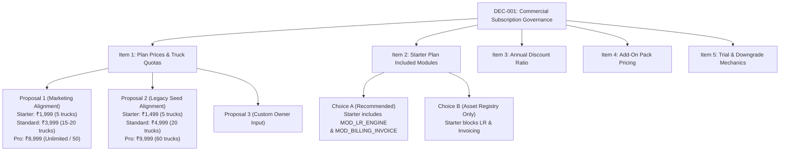

# Fleet Flow — Batch 5 Preflight Audit Report (No Code Changes)

**Document Version:** 1.0.0  
**Audit Date:** October 2026  
**Status:** Complete — Ready for Review & Commercial Approval  
**Audit Scope:** Batch 5 — Commercial SaaS, Dynamic Billing & Entitlements Engine  
**Author:** Independent Systems Reviewer & Principal Architect  
**Authoritative Reference:** [`docs/FLEET_FLOW_MASTER_REGISTER.md`](../FLEET_FLOW_MASTER_REGISTER.md)  
**Sequencing Blueprint:** [`docs/IMPLEMENTATION_BATCHES.md`](../IMPLEMENTATION_BATCHES.md)  
**Pending Decision Reference:** [`docs/decisions/DEC-001-subscription-pricing-and-entitlements.md`](../decisions/DEC-001-subscription-pricing-and-entitlements.md)  

---

## 1. Purpose and Scope Boundary

This document provides a source-verified, code-level **preflight audit and implementation blueprint** for **Batch 5** of the Fleet Flow B2B Transport & Fleet Management SaaS platform.

### 1.1. Preflight Audit Constraints & Boundaries
1. **Preflight Only — Zero Application Code Modification:** No application source code, database models, Express routes, controllers, frontend views, or test files have been modified or created during this preflight pass.
2. **Zero Git Modifications:** No files have been staged, committed, pushed, stashed, reset, cleaned, or discarded.
3. **Pristine Working Tree:** Working tree remains clean on branch `main` at commit `c05f476` (apart from this report).
4. **No Speculative Implementation:** Every finding in this document is grounded in concrete line-by-line inspection of the active codebase.
5. **Strict Decision Boundary:** `DEC-001` remains strictly **Pending Product Owner Approval**. This preflight identifies all dependencies and options but does **not** approve commercial pricing or module allocations on the Product Owner's behalf.
6. **No Premature Batch Execution:** Batch 6 (Operational Infrastructure) and later batches remain out of scope and untouched.

### 1.2. Preservation of Prior Architectural & Governance Decisions
- **`DEC-001` (Pending Product Owner Approval — Commercial Pricing Matrix & Starter Inclusions):**  
  The exact price numbers (paise) and module inclusions for the Starter tier require explicit written authorization before application seed values are committed.
- **`DEC-002` (Approved Architecture — MongoDB Replica Set Topology):**  
  Option A remains active. Strict replica-set topology (`rs0`) is required in all environments and validated fail-fast by `assertReplicaSetTopology()`. Multi-document ACID transactions remain centralized in `runInTransaction()`.
- **`DEC-003` (Pending Formal Approval — Cloud S3 Storage Migration):**  
  Migration to AWS S3 remains strictly **Pending Approval**. Batch 5 does not introduce, assume, or depend upon S3 storage. Local disk storage with path containment and magic-byte validation is preserved.
- **Deferred Transactional Outbox (`OPS-002` / Batch 8):**  
  Asynchronous external notifications (SMS, WhatsApp, webhooks) remain best-effort without an outbox table. The transactional outbox pattern remains scheduled for Batch 8.

---

## 2. Repository State at Inspection

### 2.1. Git Status Summary
A baseline inspection was executed immediately upon starting this preflight pass:

```powershell
PS C:\Users\vishh\OneDrive\Desktop\Work\TransportManagement> git status
On branch main
Your branch is up to date with 'origin/main'.

nothing to commit, working tree clean
```

- **Branch:** `main` (synchronized with `origin/main`).
- **Current HEAD Commit:** `c05f476` (*feat(batch-4): implement stakeholder portals, public tracking privacy, rate limiting & abuse defense*).
- **Existing Modified Files:** `0`
- **Existing Untracked Files:** `0`
- **Working Tree Integrity:** Confirmed clean.

### 2.2. Baseline Verification Suite (Batch 4 Closeout State)
All regression and build gates are 100% green:
1. **Targeted Backend Integration Suite:**
   ```powershell
   npm test
   ```
   - **Result:** **158 passed (158 tests)** across **10 test suites** (100% green in 33.78s).
   - Test suites verified:
     - `src/tests/smoke.test.ts` (1 test)
     - `src/tests/integration/phase22Indexes.test.ts` (7 tests)
     - `src/tests/integration/tenantRoutes.test.ts` (14 tests)
     - `src/tests/integration/phase21Hardening.test.ts` (12 tests)
     - `src/tests/integration/phase23Idempotency.test.ts` (14 tests)
     - `src/tests/integration/fileStorageSecurity.test.ts` (22 tests)
     - `src/tests/integration/tenantIsolation.test.ts` (22 tests)
     - `src/tests/integration/phase25Transactions.test.ts` (16 tests)
     - `src/tests/integration/phase3FinancialInvariants.test.ts` (27 tests)
     - `src/tests/integration/phase4PortalsAndTracking.test.ts` (23 tests)
2. **Backend TypeScript Compilation:**
   ```powershell
   npm run build
   ```
   - **Result:** Exit code 0 (`tsc` compiled with 0 errors).
3. **Frontend Production Bundle:**
   ```powershell
   npm run build
   ```
   - **Result:** Exit code 0 (`tsc -b && vite build` transformed 1,771 modules in 4.43s).

---

## 3. Verified Code-Level Findings for Batch 5 Issues

### 3.1. ISS-011: Discrepancy Between Marketing Pricing Page and Backend Plan Seeds

#### Concrete Code Evidence
1. **Frontend Marketing Page:** [`frontend/src/pages/marketing/PricingPage.tsx:15-105`](file:///c:/Users/vishh/OneDrive/Desktop/Work/TransportManagement/frontend/src/pages/marketing/PricingPage.tsx#L15-L105)
   The pricing page hardcodes a static JavaScript array `const PLANS = [...]`:
   - **Starter Fleet:** `monthlyPrice: 1999` (₹1,999 / mo), `annualPrice: 1659`, `truckQuota: 5`.
   - **Standard Commercial:** `monthlyPrice: 4999` (₹4,999 / mo), `annualPrice: 4149`, `truckQuota: 20`.
   - **Pro Enterprise:** `monthlyPrice: 9999` (₹9,999 / mo), `annualPrice: 8299`, `truckQuota: 60`.
   - **Custom Enterprise:** `monthlyPrice: null`, `truckQuota: 'Unlimited'`.
2. **Backend Seed Service:** [`backend/src/utils/billingSeedService.ts:19-115`](file:///c:/Users/vishh/OneDrive/Desktop/Work/TransportManagement/backend/src/utils/billingSeedService.ts#L19-L115)
   Seeds the MongoDB `Plan` collection upon application boot:
   - **Starter Plan (`starter`):** `monthly_price_paise: 149900` (₹1,499 / mo), `annual_price_paise: 1499000` (₹14,990 / yr), `max_trucks: 5`.
   - **Standard Commercial (`standard`):** `monthly_price_paise: 399900` (₹3,999 / mo), `annual_price_paise: 3999000` (₹39,990 / yr), `max_trucks: 20`.
   - **Pro Enterprise (`pro`):** `monthly_price_paise: 899900` (₹8,999 / mo), `annual_price_paise: 8999000` (₹89,990 / yr), `max_trucks: -1` (Unlimited).
   - **Custom Enterprise (`enterprise`):** `monthly_price_paise: 1999900` (₹19,999 / mo), `max_trucks: -1` (Unlimited).
3. **Backend Public Endpoint:** [`backend/src/controllers/billingController.ts:39-48`](file:///c:/Users/vishh/OneDrive/Desktop/Work/TransportManagement/backend/src/controllers/billingController.ts#L39-L48)
   `GET /api/billing/plans` exists, is public (unauthenticated in [`billingRoutes.ts:37`](file:///c:/Users/vishh/OneDrive/Desktop/Work/TransportManagement/backend/src/routes/billingRoutes.ts#L37)), and queries `Plan.find({ is_active: true, is_public: true })`.

#### Detailed Variance Matrix

| Plan Tier | Frontend Advertised Price (`PricingPage.tsx`) | Backend Charged Price (`billingSeedService.ts`) | Variance | Quota Advertised | Quota Backend | Quota Variance |
| :--- | :---: | :---: | :---: | :---: | :---: | :---: |
| **Starter** | **₹1,999 / mo** | **₹1,499 / mo** | -₹500 / mo | 5 Trucks | 5 Trucks | Match |
| **Standard** | **₹4,999 / mo** | **₹3,999 / mo** | -₹1,000 / mo | 20 Trucks | 20 Trucks | Match |
| **Pro** | **₹9,999 / mo** | **₹8,999 / mo** | -₹1,000 / mo | 60 Trucks | **-1 (Unlimited)** | Mismatch (Hard cap vs Unlimited) |
| **Enterprise** | Contact Sales | **₹19,999 / mo** | N/A | Unlimited | **-1 (Unlimited)** | Match |

#### Root Cause Analysis
1. `PricingPage.tsx` was created with hardcoded marketing presentation cards and never wired to fetch from `GET /api/billing/plans`.
2. `billingSeedService.ts` only seeds plans when `Plan.countDocuments() === 0` ([`billingSeedService.ts:17`](file:///c:/Users/vishh/OneDrive/Desktop/Work/TransportManagement/backend/src/utils/billingSeedService.ts#L17)). In an existing database with older seeded records, changing `billingSeedService.ts` does not automatically update pre-existing documents unless an upsert/sync strategy is used.

---

### 3.2. ISS-012: Starter Plan Entitlement Trap Blocks Core LR & Invoicing Modules

#### Concrete Code Evidence
1. **Marketing Promise:** [`frontend/src/pages/marketing/PricingPage.tsx:29,31`](file:///c:/Users/vishh/OneDrive/Desktop/Work/TransportManagement/frontend/src/pages/marketing/PricingPage.tsx#L29-L31)
   The Starter Fleet tier explicitly promises:
   - *"3-Part Printable LR / Bilty Generation"*
   - *"Basic PDF GST Invoicing"*
2. **Backend Seed Inclusions:** [`backend/src/utils/billingSeedService.ts:29-36`](file:///c:/Users/vishh/OneDrive/Desktop/Work/TransportManagement/backend/src/utils/billingSeedService.ts#L29-L36)
   The Starter plan is seeded with:
   ```typescript
   included_features: [
     'MOD_FLEET',
     'MOD_DRIVERS',
     'MOD_TRIPS',
     'MOD_MARKET_VEHICLES',
     'MOD_PARTIES',
     'MOD_DOCUMENT_VAULT',
   ]
   ```
   *`MOD_LR_ENGINE` and `MOD_BILLING_INVOICE` are completely omitted.*
3. **Module Catalog Definitions:** [`backend/src/utils/featureCatalog.ts:107-124`](file:///c:/Users/vishh/OneDrive/Desktop/Work/TransportManagement/backend/src/utils/featureCatalog.ts#L107-L124)
   - `MOD_LR_ENGINE`: `defaultTier: 'standard'`, dependencies: `['MOD_PARTIES']`.
   - `MOD_BILLING_INVOICE`: `defaultTier: 'standard'`, dependencies: `['MOD_PARTIES', 'MOD_LR_ENGINE']`.
4. **Express Route Guards:**
   - [`backend/src/routes/entryRoutes.ts:23`](file:///c:/Users/vishh/OneDrive/Desktop/Work/TransportManagement/backend/src/routes/entryRoutes.ts#L23):  
     `router.use(requireAuth, resolveTenantContext, requireActiveSubscription, requireFeature('MOD_LR_ENGINE'));`  
     *Every consignment/LR route (`/api/commercial/entries`) requires `MOD_LR_ENGINE`.*
   - [`backend/src/routes/invoiceRoutes.ts:23`](file:///c:/Users/vishh/OneDrive/Desktop/Work/TransportManagement/backend/src/routes/invoiceRoutes.ts#L23):  
     `router.use(requireAuth, resolveTenantContext, requireActiveSubscription, requireFeature('MOD_BILLING_INVOICE'));`  
     *Every invoice route (`/api/commercial/invoices` and `/api/invoices`) requires `MOD_BILLING_INVOICE`.*
5. **The Entitlement Trap Mechanism:** [`backend/src/utils/entitlementService.ts:49-89`](file:///c:/Users/vishh/OneDrive/Desktop/Work/TransportManagement/backend/src/utils/entitlementService.ts#L49-L89)
   - When a company signs up, before purchasing a plan, it falls into the trial branch where `planCode = 'standard'` and standard modules are granted. During this trial, the company can generate LRs and Invoices.
   - When the company converts and purchases the **Starter Plan**, a `Subscription` document is created with `plan_id = starterPlan._id`.
   - `getTenantEntitlements()` now uses `starterPlan.included_features`. `MOD_LR_ENGINE` and `MOD_BILLING_INVOICE` are removed.
   - Any subsequent attempt to create an LR or Invoice immediately triggers HTTP 403 `FEATURE_LOCKED`:
     ```json
     {
       "code": "FEATURE_LOCKED",
       "module": "MOD_LR_ENGINE",
       "module_name": "Lorry Receipt (LR) Engine",
       "required_tier": "standard",
       "error": "The feature \"Lorry Receipt (LR) Engine\" is not included in your current subscription plan. Please upgrade to unlock this capability."
     }
     ```

#### Impact
A transport company paying for Fleet Flow Starter Plan cannot create Biltys (LRs) or freight bills—the primary core operations of their business.

---

### 3.3. ISS-013: Unsafe Payment Checkout Simulation Mode Defense

#### Concrete Code Evidence
1. **Gateway Credentials Fallback:** [`backend/src/utils/paymentGateway.ts:35-40`](file:///c:/Users/vishh/OneDrive/Desktop/Work/TransportManagement/backend/src/utils/paymentGateway.ts#L35-L40)
   ```typescript
   export function getGatewayCredentials(): { keyId: string; keySecret: string; webhookSecret: string } {
     const keyId = process.env.RAZORPAY_KEY_ID || 'rzp_test_placeholder_key';
     const keySecret = process.env.RAZORPAY_KEY_SECRET || 'dev_secret_fallback_key';
     const webhookSecret = process.env.RAZORPAY_WEBHOOK_SECRET || 'dev_webhook_secret_fleetflow';
     return { keyId, keySecret, webhookSecret };
   }
   ```
2. **Order Creation Silent Fallback:** [`backend/src/utils/paymentGateway.ts:75-91`](file:///c:/Users/vishh/OneDrive/Desktop/Work/TransportManagement/backend/src/utils/paymentGateway.ts#L75-L91)
   ```typescript
   } catch (err: any) {
     console.warn('Razorpay API order creation failed, falling back to secure simulated order:', err.message);
   }
   // Cryptographically secure test/development order identifier
   const randomSuffix = crypto.randomBytes(6).toString('hex');
   const orderId = `order_${Date.now()}_${randomSuffix}`;
   return { id: orderId, amount: options.amount_paise, currency: options.currency || 'INR', receipt: options.receipt, key_id: keyId, is_live: false };
   ```
   *Vulnerability:* If `NODE_ENV === 'production'` and the Razorpay API call fails or keys are invalid, it catches the error and returns a simulated order with `is_live: false` instead of throwing an error.
3. **Frontend Emulator Modal:** [`frontend/src/pages/settings/BillingPage.tsx:192, 233-274`](file:///c:/Users/vishh/OneDrive/Desktop/Work/TransportManagement/frontend/src/pages/settings/BillingPage.tsx#L192-L274)
   When `orderData.is_live` is false, `BillingPage.tsx` opens an in-app "TEST MODE" checkout modal. Clicking "Pay" dispatches:
   ```typescript
   await handleVerifyPayment({
     razorpay_order_id: checkoutOrder.order_id,
     razorpay_payment_id: `pay_${Date.now()}_test`,
     razorpay_signature: 'simulated_test_signature_valid',
     plan_id: checkoutOrder.plan.id,
     billing_cycle: checkoutOrder.billing_cycle,
     payment_method: selectedMethod,
   });
   ```
4. **Signature Verification Guard:** [`backend/src/utils/paymentGateway.ts:110-115`](file:///c:/Users/vishh/OneDrive/Desktop/Work/TransportManagement/backend/src/utils/paymentGateway.ts#L110-L115)
   ```typescript
   if (
     process.env.NODE_ENV !== 'production' &&
     signature === 'simulated_test_signature_valid'
   ) {
     return { valid: true };
   }
   ```
   *Status:* `verifyPaymentSignature` currently blocks `'simulated_test_signature_valid'` in production (`process.env.NODE_ENV === 'production'`).  
   *However:* In `backend/src/server.ts:196-208` (`assertProductionEnvironment`), `RAZORPAY_WEBHOOK_SECRET` is **omitted** from mandatory environment variables. If unset, webhooks silently use `'dev_webhook_secret_fleetflow'`.

---

## 4. Dependencies on DEC-001 & Decision Boundaries

### 4.1. Formal Status of DEC-001
[`docs/decisions/DEC-001-subscription-pricing-and-entitlements.md`](file:///c:/Users/vishh/OneDrive/Desktop/Work/TransportManagement/docs/decisions/DEC-001-subscription-pricing-and-entitlements.md) is currently **Pending Product Owner Approval**.

### 4.2. Breakdown of Pending DEC-001 Decision Items



### 4.3. Separation of Work: Unblocked vs. Blocked

#### A. Work That Can Proceed Without `DEC-001` (Architectural & Technical Foundation)
1. **Dynamic Frontend Rendering (`PricingPage.tsx`):**
   Refactor `PricingPage.tsx` to dynamically query `GET /api/billing/plans` and render prices, vehicle limits, and feature lists from database records. Add loading states, error boundaries, and safe fallbacks. This architecture functions regardless of the final commercial numbers chosen.
2. **Production Simulation Hardening (`paymentGateway.ts` & `server.ts`):**
   - In `paymentGateway.ts`, update `createPaymentOrder` so that if `NODE_ENV === 'production'`, API failures immediately throw an HTTP 502 / 500 error instead of falling back to a simulated order with `is_live: false`.
   - In `server.ts`, add `RAZORPAY_WEBHOOK_SECRET` to the mandatory environment check in `assertProductionEnvironment()`.
   - Prevent dummy fallback webhook secrets in production.
3. **Idempotent Plan Seeding & Schema Migration (`billingSeedService.ts`):**
   Refactor `seedBillingCatalog()` from a naive `countDocuments() === 0` check into an idempotent `bulkWrite` or `findOneAndUpdate` by plan `code`. This ensures future price or quota updates sync cleanly into existing MongoDB databases without requiring manual database drops.
4. **Subscription Integration Test Suite Harness (`TEST-004`):**
   Create `backend/src/tests/integration/phase5SubscriptionGating.test.ts` covering:
   - Resource quota enforcement (`requireQuota('trucks')` blocking the N+1th vehicle).
   - Module gating (`requireFeature` returning HTTP 403 `FEATURE_LOCKED`).
   - Cryptographic Razorpay payment verification (HMAC-SHA256 valid signature vs. forged signature).
   - Razorpay webhook verification on raw payload buffer and replay idempotency.
   - Rejection of `'simulated_test_signature_valid'` in production mode.

#### B. Work Blocked by `DEC-001` (Requires Product Owner Decision)
1. **Committing Canonical Plan Prices and Vehicle Quotas:**  
   Whether Starter is ₹1,499 vs ₹1,999; Standard is ₹3,999 vs ₹4,999; and Pro is ₹8,999 vs ₹9,999 with 60 trucks vs Unlimited.
2. **Starter Plan Module Entitlement Allocation:**  
   Whether `MOD_LR_ENGINE` and `MOD_BILLING_INVOICE` are officially granted to the Starter tier (`Choice A`) or restricted to Standard (`Choice B`).

#### C. Out-of-Scope / Deferred to Future Batches
- **`FEAT-002` (GST e-Invoicing IRN & QR Code):** Scheduled for Batch 7.
- **`FEAT-008` (Section 194C TDS Automated Tax Certificates):** Scheduled for Batch 7.
- **`OPS-002` (Distributed Task Queue & Outbox Pattern):** Scheduled for Batch 8.
- **`DEC-003` (S3 Object Storage Migration):** Remains pending approval; local storage preserved.

---

## 5. Risk and Impact Assessment

| Risk Category | Specific Failure Mode | Impact Severity | Mitigation in Batch 5 Plan |
| :--- | :--- | :---: | :--- |
| **Security** | `createPaymentOrder` falls back to simulated order in production when Razorpay API calls fail. | **High** | Fail-fast in `createPaymentOrder`: throw HTTP 502 in production mode; never return `is_live: false` in production. |
| **Security** | Missing `RAZORPAY_WEBHOOK_SECRET` falls back to default string. | **High** | Add `RAZORPAY_WEBHOOK_SECRET` to `assertProductionEnvironment()` in `server.ts`. |
| **Consumer Protection** | Marketing page advertises lower or higher price than checkout order total. | **High** | Dynamic pricing architecture: `PricingPage.tsx` displays exact database prices from `GET /api/billing/plans`. |
| **User Experience** | Starter plan subscribers cannot generate LRs or Invoices (`ISS-012`). | **High** | Dependent on `DEC-001` Choice A sign-off: grant `MOD_LR_ENGINE` and `MOD_BILLING_INVOICE` to Starter Plan. |
| **Data Migration** | Seed service only runs on empty collection; existing deployments do not receive plan updates. | **Medium** | Implement idempotent upsert sync (`findOneAndUpdate({ code: plan.code })`) in `billingSeedService.ts`. |
| **Regression** | `requireQuota('trucks')` blocks legitimate vehicle creation or misinterprets `-1` (Unlimited). | **Medium** | Automated test suite verifying that `-1` allows arbitrary truck additions without 403 errors. |
| **Accounting** | Razorpay checkout amount calculation differs between frontend and backend. | **Medium** | Single source of truth: backend `initializeCheckout` computes subtotal, 9% CGST, 9% SGST, and total. |

---

## 6. Proposed Batch 5 Implementation Scope

### 6.1. Technical Preparation (Independent of DEC-001)
1. **Dynamic Marketing Pricing (`ISS-011`):**
   - Refactor `frontend/src/pages/marketing/PricingPage.tsx` to fetch `GET /api/billing/plans`.
   - Render pricing cards dynamically from `res.data.plans` and add-ons from `res.data.addons`.
   - Add loading skeleton and resilient fallback presentation.
2. **Payment Gateway Hardening (`ISS-013`):**
   - Update `backend/src/utils/paymentGateway.ts`:
     - In `createPaymentOrder`, assert `process.env.NODE_ENV !== 'production'` before falling back to simulated order generation. In production, throw a 502 Bad Gateway / Configuration error.
   - Update `backend/src/server.ts`:
     - Add `RAZORPAY_WEBHOOK_SECRET` to `assertProductionEnvironment()`.
3. **Idempotent Plan Seeding (`billingSeedService.ts`):**
   - Update `seedBillingCatalog()` to upsert plans by `code` rather than checking `countDocuments() === 0`.
4. **Subscription Gating & Quota Integration Test Suite (`TEST-004`):**
   - Create `backend/src/tests/integration/phase5SubscriptionGating.test.ts`.

### 6.2. Decisions Requiring PO Approval Before Execution
1. Record approved numbers for `DEC-001` (Plan prices, truck quotas, annual discount).
2. Update `billingSeedService.ts` and `featureCatalog.ts` with approved values.

---

## 7. Acceptance Criteria & Verification Plan

### 7.1. Acceptance Criteria Checklist
- [ ] **Dynamic Pricing Page:** `PricingPage.tsx` dynamically displays plans and add-ons returned by `GET /api/billing/plans`.
- [ ] **Single Source of Truth:** Changing a price or truck limit in the MongoDB `plans` collection updates the marketing page and checkout modal without redeploying code.
- [ ] **Starter Plan Entitlement:** Starter plan subscribers can access `entryRoutes` (LR generation) and `invoiceRoutes` (GST Invoicing) without receiving HTTP 403 `FEATURE_LOCKED` (contingent on DEC-001 Choice A).
- [ ] **Truck Quota Enforcement:** A company with quota `max_trucks: 5` successfully registers 5 vehicles; attempting to register a 6th vehicle returns HTTP 403 `QUOTA_EXCEEDED`.
- [ ] **Unlimited Quota Handling:** A company on a tier with `max_trucks: -1` can register vehicles beyond default limits without receiving 403 errors.
- [ ] **Feature Flag Gating:** Accessing a route requiring an unpurchased module (e.g. `MOD_CUSTOM_FIELDS` or `MOD_GPS_SYNC`) returns HTTP 403 `FEATURE_LOCKED` with clear upgrade guidance.
- [ ] **Cryptographic Verification:** Submitting valid HMAC-SHA256 signatures activates subscriptions; tampered signatures return HTTP 400.
- [ ] **Production Simulation Defense:** In `NODE_ENV === 'production'`, payment simulation is rejected; missing Razorpay credentials fail fast.
- [ ] **Webhook Idempotency:** Replaying an identical Razorpay webhook event ID returns HTTP 200 with idempotent deduplication.

### 7.2. Test Suite Specification (`phase5SubscriptionGating.test.ts`)
The integration test suite will verify:
1. `GET /api/billing/plans` returns valid active plans with integer paise pricing and module lists.
2. Quota enforcement on vehicle registration:
   - Enforces limit when `max_trucks` is exceeded.
   - Bypasses limit when `max_trucks === -1`.
3. Granular module gating via `requireFeature`:
   - Returns 403 `FEATURE_LOCKED` for unincluded modules.
   - Unlocks when plan is upgraded or add-on is granted.
4. Razorpay signature verification:
   - Valid HMAC signature updates subscription to `active`.
   - Tampered signature updates transaction to `failed` and returns 400.
5. Production environment protection:
   - Simulation bypass signature rejected when `NODE_ENV === 'production'`.
6. Webhook processing and replay safety.

---

## 8. Summary of Inspected Files

1. [`docs/FLEET_FLOW_MASTER_REGISTER.md`](file:///c:/Users/vishh/OneDrive/Desktop/Work/TransportManagement/docs/FLEET_FLOW_MASTER_REGISTER.md) — Master inventory of canonical issues and decisions.
2. [`docs/IMPLEMENTATION_BATCHES.md`](file:///c:/Users/vishh/OneDrive/Desktop/Work/TransportManagement/docs/IMPLEMENTATION_BATCHES.md) — Roadmap specification for Batch 5 scope.
3. [`docs/issues/ISS-011-pricing-page-seed-discrepancy.md`](file:///c:/Users/vishh/OneDrive/Desktop/Work/TransportManagement/docs/issues/ISS-011-pricing-page-seed-discrepancy.md) — Marketing vs seed discrepancy spec.
4. [`docs/issues/ISS-012-starter-plan-entitlement-trap.md`](file:///c:/Users/vishh/OneDrive/Desktop/Work/TransportManagement/docs/issues/ISS-012-starter-plan-entitlement-trap.md) — Starter plan entitlement trap spec.
5. [`docs/issues/ISS-013-unsafe-payment-checkout-simulation.md`](file:///c:/Users/vishh/OneDrive/Desktop/Work/TransportManagement/docs/issues/ISS-013-unsafe-payment-checkout-simulation.md) — Payment simulation risk spec.
6. [`docs/decisions/DEC-001-subscription-pricing-and-entitlements.md`](file:///c:/Users/vishh/OneDrive/Desktop/Work/TransportManagement/docs/decisions/DEC-001-subscription-pricing-and-entitlements.md) — Commercial decision specification.
7. [`docs/testing/TEST-004-subscription-feature-gating-quotas.md`](file:///c:/Users/vishh/OneDrive/Desktop/Work/TransportManagement/docs/testing/TEST-004-subscription-feature-gating-quotas.md) — Subscription test spec.
8. [`backend/src/utils/billingSeedService.ts`](file:///c:/Users/vishh/OneDrive/Desktop/Work/TransportManagement/backend/src/utils/billingSeedService.ts) — Seed service implementation.
9. [`backend/src/utils/featureCatalog.ts`](file:///c:/Users/vishh/OneDrive/Desktop/Work/TransportManagement/backend/src/utils/featureCatalog.ts) — Central module and entitlement catalog.
10. [`backend/src/utils/entitlementService.ts`](file:///c:/Users/vishh/OneDrive/Desktop/Work/TransportManagement/backend/src/utils/entitlementService.ts) — Entitlement waterfall evaluation logic.
11. [`backend/src/utils/paymentGateway.ts`](file:///c:/Users/vishh/OneDrive/Desktop/Work/TransportManagement/backend/src/utils/paymentGateway.ts) — Razorpay order generation and signature verification.
12. [`backend/src/controllers/billingController.ts`](file:///c:/Users/vishh/OneDrive/Desktop/Work/TransportManagement/backend/src/controllers/billingController.ts) — Plans endpoint, checkout, payment verification, and webhook handlers.
13. [`backend/src/routes/billingRoutes.ts`](file:///c:/Users/vishh/OneDrive/Desktop/Work/TransportManagement/backend/src/routes/billingRoutes.ts) — Route mounting and public access points.
14. [`backend/src/routes/entryRoutes.ts`](file:///c:/Users/vishh/OneDrive/Desktop/Work/TransportManagement/backend/src/routes/entryRoutes.ts) — Gated LR routes.
15. [`backend/src/routes/invoiceRoutes.ts`](file:///c:/Users/vishh/OneDrive/Desktop/Work/TransportManagement/backend/src/routes/invoiceRoutes.ts) — Gated invoice routes.
16. [`backend/src/routes/truckRoutes.ts`](file:///c:/Users/vishh/OneDrive/Desktop/Work/TransportManagement/backend/src/routes/truckRoutes.ts) — Vehicle quota middleware mounting.
17. [`backend/src/middleware/entitlementMiddleware.ts`](file:///c:/Users/vishh/OneDrive/Desktop/Work/TransportManagement/backend/src/middleware/entitlementMiddleware.ts) — `requireFeature` and `requireQuota` middleware.
18. [`backend/src/models/Plan.ts`](file:///c:/Users/vishh/OneDrive/Desktop/Work/TransportManagement/backend/src/models/Plan.ts) — Mongoose Plan schema.
19. [`backend/src/models/Subscription.ts`](file:///c:/Users/vishh/OneDrive/Desktop/Work/TransportManagement/backend/src/models/Subscription.ts) — Mongoose Subscription schema.
20. [`backend/src/server.ts`](file:///c:/Users/vishh/OneDrive/Desktop/Work/TransportManagement/backend/src/server.ts) — Production environment assertion function.
21. [`frontend/src/pages/marketing/PricingPage.tsx`](file:///c:/Users/vishh/OneDrive/Desktop/Work/TransportManagement/frontend/src/pages/marketing/PricingPage.tsx) — Static marketing pricing matrix.
22. [`frontend/src/pages/settings/BillingPage.tsx`](file:///c:/Users/vishh/OneDrive/Desktop/Work/TransportManagement/frontend/src/pages/settings/BillingPage.tsx) — In-app checkout and emulator modal.

---

## 9. Conclusion and Implementation Gate

**Batch 5 Preflight Status:**  
- **Technical Architecture:** Complete, verified, and unblocked.
- **Commercial Numbers:** **BLOCKED** pending Product Owner review and decision on [`DEC-001`](file:///c:/Users/vishh/OneDrive/Desktop/Work/TransportManagement/docs/decisions/DEC-001-subscription-pricing-and-entitlements.md).

No code changes or commits have been made. Awaiting Product Owner review and explicit approval of `DEC-001` before implementation begins.
