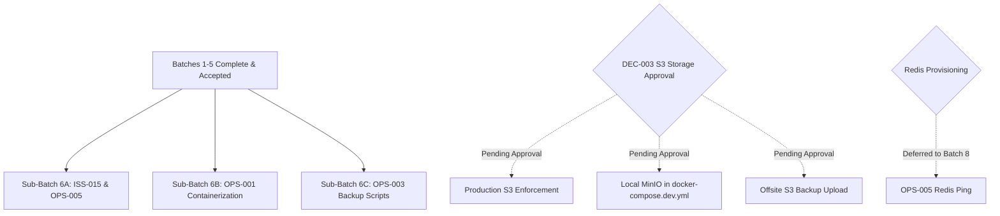

# Batch 6 Preflight Research and Audit Report

**Report ID:** `BATCH-6-PREFLIGHT-001`  
**Target Batch:** `Batch 6: Operational Infrastructure, Verification Probes & Launch Runbook`  
**Date:** October 2026  
**Status:** Review Only — Research & Planning (No Implementation Performed)  
**Authoritative Scope Source:** [`docs/IMPLEMENTATION_BATCHES.md`](../IMPLEMENTATION_BATCHES.md#batch-6-operational-infrastructure-verification-probes--launch-runbook), [`docs/FLEET_FLOW_MASTER_REGISTER.md`](../FLEET_FLOW_MASTER_REGISTER.md#5-operations--production-register-ops-), [`docs/IMPLEMENTATION_READINESS_BACKLOG.md`](../IMPLEMENTATION_READINESS_BACKLOG.md)

---

## 1. Executive Summary & Readiness Recommendation

### 1.1. Context & Purpose
Fleet Flow has achieved formal acceptance for Batch 1 through Batch 5. The application possesses verified multi-tenant jailing, compound indexing, MongoDB Replica Set multi-document ACID transactions, client-side/server-side idempotency leases, double-entry financial accounting invariants, stakeholder portals, rate-limited public tracking, dynamic plan pricing, Starter-tier module entitlements, and hardened webhook ingestion.

Batch 6 represents the final **Launch Blocker (`P1`)** batch on the commercial MVP roadmap, transitioning Fleet Flow from an application-level verified codebase into an operationally resilient, containerized, monitored, and recoverable production platform.

### 1.2. Readiness Recommendation
**Recommendation:** **PROCEED WITH SCOPE-FOCUSED SUB-BATCHING (PARTIALLY READY / BLOCKED BY DECISION)**

- **Immediate Implementation Candidate (Sub-Batch 6A — App Reliability & Health):**
  - [`ISS-015`](../issues/ISS-015-dashboard-maintenance-truck-counter.md) (Dashboard Maintenance Counter Enum): **READY**. Fully defined, verified gap in source, zero external dependencies.
  - [`OPS-005`](../operations/OPS-005-deep-health-check-probes.md) (Deep Health & Readiness Probes): **READY**. Existing `/health/ready` stub can be upgraded to an active round-trip ping check against MongoDB (`admin().ping()`) with latency and memory instrumentation, with conditional Redis checks.
- **Container Infrastructure Candidate (Sub-Batch 6B — Containerization):**
  - [`OPS-001`](../operations/OPS-001-docker-compose-architecture.md) (Multi-Environment Docker Compose): **READY FOR IMPLEMENTATION PLANNING**. Manifests exist in draft form (`docker-compose.yml`, `docker-compose.dev.yml`, `backend/Dockerfile`). Requires `frontend/Dockerfile`, `.dockerignore` files, `USER node` non-root execution, and container healthchecks.
- **Disaster Recovery Candidate (Sub-Batch 6C — Backup Runbooks):**
  - [`OPS-003`](../operations/OPS-003-backup-retention-disaster-recovery.md) (Automated Database Backup & DR): **READY FOR LOCAL SCRIPTING / BLOCKED FOR CLOUD UPLOAD**. Automated `mongodump` and restore scripts (`scripts/backup.sh`, `scripts/restore.sh`) can be created and verified locally against Docker/local MongoDB. Cloud S3 offsite synchronization is blocked until an S3 backup bucket is provisioned.
- **Strictly Blocked by Decision:**
  - [`DEC-003`](../decisions/DEC-003-storage-architecture-s3-vs-local.md) (Cloud Object Storage Mandatory Production Enforcement): **BLOCKED BY DECISION**. `DEC-003` remains **Pending Infrastructure & Security Approval**. Production server startup assertions disallowing local disk storage cannot be enabled until cloud S3 bucket credentials are confirmed.

---

## 2. Authoritative Batch 6 Scope and Source Documents

The authoritative scope for Batch 6 is established across three core project documents:

1. [`docs/IMPLEMENTATION_BATCHES.md:221-249`](../IMPLEMENTATION_BATCHES.md#batch-6-operational-infrastructure-verification-probes--launch-runbook):
   - **Theme:** SRE, Reliability Engineering & Production Deployment Readiness
   - **Priority:** `P1` (Operational Launch Blocker)
   - **Included Canonical IDs:** `ISS-015`, `OPS-001`, `OPS-003`, `OPS-005`, `DEC-003`.
2. [`docs/FLEET_FLOW_MASTER_REGISTER.md`](../FLEET_FLOW_MASTER_REGISTER.md):
   - Section 2 (Defects): `ISS-015`
   - Section 5 (Operations): `OPS-001`, `OPS-003`, `OPS-005`
   - Section 7 (Decisions): `DEC-003`
3. [`docs/IMPLEMENTATION_READINESS_BACKLOG.md`](../IMPLEMENTATION_READINESS_BACKLOG.md):
   - Backlog items lines 70, 77, 78, 79, 82.

### 2.1. Authoritative vs Legacy Discrepancies
- **`TEST-###` QA Spec Allocation:** Unlike Batches 1–5 (which were paired with `TEST-001` through `TEST-004`), there is no pre-existing `TEST-005` document in `docs/testing/` for Batch 6. A dedicated integration test suite (e.g., `backend/src/tests/integration/phase6OperationalHealth.test.ts`) must be established to guard `/health/live`, `/health/ready`, and KPI aggregation.
- **`OPS-005` Priority Discrepancy:** In `docs/operations/OPS-005-deep-health-check-probes.md`, priority is marked `P2`, whereas in `FLEET_FLOW_MASTER_REGISTER.md` and `IMPLEMENTATION_BATCHES.md`, it is designated `P1` (Operational Launch Blocker). The Master Register takes precedence (`P1`).
- **Endpoint Route Path Discrepancy:** `IMPLEMENTATION_BATCHES.md:234` references `/api/health/readiness`, whereas `OPS-005` and `healthRoutes.ts` implement `/health/ready` (mounted at `/health` in `server.ts:133`). To eliminate routing friction, aliases or canonical alignment should be maintained.

---

## 3. Issue-by-Issue Scope and Acceptance Criteria

| Canonical ID | Title | Priority | Category | Authoritative Acceptance Criteria |
| :--- | :--- | :--- | :--- | :--- |
| **`ISS-015`** | Dashboard Maintenance Truck Counter Enum Mismatch | `P1` | Defect / KPI | - `dashboardController.ts` filters by `status: 'in_maintenance'` matching `Truck.ts` schema enum.<br>- `maintenance_trucks` is exposed in `res.json({ summary: { ... } })`.<br>- Executive KPI badge displays accurate count of workshop vehicles. |
| **`OPS-001`** | Multi-Environment Docker Compose Architecture | `P1` | Infra / Deployment | - Full stack boots via `docker compose up --build` (frontend, backend, MongoDB replica set, Redis).<br>- Production backend & frontend images enforce non-root execution (`USER node` / `nginx`).<br>- Multi-stage builds: backend image < 180MB; frontend Nginx image < 40MB.<br>- Development environment (`docker-compose.dev.yml`) supports hot-reloading. |
| **`OPS-003`** | Automated Backup, Retention Policy & Disaster Recovery | `P1` | Database / SRE | - Automated script (`backup.sh`) dumps MongoDB database, compresses with gzip, and encrypts.<br>- Retention rules: 30 daily, 12 weekly, 7-year statutory annual snapshots.<br>- Disaster Recovery runbook (`restore.sh`) successfully restores database to clean environment in under 45 minutes.<br>- Integrity verification asserts collection counts and ledger balance sums post-restore. |
| **`OPS-005`** | Deep Readiness & Liveness Probes with Dependency Connectivity | `P1` | Monitoring / Health | - Liveness probe (`GET /health/live`) verifies Node.js process responsiveness.<br>- Readiness probe (`GET /health/ready`) executes active round-trip ping check on MongoDB (`admin().ping()`) and reports latency.<br>- If MongoDB disconnects or deadlocks, `/health/ready` immediately returns HTTP 503 Service Unavailable.<br>- Reports process memory stats (`heap_used_mb`, `heap_total_mb`, `heap_usage_percent`).<br>- Conditional Redis ping if Redis is configured. |
| **`DEC-003`** | Cloud Object Storage Architecture Sign-Off | `P1` | Architecture / Security | - Formal sign-off on Option A (S3 Cloud Storage in production, Sandboxed local disk in dev).<br>- Local dev MinIO service container defined in `docker-compose.dev.yml`.<br>- **STATUS: PENDING APPROVAL** (Production S3 credential mandate cannot be enforced until approved). |

---

## 4. Current Implementation Status & Evidence

### 4.1. `ISS-015` (Dashboard Maintenance Enum)
- **Files Inspected:**
  - [`backend/src/controllers/dashboardController.ts:71-90, 202`](file:///c:/Users/vishh/OneDrive/Desktop/Work/TransportManagement/backend/src/controllers/dashboardController.ts#L71-L90)
  - [`backend/src/models/Truck.ts:28, 160-164`](file:///c:/Users/vishh/OneDrive/Desktop/Work/TransportManagement/backend/src/models/Truck.ts#L28)
- **Current Behavior:**
  In `dashboardController.ts:84-86`:
  ```typescript
  maintenance_trucks: {
    $sum: { $cond: [{ $eq: ['$status', 'maintenance'] }, 1, 0] },
  }
  ```
  In `Truck.ts:162`, the enum is: `['available', 'on_trip', 'in_maintenance', 'decommissioned', 'active']`.
  Because the aggregation matches `'maintenance'` (non-existent) instead of `'in_maintenance'`, `maintenance_trucks` evaluates to `0`. Furthermore, in `dashboardController.ts:208-225`, `maintenance_trucks` is omitted from the returned `summary` object.
- **Gap:** Change condition to `$eq: ['$status', 'in_maintenance']` and add `maintenance_trucks: trucks.maintenance_trucks` to `summary` response.

### 4.2. `OPS-001` (Docker Compose Architecture)
- **Files Inspected:**
  - [`docker-compose.yml`](file:///c:/Users/vishh/OneDrive/Desktop/Work/TransportManagement/docker-compose.yml) (Exists; lines 1-74)
  - [`docker-compose.dev.yml`](file:///c:/Users/vishh/OneDrive/Desktop/Work/TransportManagement/docker-compose.dev.yml) (Exists; lines 1-51)
  - [`backend/Dockerfile`](file:///c:/Users/vishh/OneDrive/Desktop/Work/TransportManagement/backend/Dockerfile) (Exists; lines 1-26)
- **Current Behavior:**
  - `docker-compose.yml` launches `fleetflow-mongo` (MongoDB 6.0 with single-node replica set `rs0` and healthcheck) and `fleetflow-backend`.
  - `backend/Dockerfile` uses multi-stage build (`node:20-alpine` builder and runner).
- **Gaps:**
  1. `frontend/Dockerfile` does **not exist**.
  2. Frontend service is omitted from `docker-compose.yml`.
  3. `redis` service is omitted from both Compose files.
  4. `docker-compose.dev.yml` only defines `mongo`; it lacks `backend` and `frontend` hot-reload volume mounts.
  5. `backend/Dockerfile` runs as `root` (missing `USER node` non-root instruction).
  6. No `.dockerignore` files exist in root, `backend/`, or `frontend/`.

### 4.3. `OPS-003` (Automated Backup & Disaster Recovery)
- **Files Inspected:** Repository root, `backend/src/scripts/`.
- **Current Behavior:**
  Zero backup or restoration automation scripts exist. No `scripts/backup.sh` or `scripts/restore.sh` exists in the repository.
- **Gap:** Need POSIX-compliant shell scripts that execute `mongodump --gzip --archive`, optionally encrypt via OpenSSL/GPG, clean up according to retention policy, and provide a corresponding `restore.sh` drill runbook. Cloud S3 upload requires S3 credentials or local mock harness.

### 4.4. `OPS-005` (Deep Health & Readiness Probes)
- **Files Inspected:**
  - [`backend/src/routes/healthRoutes.ts`](file:///c:/Users/vishh/OneDrive/Desktop/Work/TransportManagement/backend/src/routes/healthRoutes.ts)
  - [`backend/src/server.ts:119-133`](file:///c:/Users/vishh/OneDrive/Desktop/Work/TransportManagement/backend/src/server.ts#L119-L133)
- **Current Behavior:**
  - `/health/live` returns 200 with uptime.
  - `/health/ready` checks `mongoose.connection.readyState === 1` and heap memory (< 90%).
- **Gap:**
  `mongoose.connection.readyState === 1` is an in-memory connection flag. It does not perform an active round-trip I/O check against the MongoDB engine. If the database locks or freezes, `readyState` can remain `1` while queries fail. Needs active `await mongoose.connection.db.admin().ping()`, response latency tracking (`mongodb.latency_ms`), and conditional Redis ping if Redis is configured.

### 4.5. `DEC-003` (S3 Object Storage Migration)
- **Files Inspected:** [`docs/decisions/DEC-003-storage-architecture-s3-vs-local.md`](file:///c:/Users/vishh/OneDrive/Desktop/Work/TransportManagement/docs/decisions/DEC-003-storage-architecture-s3-vs-local.md)
- **Current Behavior:**
  Status is explicitly **Pending Infrastructure & Security Approval**.
- **Gap:** Cannot activate `assertProductionEnvironment()` check that mandates S3 credentials and prohibits local disk storage until this decision is formally approved.

---

## 5. Dependencies on Earlier Batches & External Infrastructure



1. **Preceding Batches (Batches 1–5):** All 5 prerequisite batches are completed and accepted. Full backend test suite passes (188/188 tests).
2. **Docker Engine:** Local developer machine or CI runner requires Docker Engine 24+ and Docker Compose v2 for end-to-end container verification.
3. **MongoDB Replica Set:** Docker Compose environment must maintain the single-node `rs0` replica set to satisfy DEC-002 ACID transaction prerequisites.
4. **Redis:** Redis is scheduled for full deployment in Batch 8 (`OPS-002: BullMQ`). In Batch 6, Redis in Compose should be provisioned as a standard service, but backend health probes must treat Redis connectivity as *conditional* (probe only if `REDIS_URL` is set) to prevent false-positive 503 outages.
5. **AWS S3 / Cloud Bucket:** Automated offsite backups require S3 bucket access. For local/CI testing, a local file archive destination or containerized MinIO must be supported.

---

## 6. Required Decisions & Approval Status

| Decision ID | Title | Current Status | Batch 6 Impact | Action Required |
| :--- | :--- | :--- | :--- | :--- |
| **`DEC-001`** | Subscription Pricing & Entitlements | **Approved** | Batch 5 baseline active; Starter entitlements confirmed. | None (Completed). |
| **`DEC-002`** | Standalone MongoDB Fallback vs Mandatory Replica Set | **Approved Architecture** | Requires `rs0` replica set in `docker-compose.yml` and `docker-compose.dev.yml`. | Enforce in Compose manifests. |
| **`DEC-003`** | File Storage Architecture: Cloud S3 vs Local Disk | **Pending Infrastructure & Security Approval** | **BLOCKED:** Production S3 enforcement in `assertProductionEnvironment()` and S3-dependent offsite backup automation cannot be made mandatory. | Keep Pending Approval. Maintain local sandboxed storage fallback. |

---

## 7. Security, Tenant Isolation, Data Integrity & Operational Risks

1. **Docker Container Non-Root Security:**
   Running containers as `root` inside Linux namespaces exposes the host to container breakout vulnerabilities. The runner stages in `backend/Dockerfile` and `frontend/Dockerfile` must enforce non-privileged execution (`USER node` or unprivileged Nginx user).
2. **Database Backup Data Leakage:**
   `mongodump` archives contain plaintext PII (phone numbers, driver licenses, PANs, GSTINs, financial ledgers). Backup archives must be stored with restrictive permissions (`chmod 600`), encrypted using AES-256 / GPG, and must never be stored inside public web roots or committed to version control.
3. **Readiness Probe DoS Risk:**
   If `/health/ready` executes a heavy database query or ping too frequently under load-balancer healthcheck intervals (e.g., every 2 seconds across 10 instances), it could create connection churn on MongoDB. The probe must use a lightweight `admin().ping()` command with a strict timeout (e.g., 2000ms).
4. **Secret Exposure in Docker Build Context:**
   Without `.dockerignore`, local `.env` files, `.git` history, and `node_modules` could be baked into image layers. Dedicated `.dockerignore` files must explicitly exclude `.env*`, `.git`, `dist`, and `node_modules`.

---

## 8. Known Outstanding Issues (Batch 5 Quota-Concurrency Follow-up)

As formally documented in [`docs/audit/BATCH_5_IMPLEMENTATION_REPORT.md:168-183`](../audit/BATCH_5_IMPLEMENTATION_REPORT.md#52-explicit-pre-production-follow-up-issue-quota-concurrency-control-toctou):

- **Issue:** In-controller truck (`truckController.ts`) and branch (`branchController.ts`) creation employs check-then-insert (TOCTOU) logic:
  ```typescript
  const currentCount = await Truck.countDocuments({ company_id, is_deleted: false });
  if (currentCount >= limit) { ... 403 QUOTA_EXCEEDED ... }
  await Truck.create({ ... });
  ```
- **Impact:** Parallel concurrent API requests when a tenant is at `limit - 1` can both pass `countDocuments()` simultaneously, exceeding the quota by 1.
- **Batch 6 Alignment:** **Batch 6 does NOT include this fix.** Authoritative scope documents assign Batch 6 exclusively to SRE, containerization, backups, health probes, and dashboard metrics.
- **Status:** **Remains active on the Outstanding Pre-Production Risk Register.** It must be scheduled as a pre-launch concurrency hardening task (e.g., atomic `$inc` reservation counter on `Company`) prior to commercial launch.

---

## 9. Proposed Implementation Order & Verification Gates

To ensure safe, non-destructive delivery, Batch 6 should be partitioned into three sequential sub-batches:

### Phase 6A: Application Reliability & Deep Health Probes
1. **`ISS-015` Dashboard Fix:** Update `dashboardController.ts:85` to query `status: 'in_maintenance'` and return `maintenance_trucks` in `res.json({ summary: { ... } })`.
2. **`OPS-005` Deep Health Probes:** Update `healthRoutes.ts` `/ready` probe to execute `await mongoose.connection.db.admin().ping()`, measure latency in milliseconds, and add conditional Redis ping.
3. **Verification Gate 6A:** New integration suite `phase6OperationalHealth.test.ts` passes with 100% green status; full backend suite passes (190+ tests).

### Phase 6B: Containerization & Compose Architecture (`OPS-001`)
1. Create `frontend/Dockerfile` (multi-stage: Vite build + Nginx Alpine runner with SPA fallback).
2. Update `backend/Dockerfile` with `USER node` non-root execution.
3. Create `.dockerignore` in root, `backend/`, and `frontend/`.
4. Update `docker-compose.yml` (production-like) with `mongo` (replica set `rs0`), `backend`, `frontend`, and `redis`.
5. Update `docker-compose.dev.yml` with hot-reloading development services.
6. **Verification Gate 6B:** `docker compose config` validates cleanly; container build commands succeed.

### Phase 6C: Disaster Recovery Automation (`OPS-003`)
1. Create `scripts/backup.sh` (mongodump, gzip compression, encryption, retention prune).
2. Create `scripts/restore.sh` (drop confirmation, mongorestore, integrity verification check).
3. Create `docs/operations/DISASTER_RECOVERY_RUNBOOK.md` with step-by-step restoration procedures.
4. **Verification Gate 6C:** Local dry-run backup and restore execution against test MongoDB passes verification drill.

---

## 10. Explicitly Deferred or Out-of-Scope Work

In strict accordance with project roadmap constraints:
1. **`OPS-002` (BullMQ & Redis Distributed Task Processing):** Explicitly assigned to **Batch 8**. Must NOT be pulled forward to Batch 6.
2. **`OPS-004` (Sentry APM & Distributed Tracing):** Explicitly assigned to **Batch 8**.
3. **`DEC-003` Production S3 Mandatory Enforcement:** Deferred pending formal Infrastructure & Security approval. Local disk storage remains active with Batch 1 security jailing.
4. **Third-Party Statutory Gateways (`FEAT-001`–`FEAT-003` NIC/GST):** Assigned to **Batch 10**.
5. **Quota Concurrency Atomic Counter Fix:** Retained on the pre-production risk register; not included in Batch 6 scope.

---

## 11. Test and Build Verification Plan

### 11.1. Automated Regression & Unit Test Strategy
Create `backend/src/tests/integration/phase6OperationalHealth.test.ts` covering:
1. **Dashboard Maintenance Counter (`ISS-015`):**
   - Create 2 trucks with `status: 'in_maintenance'`, 1 with `available`, 1 with `on_trip`.
   - Call `GET /api/dashboard/summary`.
   - Verify `res.body.summary.maintenance_trucks === 2`.
   - Verify `res.body.summary.available_trucks === 1`.
2. **Liveness Probe (`OPS-005`):**
   - Call `GET /health/live`.
   - Verify status 200, `status === 'ok'`, and valid uptime.
3. **Readiness Probe Healthy State (`OPS-005`):**
   - Call `GET /health/ready` while connected.
   - Verify status 200, `database === 'CONNECTED'`, `mongodb.latency_ms` is a non-negative integer.
4. **Readiness Probe Disconnected State (`OPS-005`):**
   - Disconnect mongoose or stub `admin().ping()` to reject.
   - Call `GET /health/ready`.
   - Verify status 503, `status === 'DEGRADED'`, and error reporting.

### 11.2. Existing Verification Commands
- `npm test -- src/tests/integration/phase6OperationalHealth.test.ts`
- `npm test` (Full backend suite: 188+ tests)
- `npm run build` in `backend` (`tsc`)
- `npm run build` in `frontend` (`tsc -b && vite build`)
- `docker compose -f docker-compose.yml config` (Compose syntax validation)

---

## 12. Blockers, Open Questions & Recommended Next Actions

### 12.1. Principal Blockers
1. **`DEC-003` Status:** S3 Object Storage migration remains **Pending Approval**. Implementation of production startup failure for missing S3 credentials must be excluded from Batch 6 until approval is granted.
2. **S3 Backup Destination:** Cloud backup upload in `OPS-003` requires an authorized AWS S3 bucket. Backup scripts should support a configurable destination (`LOCAL_BACKUP_DIR` fallback when `BACKUP_S3_BUCKET` is unconfigured).

### 12.2. Open Questions for User / Stakeholders
1. Should `docker-compose.yml` include Redis as an operational service in Batch 6, anticipating Batch 8 (`BullMQ`), or should Redis provisioning remain entirely deferred until Batch 8? *(Recommendation: Include Redis 7-alpine in Compose manifests now so networking is prepared, but keep `/health/ready` Redis checks optional).*
2. Should `scripts/backup.sh` use standard GPG symmetric encryption or OpenSSL AES-256-CBC for backup encryption? *(Recommendation: OpenSSL AES-256-CBC with password from environment variable `BACKUP_ENCRYPTION_KEY`, avoiding extra GPG keyring dependencies in lightweight containers).*

### 12.3. Recommended Next Actions
1. User reviews this preflight report and confirms Batch 6 scope boundaries.
2. Upon explicit user authorization, initiate **Phase 6A**:
   - Fix `ISS-015` in `dashboardController.ts`.
   - Enhance `OPS-005` in `healthRoutes.ts`.
   - Build `backend/src/tests/integration/phase6OperationalHealth.test.ts`.

---

## 13. Git & Working-Tree Preservation Status

- **Current Branch:** `main`
- **Current HEAD Commit:** `d2d0df3` (`feat(batch-5): implement subscription entitlements, plan catalog, and payment hardening`)
- **Remote Sync Status:** `origin/main` is fully up to date with local `main` (`c05f476..d2d0df3` pushed to GitHub).
- **Working Tree State:** Completely clean.
- **Untracked / Preserved Files:**
  - `docs/audit/BATCH_6_PREFLIGHT_REPORT.md` (This document)
  - All preceding reports (`BATCH_5_PREFLIGHT_REPORT.md`, `BATCH_5_IMPLEMENTATION_REPORT.md`, `MH46AR1542 Tax.pdf`) preserved intact in Git history.
- **Staged Changes:** **0 files staged** (`git diff --cached` is empty).
- **Code Modifications:** **Zero lines of application source code modified during this preflight turn.**
