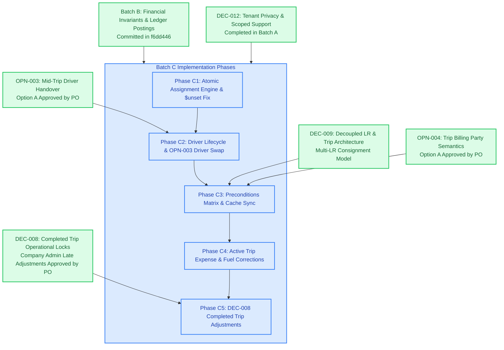

# Fleet Flow — Batch C Preflight Review: Core Fleet Assignments, Driver Handover & Trip State Machine Locks

**Document Type:** Technical Governance Pre-Implementation Review  
**Batch Identifier:** `BATCH-C`  
**Target Architecture:** Vehicle-Driver Dual Pointers, Atomic `$unset` Transactions, Trip Lifecycle State Machine, DEC-008, DEC-009, OPN-003 (Option A), OPN-004 (Option A), QST-008, QST-011, QST-013  
**Execution Posture:** **STRICTLY READ-ONLY REVIEW & DOCUMENTATION ONLY. No code modifications, migrations, or database changes authorized.**  
**Date:** 16 October 2026  
**Auditor / Governance Authority:** Antigravity Advanced Agentic AI (Pair-Programming Preflight Inspection)  
**Baseline Git Commit:** `b0076f9` (`fix(operations): disallow milestones, delays, and cash expenses on completed journeys`) on branch `main`  
**Baseline Test Status:** Automated backend suite passes 100% (21/21 test suites, 313/313 integration & unit tests passing). Production builds for backend (`tsc`) and frontend (`vite build`) succeed with zero errors.  
**Implementation Status:** **PROPOSED — PENDING PRODUCT OWNER APPROVAL**

---

## 1. Objective and Approved Product Decisions

### 1.1 Executive Summary
Following the successful implementation, financial verification, and local commit of **Batch B** (`f6dd446`), the authoritative roadmap defined in [`IMPLEMENTATION_BATCH_PLAN.md`](IMPLEMENTATION_BATCH_PLAN.md) and [`DEPENDENCY_MAP.md`](DEPENDENCY_MAP.md) establishes **Batch C: Core Fleet Assignments, Driver Handover & Trip State Machine Locks** as the next mandatory engineering phase.

The Product Owner has reviewed open architectural questions and formally approved policy directions for Batch C. This updated preflight document incorporates those approved decisions, addresses critical technical corrections regarding Mongoose driver status semantics, establishes an exhaustive trip-state precondition matrix, and structures the implementation into five strictly gated phases with focused automated tests and acceptance criteria.

---

### 1.2 Approved Product Decisions

#### 1. OPN-003 / FF-ISSUE-030 — Mid-Trip Driver Handover
- **Approved Decision:** **Option A (Administrative Single-Driver Handover Engine)**.
- **Single Active Driver:** Maintain strictly one active driver per trip on `TruckJourney.driver_id`.
- **Dedicated Endpoint:** Define a dedicated administrative driver-swap endpoint (`PUT /api/operations/journeys/:id/swap-driver`) requiring **Company Admin** authorization.
- **Audit & Handover Details:** Handover payload must record:
  - `outgoing_driver_id` and `incoming_driver_id`
  - `handover_odometer` (must be $\ge$ trip departure odometer and $\le$ current vehicle odometer)
  - Mandatory business justification reason (minimum 15 characters)
  - Timestamp of handover
  - Immutable audit history log capturing before-and-after snapshots
- **Deferred Scope:** Multi-driver wage splitting, mileage-proportional daily allowances, and multi-driver settlement allocation are deferred to a future batch.

#### 2. DEC-008 / QST-013 — Completed-Trip Corrections
- **Approved Decision:** **Strict Company Admin Authorization with Mandatory Justification**.
- **Scope of Control:** Company Admin authorization and mandatory justification are required for **every** modification to a completed trip (`journey.status === 'completed'`), including non-financial corrections (e.g. re-uploading a blurry receipt or correcting clerical notes) and financial adjustments. Zero autonomous dispatcher or accountant threshold.
- **Audit Requirement:** Preserve an immutable before-and-after audit history for every alteration.
- **Accounting & Ledger Invariants:** Financial corrections must **never** silently overwrite posted financial records. All monetary adjustments must post explicit adjusting or reversing journal entries to the General Ledger and update party balances (`BalanceParty`) atomically within MongoDB sessions.
- **Settlement Protection:** If the trip has already been settled (`is_settled: true`), post-settlement adjustments must not corrupt settlement invariants; they must be logged as post-settlement adjustments for future balance reconciliation.
- **Policy vs. Implementation Distinction:** This policy direction is formally approved; the implementation has not yet occurred and will be executed under Phase C5.

#### 3. OPN-004 / FF-ISSUE-041 — Trip Billing Party
- **Approved Decision:** **Option A (Default Debtor for Dedicated FTL vs LR-Derived LTL)**.
- **Trip Billing Party Purpose:** A trip-level billing party (`journey.billing_party_id`) identifies the default debtor for a dedicated single-customer movement (Full Truckload / FTL).
- **Consolidated LTL Derivation:** If no trip-level billing party is set (`billing_party_id` is null/undefined), commercial billing and receivables are derived strictly from attached Lorry Receipts (LRs).
- **Consignment Integrity:** The trip billing party must **never** silently override LR-specific commercial details (consignor, consignee, declared value, freight charges) or generate duplicate invoices.
- **Decoupled Architecture (DEC-009):** Preserves the approved `DEC-009` decoupled, one-to-many (1:N) Trip-to-LR architecture.
- **Downstream Commercial Invoicing Rules:**
  - *Rule 1 (FTL Commercial Contract):* When `journey.billing_party_id` is populated, the primary freight invoice is generated against that debtor. Attached LRs serve as consignment delivery manifests.
  - *Rule 2 (LTL Multi-Consignment Invoicing):* When `journey.billing_party_id` is null, invoicing engines evaluate each attached LR independently, generating invoices against each LR's designated commercial billing party.
  - *Rule 3 (Conflict Prevention):* Invoicing pipelines must verify that an invoice has not already been generated for either the trip contract or the individual LR before issuing a new invoice.

---

### 1.3 Complete Item Inventory Included in Batch C

| Item Identifier | Type | Title | Severity / Priority | Status | Authoritative File Path & Scope Summary |
| :--- | :--- | :--- | :--- | :--- | :--- |
| **[FF-ISSUE-028](file:///c:/Users/vishh/OneDrive/Desktop/Work/TransportManagement/docs/testing/issues/fleet-assignments/FF-ISSUE-028-vehicle-current-driver-stale-display.md)** | Canonical Issue | Vehicle Current Driver Display Stale or Inconsistent After Assignment Mutation | `High` | Confirmed Defect | [`backend/src/controllers/truckController.ts`](file:///c:/Users/vishh/OneDrive/Desktop/Work/TransportManagement/backend/src/controllers/truckController.ts) lines 413–416, 492–495. Controller executes `Driver.updateOne(..., { current_truck_id: undefined })` without `$unset`. Mongoose strips undefined values, leaving old driver's `current_truck_id` active in MongoDB. |
| **[FF-ISSUE-029](file:///c:/Users/vishh/OneDrive/Desktop/Work/TransportManagement/docs/testing/issues/fleet-assignments/FF-ISSUE-029-driver-historical-vehicle-assignment-sync.md)** | Canonical Issue | Simultaneous Active Vehicle Assignment Display Across Multiple Driver Records | `Critical` | Confirmed Defect | [`backend/src/controllers/truckController.ts`](file:///c:/Users/vishh/OneDrive/Desktop/Work/TransportManagement/backend/src/controllers/truckController.ts) lines 411–449, 480–505. Assigning truck to Driver B does not clear `current_truck_id` from Driver A in an atomic session. Both driver profiles show active possession of the same vehicle. |
| **[FF-ISSUE-030](file:///c:/Users/vishh/OneDrive/Desktop/Work/TransportManagement/docs/testing/issues/fleet-assignments/FF-ISSUE-030-driver-vehicle-concurrency-safeguards.md)** | Canonical Issue | Mid-Trip Driver Handover and Concurrent Assignment Safeguards Unclear | `High` | Approved (OPN-003 Option A) | [`backend/src/controllers/journeyController.ts`](file:///c:/Users/vishh/OneDrive/Desktop/Work/TransportManagement/backend/src/controllers/journeyController.ts); [`backend/src/models/TruckJourney.ts`](file:///c:/Users/vishh/OneDrive/Desktop/Work/TransportManagement/backend/src/models/TruckJourney.ts). Build dedicated administrative swap endpoint with Company Admin authorization, odometer tracking, and audit log. |
| **[FF-ISSUE-031](file:///c:/Users/vishh/OneDrive/Desktop/Work/TransportManagement/docs/testing/issues/fleet-assignments/FF-ISSUE-031-driver-assignment-history-audit-trail-missing.md)** | Canonical Issue | Driver Assignment History and Operational Pointer Sync Missing on Trip Lifecycle Transitions | `High` | Confirmed Defect | [`backend/src/controllers/journeyController.ts`](file:///c:/Users/vishh/OneDrive/Desktop/Work/TransportManagement/backend/src/controllers/journeyController.ts). Trip dispatch updates truck status but fails to record `driver.assignment_history` entry or link pointers. Delivery closeout releases truck but omits driver reconciliation. |
| **[FF-ISSUE-032](file:///c:/Users/vishh/OneDrive/Desktop/Work/TransportManagement/docs/testing/issues/fleet-assignments/FF-ISSUE-032-vehicle-status-stale-after-dispatch.md)** | Canonical Issue | Vehicle Operational Status Stale in Fleet List After Dispatch Action | `High` | Confirmed Defect | [`frontend/src/pages/operations/JourneyListPage.tsx`](file:///c:/Users/vishh/OneDrive/Desktop/Work/TransportManagement/frontend/src/pages/operations/JourneyListPage.tsx). Quick dispatch mutation invalidates `['journeys']` and `['journey-metrics']`, but omits `['available-trucks']`, `['trucks']`, and `['drivers']`. |
| **[FF-ISSUE-035](file:///c:/Users/vishh/OneDrive/Desktop/Work/TransportManagement/docs/testing/issues/trip-lifecycle/FF-ISSUE-035-draft-trip-ineligible-operational-actions.md)** | Canonical Issue | Draft Trip Exposes Ineligible Routine Operational Action Tabs | `High` | Confirmed Defect | [`backend/src/controllers/journeyController.ts`](file:///c:/Users/vishh/OneDrive/Desktop/Work/TransportManagement/backend/src/controllers/journeyController.ts). Backend permits posting transit milestones, delays, fuel stops, and cash expenses to journeys in `draft` status prior to departure. |
| **[FF-ISSUE-036](file:///c:/Users/vishh/OneDrive/Desktop/Work/TransportManagement/docs/testing/issues/trip-lifecycle/FF-ISSUE-036-checkpoint-missing-until-browser-refresh.md)** | Canonical Issue | Trip Checkpoint Added From List Missing in Record Until Browser Refresh | `High` | Confirmed Defect | [`frontend/src/pages/operations/JourneyListPage.tsx`](file:///c:/Users/vishh/OneDrive/Desktop/Work/TransportManagement/frontend/src/pages/operations/JourneyListPage.tsx). List modal mutation invalidates `['journeys']` but omits `['journey-detail', selectedJourneyId]`. Detail page renders stale checkpoints if previously cached. |
| **[FF-ISSUE-037](file:///c:/Users/vishh/OneDrive/Desktop/Work/TransportManagement/docs/testing/issues/trip-lifecycle/FF-ISSUE-037-completed-trip-operational-actions-editable.md)** | Canonical Issue | Completed Trip Remains Editable Through Routine Operational Actions | `High` | Mitigated / Gated by DEC-008 | [`backend/src/controllers/journeyController.ts`](file:///c:/Users/vishh/OneDrive/Desktop/Work/TransportManagement/backend/src/controllers/journeyController.ts). Routine endpoints now reject completed journeys; formalization of audited late correction endpoint under DEC-008 is scheduled for Phase C5. |
| **[FF-ISSUE-038](file:///c:/Users/vishh/OneDrive/Desktop/Work/TransportManagement/docs/testing/issues/trip-lifecycle/FF-ISSUE-038-fuel-stops-milestones-edit-missing.md)** | Canonical Issue | Fuel Stops and Milestones Cannot Be Edited or Corrected After Submission | `Medium` | Design Gap | [`backend/src/controllers/journeyController.ts`](file:///c:/Users/vishh/OneDrive/Desktop/Work/TransportManagement/backend/src/controllers/journeyController.ts); [`backend/src/routes/journeyRoutes.ts`](file:///c:/Users/vishh/OneDrive/Desktop/Work/TransportManagement/backend/src/routes/journeyRoutes.ts). Build audited `PUT` endpoints for fuel slips and milestones during active transit with automatic ledger reconciliation. |
| **[FF-ISSUE-039](file:///c:/Users/vishh/OneDrive/Desktop/Work/TransportManagement/docs/testing/issues/trip-lifecycle/FF-ISSUE-039-cash-expenses-edit-voucher-missing.md)** | Canonical Issue | Cash Expenses Cannot Be Edited to Add or Replace Receipt Voucher | `Medium` | Design Gap | [`backend/src/controllers/journeyController.ts`](file:///c:/Users/vishh/OneDrive/Desktop/Work/TransportManagement/backend/src/controllers/journeyController.ts); [`backend/src/routes/journeyRoutes.ts`](file:///c:/Users/vishh/OneDrive/Desktop/Work/TransportManagement/backend/src/routes/journeyRoutes.ts). Build audited `PUT` endpoints to update driver cash expenses (voucher URL, amount, category). |
| **[FF-ISSUE-041](file:///c:/Users/vishh/OneDrive/Desktop/Work/TransportManagement/docs/testing/issues/trip-lifecycle/FF-ISSUE-041-customer-billing-party-field-linkage-unclear.md)** | Canonical Issue | Customer or Shipper Billing Party Field Purpose and Downstream Linkage Unclear | `Medium` | Approved (OPN-004 Option A) | [`backend/src/models/TruckJourney.ts`](file:///c:/Users/vishh/OneDrive/Desktop/Work/TransportManagement/backend/src/models/TruckJourney.ts); [`docs/testing/decisions/DEC-009-lr-trip-workflow-architecture.md`](file:///c:/Users/vishh/OneDrive/Desktop/Work/TransportManagement/docs/testing/decisions/DEC-009-lr-trip-workflow-architecture.md). Document and implement FTL default debtor vs LR-derived consolidated LTL invoicing rules. |
| **[DEC-008](file:///c:/Users/vishh/OneDrive/Desktop/Work/TransportManagement/docs/testing/decisions/DEC-008-completed-trip-operational-locks.md)** | Architectural Decision | Completed Trip Operational Locks and Reason-Audited Late Corrections | `Approved Policy` | Implementation Pending (C5) | Mandates Company Admin approval for all post-completion trip modifications. Mandatory justification reason, immutable audit trail, and ledger adjusting entries. |
| **[DEC-009](file:///c:/Users/vishh/OneDrive/Desktop/Work/TransportManagement/docs/testing/decisions/DEC-009-lr-trip-workflow-architecture.md)** | Architectural Decision | Decoupled Lorry Receipt (LR) and Trip Workflow Architecture | `Approved` | Architectural Direction | Formally decouples Lorry Receipts from Trips (1:N relationship, standalone LR creation, decoupled lifecycles). |
| **[QST-008](file:///c:/Users/vishh/OneDrive/Desktop/Work/TransportManagement/docs/testing/issues/unresolved-questions/QST-008-stale-state-invalidation-triggers.md)** | Unresolved Question | Vehicle, Driver, and Checkpoint Stale State Causes and Invalidation Triggers | `High` | Technical Analysis Complete | Establishes the exact React Query cache key synchronization topology across fleet management, journey roster, and detail views. |
| **[QST-011](file:///c:/Users/vishh/OneDrive/Desktop/Work/TransportManagement/docs/testing/issues/unresolved-questions/QST-011-trip-lifecycle-state-machine-preconditions.md)** | Unresolved Question | Comprehensive Trip Lifecycle State Machine Preconditions | `High` | Technical Analysis Complete | Defines the exhaustive state transition matrix governing allowed and prohibited actions across all journey states (`draft`, `active`, `delayed`, `completed`, `cancelled`, and `settled`). |
| **[QST-013](file:///c:/Users/vishh/OneDrive/Desktop/Work/TransportManagement/docs/testing/issues/unresolved-questions/QST-013-completed-trip-correction-workflow-status.md)** | Unresolved Question | Completed Trip Operational Locking and Late Entry Correction Workflow | `High` | Architectural Review Complete | Details implementation specification for late correction approvals, before/after diff logging, and ledger adjusting entries under DEC-008. |

---

## 2. Forensic Code Audit & Technical Root-Cause Evidence

### 2.1 The Mongoose `$unset` Defect & Dual Driver Assignment Anomaly (`FF-ISSUE-028`, `FF-ISSUE-029`)
- **File:** [`backend/src/controllers/truckController.ts`](file:///c:/Users/vishh/OneDrive/Desktop/Work/TransportManagement/backend/src/controllers/truckController.ts) (lines 411–449, 480–496)
- **Vulnerable Code Snippet:**
  ```typescript
  // backend/src/controllers/truckController.ts (assignDriver)
  if (truck.current_driver_id && String(truck.current_driver_id) !== String(driver._id)) {
    await Driver.updateOne(
      { _id: truck.current_driver_id },
      { current_truck_id: undefined } // <--- CRITICAL BUG: Mongoose strips 'undefined' in updates!
    );
    const lastAssignment = truck.driver_assignments[truck.driver_assignments.length - 1];
    if (lastAssignment && !lastAssignment.unassigned_at) {
      lastAssignment.unassigned_at = new Date();
    }
  }

  // If driver is currently assigned to another truck, detach that truck
  if (driver.current_truck_id && String(driver.current_truck_id) !== String(truck._id)) {
    await Truck.updateOne(
      { _id: driver.current_truck_id },
      { current_driver_id: undefined } // <--- CRITICAL BUG: Same stripping occurs!
    );
  }
  ```
- **Forensic Evidence & Impact:**
  1. In MongoDB via Mongoose, passing `{ current_truck_id: undefined }` in an update document causes Mongoose to omit the field entirely from the update command. The database receives `{ $set: {} }`, and the existing ObjectId stored in `current_truck_id` on the previous driver document is **never deleted**.
  2. In `unassignDriver` ([lines 492–495](file:///c:/Users/vishh/OneDrive/Desktop/Work/TransportManagement/backend/src/controllers/truckController.ts#L492-L495)), the exact same defect exists: `await Driver.updateOne({ _id: driverId }, { current_truck_id: undefined })`.
  3. Because updates are executed sequentially outside of a MongoDB ACID session (`ClientSession`), concurrent requests or partial server failures create orphaned bidirectional references. Driver A and Driver B both reference Truck 1, while Truck 1 references Driver B.
  4. Tenant scoping is omitted on lines 413, 426, and 492: queries do not filter by `company_id: req.tenant?.id`.

---

### 2.2 Driver Status Schema Semantics vs. Operational Assignment Lifecycle (`FF-ISSUE-031`)
- **Files:** [`backend/src/models/Driver.ts`](file:///c:/Users/vishh/OneDrive/Desktop/Work/TransportManagement/backend/src/models/Driver.ts), [`backend/src/models/Truck.ts`](file:///c:/Users/vishh/OneDrive/Desktop/Work/TransportManagement/backend/src/models/Truck.ts), [`backend/src/controllers/journeyController.ts`](file:///c:/Users/vishh/OneDrive/Desktop/Work/TransportManagement/backend/src/controllers/journeyController.ts)
- **Actual Mongoose Schema Inspection:**
  - `Driver.status` enum is strictly: `['active', 'on_leave', 'terminated']` (see `Driver.ts` line 121).
  - `Truck.status` enum is: `['available', 'on_trip', 'in_maintenance', 'decommissioned', 'active']` (see `Truck.ts` line 28).
  - Driver roster filtering (`driverController.ts` lines 52–95) derives driver operational availability from:
    - Employment status: `status === 'active'`
    - Vehicle assignment: `current_truck_id` (present or null)
    - Active trip engagement: Derived from whether an active `TruckJourney` currently references `driver_id` with `status IN ('active', 'delayed')`.
- **CRITICAL TECHNICAL CORRECTION:**
  - **Do NOT introduce an unsupported `'available'` or `'on_trip'` status onto `Driver.status`.** Doing so would violate the Mongoose enum validator and break driver roster calculations and KYC filtering.
  - `Driver.status` represents the employment duty state (`active`, `on_leave`, `terminated`).
  - The driver's operational relationship with a vehicle is tracked by `Driver.current_truck_id` and the historical audit array `Driver.assignment_history: [{ truck_id, assigned_at, unassigned_at, notes }]`.
- **Current Defect in Journey Controller:**
  ```typescript
  // dispatchJourney (lines 577-580)
  truck.status = 'on_trip';
  truck.current_driver_id = driver._id;
  await truck.save();
  // BUG: driver.current_truck_id is not updated, and no entry is pushed to driver.assignment_history!

  // completeDeliveryAndPOD (lines 1021-1029)
  truck.status = 'available';
  await truck.save();
  // BUG: Driver lifecycle is completely unhandled upon delivery closeout!
  ```
- **Required Lifecycle Transitions:**
  1. **Dispatch:**
     - Precondition: Driver must have `status === 'active'` (must not be `on_leave` or `terminated`). Driver must have no conflicting active journey.
     - Mutation: Synchronize `driver.current_truck_id = truck._id`. Push an assignment record to `driver.assignment_history: { truck_id: truck._id, assigned_at: new Date(), notes: 'Dispatched on journey ' + journey.journey_number }`. `driver.status` remains `'active'`.
  2. **Delivery Completion (`completeDeliveryAndPOD`):**
     - Mutation: `journey.status = 'completed'`. `truck.status = 'available'`.
     - Driver is freed from active trip engagement (allowing assignment to a new journey). `driver.status` remains `'active'`. If unassigning from vehicle, close `assignment_history` entry with `unassigned_at = new Date()`.
  3. **Cancellation (`cancelJourney`):**
     - Mutation: `journey.status = 'cancelled'`. If `truck.status === 'on_trip'`, release `truck.status = 'available'`.
     - Driver is freed from active trip engagement. `driver.status` remains `'active'`.
  4. **Administrative Driver Swap (`swapDriver` — OPN-003):**
     - Outgoing driver: Close active assignment entry in `driver.assignment_history` with `unassigned_at = new Date()` and note `'Relieved mid-trip: ' + reason`. Atomically unset `driver.current_truck_id`. `driver.status` remains `'active'`.
     - Incoming driver: Verify `driver.status === 'active'` and no active trip conflict. Set `driver.current_truck_id = truck._id`. Push to `driver.assignment_history: { truck_id: truck._id, assigned_at: new Date(), notes: 'Assigned mid-trip via handover: ' + reason }`.
     - Truck: `truck.current_driver_id = incoming_driver._id`. Update `truck.driver_assignments`.
     - Journey: `journey.driver_id = incoming_driver._id`. Append to `journey.driver_handover_history`.

---

### 2.3 Stale React Query Cache Invalidation Keys (`FF-ISSUE-032`, `FF-ISSUE-036`, `QST-008`)
- **File:** [`frontend/src/pages/operations/JourneyListPage.tsx`](file:///c:/Users/vishh/OneDrive/Desktop/Work/TransportManagement/frontend/src/pages/operations/JourneyListPage.tsx) (lines 96–100, 116–122)
- **Vulnerable Code Snippet:**
  ```typescript
  // Quick Dispatch Mutation
  onSuccess: (data) => {
    toast.success(data.message || 'Vehicle dispatched successfully.');
    queryClient.invalidateQueries({ queryKey: ['journeys'] });
    queryClient.invalidateQueries({ queryKey: ['journey-metrics'] });
    // OMITTED: ['available-trucks'], ['trucks'], ['drivers'], ['active-drivers']
  }

  // Quick Milestone Mutation
  onSuccess: () => {
    toast.success('Location milestone logged successfully.');
    setIsMilestoneModalOpen(false);
    queryClient.invalidateQueries({ queryKey: ['journeys'] });
    // OMITTED: ['journey-detail', selectedJourneyId]
  }
  ```
- **Forensic Evidence & Impact:**
  1. Dispatching a vehicle from the roster modifies truck and driver state on the server, but does not invalidate fleet query caches. Navigating to `/fleet/trucks` displays the dispatched truck with an outdated "Available" badge.
  2. Logging a checkpoint via the list modal invalidates `['journeys']` but omits `['journey-detail', selectedJourneyId]`. If the operator opens the detail view for that journey, cached data displays the previous location until a manual browser refresh.

---

### 2.4 Precondition Invariants on Draft Journeys (`FF-ISSUE-035`, `QST-011`)
- **File:** [`backend/src/controllers/journeyController.ts`](file:///c:/Users/vishh/OneDrive/Desktop/Work/TransportManagement/backend/src/controllers/journeyController.ts) (lines 640–648, 694–705, 771–781, 939–949)
- **Current Vulnerability:**
  ```typescript
  // addMilestone / recordDelay / addDieselStop / addDriverExpense
  if (journey.is_settled) return res.status(409).json(...);
  if (journey.status === 'completed' || journey.status === 'cancelled') return res.status(400).json(...);
  // <--- CRITICAL GAP: If journey.status === 'draft', the mutation is ALLOWED!
  ```
- **Forensic Evidence & Impact:**
  1. A journey in `draft` status has not departed the origin facility. Allowing en-route transit milestones, delay reports, diesel stops, and driver expenses prior to dispatch violates logistics state machine semantics.
  2. While the frontend detail page hides these action buttons, backend REST API endpoints lack `journey.status !== 'draft'` assertions, allowing API consumers, scripts, or stale tabs to push premature progress logs and expenses.

---

### 2.5 Absence of Audited Edit/Correction Endpoints (`FF-ISSUE-038`, `FF-ISSUE-039`, `DEC-008`, `QST-013`)
- **File:** [`backend/src/routes/journeyRoutes.ts`](file:///c:/Users/vishh/OneDrive/Desktop/Work/TransportManagement/backend/src/routes/journeyRoutes.ts) (lines 40–58)
- **Forensic Evidence & Impact:**
  1. Sub-resources on `TruckJourney` (`diesel_expenses`, `driver_expenses`, `daily_progress`, `delays`) are appended via array `$push` operations.
  2. Zero `PUT` or `PATCH` endpoints exist for sub-resources:
     - No `PUT /api/operations/journeys/:id/diesel/:dieselId`
     - No `PUT /api/operations/journeys/:id/expenses/:expenseId`
  3. If an accountant enters ₹9,000 instead of ₹900 for a fuel stop, or a driver uploads a blurred voucher photo, the system provides no mechanism to correct the error.
  4. For fuel stops with ledger postings, corrections must atomically recalculate fuel balances, adjust or reverse general ledger journals, and update vendor balances without corrupting double-entry balance invariants.

---

## 3. Explicit Scope Boundaries

### 3.1 In-Scope for Batch C
1. **Atomic Driver Assignment & Pointer Reconciliation (`FF-ISSUE-028`, `FF-ISSUE-029`):**
   - Refactor `assignDriver` and `unassignDriver` in `truckController.ts` to use explicit `{ $unset: { current_truck_id: 1 } }` and `{ $unset: { current_driver_id: 1 } }`.
   - Wrap driver-truck assignment mutations within MongoDB ACID transactions (`runInTransaction`).
   - Enforce strict tenant scoping (`company_id: req.tenant?.id`) on all driver and truck updates.
2. **Driver Operational Lifecycle & History Tracking (`FF-ISSUE-031`):**
   - Synchronize `driver.current_truck_id` and append to `driver.assignment_history` upon dispatch.
   - Reconcile pointers on POD delivery completion and trip cancellation.
   - Maintain `Driver.status` strictly within `['active', 'on_leave', 'terminated']`.
3. **Mid-Trip Driver Handover Engine (`OPN-003 / FF-ISSUE-030` — Option A):**
   - Implement `PUT /api/operations/journeys/:id/swap-driver` requiring Company Admin authorization.
   - Record outgoing/incoming drivers, handover odometer, mandatory justification reason, and audit history.
4. **Comprehensive Trip State Machine Preconditions (`FF-ISSUE-035`, `QST-011`):**
   - Backend enforcement rejecting milestones, delays, fuel stops, and cash expenses on `draft`, `completed`, `cancelled`, and settled trips.
5. **React Query Cache Key Synchronization (`FF-ISSUE-032`, `FF-ISSUE-036`, `QST-008`):**
   - Invalidate all dependent query keys (`['journeys']`, `['journey-metrics']`, `['available-trucks']`, `['trucks']`, `['drivers']`, `['journey-detail', id]`) on operational actions.
6. **Audited Correction Endpoints for Active Trips (`FF-ISSUE-038`, `FF-ISSUE-039`):**
   - Implement `PUT /api/operations/journeys/:id/expenses/:expenseId` for active/delayed journeys.
   - Implement `PUT /api/operations/journeys/:id/diesel/:dieselId` with atomic ledger $\Delta$ adjustments for active/delayed journeys.
7. **Completed-Trip Late Adjustment Workflow Under DEC-008 (`DEC-008`, `QST-013`):**
   - Implement `POST /api/operations/journeys/:id/adjustments` requiring Company Admin authorization, mandatory justification reason, and immutable before/after auditing.
   - Enforce ledger-safe adjusting journal postings.
8. **Trip Billing Party Rules Specification (`OPN-004 / FF-ISSUE-041` — Option A):**
   - Document and implement FTL default debtor vs LR-derived consolidated LTL invoicing rules.

### 3.2 Out-of-Scope for Batch C (Deferred to Later Batches)
1. **Multi-Driver Wage Splitting & Settlement Calculations (`OPN-003 Option B`):**
   - Deferred by Product Owner decision to a future batch.
2. **Generic Numeric Input Trapping (`FF-ISSUE-017`, `FF-ISSUE-018`, `FF-ISSUE-040`, `FF-ISSUE-046`):**
   - Belongs strictly to **Batch G (Design System & UI/UX Polish)**.
3. **Subscription Trial & Quota Gating (`FF-ISSUE-002`, `DEC-001`):**
   - Belongs strictly to **Batch D (Subscription Entitlements & Approval Workflows)**.
4. **Approval Rule Triggering for Dispatchers (`FF-ISSUE-059`, `QST-005`):**
   - Belongs strictly to **Batch D**.
5. **Third-Party Webhook Ingestion & Dead-Letter Queues (`FF-ISSUE-054`, `DEC-011`):**
   - Belongs strictly to **Batch E (Notification Delivery Tracking)**.
6. **Regional Hub Prefixing & LR Sequencing (`DEC-010`, `FF-ISSUE-051`):**
   - Belongs strictly to **Batch F (Regional Branches & Hubs)**.
7. **Incognito Authentication Session Retest (`FF-ISSUE-058`, `QST-014`):**
   - Quarantined strictly for the **Final Verification Phase**.

---

## 4. Architectural Dependencies & Approved Product Decisions



---

## 5. Security, Tenant Isolation, Concurrency & Backward-Compatibility Risks

### 5.1 MongoDB Replica-Set Transaction Requirements
- **Requirement:** All dual-pointer assignment mutations (`truckController.ts`), driver swap operations (`swapDriver`), and fuel/expense corrections (`journeyController.ts`) must execute inside `runInTransaction(async (session) => { ... })`.
- **Replica-Set Availability:** In production and local development environments running MongoDB replica sets, transactions provide ACID atomicity. In test environments without replica sets, `runInTransaction` gracefully executes the callback directly while preserving query consistency.

### 5.2 Tenant Isolation Safeguards
- **Risk:** Unscoped queries using only `_id` allow potential cross-tenant entity manipulation.
- **Mitigation:**
  - Enforce `{ _id: entityId, company_id: req.tenant?.id }` on every database query, lookup, and atomic update.
  - Pass `company_id` to all helper functions and validate entity ownership using `validateTenantOwnership`.

### 5.3 Concurrency & Pointer Race Conditions
- **Risk:** Two dispatchers simultaneously assign Truck 1 to Driver A and Driver B, or dispatch Driver A onto two journeys at the same instant.
- **Mitigation:**
  - In `truckController.ts`, verify within the transaction session that neither the truck nor the target driver has been concurrently modified.
  - In `journeyController.ts` (`dispatchJourney` and `swapDriver`), query for existing active journeys (`status IN ('active', 'delayed')`) referencing the vehicle or driver within the transaction session. If found, abort with `409 Conflict`.

### 5.4 Financial Ledger Integrity on Corrections (`FF-ISSUE-038`, `DEC-008`)
- **Risk:** Editing a diesel fuel stop logged under `payment_mode: 'credit'` affects vendor current balance and General Ledger journal vouchers. Directly mutating the diesel record without adjusting ledger entries creates accounting desynchronization.
- **Mitigation:**
  - Compute $\Delta = \text{new\_total} - \text{old\_total}$.
  - In a MongoDB ACID session, adjust `BalanceParty.current_balance` by $\Delta$, and post an audited adjusting journal voucher to the General Ledger.
  - Reject routine edits if the journey has already been included in a finalized driver settlement (`is_settled: true`).
  - Completed-trip corrections under DEC-008 must post explicit adjusting entries rather than mutating historical records.

---

## 6. Comprehensive Trip-State Precondition Matrix

The backend must strictly enforce state preconditions across all operational and lifecycle endpoints. The following matrix defines the authoritative rules:

| Endpoint & Operation | Allowed Lifecycle States | Prohibited States & HTTP Response | Settled Check (`is_settled: true`) | Required Authorization Role | Audit Trail Requirement |
| :--- | :--- | :--- | :--- | :--- | :--- |
| **`createJourney`**<br>`POST /api/operations/journeys` | Initial Creation (Produces `draft`) | N/A | N/A | `admin`, `dispatcher` | Standard Audit Log |
| **`dispatchJourney`**<br>`PUT /api/operations/journeys/:id/dispatch` | `draft` | `active` (400)<br>`delayed` (400)<br>`completed` (400)<br>`cancelled` (400) | Prohibited (409) | `admin`, `dispatcher`<br>(Company Admin for credit override) | `STATUS_CHANGE`<br>(+ Credit Override Audit) |
| **`addMilestone`**<br>`POST /api/operations/journeys/:id/milestones` | `active`, `delayed` | `draft` (400)<br>`completed` (400)<br>`cancelled` (400) | Prohibited (409) | `admin`, `dispatcher` | Checkpoint Audit |
| **`recordDelay`**<br>`POST /api/operations/journeys/:id/delays` | `active`, `delayed` | `draft` (400)<br>`completed` (400)<br>`cancelled` (400) | Prohibited (409) | `admin`, `dispatcher` | Incident Audit |
| **`addDieselStop`**<br>`POST /api/operations/journeys/:id/diesel` | `active`, `delayed` | `draft` (400)<br>`completed` (400)<br>`cancelled` (400) | Prohibited (409) | `admin`, `dispatcher`, `accountant` | Financial Ledger Journal + Audit |
| **`addDriverExpense`**<br>`POST /api/operations/journeys/:id/expenses` | `active`, `delayed` | `draft` (400)<br>`completed` (400)<br>`cancelled` (400) | Prohibited (409) | `admin`, `dispatcher`, `accountant` | Cash Advance Audit |
| **`completeDeliveryAndPOD`**<br>`POST /api/operations/journeys/:id/pod` | `active`, `delayed` | `draft` (400)<br>`completed` (400)<br>`cancelled` (400) | Prohibited (409) | `admin`, `dispatcher` | `STATUS_CHANGE` + POD Audit |
| **`cancelJourney`**<br>`PUT /api/operations/journeys/:id/cancel` | `draft`, `active`, `delayed` | `completed` (400) | Prohibited (400) | `admin`, `dispatcher` | `STATUS_CHANGE` + Abort Reason |
| **`swapDriver` (OPN-003)**<br>`PUT /api/operations/journeys/:id/swap-driver` | `active`, `delayed` | `draft` (400)<br>`completed` (400)<br>`cancelled` (400) | Prohibited (409) | **Company Admin Only** (`admin` or `superadmin`) | Dedicated Handover Audit Log (Before/After) |
| **`updateDieselStop` (C4)**<br>`PUT /api/operations/journeys/:id/diesel/:dieselId` | `active`, `delayed` | `draft` (400)<br>`completed` (400)<br>`cancelled` (400) | Prohibited (409) | `admin`, `accountant` | $\Delta$ Ledger Journal + Diff Audit |
| **`updateDriverExpense` (C4)**<br>`PUT /api/operations/journeys/:id/expenses/:expenseId` | `active`, `delayed` | `draft` (400)<br>`completed` (400)<br>`cancelled` (400) | Prohibited (409) | `admin`, `accountant` | Diff Audit + Voucher URL |
| **`adjustCompletedTrip` (DEC-008 / C5)**<br>`POST /api/operations/journeys/:id/adjustments` | `completed` | `draft` (400)<br>`active` (400)<br>`delayed` (400)<br>`cancelled` (400) | Permitted only via Adjusting Journal; no direct mutation | **Company Admin Only** (`admin` or `superadmin`) | Mandatory Justification + Immutable Diff Audit |

---

## 7. Sequenced Gated Implementation Phases (C1 to C5)

To guarantee zero regression risk and maintain test suite stability, Batch C is sequenced into five strictly gated implementation phases:

> [!IMPORTANT]
> **PHASE GATING RULE:**  
> Each phase must achieve 100% automated test pass rates and production build verification before the subsequent phase may be initiated. No later phase may begin if any preceding phase's required checks fail.

```
┌─────────────────────────────────────────────────────────────────────────────┐
│ Phase C1: Atomic, Tenant-Scoped Driver–Truck Assignments & $unset Fix       │
│ - Fix Mongoose undefined stripping in truckController.ts with $unset       │
│ - Wrap driver assignment and unassignment in runInTransaction               │
│ - Enforce strict tenant isolation (company_id: req.tenant?.id)              │
│ - Automated Test Suite: driverVehicleSync.test.ts                           │
└──────────────────────────────────────┬──────────────────────────────────────┘
                                       ▼ (Gated on C1 Tests Passing)
┌─────────────────────────────────────────────────────────────────────────────┐
│ Phase C2: Driver Operational Lifecycle, History & OPN-003 Driver Swap       │
│ - Sync driver.current_truck_id and assignment_history on trip dispatch      │
│ - Release vehicle and reconcile driver on delivery POD and trip cancel      │
│ - Maintain Driver.status strictly within ['active', 'on_leave', 'terminated']│
│ - Implement PUT /api/operations/journeys/:id/swap-driver (OPN-003 Option A) │
│ - Automated Test Suite: driverLifecycleAndSwap.test.ts                      │
└──────────────────────────────────────┬──────────────────────────────────────┘
                                       ▼ (Gated on C2 Tests Passing)
┌─────────────────────────────────────────────────────────────────────────────┐
│ Phase C3: Backend Trip-State Preconditions & React Query Cache Sync         │
│ - Enforce precondition matrix on all en-route endpoints in journeyController│
│ - Reject milestones, delays, fuel stops, and expenses on draft journeys (400)│
│ - Synchronize React Query cache keys across roster, metrics, and details    │
│ - Implement OPN-004 Option A default debtor vs LR derivation rules          │
│ - Automated Test Suite: journeyLifecycleState.test.ts                       │
└──────────────────────────────────────┬──────────────────────────────────────┘
                                       ▼ (Gated on C3 Tests Passing)
┌─────────────────────────────────────────────────────────────────────────────┐
│ Phase C4: Active-Trip Expense & Fuel Corrections with Ledger Adjustments   │
│ - Implement PUT /api/operations/journeys/:id/expenses/:expenseId            │
│ - Implement PUT /api/operations/journeys/:id/diesel/:dieselId               │
│ - Atomic delta balance calculation and adjusting General Ledger journals    │
│ - Automated Test Suite: journeyCorrections.test.ts                          │
└──────────────────────────────────────┬──────────────────────────────────────┘
                                       ▼ (Gated on C4 Tests Passing)
┌─────────────────────────────────────────────────────────────────────────────┐
│ Phase C5: Completed-Trip Correction Workflow Under DEC-008                  │
│ - Implement POST /api/operations/journeys/:id/adjustments                   │
│ - Require Company Admin authorization and mandatory justification (>= 15 ch)│
│ - Immutable before-and-after audit logging for all changes                  │
│ - Accounting reversing/adjusting entries for financial corrections          │
│ - Frontend UI modal for late adjustments and audit history display          │
│ - Automated Test Suite: completedTripAdjustments.test.ts                    │
└─────────────────────────────────────────────────────────────────────────────┘
```

---

## 8. Focused Automated Tests & Acceptance Criteria by Phase

### Phase C1: Atomic Driver–Truck Assignments & Pointer Reconciliation
- **Objective:** Eliminate the Mongoose undefined stripping bug and dual-assignment anomalies.
- **Key Files Modified:** [`backend/src/controllers/truckController.ts`](file:///c:/Users/vishh/OneDrive/Desktop/Work/TransportManagement/backend/src/controllers/truckController.ts).
- **Automated Tests (`backend/src/tests/integration/driverVehicleSync.test.ts`):**
  1. `assignDriver` with new driver atomically detaches previous driver using `$unset: { current_truck_id: 1 }`. Verify previous driver document in MongoDB has no `current_truck_id`.
  2. `unassignDriver` atomically unsets both `truck.current_driver_id` and `driver.current_truck_id` and records `unassigned_at` on both assignment arrays.
  3. Reassigning a driver who is already attached to Truck X to Truck Y detaches Truck X and attaches Truck Y atomically.
  4. Concurrent assignment attempts fail safely without leaving orphaned pointers.
  5. Cross-tenant assignment requests return HTTP 403/404 (tenant isolation verified).
- **Explicit Acceptance Criteria:**
  - Zero dual-assignment states in MongoDB across `Truck` and `Driver` collections.
  - Driver profile page displays accurate, real-time vehicle possession.
  - All fleet mutations execute within `runInTransaction`.

---

### Phase C2: Driver Operational Lifecycle, History & OPN-003 Driver Swap
- **Objective:** Synchronize driver vehicle assignments on journey lifecycle events and provide administrative mid-trip handover.
- **Key Files Modified:** [`backend/src/controllers/journeyController.ts`](file:///c:/Users/vishh/OneDrive/Desktop/Work/TransportManagement/backend/src/controllers/journeyController.ts), [`backend/src/routes/journeyRoutes.ts`](file:///c:/Users/vishh/OneDrive/Desktop/Work/TransportManagement/backend/src/routes/journeyRoutes.ts), [`backend/src/models/TruckJourney.ts`](file:///c:/Users/vishh/OneDrive/Desktop/Work/TransportManagement/backend/src/models/TruckJourney.ts).
- **Automated Tests (`backend/src/tests/integration/driverLifecycleAndSwap.test.ts`):**
  1. Dispatching a journey synchronizes `driver.current_truck_id` and appends an entry to `driver.assignment_history`.
  2. Dispatching a driver with status `on_leave` or `terminated` is rejected with HTTP 400.
  3. Completing delivery (`completeDeliveryAndPOD`) releases truck to `available` and clears active trip lock for the driver without mutating `driver.status`.
  4. Cancelling an active journey releases truck to `available` and frees driver.
  5. `PUT /:id/swap-driver`:
     - Non-admin user returns HTTP 403 Forbidden.
     - Justification reason under 15 characters returns HTTP 400 Bad Request.
     - Handover odometer less than trip start odometer or greater than truck odometer returns HTTP 400 Bad Request.
     - Successful swap updates `journey.driver_id`, appends to `journey.driver_handover_history`, updates `driver.assignment_history` for both drivers, and logs an immutable audit event.
- **Explicit Acceptance Criteria:**
  - `Driver.status` remains strictly within `['active', 'on_leave', 'terminated']`.
  - Mid-trip driver relief can be executed by Company Admin with complete audit trail and odometer tracking.

---

### Phase C3: Backend Trip-State Preconditions & React Query Cache Synchronization
- **Objective:** Enforce trip lifecycle state machine guards and eliminate stale UI badges.
- **Key Files Modified:** [`backend/src/controllers/journeyController.ts`](file:///c:/Users/vishh/OneDrive/Desktop/Work/TransportManagement/backend/src/controllers/journeyController.ts), [`frontend/src/pages/operations/JourneyListPage.tsx`](file:///c:/Users/vishh/OneDrive/Desktop/Work/TransportManagement/frontend/src/pages/operations/JourneyListPage.tsx), [`frontend/src/pages/operations/JourneyDetailPage.tsx`](file:///c:/Users/vishh/OneDrive/Desktop/Work/TransportManagement/frontend/src/pages/operations/JourneyDetailPage.tsx).
- **Automated Tests (`backend/src/tests/integration/journeyLifecycleState.test.ts`):**
  1. `POST /:id/milestones` on `draft` journey returns HTTP 400 Bad Request.
  2. `POST /:id/delays` on `draft` journey returns HTTP 400 Bad Request.
  3. `POST /:id/diesel` on `draft` journey returns HTTP 400 Bad Request.
  4. `POST /:id/expenses` on `draft` journey returns HTTP 400 Bad Request.
  5. Operational actions on `completed` or `cancelled` journeys return HTTP 400 Bad Request.
  6. Operational actions on settled journeys (`is_settled: true`) return HTTP 409 Conflict.
  7. Cancelling a `completed` or settled journey returns HTTP 400 Bad Request.
  8. OPN-004 Billing Party Tests:
     - Journey with `billing_party_id` sets default debtor for FTL movement.
     - Journey with null `billing_party_id` derives billing from attached LRs.
- **Explicit Acceptance Criteria:**
  - Direct API calls attempting en-route operations on `draft` trips are completely blocked.
  - UI quick dispatch and checkpoint actions immediately refresh vehicle status badges, metrics, and detail views without browser reload.

---

### Phase C4: Active-Trip Expense & Fuel Corrections with Ledger Adjustments
- **Objective:** Allow clerical corrections to fuel slips and expense vouchers during active transit without compromising financial balance integrity.
- **Key Files Modified:** [`backend/src/controllers/journeyController.ts`](file:///c:/Users/vishh/OneDrive/Desktop/Work/TransportManagement/backend/src/controllers/journeyController.ts), [`backend/src/routes/journeyRoutes.ts`](file:///c:/Users/vishh/OneDrive/Desktop/Work/TransportManagement/backend/src/routes/journeyRoutes.ts), [`backend/src/utils/ledgerService.ts`](file:///c:/Users/vishh/OneDrive/Desktop/Work/TransportManagement/backend/src/utils/ledgerService.ts).
- **Automated Tests (`backend/src/tests/integration/journeyCorrections.test.ts`):**
  1. `PUT /:id/expenses/:expenseId` updates category, amount, notes, and receipt voucher URL on active journey, logging before/after audit snapshot.
  2. `PUT /:id/diesel/:dieselId` updating litres and rate:
     - Calculates $\Delta = \text{new\_total} - \text{old\_total}$.
     - Atomically adjusts `BalanceParty.current_balance` for credit fuel vendors.
     - Posts an adjusting journal entry to General Ledger.
  3. Attempting routine edits on `completed`, `cancelled`, or settled trips returns HTTP 400 / 409.
- **Explicit Acceptance Criteria:**
  - Active trip expense and fuel stop clerical errors can be corrected by authorized dispatchers/accountants.
  - Vendor balances and general ledger journal vouchers remain 100% synchronized with no balance drift.

---

### Phase C5: Completed-Trip Correction Workflow Under DEC-008
- **Objective:** Provide a secure, Company Admin-governed late adjustment workflow for completed trips with mandatory justification and immutable auditing.
- **Key Files Modified:** [`backend/src/controllers/journeyController.ts`](file:///c:/Users/vishh/OneDrive/Desktop/Work/TransportManagement/backend/src/controllers/journeyController.ts), [`backend/src/routes/journeyRoutes.ts`](file:///c:/Users/vishh/OneDrive/Desktop/Work/TransportManagement/backend/src/routes/journeyRoutes.ts), [`frontend/src/pages/operations/JourneyDetailPage.tsx`](file:///c:/Users/vishh/OneDrive/Desktop/Work/TransportManagement/frontend/src/pages/operations/JourneyDetailPage.tsx).
- **Automated Tests (`backend/src/tests/integration/completedTripAdjustments.test.ts`):**
  1. `POST /:id/adjustments` by dispatcher or accountant returns HTTP 403 Forbidden.
  2. Request with justification reason under 15 characters returns HTTP 400 Bad Request.
  3. Non-financial late correction (e.g. uploading missing voucher slip) succeeds with Company Admin credentials and creates audit trail.
  4. Financial late correction posts an adjusting journal entry to General Ledger rather than rewriting historical transaction.
  5. Attempting direct manipulation on settled trips without adjustment entry returns HTTP 409 Conflict.
- **Explicit Acceptance Criteria:**
  - Routine operational actions remain locked on completed trips.
  - Late modifications require explicit Company Admin authorization and mandatory justification.
  - Complete, immutable before-and-after audit history is preserved.
  - Financial records preserve accounting invariants without silent overwrites.

---

## 9. Formal Governance Gate & Sign-Off Status

```
═══════════════════════════════════════════════════════════════════════════════
  BATCH C PREFLIGHT REVIEW STATUS:
  PROPOSED — PENDING PRODUCT OWNER APPROVAL
═══════════════════════════════════════════════════════════════════════════════
  [X] Git baseline established on branch main (Commit b0076f9 verified).
  [X] Working tree preserved without overwriting or stashing uncommitted files.
  [X] Approved Product Decisions recorded:
      - OPN-003 (Mid-trip driver handover): Option A selected.
      - DEC-008 (Completed-trip corrections): Company Admin + mandatory audit.
      - OPN-004 (Trip billing party): Option A selected (FTL default debtor).
  [X] Technical corrections to preflight implemented:
      - Driver status verified against Mongoose schema (['active', 'on_leave', 'terminated']).
      - Comprehensive trip-state precondition matrix expanded.
      - 5 gated implementation phases defined (C1 to C5).
      - Focused automated tests and explicit acceptance criteria specified.
  [ ] Implementation authorized by Product Owner. (AWAITING SIGN-OFF)
═══════════════════════════════════════════════════════════════════════════════
```

> [!WARNING]
> **STRICT EXECUTION BOUNDARY: NO CODE CHANGES AUTHORIZED**  
> Under governance protocol, no application code, models, controllers, tests, or database entries may be modified until formal Product Owner sign-off is granted on this preflight specification.
