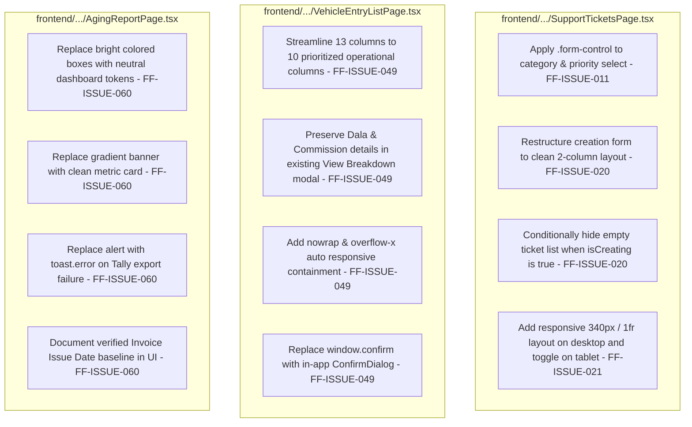

# Fleet Flow — Batch H Phase H5 Preflight Review (Documentation Only)

**Phase:** H5 — Operational Forms, Support Tickets & Reporting Viewports Polish  
**Batch:** H — General UI Polish  
**Date:** 2026-10-17  
**Mode:** Documentation Only (Implementation Not Authorized)  
**Corpus Name:** `Vishal-8630/Fleet-Flow`  
**Git Commit Baseline:** `b040e00` (Branch: `main`)  

---

## 1. Executive Summary & Objective

The objective of this preflight review is to establish the exact scope, technical root causes, affected files, proposed minimal changes, and regression safeguards for **Phase H5** of **Batch H**. 

Phase H5 is the final phase of Batch H. It addresses operational forms, tenant support ticket layouts, responsive table clipping on market movements, and AR aging report card aesthetics.

**Mandatory Constraint:** This document is **documentation-only**. No production code, styles, tests, or issue statuses are modified during this preflight.

---

## 2. Git State & Working Tree Audit

### 2.1 Git Status Prior to Preflight
Execution of `git status -s` and `git branch --show-current` confirmed:
- **Active Branch:** `main`
- **Tracked Modifications Preserved from Phases H1–H4:**
  - `docs/testing/ISSUE_INDEX.md`
  - `docs/testing/issues/ui-ux/FF-ISSUE-001` through `010`, `013` through `019`
  - `docs/testing/issues/financial-accounting/FF-ISSUE-046`
  - `docs/testing/issues/trip-lifecycle/FF-ISSUE-040`
  - `frontend/src/styles/components/badges.css`, `buttons.css`, `forms.css`, `variables.css`
  - `frontend/src/components/layout/PublicLayout.tsx`, `Sidebar.tsx`
  - `frontend/src/pages/marketing/HomePage.tsx`, `FeaturesPage.tsx`, `PricingPage.tsx`
  - `frontend/src/pages/auth/LoginPage.tsx`, `RegisterPage.tsx`
  - `frontend/src/pages/commercial/SettlementListPage.tsx`
  - `frontend/src/pages/operations/NewJourneyPage.tsx`
  - `frontend/src/pages/fleet/TruckListPage.tsx`, `DriverListPage.tsx`, `TruckDetailPage.tsx`
  - `frontend/src/pages/parties/BillingPartyListPage.tsx`, `BalancePartyListPage.tsx`
  - `frontend/src/App.tsx`
- **Untracked Artifacts Preserved:**
  - `backend/src/tests/integration/phase8BatchH1PrimitivesAndAccessibility.test.ts`
  - `backend/src/tests/integration/phase8BatchH2NumericInputsAndSettlement.test.ts`
  - `backend/src/tests/integration/phase8BatchH3ConfirmDialogsAndRoutes.test.ts`
  - `backend/src/tests/integration/phase8BatchH4PublicAndAuthShell.test.ts`
  - `docs/testing/audit/BATCH_H1_AUDIT_REPORT.md`
  - `docs/testing/audit/BATCH_H2_AUDIT_REPORT.md`
  - `docs/testing/audit/BATCH_H3_AUDIT_REPORT.md`
  - `docs/testing/audit/BATCH_H4_AUDIT_REPORT.md`
  - `frontend/src/components/common/ConfirmDialog.tsx`
  - `frontend/src/components/layout/AuthLayout.tsx`
  - `frontend/src/pages/marketing/SecurityPage.tsx`
  - `frontend/src/pages/marketing/HelpCenterPage.tsx`
- **Working Tree Integrity:** Preserved with zero staging, commits, pushes, stashes, reverts, or resets.

### 2.2 Git Status Following Preflight Document Creation
Following the creation of this preflight document (`docs/testing/audit/BATCH_H5_PREFLIGHT_REVIEW.md`):
- **Branch:** `main` (commit baseline `b040e00`)
- **Staged Changes:** None (`git diff --staged` is empty)
- **Tracked Changes:** Exactly matches the preserved modifications from Phases H1–H4
- **Untracked Additions:** Only `docs/testing/audit/BATCH_H5_PREFLIGHT_REVIEW.md` added to the existing untracked files
- **Zero Destructive Actions:** No `git clean`, `git reset`, `git checkout`, `git commit`, or `git push` was executed.


---

## 3. Master Issue Registry Audit (H5 Candidates)

The master issue registry ([`docs/testing/ISSUE_INDEX.md`](file:///c:/Users/vishh/OneDrive/Desktop/Work/TransportManagement/docs/testing/ISSUE_INDEX.md)) and canonical issue files were audited to verify the current status and acceptance criteria of each candidate issue:

| Canonical ID | Canonical Title | Category | Current Status | Module / Target | Authorized in H5 Scope? |
| :--- | :--- | :--- | :--- | :--- | :--- |
| **`FF-ISSUE-011`** | Form Select Dropdowns Render as Unstyled Browser Native Elements | UI-UX | **Partially Resolved (Batch H1 Primitives; H5 Remaining)** | Form Inputs & Modals | **Yes (Candidate)** |
| **`FF-ISSUE-020`** | Support Ticket Creation Form Spacing, Field Boundaries, and Layout Distortion | UI-UX | **Observed** | Help & Support Desk | **Yes (Candidate)** |
| **`FF-ISSUE-021`** | Support Ticket Message Thread and Reply Composer Horizontal Clipping | UI-UX | **Observed** | Help & Support Desk | **Yes (Candidate)** |
| **`FF-ISSUE-049`** | Market Movement List View Overcrowded and Visually Clipped | UI-UX | **Observed** | Market Movements | **Yes (Candidate)** |
| **`FF-ISSUE-060`** | AR Aging Report Visual Styling and Aging Bucket Semantics | Financial | **Needs Verification** | AR Aging Report | **Yes (Candidate)** |
| **`FF-ISSUE-010`** | Deletion Actions Trigger Unstyled Browser Native Confirm Dialogs | UI-UX | **Resolved (Batch H3)** | Master Registries | **No (Already Resolved)**<br>*(See Note below)* |

> [!NOTE]
> **Status of Confirmation Dialogs (`FF-ISSUE-010`):**
> `FF-ISSUE-010` is canonical and was marked **Resolved in Batch H3** across all in-scope master registries (`TruckListPage`, `DriverListPage`, `BillingPartyListPage`, `BalancePartyListPage`, and `TruckDetailPage`).
> However, as documented in `BATCH_H3_AUDIT_REPORT.md` (Section 3.3), a solitary call to `window.confirm()` remains in [`VehicleEntryListPage.tsx`](file:///c:/Users/vishh/OneDrive/Desktop/Work/TransportManagement/frontend/src/pages/operations/VehicleEntryListPage.tsx#L536) for deleting market movements. Because `VehicleEntryListPage.tsx` is being refactored in H5 under `FF-ISSUE-049`, replacing this single remaining call with `<ConfirmDialog />` is naturally included in `FF-ISSUE-049` scope. All other administrative/commercial confirm dialogs (`CustomFieldsPage`, `TeamMembersPage`, `TyreManagementPage`, `MaintenanceDashboardPage`, `InvoiceListPage`, `LRListPage`) are **deferred** to their respective future functional workstreams.

---

## 4. Forensic Investigation of Candidate Issues

### 4.1 `FF-ISSUE-011`: Remaining Custom Select / Dropdown Styling
- **Canonical Acceptance Criteria:**
  - [x] Operational form select controls feature accessible keyboard focus indicators (`:focus-visible` with 2px high-contrast outline) *(Completed in Batch H1)*.
  - [ ] All operational form dropdowns feature custom-styled borders, heights, and chevron indicators *(Remaining: Phase H5)*.
  - [ ] Dropdowns match adjacent text and number inputs in height, border radius, and focus state *(Remaining: Phase H5)*.
  - [x] Full keyboard navigation focus visibility is verified across form controls and buttons *(Completed in Batch H1)*.
- **Source Inspection:**
  - In `frontend/src/styles/components/forms.css` (lines 38–53), custom select styling (`appearance: none`, custom SVG chevron background, padding, and focus rings) is already defined for `.form-control`, `.form-input`, `.form-select`, and `select.form-control`.
  - In Batch H1, `:focus-visible` accessibility was added to `.form-control` and `.form-select`.
  - **Remaining Defect:** In legacy views—specifically [`SupportTicketsPage.tsx`](file:///c:/Users/vishh/OneDrive/Desktop/Work/TransportManagement/frontend/src/pages/support/SupportTicketsPage.tsx#L293-L302)—dropdowns are declared as raw `<select>` elements with inline styles (`style={{ width: '100%', padding: '0.5rem 0.75rem', ... }}`) completely omitting `className="form-control"` or `className="form-select"`. Consequently, they render as unstyled browser-native controls without the custom SVG chevron and fail to inherit the design system tokens.
- **Proposed Smallest Safe Change:**
  - Replace raw inline-styled `<select>` elements in `SupportTicketsPage.tsx` with standard `<select className="form-control">` (or `.form-select`).
  - Ensure uniform height (40px/44px), custom chevron, and `:focus-visible` ring.

---

### 4.2 `FF-ISSUE-020`: Support Ticket Creation Form Layout Distortion
- **Canonical Acceptance Criteria:**
  - [ ] Support ticket creation form renders in a clean, compact container with consistent input styling.
  - [ ] Empty state graphic is completely hidden while the creation form is active.
  - [ ] Form is fully responsive on mobile and desktop viewports.
- **Source Inspection ([`SupportTicketsPage.tsx`](file:///c:/Users/vishh/OneDrive/Desktop/Work/TransportManagement/frontend/src/pages/support/SupportTicketsPage.tsx#L282-L327)):**
  - **Distorted Grid:** Line 286 declares `<div style={{ display: 'grid', gridTemplateColumns: '1fr 1fr 1fr', gap: '1rem', ... }}>`.
    - Subject spans `gridColumn: '1/-1'` (full width).
    - Category spans 1 column.
    - Priority spans 1 column.
    - The **3rd column is completely empty**, leaving an asymmetrical gaping void on the right.
    - Message textarea then spans `gridColumn: '1/-1'`.
  - **Input Styling Defect:** Inputs and textareas use inline `border: '1px solid var(--border-default)'` without standard `.form-control` classes, resulting in flat, undefined borders that look like floating boxes.
  - **Erroneous Empty-State Rendering:** In lines 317–327, the ticket list and its empty-state placeholder (`<LifeBuoy size={40} /> No support tickets yet`) are rendered inside an unconditional container directly below the unsubmitted form. When a user clicks "New Ticket" on an empty account, both the creation form and the empty-state graphic render simultaneously on the same screen.
- **Proposed Smallest Safe Change:**
  - Wrap creation form in a focused, compact card with `maxWidth: 720` or a balanced 2-column grid (`gridTemplateColumns: '1fr 1fr'`) pairing Category and Priority side-by-side.
  - Apply standard `className="form-control"` across Subject input, Category select, Priority select, and Message textarea.
  - Implement strict view switching: hide the ticket list / empty-state container when `showCreate === true`.

---

### 4.3 `FF-ISSUE-021`: Support Ticket Message Thread & Reply Composer Horizontal Clipping
- **Canonical Acceptance Criteria:**
  - [ ] Conversation thread and reply composer occupy appropriate, readable width.
  - [ ] Left pane clearly displays ticket metadata, status, and SLA timers.
  - [ ] Input composer remains pinned or easily accessible at the base of the thread.
- **Source Inspection ([`SupportTicketsPage.tsx`](file:///c:/Users/vishh/OneDrive/Desktop/Work/TransportManagement/frontend/src/pages/support/SupportTicketsPage.tsx#L317-L391)):**
  - Line 317 uses a rigid 2-column split: `gridTemplateColumns: selectedTicket ? '1fr 1fr' : '1fr'`.
  - On viewports `< 1024px` (tablets and small laptops), dividing screen width into two equal halves leaves only ~350px for the message thread.
  - In lines 366–374, user messages have `maxWidth: '80%'` inside this narrow column, compressing multi-line text into deep vertical ribbons.
  - The reply composer in lines 377–388 is clamped inside the narrow pane with fixed button padding, causing horizontal clipping or overflow when virtual keyboards or sidebars are active.
- **Proposed Smallest Safe Change:**
  - Update the ticket detail container to use responsive stacking:
    - Desktop (`>= 1024px`): 1 column for ticket list/overview, 2 columns for conversation thread (`gridTemplateColumns: '340px 1fr'`).
    - Tablet & Mobile (`< 1024px`): Responsive toggle between ticket list and selected ticket conversation (with a "Back to Tickets" button).
  - Give conversation message bubbles natural readability (`maxWidth: '75%'` with comfortable padding).
  - Pinned or full-width reply composer with `boxSizing: 'border-box'`.

---

### 4.4 `FF-ISSUE-049`: Market Movement List View Overcrowded and Visually Clipped
- **Canonical Acceptance Criteria:**
  - [ ] Table fits cleanly without awkward truncation on standard desktop resolutions.
  - [ ] Columns prioritize Movement ID, Broker/Truck, Route, Delivery Status, Settlement Status, and Net Due.
  - [ ] Status badges use shared design tokens.
- **Source Inspection ([`VehicleEntryListPage.tsx`](file:///c:/Users/vishh/OneDrive/Desktop/Work/TransportManagement/frontend/src/pages/operations/VehicleEntryListPage.tsx#L400-L550)):**
  - **13 Crammed Columns:**
    `Entry #` | `Date` | `Hired Vehicle & Driver` | `Supplier (Balance Party)` | `Route` | `Agreed Freight` | `Advances` | `Dala (₹)` | `Kamisan (₹)` | `Net Balance Due` | `POD Status` | `Status` | `Actions`
  - Columns 8 (`Dala (₹)`) and 9 (`Kamisan (₹)`) represent secondary brokerage fee adjustments.
  - The "View Breakdown" modal (`viewEntry`, lines 770–820) **already displays** the full arithmetic equation:
    `Net Due = Agreed Freight - Cash Advance - Diesel Advance - Dala - Commission + Halting`.
  - On standard 1366x768 and 1080p laptop displays, the 13 columns force ugly cell wrapping, header truncation, and table clipping.
  - **Remaining Browser Confirm:** Line 536 invokes `if (window.confirm('Delete entry ' + entry.entry_number + '?'))`.
- **Proposed Smallest Safe Change:**
  - Consolidate primary table columns by removing separate Dala and Commission table cells from the main grid (both remain accessible in the 1-click View Breakdown modal).
  - Streamline table headers to 10 prioritized columns:
    1. `Entry #`
    2. `Date`
    3. `Vehicle & Driver`
    4. `Supplier (Vendor)`
    5. `Route`
    6. `Agreed Freight`
    7. `Total Advances`
    8. `Net Balance Due`
    9. `Status (POD & Payment)`
    10. `Actions`
  - Wrap table in `.table-responsive` with `overflowX: 'auto'` and `whiteSpace: 'nowrap'` on headers and sensitive figures.
  - Replace `window.confirm()` on line 536 with `<ConfirmDialog />`.

---

### 4.5 `FF-ISSUE-060`: AR Aging Report Visual Styling and Aging Bucket Semantics
- **Canonical Acceptance Criteria:**
  - [ ] AR Aging cards adhere to design system neutral cards and subtle borders.
  - [ ] Aging buckets clearly indicate calculation baseline (e.g., Days Past Due / Days from Invoice Issue Date).
  - [ ] Bucket totals accurately reflect unpaid balances after partial payments and credit notes.
- **Source Inspection:**
  - **Frontend ([`AgingReportPage.tsx`](file:///c:/Users/vishh/OneDrive/Desktop/Work/TransportManagement/frontend/src/pages/commercial/AgingReportPage.tsx)):**
    - Line 92 invokes native browser `alert('Failed to export Tally XML. Please try again.')`.
    - Lines 134–151 render a loud gradient banner: `linear-gradient(135deg, var(--color-primary-600), var(--color-primary-800))` with a decorative `AlertCircle size={48}`.
    - Lines 154–179 render four saturated colored boxes (`#f0fdf4`, `#fffbeb`, `#fff7ed`, `#fef2f2`) with thick 2px colored borders, diverging from the clean neutral dashboard card aesthetic.
    - Subtitle is generic: *"Outstanding invoice aging analysis by payment delay period"*.
  - **Backend Calculation Audit ([`backend/src/controllers/commercialReportController.ts`](file:///c:/Users/vishh/OneDrive/Desktop/Work/TransportManagement/backend/src/controllers/commercialReportController.ts#L74-L98)):**
    - Line 74: `const outstanding = Math.round((inv.balance_amount ?? (inv.total_amount - (inv.paid_amount || 0))) * 100);`
      *(Accurately factors in partial payments and credit notes; `balance_amount = total_amount - paid_amount - credited_amount` per Batch B).*
    - Line 77–78:
      ```typescript
      const invoiceDate = new Date(inv.invoice_date || inv.created_at);
      const ageDays = Math.floor((now.getTime() - invoiceDate.getTime()) / (1000 * 60 * 60 * 24));
      ```
    - **Key Finding:** The backend calculates `ageDays` strictly from **Invoice Issue Date** (`inv.invoice_date || inv.created_at`), NOT Invoice Due Date!
- **Mandatory Safeguard:** Per instructions, backend controllers and reporting calculations must **not** be modified. The UI must clearly disclose the verified calculation baseline:
  *"Aging computed based on elapsed days from Invoice Issue Date (0–30, 31–60, 61–90, and 90+ days). Outstanding amounts reflect total invoice value minus cash receipts and credit notes."*
- **Proposed Smallest Safe Change:**
  - Replace `alert()` with `toast.error('Failed to export Tally XML. Please try again.')`.
  - Replace dark blue gradient banner with clean enterprise summary card (`var(--bg-surface)`, `border: 1px solid var(--border-light)`).
  - Restyle `AgingBucketCard` to neutral cards with subtle semantic left/top border accents.
  - Add explicit calculation baseline helper text in the header and card tooltips.


---

## 5. In-Scope vs Out-of-Scope Boundaries

### 5.1 Explicit In-Scope Boundaries for Phase H5
- **Files Authorized for Editing:**
  1. [`frontend/src/pages/support/SupportTicketsPage.tsx`](file:///c:/Users/vishh/OneDrive/Desktop/Work/TransportManagement/frontend/src/pages/support/SupportTicketsPage.tsx) (`FF-ISSUE-011`, `FF-ISSUE-020`, `FF-ISSUE-021`)
  2. [`frontend/src/pages/operations/VehicleEntryListPage.tsx`](file:///c:/Users/vishh/OneDrive/Desktop/Work/TransportManagement/frontend/src/pages/operations/VehicleEntryListPage.tsx) (`FF-ISSUE-049`)
  3. [`frontend/src/pages/commercial/AgingReportPage.tsx`](file:///c:/Users/vishh/OneDrive/Desktop/Work/TransportManagement/frontend/src/pages/commercial/AgingReportPage.tsx) (`FF-ISSUE-060`)
- **New Test File Authorized:**
  - `backend/src/tests/integration/phase8BatchH5FormsAndReporting.test.ts`
- **Documentation Deliverable Authorized:**
  - `docs/testing/audit/BATCH_H5_AUDIT_REPORT.md`
  - Update issue files (`FF-ISSUE-011`, `020`, `021`, `049`, `060`) and `docs/testing/ISSUE_INDEX.md` upon completion.

### 5.2 Explicit Out-of-Scope Boundaries
- **Strictly Excluded Workstreams:**
  - **Support Inbox (`FF-ISSUE-022` / `QST-004`):** Central platform-wide Super-Admin support inbox is strictly out of scope. Do not touch or modify Super-Admin routes or models.
  - **Incognito Instability (`FF-ISSUE-058` / `QST-014`):** Strictly out of scope; designated as the final workstream across all batches.
  - **Batch G Regional Branches (`FF-ISSUE-051`, `052`, `053`):** Branch creation forms, sequencing logic, and hub hierarchies are strictly preserved.
  - **Backend Controllers & Schemas:** Zero modifications to backend models, MongoDB schemas, or API query logic.
  - **Unrelated Confirmation Dialogs:** Do not touch `CustomFieldsPage`, `TeamMembersPage`, `TyreManagementPage`, `MaintenanceDashboardPage`, `InvoiceListPage`, or `LRListPage`.

---

## 6. Proposed Implementation Plan (Smallest Safe Changes)



---

## 7. Regression Risks & Mitigation Strategies

| Risk | Potential Impact | Mitigation Strategy |
| :--- | :--- | :--- |
| **Market Movement Financial Data Loss** | Removing Dala/Commission from table headers makes operators believe the data is gone | The data remains 100% visible in the 1-click `<Eye size={14} />` "View Financial Breakdown & Arithmetic" modal. Confirm table columns only hide secondary presentation columns without touching state or query objects. |
| **Support Ticket Submission State Breakage** | Form reorganization disrupts state bindings | Retain exact `form` state object (`{ subject, category, priority, message }`) and mutation handler `handleCreate`. Only modify JSX container layout and CSS classes. |
| **Support Session Review Disruption** | Modifying `SupportTicketsPage.tsx` affects DEC-012 support access approvals | Leave lines 100–280 (Support Access Request approval cards) completely untouched. Changes are isolated strictly to creation form and ticket messages. |
| **AR Aging Backend Desync** | Confusing due date vs invoice date causes disputes | Keep backend query untouched; explicitly label the calculation baseline in the UI: *"Days elapsed from Invoice Issue Date"*. |
| **Confirmation Dialog Leakage** | Deleting market movement fails or double-posts | Use the robust `<ConfirmDialog />` created in Batch H3, which handles focus trapping, autofocus on Cancel, Escape dismissal, and `isLoading` submission lock. |

---

## 8. Verification Strategy & Test Commands

Upon authorization, verification will execute:

1. **Focused Phase H5 Automated Test Suite:**
   - File: `backend/src/tests/integration/phase8BatchH5FormsAndReporting.test.ts`
   - Tests:
     - `SupportTicketsPage.tsx` uses `.form-control` / `.form-select` on dropdowns.
     - `SupportTicketsPage.tsx` conditionally hides empty-state graphic when `showCreate` is true.
     - `SupportTicketsPage.tsx` implements responsive conversation pane styling.
     - `VehicleEntryListPage.tsx` table uses responsive wrapper and streamlined columns.
     - `VehicleEntryListPage.tsx` uses `<ConfirmDialog />` and zero `window.confirm()`.
     - `AgingReportPage.tsx` uses neutral tokens and `toast.error()` instead of `alert()`.
     - `AgingReportPage.tsx` documents Invoice Issue Date calculation baseline.
2. **Cumulative Batch H Test Suite:**
   - Command: `npx vitest run src/tests/integration/phase8BatchH`
   - Expectation: 5 test files, 100% passing.
3. **Frontend Production Build:**
   - Command: `npm --prefix frontend run build`
   - Expectation: TypeScript compilation (`tsc -b`) and Vite bundling exit with code 0.
4. **Full Backend Regression Suite:**
   - Command: `npx vitest run`
   - Expectation: All 42+ test files, 636+ tests passing with zero regressions.

---

## 9. Ambiguities & Decisions Requiring Product-Owner Alignment

1. **AR Aging Calculation Baseline (`FF-ISSUE-060`):**
   - *Investigation Finding:* The backend calculates aging using `(now - invoice.invoice_date) / 86400000` (Days from Invoice Date).
   - *Design Alignment:* Without authorization to alter backend accounting queries, the H5 implementation will retain the existing backend calculation and document the policy clearly in the UI: *"Aging calculated based on elapsed days from Invoice Issue Date"*.
2. **Market Movement Secondary Columns (`FF-ISSUE-049`):**
   - *Design Alignment:* Moving Dala and Kamisan into the View Breakdown modal streamlines the main table from 13 to 10 columns, preventing horizontal text truncation while keeping full financial auditing accessible in 1 click.
3. **Confirmation Dialog Scope:**
   - *Design Alignment:* Confirmed that `FF-ISSUE-010` is already resolved. Only the solitary call in `VehicleEntryListPage.tsx` is updated as part of `FF-ISSUE-049`. All other administrative confirm dialogs remain deferred.

---

## 10. Stopping Condition & Sign-Off

This document constitutes the complete, source-verified preflight review for **Batch H Phase H5**.

- **No code changes have been implemented.**
- **No issue statuses have been updated.**
- **Excluded workstreams (`FF-ISSUE-022`, `FF-ISSUE-058`) remain untouched.**

Execution is stopped. Awaiting explicit authorization before proceeding with the Phase H5 implementation.
