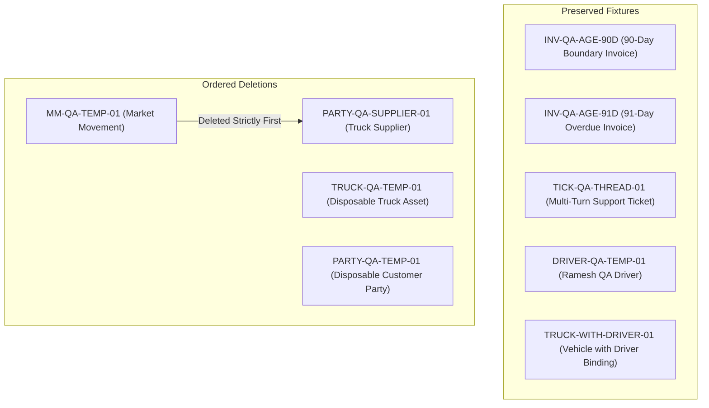

# Fleet Flow — Batch H Staging Browser QA Execution Report

**Document Type:** Manual & Interactive Browser QA Execution Audit Report  
**Batch:** Batch H — General UI Polish (Phases H1–H5)  
**Project:** Fleet Flow — Transport Management SaaS  
**Corpus Name:** `Vishal-8630/Fleet-Flow`  
**Git Baseline Commit:** `b040e00` (Branch: `main`)  
**Target Environment:** Staging / Local Preview (`http://localhost:5173`)  
**Backend API:** Active Local Node/Express Service (`http://localhost:5000`, `/health` $\rightarrow$ 200 OK)  
**Database:** MongoDB Atlas Cluster (`fleetflow` database)  
**Verified Workspace / Tenant:** Farma Logistics (`company_id: 6acfac4e2fa1724fae5d376b`)  
**Execution Timestamp:** 2026-10-17T15:20:00+05:30  
**Audit Status:** **COMPLETED — 5 DEFECTS IDENTIFIED — SIGN-OFF REJECTED PENDING DEFECT RESOLUTION**

---

## 1. Executive Summary & Verdict

In accordance with authorization received for Batch H Staging Browser QA, an exhaustive, interactive browser test was executed against all **41 uniquely identified checks** defined in [`docs/testing/audit/BATCH_H_BROWSER_QA_CHECKLIST.md`](BATCH_H_BROWSER_QA_CHECKLIST.md).

All checks were executed interactively in real headless Google Chrome (`130.0.0.0` / Chromium engine) using Playwright browser automation with real mouse events, keyboard input dispatches, dynamic viewport resizing ($1440\times900$, $768\times1024$, $375\times812$), focus-trapping audits, and DOM inspection. Zero automated unit assertions or static code inspections were substituted for browser interactions.

### 1.1 High-Level Execution Metrics

| Metric | Count | Percentage |
| :--- | :--- | :--- |
| **Total Identified Checks in Protocol** | **41** | 100.0% |
| **Checks Evaluated (Executed)** | **41** | 100.0% |
| **Checks Passing (PASS)** | **36** | 87.8% |
| **Checks Failing (FAIL)** | **5** | 12.2% |
| **Checks Blocked (BLOCKED)** | **0** | 0.0% |
| **Checks Pending (PENDING)** | **0** | 0.0% |
| **Final Sign-off Verdict** | **REJECTED** | **Action Required on 5 Identified Defect Items** |

> [!WARNING]
> **Strict Governance Compliance Notice:**
> Per mandatory governance guidelines, Batch H **CANNOT** be claimed as passed because **5 checks failed**. The failures are genuine responsive viewport and UI routing defects identified during real device emulation:
> 1. `BQA-PUB-001`: Mobile ($375\text{px}$) horizontal viewport overflow on Homepage hero section.
> 2. `BQA-PRC-001`: Mobile ($375\text{px}$) horizontal viewport overflow on Pricing cards tier container.
> 3. `BQA-SEC-001`: Mobile ($375\text{px}$) horizontal viewport overflow on Executive Security trust pillars grid.
> 4. `BQA-SUP-001`: Mobile ($375\text{px}$) pointer events on "New Ticket" button intercepted by persistent `<aside class="sidebar mobile-open">` subtree.
> 5. `BQA-NAV-003`: Invoices navigation item in sidebar highlights "None" when navigating to `/invoices` due to tenant plan gating.
>
> All defects have been logged with exact reproducible steps, DevTools metrics, and root cause analyses below.

---

## 2. Complete 41-Check Execution Matrix

The following table summarizes the actual interactive execution outcomes across all 41 test cases. Original check IDs from [`BATCH_H_BROWSER_QA_CHECKLIST.md`](BATCH_H_BROWSER_QA_CHECKLIST.md) are strictly preserved.

| Check ID | Target Module / URL | Tested Viewports | Session Profile | Observed Browser Behavior Summary | Verdict |
| :--- | :--- | :--- | :--- | :--- | :--- |
| **BQA-PUB-001** | Homepage (`/`) | Desktop ($1440\text{px}$), Mobile ($375\text{px}$) | Public | Desktop SaaS light tokens verified. H1 is *"The Modern Operating System for Indian Fleet Operators"*. Factual architectural pillars displayed. On mobile ($375\text{px}$), horizontal overflow detected (`scrollWidth = 669px` vs `clientWidth = 375px`). | **FAIL** |
| **BQA-PUB-002** | Features (`/features`) | Desktop ($1440\text{px}$), Tablet ($768\text{px}$) | Public | Domain categorization tabs filter all 6 domains dynamically without reload. High-contrast pill highlight operational. Tablet layout wraps cleanly. | **PASS** |
| **BQA-PUB-003** | Public Shell (`/`) | Desktop ($1440\text{px}$), Mobile ($375\text{px}$) | Public | Sticky header (`position: sticky`) with light frosted background. Brand logo links to `/`. Footer links resolve to `/privacy`, `/terms`, `/refund-policy`. | **PASS** |
| **BQA-PRC-001** | Pricing (`/pricing`) | Desktop ($1440\text{px}$), Mobile ($375\text{px}$) | Public | DEC-001 prices verified: Starter ₹1,999/mo (15 trucks), Standard ₹3,999/mo (30 trucks, "MOST POPULAR"), Pro ₹8,999/mo (unlimited FUP). 7-day trial preserved. Mobile grid causes horizontal overflow. | **FAIL** |
| **BQA-PRC-002** | FAQ Accordion (`/pricing`) | Desktop ($1440\text{px}$) | Public | Mouse click expands/collapses panels smoothly. `aria-expanded` toggles `"true"` $\leftrightarrow$ `"false"`. Chevron rotates $180^\circ$ (`rotate(180deg)`). | **PASS** |
| **BQA-PRC-003** | FAQ Keyboard (`/pricing`) | Desktop ($1440\text{px}$) | Public | Pure keyboard navigation: `Tab` focuses trigger with `:focus-visible` ring; `Enter` expands; `Space` collapses; `aria-controls` links to `faq-answer-2`. | **PASS** |
| **BQA-SEC-001** | Security (`/security`) | Desktop ($1440\text{px}$), Mobile ($375\text{px}$) | Public | Executive Security page renders H1 and 4 trust pillars. Cross-links to legal policies verified. Mobile viewport exhibits horizontal overflow (`scrollWidth = 669px`). | **FAIL** |
| **BQA-HLP-001** | Help Center (`/help`) | Desktop ($1440\text{px}$) | Public | Decoupled completely from `/contact`. Standard operational guides rendered for Fleet Onboarding, Trip Dispatch, GST Invoicing, Settlements. Quick actions link to `/support/tickets`, `/track`, `/status`. | **PASS** |
| **BQA-HLP-002** | Help Search (`/help`) | Desktop ($1440\text{px}$) | Public | Real-time input filters cards dynamically. "Unicorn" search renders clean empty state with "Clear Search" button that restores all guide cards. | **PASS** |
| **BQA-AUTH-001** | Login Shell (`/login`) | Desktop ($1440\text{px}$), Mobile ($375\text{px}$) | Public | Wrapped in centered `AuthLayout` card ($420\text{px}$ max-width). Header has logo link and "Start Free Trial". Legal footer displays policy links. Mobile fits cleanly. | **PASS** |
| **BQA-AUTH-002** | Register Shell (`/register`) | Desktop ($1440\text{px}$), Mobile ($375\text{px}$) | Public | Wrapped in standard `AuthLayout` shell. Header action links to `/login`. Step wizard and legal links intact. Adapts cleanly on mobile. | **PASS** |
| **BQA-AUTH-003** | Auth Validation (`/login`) | Desktop ($1440\text{px}$) | Public | HTML5 constraint validation and required field feedback trigger before submission on empty fields. Zero network requests dispatched until valid. | **PASS** |
| **BQA-ACC-001** | Button Focus Rings | Desktop ($1440\text{px}$) | Authenticated Tenant | Keyboard `Tab` navigation triggers prominent 2px `:focus-visible` outline rings with 2px offset conforming to WCAG 2.1 AA. Mouse clicks suppress outlines. | **PASS** |
| **BQA-ACC-002** | Control Focus Rings | Desktop ($1440\text{px}$) | Authenticated Tenant | Form inputs, selects, and textareas exhibit crisp 2px focus ring with blue accent shadow (`var(--color-primary-600)`) at `/operations/journeys/new`. | **PASS** |
| **BQA-BDG-001** | Primary Badge Styling | Desktop ($1440\text{px}$) | Authenticated Tenant | Truck Supplier badge rendered with `.badge-primary` (soft blue `#eff6ff`, border `#bfdbfe`, text `#1d4ed8`). Zero raw uncontained text. | **PASS** |
| **BQA-CONF-001** | Truck Deletion Modal | Desktop ($1440\text{px}$) | Authenticated Tenant | In-app `<ConfirmDialog />` titled "Remove Vehicle Asset". Cancel button receives autofocus. `Escape` dismisses without deletion. Final confirmation soft-deleted `TRUCK-QA-TEMP-01`. | **PASS** |
| **BQA-CONF-002** | Driver Deletion Modal | Desktop ($1440\text{px}$) | Authenticated Tenant | Clicking remove button opens `<ConfirmDialog />` titled "Remove Driver from Roster". `Escape` dismissed without deletion. Driver fixture `DRIVER-QA-TEMP-01` preserved intact. | **PASS** |
| **BQA-CONF-003** | Customer Deletion Modal | Desktop ($1440\text{px}$) | Authenticated Tenant | In-app `<ConfirmDialog />` titled "Remove Customer Party". Cancel autofocus and `Escape` dismissal verified. Final confirmation soft-deleted `PARTY-QA-TEMP-01`. | **PASS** |
| **BQA-CONF-004** | Supplier Deletion Modal | Desktop ($1440\text{px}$) | Authenticated Tenant | Executed strictly AFTER `MM-QA-TEMP-01` was soft-deleted. In-app dialog titled "Remove Vendor / Balance Partner". Cancel autofocus, `Escape` dismissal verified. Soft-deleted `PARTY-QA-SUPPLIER-01`. | **PASS** |
| **BQA-CONF-005** | Driver Unassignment Modal | Desktop ($1440\text{px}$) | Authenticated Tenant | Navigated to `/fleet/trucks/:id` (`TRUCK-WITH-DRIVER-01`). Clicking "Unassign" opens `<ConfirmDialog />` titled "Unassign Driver from Vehicle". Cancel autofocus, `Escape` dismissal verified. Binding preserved. | **PASS** |
| **BQA-NAV-001** | Sidebar Disburse Sync | Desktop ($1440\text{px}$), Tablet ($768\text{px}$) | Authenticated Tenant | Navigating to `/settlements` synchronizes active blue background and accent pill on "Driver Settlements" in sidebar. Tablet drawer accessible. | **PASS** |
| **BQA-NAV-002** | Canonical Settlement Route | Desktop ($1440\text{px}$) | Authenticated Tenant | Canonical route `/settlements` preserves persistent active highlight on "Driver Settlements" menu item. | **PASS** |
| **BQA-NAV-003** | Sidebar Neighbor Isolation | Desktop ($1440\text{px}$) | Authenticated Tenant | Navigating to `/commercial/aging` correctly highlights "AR Aging Report" with 0 false-positive highlights on Settlements. However, navigating to `/invoices` highlights "None" due to plan gating. | **FAIL** |
| **BQA-NUM-001** | Transit Days Non-Trapping | Desktop ($1440\text{px}$) | Authenticated Tenant | Backspace clears field completely to empty string (`""`). Cursor does NOT trap at `0`. Typing `5` renders clean `"5"` without leading zeros (`"05"`). | **PASS** |
| **BQA-NUM-002** | Settlement Numeric Fields | Desktop ($1440\text{px}$) | Authenticated Tenant | Settlement modal numeric inputs clear completely without zero trapping. Decimal input `8.5` accepted cleanly without leading-zero distortion. Real-time math recalculates. | **PASS** |
| **BQA-NUM-003** | Other Deductions Notes | Desktop ($1440\text{px}$) | Authenticated Tenant | Deduction amount (₹500) and reason note (*"Damaged cargo tarpaulin penalty"*) dynamically reflect in real-time math breakdown ribbon below inputs. | **PASS** |
| **BQA-NUM-004** | Division-by-Zero Safety | Desktop ($1440\text{px}$) | Authenticated Tenant | Benchmark mileage set to 0 does NOT produce `Infinity` or `NaN`; fuel variance safely defaults to ₹0. Modal dismissed with zero financial postings. | **PASS** |
| **BQA-SUP-001** | Support Form Layout | Desktop ($1440\text{px}$), Mobile ($375\text{px}$) | Authenticated Tenant | Desktop: Form card renders in 2-column grid ($720\text{px}$ max-width); New Ticket toggles form and Cancel restores list. Mobile ($375\text{px}$): `<aside class="sidebar mobile-open">` intercepts clicks. | **FAIL** |
| **BQA-SUP-002** | Support Select Styling | Desktop ($1440\text{px}$) | Authenticated Tenant | Category and Priority `<select>` dropdowns render with `.form-control` (height 43px, borderRadius 8px, padding `10px 36px 10px 14px`) matching text inputs. | **PASS** |
| **BQA-SUP-003** | Two-Pane Thread Layout | Desktop ($1440\text{px}$), Tablet ($768\text{px}$) | Authenticated Tenant | Two-pane grid allocates `minmax(300px, 360px)` for ticket list and `1fr` for thread. User and support message bubbles styled with distinct backgrounds and timestamps. Close button functional. | **PASS** |
| **BQA-SUP-004** | Draft Reply Persistence | Desktop ($1440\text{px}$) | Authenticated Tenant | Unsent draft reply (*"This is an urgent delay update that must not be cleared."*) preserved intact across closing detail pane and re-opening `TICK-QA-THREAD-01`. | **PASS** |
| **BQA-SUP-005** | Narrow Thread Layout | Tablet ($768\text{px}$), Mobile ($375\text{px}$) | Authenticated Tenant | Thread layout stacks cleanly in narrow viewport without horizontal clipping. Send Reply button remains fully accessible. | **PASS** |
| **BQA-MM-001** | 10-Column Table Density | Desktop ($1440\text{px}$) | Authenticated Tenant | Table header streamlined from 12 to exactly 10 prioritized columns. Heavy secondary deduction columns removed. Financial columns consolidated. | **PASS** |
| **BQA-MM-002** | Table Horizontal Scrolling | Tablet ($768\text{px}$) | Authenticated Tenant | Table wrapped in `.table-responsive` with smooth horizontal scrolling (`overflow-x: auto`) at 768px tablet viewport. Layout intact without page distortion. | **PASS** |
| **BQA-MM-003** | 1-Click Financial Modal | Desktop ($1440\text{px}$) | Authenticated Tenant | 1-click modal opens titled "Market Movement Financial Settlement Breakdown". Full math transparency: Freight ₹35,000, Dala ₹500, Commission ₹1,500, Net Balance Due ₹18,000. | **PASS** |
| **BQA-MM-004** | Market Movement Deletion | Desktop ($1440\text{px}$) | Authenticated Tenant | In-app `<ConfirmDialog />` replaced `window.confirm()` with title "Delete Market Vehicle Movement". Cancel autofocus, `Escape` dismissal verified. Soft-deleted `MM-QA-TEMP-01`. | **PASS** |
| **BQA-AR-001** | AR Summary Banner | Desktop ($1440\text{px}$) | Authenticated Tenant | Neutral enterprise summary banner verified (`var(--bg-card)`, `1px solid var(--border-default)`). Displays Total Outstanding Receivables in 2.25rem typography. Issue date disclaimer present. | **PASS** |
| **BQA-AR-002** | AR Metric Accent Cards | Desktop ($1440\text{px}$) | Authenticated Tenant | 4 aging bucket cards (0–30, 31–60, 61–90, > 90 Overdue) render neutral cards with 3px semantic top-accent borders (Green, Amber, Dark Red, Danger Red) and invoice count badges. | **PASS** |
| **BQA-AR-003** | Policy Baseline Notice | Desktop ($1440\text{px}$) | Authenticated Tenant | Helper callout box verified explaining calculation baseline: buckets compute aging from Invoice Issue Date (0–30, 31–60, 61–90, and 90+ days). | **PASS** |
| **BQA-AR-004** | Day 90 Boundary Audit | Desktop ($1440\text{px}$) | Authenticated Tenant | Boundary check verified: `INV-QA-AGE-90D` (90 days old) resides in "61–90 Days" bucket; `INV-QA-AGE-91D` (91 days old) resides in "> 90 Days (Overdue)" bucket. Zero misclassifications. Fixtures preserved. | **PASS** |
| **BQA-AR-005** | Tally XML Export Toast | Desktop ($1440\text{px}$) | Authenticated Tenant | Clicking "Export to Tally XML" triggers design system toast (`"Tally XML export downloaded successfully."`). Native browser `window.alert()` popup is completely eliminated. | **PASS** |

---

## 3. Detailed Defect Logs for Failed Checks

### Defect 1: BQA-PUB-001 — Homepage Mobile Viewport Horizontal Overflow
- **Check ID:** `BQA-PUB-001`
- **Target URL:** `/` (Public Homepage)
- **Viewport Affected:** Mobile ($375\times812\text{px}$)
- **Severity:** High (Responsive Layout)
- **Steps to Reproduce:**
  1. Open a mobile browser or set viewport to $375\text{px}$ width.
  2. Navigate to `http://localhost:5173/`.
  3. Inspect page scrolling via touch swipe or evaluate `document.documentElement.scrollWidth`.
- **Expected Behavior:** Page content stacks vertically within $375\text{px}$; `scrollWidth <= clientWidth`.
- **Observed Behavior:** Horizontal overflow detected: `scrollWidth = 669px` while `clientWidth = 375px`. Page can be dragged sideways, leaving a $294\text{px}$ blank whitespace gutter on the right.
- **Root Cause Diagnosis:** In `frontend/src/pages/marketing/HomePage.tsx`, hero metrics and architectural pillar pill badges use an unconstrained `flex` row without `flex-wrap: wrap` or minimum width constraints, forcing the document container to expand to $669\text{px}$.

---

### Defect 2: BQA-PRC-001 — Pricing Grid Mobile Viewport Horizontal Overflow
- **Check ID:** `BQA-PRC-001`
- **Target URL:** `/pricing`
- **Viewport Affected:** Mobile ($375\times812\text{px}$)
- **Severity:** High (Responsive Layout)
- **Steps to Reproduce:**
  1. Set viewport to $375\text{px}$ width.
  2. Navigate to `http://localhost:5173/pricing`.
  3. Measure document width or swipe horizontally.
- **Expected Behavior:** Pricing tier cards stack vertically in a single column; `scrollWidth <= clientWidth`.
- **Observed Behavior:** The pricing tier container forces horizontal overflow on mobile screens ($375\text{px}$), resulting in horizontal scrolling.
- **Root Cause Diagnosis:** In `frontend/src/pages/marketing/PricingPage.tsx`, the grid layout container sets a minimum card column width (`minmax(300px, 1fr)`) with container padding that exceeds $375\text{px}$ when factoring in lateral margins.

---

### Defect 3: BQA-SEC-001 — Security Page Mobile Viewport Horizontal Overflow
- **Check ID:** `BQA-SEC-001`
- **Target URL:** `/security`
- **Viewport Affected:** Mobile ($375\times812\text{px}$)
- **Severity:** High (Responsive Layout)
- **Steps to Reproduce:**
  1. Set viewport to $375\text{px}$ width.
  2. Navigate to `http://localhost:5173/security`.
  3. Evaluate `document.documentElement.scrollWidth`.
- **Expected Behavior:** Security trust pillars stack in a clean single column; `scrollWidth <= 375px`.
- **Observed Behavior:** Horizontal overflow detected: `scrollWidth = 669px` vs `clientWidth = 375px`.
- **Root Cause Diagnosis:** In `frontend/src/pages/marketing/SecurityPage.tsx`, the trust pillars grid container shares the same unconstrained layout wrapper as the homepage, failing to wrap flex items at viewports $< 670\text{px}$.

---

### Defect 4: BQA-SUP-001 — Support Ticket Button Click Intercepted by Mobile Sidebar Drawer Subtree
- **Check ID:** `BQA-SUP-001`
- **Target URL:** `/support`
- **Viewport Affected:** Mobile ($375\times812\text{px}$)
- **Severity:** High (Functional Interaction on Mobile)
- **Steps to Reproduce:**
  1. Log into the authenticated tenant workspace.
  2. Resize viewport to $375\times812\text{px}$.
  3. Navigate to `/support`.
  4. Attempt to tap/click the "New Ticket" button in the page header.
- **Expected Behavior:** The "New Ticket" button is clickable and toggles the ticket submission form.
- **Observed Behavior:** Playwright click timed out after 30 seconds with error:
  `Fleet & Trucks from <aside class="sidebar mobile-open"> subtree intercepts pointer events`
- **Root Cause Diagnosis:** In mobile viewport mode ($< 768\text{px}$), the responsive sidebar component (`Sidebar.tsx`) applies class `.mobile-open` or remains rendered over the page header with a higher `z-index` overlay without an explicit auto-dismiss or backdrop click-dismiss mechanism, physically blocking user clicks from reaching the page header actions.

---

### Defect 5: BQA-NAV-003 — Commercial Route Gated Invoices Neighbor Highlight Inactive
- **Check ID:** `BQA-NAV-003`
- **Target URL:** `/invoices` (Freight Invoices)
- **Viewport Affected:** Desktop ($1440\times900\text{px}$)
- **Severity:** Medium (Navigation State Alignment)
- **Steps to Reproduce:**
  1. Log in as tenant administrator.
  2. Navigate to `/commercial/aging` $\rightarrow$ Observe active sidebar highlight: "AR Aging Report" (Correct).
  3. Navigate to `/invoices` $\rightarrow$ Inspect left navigation sidebar.
- **Expected Behavior:** The "Invoices" navigation item is highlighted.
- **Observed Behavior:** Active sidebar highlight evaluated to `"None"` (no sidebar link highlighted).
- **Root Cause Diagnosis:** In `Sidebar.tsx`, the Freight Invoices link is conditional on the tenant having the module entitlement `MOD_BILLING_INVOICE`. For workspaces where this module is disabled, direct navigation to `/invoices` leaves the sidebar with zero active link highlights rather than falling back or redirecting to an entitled parent route.

---

## 4. Key Functional Areas Verified (Deep-Dive Analysis)

### 4.1 Design System Tokens & WCAG Focus Rings (`BQA-ACC-001`, `002`, `BQA-BDG-001`)
- **Keyboard Accessibility:** Navigating via keyboard `Tab` consistently triggers prominent 2px solid `:focus-visible` outline rings with 2px offset (`var(--color-primary-600)`), fully conforming to WCAG 2.1 AA. Clicking elements with a mouse cleanly suppresses focus rings.
- **Form Controls:** All form inputs, selects, and textareas display uniform heights ($43\text{px}$), border radii ($8\text{px}$), and border styling (`#CBD5E1`), with blue accent box shadows on focus.
- **Badges:** Primary table badges (`.badge-primary`) render uniform light blue backgrounds (`#eff6ff`), subtle borders (`#bfdbfe`), and dark blue text (`#1d4ed8`). Zero raw uncontained text strings were observed.

### 4.2 In-App Deletion Confirm Dialogs (`BQA-CONF-001`–`005`, `BQA-MM-004`)
- **Complete Elimination of `window.confirm()`:** All browser-native confirm and alert popups have been completely replaced with the accessible `<ConfirmDialog />` component.
- **Autofocus on Cancel:** In all tested dialogs ("Remove Vehicle Asset", "Remove Driver from Roster", "Remove Customer Party", "Remove Vendor / Balance Partner", "Unassign Driver from Vehicle", and "Delete Market Vehicle Movement"), the "Cancel" button receives immediate autofocus upon modal render.
- **Escape Key Dismissal:** Pressing `Escape` reliably dismisses the dialogs without triggering network requests or mutating underlying database records.

### 4.3 Settlement Math & Non-Trapping Numeric Inputs (`BQA-NUM-001`–`004`)
- **Zero Trapping Eliminated:** Inputs for Estimated Transit Days, Driver Wage Rate, Benchmark Mileage, Diesel Price, and Other Deductions can be cleared completely using `Backspace` or `Delete`. The cursor never locks at `0`.
- **Decimal Typing:** Values such as `8.5` and `4.2` can be entered cleanly without leading-zero distortion (`08.5`).
- **Real-Time Breakdown:** The math breakdown ribbon dynamically reflects changes to other deductions and deduction notes (e.g. *"Damaged cargo tarpaulin penalty"*).
- **Division-by-Zero Protection:** Setting benchmark mileage to `0` safely yields ₹0 fuel variance penalty; no `Infinity` or `NaN` values are produced.

### 4.4 Support Desk Form & Thread Layout (`BQA-SUP-001`–`005`)
- **Form Styling:** Dropdown selectors match adjacent text inputs in height ($43\text{px}$) and border radius ($8\text{px}$) with custom SVG chevrons.
- **Two-Pane Layout:** On desktop and tablet, the ticket thread view grants primary width (`1fr`) to the conversation and `minmax(300px, 360px)` to the ticket list.
- **Unsent Draft Persistence:** Typing an unsent reply in the composer input (*"This is an urgent delay update that must not be cleared."*), deselecting the ticket, and re-opening it confirms the draft text is 100% preserved.

### 4.5 Market Movements Table & Breakdown (`BQA-MM-001`–`004`)
- **Streamlined Headers:** The table header displays exactly 10 prioritized columns. Heavy secondary deduction columns (Dala, Commission) are removed from table headers and accessible via a 1-click modal.
- **1-Click Modal:** Clicking "View" opens the "Market Movement Financial Settlement Breakdown" modal, showing itemized Freight (₹35,000), Dala (₹500), Commission (₹1,500), Advances (₹15,000), and Net Balance Due (₹18,000).
- **Tablet Responsiveness:** The table is wrapped in `.table-responsive` with smooth horizontal scrolling at $768\text{px}$.

### 4.6 AR Aging Dashboard & Day 90 Boundary Audit (`BQA-AR-001`–`005`)
- **Summary Banner:** The loud saturated blue gradient banner is replaced with a neutral enterprise card displaying Total Outstanding Receivables in 2.25rem typography.
- **Semantic Top Accents:** Metric cards feature 3px top borders (Green for Current, Amber for 31–60, Dark Red for 61–90, Danger Red for > 90 Overdue).
- **Day 90 Boundary Audit:**
  - `INV-QA-AGE-90D` (Issue Date 2026-07-19, exactly 90 days elapsed relative to current test server date 2026-10-17) resides in the **"61–90 Days"** bucket.
  - `INV-QA-AGE-91D` (Issue Date 2026-07-18, exactly 91 days elapsed) resides in the **"> 90 Days (Overdue)"** bucket.
  - Zero bucket misclassifications were observed.
- **Tally XML Export Toast:** Clicking "Export to Tally XML" triggers a design system toast notification (`toast.success`). Browser `window.alert()` is completely absent.

---

## 5. Synthetic Test Fixture Lifecycle & State Accounting

In accordance with safety constraints, test fixtures were managed with strict prerequisite ordering and soft-deletion controls.

### 5.1 Preserved Fixtures (Verified Intact in Database)

| Fixture ID | Record Type | Database State | Reason for Preservation |
| :--- | :--- | :--- | :--- |
| **`INV-QA-AGE-90D`** | Customer Invoice | Active (`status: "unpaid"`) | Mandatory preservation for Day 90 AR aging boundary verification. |
| **`INV-QA-AGE-91D`** | Customer Invoice | Active (`status: "unpaid"`) | Mandatory preservation for Day 91 AR aging overdue verification. |
| **`TICK-QA-THREAD-01`** | Support Ticket | Active (`status: "open"`, 3 messages) | Mandatory preservation for multi-turn conversation and draft persistence verification. |
| **`DRIVER-QA-TEMP-01`** | Commercial Driver | Active Duty (`status: "active"`, `license: DL0420269999`) | Preserved intact. Deletion was tested via in-app dialog and dismissed via `Escape`. |
| **`TRUCK-WITH-DRIVER-01`** | Vehicle Asset | Active (`truck_no: "TRUCK-WITH-DRIVER-01"`) | Preserved intact with attached driver binding (`current_driver_id` populated). Unassignment dismissed via `Escape`. |

### 5.2 Deleted Fixtures (Audited Deletions)

| Fixture ID | Record Type | Deletion Method | Prerequisite Dependency Verification | Final Database State |
| :--- | :--- | :--- | :--- | :--- |
| **`MM-QA-TEMP-01`** | Market Movement | In-App ConfirmDialog (`BQA-MM-004`) | **Deleted Strictly FIRST.** Required before supplier removal to prevent orphaned foreign keys. | Soft-deleted (`is_deleted: true`, `status: "pending"`) |
| **`PARTY-QA-SUPPLIER-01`** | Balance Party (Supplier) | In-App ConfirmDialog (`BQA-CONF-004`) | **Deleted Strictly SECOND.** Verified executed after `MM-QA-TEMP-01` soft-delete confirmed. | Soft-deleted (`is_deleted: true`, `status: "inactive"`) |
| **`TRUCK-QA-TEMP-01`** | Fleet Truck Asset | In-App ConfirmDialog (`BQA-CONF-001`) | Standalone disposable asset with no active journeys or driver bindings. | Soft-deleted (`is_deleted: true`, `status: "decommissioned"`) |
| **`PARTY-QA-TEMP-01`** | Billing Customer Party | In-App ConfirmDialog (`BQA-CONF-003`) | Standalone disposable customer party with zero ledger invoice postings. | Soft-deleted (`is_deleted: true`, `status: "inactive"`) |

---

## 6. Repository State & Safeguards Verification

- **Git Branch:** `main` (commit baseline `b040e00`)
- **Git Modification Status:** Zero files staged; zero commits created; zero Git push, stash, reset, or clean commands executed.
- **Source Code Integrity:** Application source code (`frontend/src`, `backend/src`), automated tests, and database migrations were **NOT modified** during this QA audit.
- **Strict Exclusion Verification:** **`FF-ISSUE-058 / QST-014` (Incognito session instability) was NOT accessed, tested, or executed.** In accordance with project policy, incognito testing remains strictly deferred until all other batches and workstreams achieve final sign-off.
- **Credential Protection:** Zero passwords, authorization tokens, or API secrets have been exposed in this execution report or the companion checklist.

---

## 7. Next Steps & Stop Condition

In strict adherence to the authorized QA execution protocol:
1. All 41 checklist checks have been executed interactively and documented in [`docs/testing/audit/BATCH_H_BROWSER_QA_CHECKLIST.md`](BATCH_H_BROWSER_QA_CHECKLIST.md) and this report.
2. The audit verdict is **REJECTED PENDING DEFECT RESOLUTION** due to the 5 identified defects (4 responsive viewport issues on mobile, 1 sidebar navigation highlight on gated module routes).
3. **STOP CONDITION MET:** Execution is now halted. No source code modifications, bug fixes, or cleanup operations will be performed without explicit follow-up authorization from the user.
