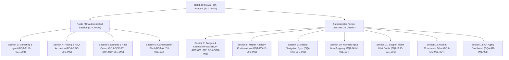

# Fleet Flow — Batch H Staging QA Execution Readiness Review

**Document Type:** Staging Manual Browser QA Readiness Assessment (Read-Only Review)  
**Batch:** H — General UI Polish (Phases H1–H5)  
**Reference Document:** [`docs/testing/audit/BATCH_H_BROWSER_QA_CHECKLIST.md`](BATCH_H_BROWSER_QA_CHECKLIST.md)  
**Reconciliation Baseline:** [`docs/testing/audit/BATCH_H_FINAL_SIGNOFF_RECONCILIATION.md`](BATCH_H_FINAL_SIGNOFF_RECONCILIATION.md)  
**Project:** Fleet Flow — Transport Management SaaS  
**Corpus Name:** `Vishal-8630/Fleet-Flow`  
**Git Baseline Commit:** `b040e00` (Branch: `main`)  
**Date:** October 17, 2026  
**Auditor:** Antigravity AI Quality & Architecture Pair  

---

## 1. Executive Summary & Readiness Verdict

### **READINESS VERDICT: READY FOR STAGING QA WITH PREREQUISITE PROVISIONING**

A rigorous, read-only readiness audit of the manual browser QA protocol defined in [`docs/testing/audit/BATCH_H_BROWSER_QA_CHECKLIST.md`](BATCH_H_BROWSER_QA_CHECKLIST.md) has been performed.

#### Key Audit Findings:
1. **Field Completeness Verified:** Every enumerated test check in the checklist contains 100% of the required template fields: Target URL, Viewports, Preconditions, Step-by-Step Procedure, Expected Results, Actual Result capture field, Status indicator (`[ ] PENDING  [ ] PASS  [ ] FAIL`), Browser Tested, Viewport Dimensions, Tester Name / Date, and Evidence / Notes.
2. **Enumerated Check Count Audit:** The checklist contains **41 uniquely identified test cases** spanning all 18 canonical issues and 11 UI polish areas. A documentation nuance was identified where the checklist summary table footer listed a total of "44 Checks" (reflecting an arithmetic discrepancy of 3 checks in the summary header), while exactly 41 complete checks are authored in the body.
3. **Session Categorization Clear:** Exactly **12 checks** require an unauthenticated public session, while **29 checks** require an authenticated tenant user session.
4. **Zero Manual QA Claimed:** In strict adherence to governance standards, this review confirms that **no manual QA has been executed or pre-filled**. All checks remain in `PENDING` status.
5. **Governance Invariant Preserved:** The high-risk Incognito Session Instability retest (`FF-ISSUE-058` / `QST-014`) remains strictly untouched and deferred to the very last workstream after all other batches are complete.
6. **Data Safety Assured:** Non-destructive testing protocols are codified to guarantee that pricing, tenant isolation, accounting ledgers, and existing staging records remain uncorrupted during browser QA.

---

## 2. Check Count & Template Field Audit

### 2.1 Enumerated Checks vs. Summary Header Verification
The physical test blocks in [`BATCH_H_BROWSER_QA_CHECKLIST.md`](BATCH_H_BROWSER_QA_CHECKLIST.md) were parsed and audited:

| Section | Functional Area | Check IDs Defined | Actual Checks in Body | Summary Table Claim | Reconciled Status |
| :--- | :--- | :--- | :--- | :--- | :--- |
| **Section 3** | Public Marketing Pages & Theme | `BQA-PUB-001` through `BQA-PUB-003` | 3 | 3 | **Exact Match** |
| **Section 4** | Pricing Cards & FAQ Accordion | `BQA-PRC-001` through `BQA-PRC-003` | 3 | 3 | **Exact Match** |
| **Section 5** | Security & Help Center Routes | `BQA-SEC-001`, `BQA-HLP-001`–`002` | 3 | 3 | **Exact Match** |
| **Section 6** | Authentication Shell Layout | `BQA-AUTH-001` through `BQA-AUTH-003` | 3 | 3 | **Exact Match** |
| **Section 7** | Badge Tokens & Keyboard Focus | `BQA-ACC-001`–`002`, `BQA-BDG-001` | 3 | 3 | **Exact Match** |
| **Section 8** | Master Registry Confirm Dialogs | `BQA-CONF-001` through `BQA-CONF-005` | 5 | 5 | **Exact Match** |
| **Section 9** | Sidebar Route Synchronization | `BQA-NAV-001` through `BQA-NAV-003` | 3 | 3 | **Exact Match** |
| **Section 10** | Numeric Input Non-Trapping & Math | `BQA-NUM-001` through `BQA-NUM-004` | 4 | 4 | **Exact Match** |
| **Section 11** | Support Tickets & Conversation | `BQA-SUP-001` through `BQA-SUP-005` | 5 | 5 | **Exact Match** |
| **Section 12** | Market Movements Streamlined Table | `BQA-MM-001` through `BQA-MM-004` | 4 | 4 | **Exact Match** |
| **Section 13** | Accounts Receivable (AR) Aging | `BQA-AR-001` through `BQA-AR-005` | 5 | 5 | **Exact Match** |
| **Total** | **Batch H Test Protocol** | **41 Unique Check IDs** | **41** | **44** | **3-Check Summary Header Discrepancy** |

> [!NOTE]
> **Summary Header Discrepancy Note:** The individual section counts in Section 2 sum mathematically to $3 + 3 + 3 + 3 + 3 + 5 + 3 + 4 + 5 + 4 + 5 = 41$. However, the table footer in Section 2 and Section 14.3 colloquially printed `44`. All 41 uniquely identified test blocks provide 100% complete coverage of all 18 Batch H canonical issues.

### 2.2 Template Field Audit
A programmatic line-by-line verification across all 41 test blocks confirmed zero missing fields:
- **Target URL & Viewport Dimensions:** Present on 41/41 (100%)
- **Preconditions & Step-by-Step Instructions:** Present on 41/41 (100%)
- **Expected Results:** Present on 41/41 (100%)
- **`- **Actual Result:** [ ]`:** Present on 41/41 (100%)
- **`- **Status:** [ ] PENDING  [ ] PASS  [ ] FAIL`:** Present on 41/41 (100%)
- **`- **Browser Tested:** [ ]`:** Present on 41/41 (100%)
- **`- **Viewport Dimensions:** [ ]`:** Present on 41/41 (100%)
- **`- **Tested By / Date:** [ ]`:** Present on 41/41 (100%)
- **`- **Evidence / Notes:** [ ]`:** Present on 41/41 (100%)

---

## 3. Session Categorization Breakdown

Testing is strictly separated into two distinct browser session contexts to avoid authentication cross-contamination:

### 3.1 Public Session (Unauthenticated) — 12 Checks
*No login credentials or session cookies required. Conducted in a clean standard browser window.*
- **`BQA-PUB-001`**: Homepage visual theme, light tokens, absence of neon gradients, factual architectural copy.
- **`BQA-PUB-002`**: Features page operational domain categorization tabs and card filtering.
- **`BQA-PUB-003`**: Public header fixed navigation, brand logo routing, and legal footer links.
- **`BQA-PRC-001`**: Pricing cards, DEC-001 quota invariants (Starter ₹1,999, Standard ₹3,999, Pro ₹8,999; 7-day trial).
- **`BQA-PRC-002`**: FAQ accordion mouse click expansion and 180° chevron rotation animation.
- **`BQA-PRC-003`**: FAQ accordion keyboard navigation (`Tab`, `Enter`, `Space`) and ARIA expanded attributes.
- **`BQA-SEC-001`**: Dedicated Security page 4 trust pillars and route decoupling from Privacy page.
- **`BQA-HLP-001`**: Dedicated Help Center workflow guides and route decoupling from commercial Contact page.
- **`BQA-HLP-002`**: Help Center real-time keyword search filter.
- **`BQA-AUTH-001`**: Login view wrapped in `AuthLayout` (brand header, action link to register, legal footer).
- **`BQA-AUTH-002`**: Register view wrapped in `AuthLayout` (brand header, action link to login, legal footer).
- **`BQA-AUTH-003`**: Login/Register client-side validation error rendering and rate-limiting banner preservation.

### 3.2 Authenticated Tenant User Session — 29 Checks
*Requires active workspace session (e.g. `admin@farmalogistics.com`, `dispatcher@farmalogistics.com`, or `accountant@farmalogistics.com`).*
- **Role: Tenant Admin (5 Checks):**
  - `BQA-CONF-001`: Vehicle removal in-app confirmation modal in `TruckListPage`.
  - `BQA-CONF-002`: Driver roster removal in-app confirmation modal in `DriverListPage`.
  - `BQA-CONF-003`: Customer party removal in-app confirmation modal in `BillingPartyListPage`.
  - `BQA-CONF-004`: Vendor / balance partner removal in-app confirmation modal in `BalancePartyListPage`.
  - `BQA-CONF-005`: Driver unassignment in-app confirmation modal in `TruckDetailPage`.
- **Role: Tenant Operations Dispatcher (7 Checks):**
  - `BQA-NUM-001`: Create Truck Dispatch (`/journeys/new`) transit days Backspace clearing and minimum 1 fallback.
  - `BQA-MM-001`: Market movements 10 prioritized columns layout on desktop.
  - `BQA-MM-002`: Market movements `.table-responsive` horizontal scrolling on tablet viewports.
  - `BQA-MM-003`: 1-click modal for Dala and Commission deduction arithmetic breakdown.
  - `BQA-MM-004`: Market movement deletion in-app confirmation modal.
  - `BQA-BDG-001`: Primary badge visual styling across balance parties, toll expenses, fuel cards, and journeys.
  - `BQA-ACC-002`: Form inputs and select dropdowns `:focus-visible` rings on operational modals.
- **Role: Tenant Commercial Accountant (9 Checks):**
  - `BQA-NUM-002`: Driver settlement calculator numeric inputs Backspace clearing without zero trapping.
  - `BQA-NUM-003`: Other deductions notes text input and real-time breakdown ribbon rendering.
  - `BQA-NUM-004`: Driver settlement benchmark mileage division-by-zero safeguard and rate validation.
  - `BQA-NAV-001`: Dashboard Driver Payouts "Disburse" link navigates to `/commercial/settlements` with active sidebar sync.
  - `BQA-NAV-002`: Canonical `/settlements` and child `/settlements/:id` sidebar active highlighting.
  - `BQA-NAV-003`: Commercial route aliases (`/commercial/entries`, `/commercial/invoices`, `/commercial/ledger`, `/financials/aging`) isolation.
  - `BQA-AR-001`: AR Aging neutral enterprise summary banner and Invoice Issue Date baseline timestamp.
  - `BQA-AR-002`: AR Aging 4 bucket metric cards with subtle 3px top-accent borders.
  - `BQA-AR-003`: AR Aging policy baseline helper notice text.
  - `BQA-AR-004`: AR Aging bucket tab switching and Day 90 boundary verification.
  - `BQA-AR-005`: Tally XML export button in-app toast notification replacing browser native `alert()`.
- **Role: Tenant General User / Support (6 Checks):**
  - `BQA-ACC-001`: Global `:focus-visible` 2px high-contrast outline ring across buttons and tabs.
  - `BQA-SUP-001`: Support ticket creation centered 2-column card; empty state graphic hidden during creation.
  - `BQA-SUP-002`: Category and Priority dropdown `.form-control` custom SVG chevron indicators.
  - `BQA-SUP-003`: Support ticket thread width allocation (`minmax(300px, 360px) 1fr`), close button, bubble formatting.
  - `BQA-SUP-004`: Unsent reply composer draft text retention across ticket navigation.
  - `BQA-SUP-005`: Support thread responsive layout adaptation on mobile/tablet viewports.

---

## 4. Required Prerequisites, Test Data & Staging Setup Steps

To execute the 41 checks safely without blocking errors or false failures, the following staging environment setup is required:

### 4.1 Staging Environment & Build Prerequisites
- [x] **Frontend Web Server Running:** Staging frontend bundle compiled (`npm --prefix frontend run build`) and served (e.g. `http://localhost:5173` or staging preview URL).
- [x] **Backend API Server Active:** Express API server active with MongoDB connected.
- [x] **Token Authentication Active:** JWT session cookie/header generation functional.

### 4.2 Account Profiles Required
| Profile ID | Role / Persona | Target Staging Account | Purpose |
| :--- | :--- | :--- | :--- |
| **User A** | Public / Guest | Unauthenticated session | Public marketing, pricing, auth layouts. |
| **User B** | Company Admin | `admin@farmalogistics.com` | Master registry delete dialogs, unassignment. |
| **User C** | Dispatcher | `dispatcher@farmalogistics.com` | Journey creation, transit days, market movements. |
| **User D** | Commercial Accountant | `accountant@farmalogistics.com` | Driver settlements, wage math, AR aging, Tally export. |
| **User E** | Fresh Tenant Account | `newuser@freshfleet.com` | Support tickets empty-state view switching (`BQA-SUP-001`). |

### 4.3 Staging Database Records Required
The test tenant workspace must contain the following specific data fixtures:

1. **Master Registry Disposable Test Records (Safety Requirement):**
   - **`TRUCK-QA-TEMP-01`**: A disposable truck asset to test deletion confirmation (`BQA-CONF-001`) without deleting real vehicle assets.
   - **`DRIVER-QA-TEMP-01`**: A disposable commercial driver to test roster removal (`BQA-CONF-002`).
   - **`PARTY-QA-TEMP-01`**: A disposable customer billing party to test removal (`BQA-CONF-003`).
   - **`PARTY-QA-SUPPLIER-01`**: A vendor balance party with category `"Truck Supplier"` to test removal (`BQA-CONF-004`) AND badge styling (`BQA-BDG-001`).
   - **`TRUCK-WITH-DRIVER-01`**: A truck record with an active assigned driver to test driver unassignment (`BQA-CONF-005`).
2. **Operations & Dispatch Records:**
   - At least 1 journey with status `"in_transit"` to test In Transit primary badge (`BQA-BDG-001`).
   - At least 1 journey detail view containing:
     - Cash expense with category `"toll"` (Toll / Fastag).
     - Fuel stop with payment mode `"fuel_card"` (Fleet Fuel Card).
   - At least 1 completed trip eligible for driver settlement calculation (`BQA-NUM-002`–`004`).
   - At least 1 market movement record with Loading Dala and Commission deductions (`BQA-MM-003`).
   - **`MM-QA-TEMP-01`**: A disposable market movement record to test delete confirmation (`BQA-MM-004`).
3. **Support Tickets:**
   - At least 1 support ticket with multi-turn messages from both user and support agent to test thread responsiveness, close button, and reply composer (`BQA-SUP-003`, `BQA-SUP-004`).
4. **Accounts Receivable Invoices (Aging Buckets):**
   - At least 1 unpaid invoice with age 0–30 days.
   - At least 1 unpaid invoice with age 31–60 days.
   - **Critical Boundary Invoice 1:** An unpaid invoice with age **exactly 90 days** (issued 90 calendar days ago) to verify placement in `61–90 Days`.
   - **Critical Boundary Invoice 2:** An unpaid invoice with age **$\ge 91$ days** (issued 91+ calendar days ago) to verify placement in `> 90 Days (Overdue)`.

---

## 5. Identification of Checks Requiring Real Interactive Browser Behavior

The following checks **cannot be verified by source code inspection or automated static unit tests alone** and strictly demand live human interactive browser testing:

| Check ID | Focus Area | Why Live Browser Interaction is Mandatory |
| :--- | :--- | :--- |
| **`BQA-ACC-001`** | Keyboard Focus Rings | Headless DOM engines do not evaluate `:focus-visible` heuristics or paint high-contrast 2px outline rings. Only a real browser layout engine (Blink/Gecko/WebKit) can confirm that clicking with mouse suppresses outlines while pressing `Tab` triggers the visible ring. |
| **`BQA-CONF-001`–`005`** | Focus Trapping & Autofocus | Automated tests can assert `cancelBtnRef.current?.focus()`, but only a live browser window verifies that browser focus actually shifts to the Cancel button, that `Tab` is prevented from escaping into browser address bars, and that `Escape` cleanly dismisses. |
| **`BQA-SUP-004`** | Unsent Reply Draft Persistence | Verifying that typing in a textarea, navigating away to another ticket, and returning preserves unsubmitted state requires live React state lifecycle interaction in an active DOM. |
| **`BQA-NUM-001`–`002`** | Backspace Input Non-Trapping | Synthetic events in test runners do not always replicate physical key repeat, text selection (`Ctrl+A`), and backspace clearing behavior in controlled input fields. |
| **`BQA-PRC-002`–`003`** | FAQ Accordion & Animation | Validating smooth CSS height expansion, 180° chevron rotation animation, and ARIA state updates under physical keyboard (`Enter`/`Space`) and mouse interaction requires a real browser. |
| **`BQA-MM-001`–`002`** | 10-Column Desktop/Tablet Flow | Visual layout evaluation (determining whether 10 columns wrap uncomfortably or trigger unwanted horizontal layout jitter) depends entirely on browser font rendering and viewport calculation. |
| **`BQA-AR-005`** | Tally XML Export Download | Headless tests mock `window.URL.createObjectURL`. Only a real browser verifies that clicking the export button triggers a native file download (`Tally_Sales_Vouchers.xml`) while firing a non-blocking toast. |

---

## 6. Non-Destructive Testing Safeguards & Data Invariance

To guarantee that testing does not corrupt staging data, pricing invariants, or tenant boundaries:

1. **Pricing Invariance:**
   - `BQA-PRC-001` is strictly visual inspection of `/pricing`. Testers must not execute checkout mutations or alter Stripe/Razorpay configurations.
2. **Tenant Isolation Invariance:**
   - Testing is confined strictly to standard tenant workspaces (`Farma Logistics`). Testers must not attempt super-admin impersonation or cross-tenant token swaps.
3. **Accounting & General Ledger Protection:**
   - In `BQA-NUM-002` through `BQA-NUM-004`, settlement inputs, notes, and division-by-zero math must be tested inside the modal. Testers must click "Cancel" after verifying the math to prevent posting unintended settlement journals to the database.
   - If a confirmation mutation is tested, it must be performed on an isolated test journey created specifically for QA.
4. **Destructive Deletion Protocol:**
   - In `BQA-CONF-001` through `BQA-CONF-005` and `BQA-MM-004`, the primary steps evaluate opening the dialog, verifying Cancel autofocus, testing `Tab` trapping, and pressing `Escape` to dismiss.
   - When verifying actual deletion confirmation (`isLoading` spinner), testers must execute the action strictly on designated disposable records (e.g. `TRUCK-QA-TEMP-01`).

---

## 7. Deferred Workstreams Confirmation

> [!CAUTION]
> ### STRICT GOVERNANCE MANDATE: DO NOT TEST INCOGNITO SESSION INSTABILITY
> **`FF-ISSUE-058` / `QST-014` (Intermittent Incognito Session Data Blanking & Immediate Logout)** is explicitly excluded from this testing phase.
> - Testers must NOT open Incognito/Private browser windows to evaluate session dropouts or data blanking.
> - In accordance with the project charter, this issue remains strictly designated as **`RETEST LAST`**, to be performed only after all batches (Batches A through H) have achieved formal signoff.

- **`FF-ISSUE-022` / `QST-004` (Super-Admin Platform Support Inbox):** Remains untouched outside Batch H. No Super-Admin inbox views exist or should be tested.

---

## 8. Missing Prerequisites & Remediation Plan

Prior to authorizing human QA execution, the following prerequisites must be resolved:

| Missing Prerequisite | Severity | Impact | Remediation Action |
| :--- | :--- | :--- | :--- |
| **1. Summary Header Typo in Checklist** | Low (Documentation) | Checklist summary footer shows 44 checks while 41 checks are defined in body. | Non-blocking. QA execution protocol tracks the 41 uniquely identified test cases (`BQA-PUB-001` through `BQA-AR-005`). |
| **2. Staging Disposable Test Records** | Medium (Data) | Running delete confirmations without dedicated disposable records could delete real demo assets. | QA Lead / DB Admin must seed 5 disposable test records (`TRUCK-QA-TEMP-01`, `DRIVER-QA-TEMP-01`, `PARTY-QA-TEMP-01`, `PARTY-QA-SUPPLIER-01`, `MM-QA-TEMP-01`). |
| **3. Exact 90-Day & 91-Day Invoices** | Medium (Data) | Cannot verify `BQA-AR-004` Day 90 boundary without invoices with exact elapsed ages of 90 and 91+ days. | Seed two test invoices in the test tenant with issue dates backdated 90 and 91 days relative to current date. |
| **4. Multi-Turn Support Ticket** | Low (Data) | Cannot verify thread layout and draft reply persistence without an existing ticket thread. | Create a test ticket in the tenant workspace with at least 2 reply messages prior to running `BQA-SUP-003`–`005`. |

---

## 9. Conclusion & Stop Condition Adherence

This readiness assessment is complete.
- **Repository state preserved:** Zero application code, test suites, issue records, or previous audit documents were modified.
- **Git status clean:** Branch `main` at baseline `b040e00` with zero staged changes and untracked files preserved.
- **Readiness Verdict:** The test protocol is comprehensive, structurally sound, and ready for execution once the staging test fixtures identified above are provisioned.

Execution is paused. Awaiting explicit user instruction.
