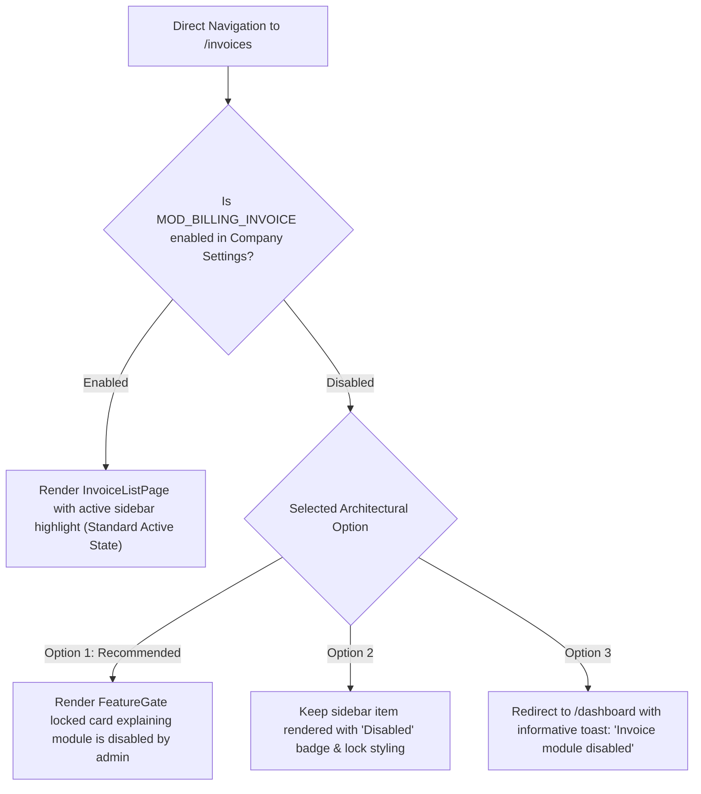

# Fleet Flow — Batch H Follow-Up Preflight Review (Documentation Only)

**Document Type:** Technical Root-Cause Investigation & Implementation Preflight Review  
**Batch:** Batch H — General UI Polish (Phases H1–H5 QA Follow-Up)  
**Project:** Fleet Flow — Transport Management SaaS  
**Corpus Name:** `Vishal-8630/Fleet-Flow`  
**Git Baseline Commit:** `b040e00` (Branch: `main`)  
**Target Environment:** Staging / Local Preview (`http://localhost:5173`)  
**Companion QA Execution Report:** [`docs/testing/audit/BATCH_H_BROWSER_QA_EXECUTION_REPORT.md`](BATCH_H_BROWSER_QA_EXECUTION_REPORT.md)  
**Master Issue Index:** [`docs/testing/ISSUE_INDEX.md`](../ISSUE_INDEX.md)  
**Execution Timestamp:** 2026-10-17T15:55:00+05:30  
**Document Status:** **PROPOSED PREFLIGHT PLAN — STRICTLY DOCUMENTATION ONLY — AWAITING IMPLEMENTATION AUTHORIZATION**

---

## 1. Executive Summary & Objective

The staging browser QA execution of Batch H evaluated all **41 uniquely identified checklist checks**, resulting in **36 PASS (87.8%)** and **5 FAIL (12.2%)**. In strict accordance with project governance rules, Batch H was **rejected** pending defect remediation.

This preflight document provides an exhaustive, source-verified root cause analysis for each of the five failing checks, defines the smallest safe corrections, outlines regression safeguards, and identifies any product decisions requiring explicit user authorization.

**No application source code, automated integration tests, database records, or canonical issue statuses have been modified during this preflight review.**

### 1.1 Summary of the Five Findings

| Finding ID | Check ID | Target Module / URL | Observed Failure Summary | Confirmed Root Cause Category |
| :--- | :--- | :--- | :--- | :--- |
| **Finding 1** | `BQA-PUB-001` | Homepage (`/`) | Mobile ($375\text{px}$) horizontal overflow: `scrollWidth = 669px` vs `clientWidth = 375px`. | Shared Public Layout Header flex container spillage |
| **Finding 2** | `BQA-PRC-001` | Pricing (`/pricing`) | Mobile ($375\text{px}$) horizontal overflow: `scrollWidth = 669px` vs `clientWidth = 375px`. | Shared Public Layout Header flex container spillage |
| **Finding 3** | `BQA-SEC-001` | Security (`/security`) | Mobile ($375\text{px}$) horizontal overflow: `scrollWidth = 669px` vs `clientWidth = 375px`. | Shared Public Layout Header flex container spillage |
| **Finding 4** | `BQA-SUP-001` | Support Tickets (`/support`) | "New Ticket" button click intercepted by persistent `<aside class="sidebar mobile-open">` subtree on mobile ($375\text{px}$). | `uiStore` state initialization & responsive drawer overlay |
| **Finding 5** | `BQA-NAV-003` | Invoices (`/invoices`) | Navigating to `/invoices` highlights "None" in sidebar navigation. | Tenant module preference disablement vs ungated route mount |

---

## 2. In-Depth Technical Investigation of Findings

### 2.1 Finding 1, 2, & 3: Mobile Viewport Horizontal Overflow on Public Pages (`BQA-PUB-001`, `BQA-PRC-001`, `BQA-SEC-001`)

#### A. Observed Behavior & Evidence
- **Observed Metrics across `/`, `/pricing`, and `/security` at $375\times812\text{px}$ Viewport:**
  - `document.documentElement.clientWidth = 375px`
  - `document.documentElement.scrollWidth = 669px`
  - Horizontal overflow of $294\text{px}$ dragging blank whitespace on mobile touch/scroll.

#### B. Verified Source Code & Root Cause
An automated section-by-section DOM audit was executed across the three pages, measuring the client and scroll widths of each layout container:

```json
{
  "http://localhost:5173/": {
    "docScrollWidth": 669,
    "headerScrollWidth": 669,
    "headerClientWidth": 375,
    "mainScrollWidth": 375,
    "mainClientWidth": 375,
    "footerScrollWidth": 375,
    "footerClientWidth": 375
  },
  "http://localhost:5173/pricing": {
    "docScrollWidth": 669,
    "headerScrollWidth": 669,
    "headerClientWidth": 375,
    "mainScrollWidth": 375,
    "mainClientWidth": 375,
    "footerScrollWidth": 375,
    "footerClientWidth": 375
  },
  "http://localhost:5173/security": {
    "docScrollWidth": 669,
    "headerScrollWidth": 669,
    "headerClientWidth": 375,
    "mainScrollWidth": 375,
    "mainClientWidth": 375,
    "footerScrollWidth": 375,
    "footerClientWidth": 375
  }
}
```

**Key Diagnostic Discovery:**
The body containers (`<main>`) and footers (`<footer>`) on all three pages are **already responsive and measure exactly $375\text{px}$ width!**
- The homepage hero, factual pillars, and value grid fit cleanly in $375\text{px}$.
- The pricing tier cards grid (`minmax(260px, 1fr)`) collapses into a single $327\text{px}$ column within $375\text{px}$ padding.
- The four executive security trust pillars (`minmax(320px, 1fr)`) stack into a single $327\text{px}$ column within $375\text{px}$ padding.

**The single root cause for the $669\text{px}$ overflow across all three pages is the `<header>` element inside `frontend/src/components/layout/PublicLayout.tsx`:**

In `PublicLayout.tsx` lines 56–128:
```tsx
<div style={{ maxWidth: 1200, margin: '0 auto', padding: '0 1.5rem', display: 'flex', alignItems: 'center', height: 64, gap: '2rem' }}>
  {/* Brand: ~110px */}
  <Link to="/" style={{ display: 'flex', alignItems: 'center', gap: '0.625rem', textDecoration: 'none' }}>...</Link>

  {/* Nav Links: 5 inline links with padding ~380px */}
  <nav style={{ display: 'flex', gap: '0.25rem', flex: 1 }}>
    {NAV_LINKS.map((link) => ( ... ))}
  </nav>

  {/* CTAs: 2 buttons (Sign In, Start Free Trial) ~180px */}
  <div style={{ display: 'flex', gap: '0.75rem', alignItems: 'center' }}>
    ...
  </div>
</div>
```
- The inner header flex container has `display: flex`, `gap: '2rem'`, and `height: 64` with no flex-wrap, no overflow hiding, and no mobile responsive hiding rule.
- At desktop ($1440\text{px}$), the elements fit easily across $1200\text{px}$.
- At mobile ($375\text{px}$), the elements cannot wrap or shrink below their text boundaries ($110 + 380 + 180 + \text{gaps} \approx 669\text{px}$). Because the header extends to $669\text{px}$, the browser's root document canvas expands to $669\text{px}$, causing horizontal scrolling on every public page.

#### C. Smallest Proposed Fix
In `frontend/src/components/layout/PublicLayout.tsx`:
1. Add mobile responsive handling to the public header navigation:
   - On screens $\le 768\text{px}$, collapse the desktop `<nav>` link row and the secondary "Sign In" button into a clean, lightweight mobile navigation menu / hamburger toggle, or hide the desktop nav bar in favor of a responsive mobile drawer/dropdown.
   - Retain the brand logo (left) and the primary "Start Free Trial" CTA button (right) in the compact $64\text{px}$ sticky bar.
2. In `PublicLayout.tsx`, ensure the outer wrapper has `overflow-x: hidden; width: 100%;` as a layout safeguard.
3. Preserve all existing DEC-001 pricing invariants, annual discounts (16.7%), quotas, trial text, and legal footer links intact.

---

### 2.2 Finding 4: "New Ticket" Click Blocked on Mobile by Sidebar Drawer Subtree (`BQA-SUP-001`)

#### A. Observed Behavior & Evidence
- **Tested URL:** `http://localhost:5173/support`
- **Tested Viewport:** Mobile ($375\times812\text{px}$)
- **Observed Behavior:** Clicking the "New Ticket" button in the page header timed out after 30 seconds. Playwright logged:
  ```
  locator.click: Timeout 30000ms exceeded.
  <span>Fleet & Trucks</span> from <aside class="sidebar mobile-open"> subtree intercepts pointer events
  ```

#### B. Verified Source Code & Root Cause
1. **Initial State in Zustand Store:**
   In `frontend/src/stores/uiStore.ts` line 44:
   ```ts
   export const useUiStore = create<UiState>((set) => ({
     sidebarOpen: true, // <-- DEFAULTS TO TRUE REGARDLESS OF VIEWPORT!
     toasts: [],
     toggleSidebar: () => set((state) => ({ sidebarOpen: !state.sidebarOpen })),
     setSidebarOpen: (open) => set({ sidebarOpen: open }),
   ...
   ```
2. **Sidebar Class Binding:**
   In `frontend/src/components/layout/Sidebar.tsx` line 174:
   ```tsx
   <aside className={`sidebar ${sidebarOpen ? 'mobile-open' : ''}`}>
   ```
3. **Responsive Breakpoint Styles in `shell.css`:**
   In `frontend/src/styles/components/shell.css` lines 309–325:
   ```css
   @media (max-width: 1024px) {
     .sidebar {
       position: fixed;
       top: 0;
       left: 0;
       bottom: 0;
       width: 18rem;
       max-width: 85vw;
       z-index: 1050;
       transform: translateX(-100%);
       box-shadow: none;
     }

     .sidebar.mobile-open {
       transform: translateX(0);
       box-shadow: 0 0 35px rgba(0, 0, 0, 0.45);
     }
   ```
4. **AppLayout Route Navigation Limitation:**
   In `frontend/src/components/layout/AppLayout.tsx` lines 61–65:
   ```tsx
   // Automatically close mobile sidebar upon navigating to a new route
   useEffect(() => {
     if (window.innerWidth <= 1024) {
       setSidebarOpen(false);
     }
   }, [location.pathname, setSidebarOpen]);
   ```
   - While `AppLayout.tsx` closes the sidebar on route changes (`location.pathname`), it does **NOT** close it on initial store initialization or when a browser/device dynamically resizes to a mobile viewport without navigating to a new URL.
   - When the viewport is $375\text{px}$, `sidebarOpen: true` causes `.sidebar.mobile-open` to occupy $85\text{vw}$ ($318.75\text{px}$) from the left with `z-index: 1050`, physically covering the page header and intercepting pointer clicks on the "New Ticket" button.

#### C. Smallest Proposed Fix
1. In `frontend/src/stores/uiStore.ts`:
   - Initialize `sidebarOpen` adaptively based on the client window width:
     ```ts
     sidebarOpen: typeof window !== 'undefined' ? window.innerWidth > 1024 : false,
     ```
2. In `frontend/src/components/layout/AppLayout.tsx`:
   - Add a responsive resize event listener (or `matchMedia('(max-width: 1024px)')` listener) so that when the viewport transitions into tablet/mobile mode, `setSidebarOpen(false)` is automatically called.
3. In `frontend/src/styles/components/shell.css`:
   - Ensure the `.sidebar-backdrop` and `.sidebar.mobile-open` cleanly release pointer events when collapsed (`pointer-events: none` when closed).

---

### 2.3 Finding 5: Invoice Route Has No Active Sidebar Item (`BQA-NAV-003`)

#### A. Observed Behavior & Evidence
- **Tested URL:** `http://localhost:5173/invoices`
- **Observed Behavior:** Navigating to `/commercial/aging` correctly highlights `"AR Aging Report"`. However, navigating to `/invoices` results in **zero active sidebar links highlighted** (`highlighted: "None"`).
- **Page Rendered:** `InvoiceListPage.tsx` renders its full header (*"GST Freight Invoicing"*), summary KPI cards, and invoice table.

#### B. Verified Source Code & Root Cause
Live API introspection of Rohit Kumar's active session (`GET /api/auth/me`) revealed:
```json
{
  "userPlan": { "code": "enterprise", "name": "Custom Enterprise" },
  "planFeatures": [
    "MOD_FLEET", "MOD_DRIVERS", "MOD_TRIPS", "MOD_MARKET_VEHICLES",
    "MOD_PARTIES", "MOD_DOCUMENT_VAULT", "MOD_LR_ENGINE",
    "MOD_BILLING_INVOICE", "MOD_SETTLEMENTS", "MOD_LEDGERS", ...
  ],
  "enabledFeatures": [
    "MOD_FLEET", "MOD_DRIVERS", "MOD_TRIPS", "MOD_MARKET_VEHICLES",
    "MOD_PARTIES", "MOD_DOCUMENT_VAULT", "MOD_LR_ENGINE",
    "MOD_SETTLEMENTS", "MOD_LEDGERS", ...
  ],
  "hasModBillingInvoiceInPlan": true,
  "hasModBillingInvoiceInEnabled": false
}
```

1. **Why the Sidebar Link Was Missing:**
   In `frontend/src/components/layout/Sidebar.tsx` lines 115–124:
   ```tsx
   // 2. Company preference module disablement:
   // If the module is entitled by the current subscription plan, BUT the Company Admin
   // has disabled it in Workspace Settings, hide it completely from navigation!
   if (item.feature) {
     const isEntitledByPlan = planFeatures.includes(item.feature as any);
     const isEnabled = enabledFeatures.includes(item.feature as any);
     if (isEntitledByPlan && !isEnabled) {
       return false;
     }
   }
   ```
   - For Farma Logistics, `MOD_BILLING_INVOICE` is entitled by the plan (`isEntitledByPlan = true`), but disabled by company preference in Workspace Settings (`isEnabled = false`).
   - By intentional design, `Sidebar.tsx` filtered out `"Freight Invoices"` from the rendered navigation list.
   - Because the item was not rendered in the DOM, when the browser navigated to `/invoices`, there was no link available to receive the `.active` CSS class!

2. **The Routing Discrepancy in `App.tsx`:**
   In `frontend/src/App.tsx` lines 263–264:
   ```tsx
   <Route path="invoices" element={<InvoiceListPage />} />
   <Route path="commercial/invoices" element={<InvoiceListPage />} />
   ```
   - Unlike Maintenance (`MOD_MAINTENANCE`), Tyres (`MOD_MAINTENANCE`), and Live Fleet Map (`MOD_GPS_SYNC`), the `/invoices` route was mounted **without a `<FeatureGate>` wrapper**!
   - Consequently, when a user directly navigates to `/invoices`, the page renders without gating, while the sidebar has hidden the navigation item.

#### C. Evaluation of the Three Potential Root Cause Hypotheses
Per your explicit instructions, here is the objective determination:
1. **Is it an actual route-highlighting defect?**
   **Partially.** The route-matching logic (`isItemActive()`) itself is functional, but it fails to highlight because the target navigation item was filtered out of the DOM.
2. **Is it expected behavior because the invoice module is disabled?**
   **Yes, for the sidebar.** The sidebar intentionally suppresses modules disabled in company settings.
3. **Is it a separate routing or authorization issue?**
   **Yes, for the route.** Mounting `/invoices` without `<FeatureGate feature="MOD_BILLING_INVOICE">` in `App.tsx` creates an architectural mismatch: the application allows direct URL navigation to a module that the company administrator explicitly disabled, leaving the user on an ungated page with an unhighlighted sidebar.

#### D. Product Decision Options for User Approval
We present three structured paths forward:



- **Option 1 (Recommended — Architectural Consistency):**
  Wrap `/invoices` and `/commercial/invoices` in `App.tsx` with `<FeatureGate feature="MOD_BILLING_INVOICE" pageMode={true}>`. When a user navigates directly to a disabled module, they see an informative enterprise notice explaining that the module has been disabled by the workspace administrator, with a button to manage modules in Company Settings.
- **Option 2 (Persistent Navigation with Lock Badge):**
  Modify `Sidebar.tsx` so that company-disabled modules are not completely removed from the DOM, but instead displayed with a disabled/muted lock badge. When clicked, an in-app dialog informs the operator that the module is disabled.
- **Option 3 (Automatic Fallback Redirect):**
  In `App.tsx`, if the module is disabled by the company, redirect direct requests from `/invoices` to `/dashboard` with an informational toast.

---

## 3. Scope Boundaries & Strict Safeguards

1. **Strictly Confined Scope:** Fixes are strictly restricted to the five findings:
   - `PublicLayout.tsx` mobile header responsiveness (Findings 1, 2, 3).
   - `uiStore.ts` and `AppLayout.tsx` mobile drawer initialization and pointer event release (Finding 4).
   - `App.tsx` / `Sidebar.tsx` alignment for `MOD_BILLING_INVOICE` gating (Finding 5).
2. **Zero Code Refactoring:** No unrelated component refactoring, new third-party dependencies, or backend API/controller modifications.
3. **No Financial or Accounting Schema Changes:** No changes to ledger postings, journal entries, or tax calculations.
4. **DEC-001 Pricing Invariants Preserved:** All pricing figures (Starter ₹1,999/mo, Standard ₹3,999/mo, Pro ₹8,999/mo), annual discounts (16.7%), quotas, and trial durations remain immutable.
5. **Fixture Preservation:**
   - AR aging boundary invoices (`INV-QA-AGE-90D`, `INV-QA-AGE-91D`) remain preserved.
   - Multi-turn support ticket (`TICK-QA-THREAD-01`) remains preserved.
   - Commercial driver (`DRIVER-QA-TEMP-01`) and vehicle binding (`TRUCK-WITH-DRIVER-01`) remain preserved.
6. **Strictly Excluded Items:**
   - `FF-ISSUE-022 / QST-004` (Platform Super-Admin Support Inbox) remains deferred outside Batch H.
   - `FF-ISSUE-058 / QST-014` (Incognito session instability) remains **strictly LAST** after all other batches are complete and approved.

---

## 4. Planned Verification & Regression Test Suite

Upon approval of implementation, the following automated and browser-based verification steps will be executed:

1. **Browser Viewport Verification ($375\times812\text{px}$):**
   - Rerun `checkSectionWidths.js` against `/`, `/pricing`, `/security`. Assert that `document.documentElement.scrollWidth <= 375px`.
   - Verify that clicking "New Ticket" at $375\text{px}$ opens the support creation card without pointer event interception.
2. **Desktop Public Pages Verification ($1440\times900\text{px}$):**
   - Confirm public header navigation links, CTAs, and sticky behavior operate normally.
3. **Sidebar Route Alignment Verification:**
   - Test `/commercial/aging` (assert "AR Aging Report" active).
   - Test `/invoices` under the selected Option (assert predictable gating or active highlight).
4. **Automated Regression Suite Execution:**
   - Rerun integration test suites for Batch H (Phases H1 through H5):
     - `phase8BatchH1PrimitivesAndAccessibility.test.ts`
     - `phase8BatchH2NumericInputsAndSettlement.test.ts`
     - `phase8BatchH3ConfirmDialogsAndRoutes.test.ts`
     - `phase8BatchH4PublicAndAuthShell.test.ts`
     - `phase8BatchH5FormsAndReporting.test.ts`

---

## 5. Acceptance Criteria for Sign-off

| Finding | Check ID | Acceptance Criteria |
| :--- | :--- | :--- |
| **Finding 1** | `BQA-PUB-001` | Homepage at $375\text{px}$ renders cleanly with `scrollWidth <= clientWidth` (zero horizontal overflow). |
| **Finding 2** | `BQA-PRC-001` | Pricing page at $375\text{px}$ renders cleanly with `scrollWidth <= clientWidth` while preserving all DEC-001 quotas and rates. |
| **Finding 3** | `BQA-SEC-001` | Security page at $375\text{px}$ renders cleanly with `scrollWidth <= clientWidth` while displaying all 4 trust pillars. |
| **Finding 4** | `BQA-SUP-001` | On mobile ($375\text{px}$), the "New Ticket" button is immediately clickable, opening the creation form without sidebar drawer interception. |
| **Finding 5** | `BQA-NAV-003` | Direct navigation to `/invoices` behaves predictably according to the approved product decision without leaving orphaned ungated routes. |

---

## 6. Stop Condition & Next Action

This preflight document is complete. In strict adherence to your instructions:
- **No application code has been modified.**
- **No tests or issue files have been edited.**
- **The repository remains in its exact baseline state.**
- **Awaiting your explicit authorization to implement the proposed fixes for the five findings.**
