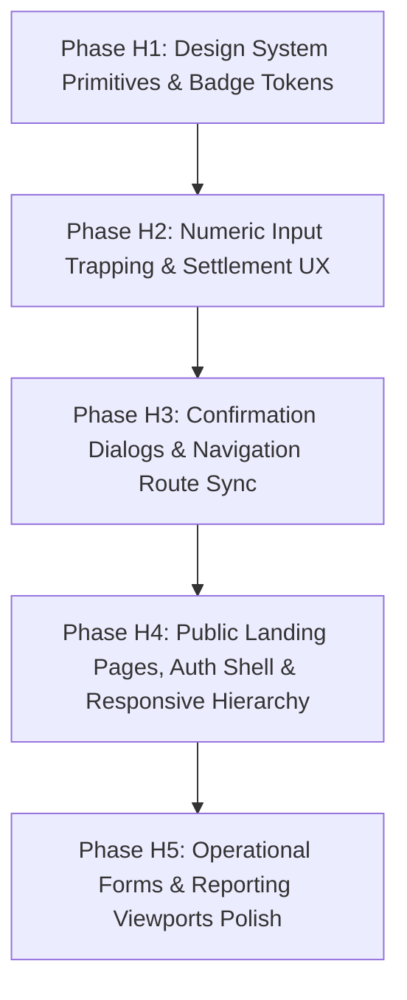

# Fleet Flow — Batch H Preflight Review: Design System, UI-UX Polish & Forms

**Document Type:** Technical Governance Pre-Implementation Review  
**Phase Identifier:** `BATCH-H` (Preflight Review & Architectural Plan)  
**Target Architecture:** Design System Tokens, Button States & Focus Accessibility, Badge Unification, Form Input Trapping & Numeric Calculators, Accessible Modal Dialogs, Public Landing Pages & Auth Shell, Responsive Operational Views  
**Authoritative Source Register:** [`docs/testing/ISSUE_INDEX.md`](file:///c:/Users/vishh/OneDrive/Desktop/Work/TransportManagement/docs/testing/ISSUE_INDEX.md#L259-L262) (Lines 259–262)  
**Execution Posture:** **STRICTLY READ-ONLY TECHNICAL PREFLIGHT. No application code, schemas, tests, or configurations modified. No issue statuses modified.**  
**Auditor / Governance Authority:** Antigravity Advanced Agentic AI (Pair-Programming Preflight Inspection)  
**Baseline Git Commit:** [`b040e00`](https://github.com/Vishal-8630/Fleet-Flow/commit/b040e00) (`feat(operations): implement Batch G (G1-G6) multi-branch numbering, commercial reporting, and frontend hardening`) on branch `main`  
**Current Working-Tree Status:** Clean (`nothing to commit, working tree clean`)  
**Preflight Recommendation:** **`ACCEPT` (Ready for Phased Implementation Authorization Gate)**  

---

## 1. Executive Summary & Purpose

Following the successful completion, test verification (129/129 backend integration tests passing), and Git deployment of **Batch G (Regional Branches, Hubs & Operational Numbering)**, this document establishes the authoritative, documentation-only preflight review for **Batch H: Design System, UI-UX Polish & Forms**.

### 1.1 Core Objectives
1. **Establish Authoritative Scope:** Lock the canonical unresolved scope for Batch H per [`docs/testing/ISSUE_INDEX.md`](file:///c:/Users/vishh/OneDrive/Desktop/Work/TransportManagement/docs/testing/ISSUE_INDEX.md#L259-L262), cross-referencing candidate investigation areas and prior batch completions.
2. **Forensic Codebase Audit:** Inspect all candidate components, form handlers, button definitions, badge styles, modals, public landing pages, and responsive layouts across `frontend/src/` to diagnose the exact root causes of user-reported UI friction.
3. **Resolve Systematic Defect Clusters:** Establish source-backed evidence for widespread UI defects, including:
   - **Numeric Input Trapping:** The JavaScript `Number("") === 0` coercion bug trapping settlement and dispatch inputs at zero upon Backspace.
   - **The Missing `.badge-primary` Systematic Defect:** How a missing 6-line CSS rule in `badges.css` caused plain unstyled text rendering across 4 separate canonical issues (`FF-ISSUE-013`, `FF-ISSUE-014`, `FF-ISSUE-015`, `FF-ISSUE-016`) and 8+ production pages.
   - **Accessible Button & Confirmation Modal Primitives:** Replacing blocking native browser `window.confirm()` popups across 12 master registry files with themed `<ConfirmDialog />` components, and adding WCAG 2.1 AA `:focus-visible` focus rings.
   - **Public Landing Page Harmony:** Bridging the aesthetic chasm between dark-gradient marketing pages and the clean slate enterprise dashboard.
   - **Sidebar Route Synchronization:** Resolving route mismatches (`/commercial/settlements` vs `/settlements`) preventing active menu highlighting.
4. **Phased Implementation Blueprint:** Structure the proposed changes into five isolated, risk-mitigated sub-phases (H1 through H5) with explicit acceptance criteria, verification commands, and safety gates.
5. **Enforce Strict Governance Invariants:** Preserve all existing files, maintain Git working tree cleanliness, and strictly prohibit modifying application code, tests, or issue statuses until formal user authorization is granted.

---

## 2. Canonical Scope & Issue Registry Reconciliation

### 2.1 In-Scope Canonical Items

Per [`docs/testing/ISSUE_INDEX.md`](file:///c:/Users/vishh/OneDrive/Desktop/Work/TransportManagement/docs/testing/ISSUE_INDEX.md#L259-L262) Section 7 (Batch H), the canonical candidates and their source-verified statuses are reconciled below:

| Canonical ID | Category | Canonical Title | Priority | Status in Registry | Primary Source File(s) | Focus Cluster |
| :--- | :--- | :--- | :--- | :--- | :--- | :--- |
| **[`FF-ISSUE-018`](file:///c:/Users/vishh/OneDrive/Desktop/Work/TransportManagement/docs/testing/issues/ui-ux/FF-ISSUE-018-numeric-input-clearing-settlement.md)** / **[`FF-ISSUE-046`](file:///c:/Users/vishh/OneDrive/Desktop/Work/TransportManagement/docs/testing/issues/financial-accounting/FF-ISSUE-046-driver-settlement-numeric-inputs-trap-zero.md)** | UI-UX | Driver Settlement Wage Calculator Fields Trapped at Zero Without Clear Behavior | `Medium` | Observed | [`SettlementListPage.tsx`](file:///c:/Users/vishh/OneDrive/Desktop/Work/TransportManagement/frontend/src/pages/commercial/SettlementListPage.tsx#L609-L652) | Phase H2: Forms & Input Trapping |
| **[`FF-ISSUE-017`](file:///c:/Users/vishh/OneDrive/Desktop/Work/TransportManagement/docs/testing/issues/ui-ux/FF-ISSUE-017-numeric-input-clearing-transit-days.md)** / **[`FF-ISSUE-040`](file:///c:/Users/vishh/OneDrive/Desktop/Work/TransportManagement/docs/testing/issues/trip-lifecycle/FF-ISSUE-040-transit-days-input-traps-zero.md)** | UI-UX | Estimated Transit Days Numeric Field Trapped at Zero Without Clear Behavior | `Medium` | Observed | [`NewJourneyPage.tsx`](file:///c:/Users/vishh/OneDrive/Desktop/Work/TransportManagement/frontend/src/pages/operations/NewJourneyPage.tsx#L628-L637) | Phase H2: Forms & Input Trapping |
| **[`FF-ISSUE-010`](file:///c:/Users/vishh/OneDrive/Desktop/Work/TransportManagement/docs/testing/issues/ui-ux/FF-ISSUE-010-native-browser-confirm-dialogs.md)** | UI-UX | Deletion Actions Trigger Unstyled Browser Native Confirm Dialogs | `Medium` | Observed | 12 Master Pages (`TruckListPage.tsx`, `DriverListPage.tsx`, etc.) | Phase H3: Confirmation Modals |
| **[`FF-ISSUE-011`](file:///c:/Users/vishh/OneDrive/Desktop/Work/TransportManagement/docs/testing/issues/ui-ux/FF-ISSUE-011-native-select-dropdown-ui.md)** | UI-UX | Form Select Dropdowns Render as Unstyled Browser Native Elements | `Medium` | Observed | [`SupportTicketsPage.tsx`](file:///c:/Users/vishh/OneDrive/Desktop/Work/TransportManagement/frontend/src/pages/support/SupportTicketsPage.tsx#L293-L301), [`forms.css`](file:///c:/Users/vishh/OneDrive/Desktop/Work/TransportManagement/frontend/src/styles/components/forms.css#L38-L54) | Phase H1: Design System Primitives |
| **[`FF-ISSUE-013`](file:///c:/Users/vishh/OneDrive/Desktop/Work/TransportManagement/docs/testing/issues/ui-ux/FF-ISSUE-013-category-badge-styling-inconsistency.md)** | UI-UX | Category and Party Badge Visual Styling Inconsistency Across Modules | `Low` | Observed | [`BalancePartyListPage.tsx`](file:///c:/Users/vishh/OneDrive/Desktop/Work/TransportManagement/frontend/src/pages/parties/BalancePartyListPage.tsx#L206-L223), [`badges.css`](file:///c:/Users/vishh/OneDrive/Desktop/Work/TransportManagement/frontend/src/styles/components/badges.css) | Phase H1: Design System Primitives |
| **[`FF-ISSUE-014`](file:///c:/Users/vishh/OneDrive/Desktop/Work/TransportManagement/docs/testing/issues/ui-ux/FF-ISSUE-014-cash-expense-badge-inconsistency.md)** | UI-UX | Cash Expense Category Badge and Text Presentation Inconsistencies | `Low` | Observed | [`JourneyDetailPage.tsx`](file:///c:/Users/vishh/OneDrive/Desktop/Work/TransportManagement/frontend/src/pages/operations/JourneyDetailPage.tsx#L390-L409), [`badges.css`](file:///c:/Users/vishh/OneDrive/Desktop/Work/TransportManagement/frontend/src/styles/components/badges.css) | Phase H1: Design System Primitives |
| **[`FF-ISSUE-015`](file:///c:/Users/vishh/OneDrive/Desktop/Work/TransportManagement/docs/testing/issues/ui-ux/FF-ISSUE-015-payment-mode-badge-inconsistency.md)** | UI-UX | Fuel Payment Mode Badge Presentation Inconsistency | `Low` | Observed | [`JourneyDetailPage.tsx`](file:///c:/Users/vishh/OneDrive/Desktop/Work/TransportManagement/frontend/src/pages/operations/JourneyDetailPage.tsx#L411-L422), [`badges.css`](file:///c:/Users/vishh/OneDrive/Desktop/Work/TransportManagement/frontend/src/styles/components/badges.css) | Phase H1: Design System Primitives |
| **[`FF-ISSUE-016`](file:///c:/Users/vishh/OneDrive/Desktop/Work/TransportManagement/docs/testing/issues/ui-ux/FF-ISSUE-016-trip-status-badge-inconsistency.md)** | UI-UX | Journey Status Display Inconsistency Between Plain Text and Badges | `Low` | Observed | [`JourneyListPage.tsx`](file:///c:/Users/vishh/OneDrive/Desktop/Work/TransportManagement/frontend/src/pages/operations/JourneyListPage.tsx#L172-L203), [`badges.css`](file:///c:/Users/vishh/OneDrive/Desktop/Work/TransportManagement/frontend/src/styles/components/badges.css) | Phase H1: Design System Primitives |
| **[`FF-ISSUE-019`](file:///c:/Users/vishh/OneDrive/Desktop/Work/TransportManagement/docs/testing/issues/ui-ux/FF-ISSUE-019-sidebar-active-route-highlight.md)** | UI-UX | Sidebar Active Menu Item Highlight Missing on Nested Navigation Routes | `Low` | Observed | [`Sidebar.tsx`](file:///c:/Users/vishh/OneDrive/Desktop/Work/TransportManagement/frontend/src/components/layout/Sidebar.tsx#L81-L101), [`DashboardPage.tsx`](file:///c:/Users/vishh/OneDrive/Desktop/Work/TransportManagement/frontend/src/pages/dashboard/DashboardPage.tsx#L296) | Phase H3: Confirmation Modals & Nav |
| **[`FF-ISSUE-001`](file:///c:/Users/vishh/OneDrive/Desktop/Work/TransportManagement/docs/testing/issues/ui-ux/FF-ISSUE-001-public-site-color-scheme.md)** | UI-UX | Inconsistent Public-Site Color Scheme and Dark Gradient Overdecoration | `Medium` | Observed | [`HomePage.tsx`](file:///c:/Users/vishh/OneDrive/Desktop/Work/TransportManagement/frontend/src/pages/marketing/HomePage.tsx#L67-L105), [`PublicLayout.tsx`](file:///c:/Users/vishh/OneDrive/Desktop/Work/TransportManagement/frontend/src/components/layout/PublicLayout.tsx) | Phase H4: Public Marketing & Auth |
| **[`FF-ISSUE-003`](file:///c:/Users/vishh/OneDrive/Desktop/Work/TransportManagement/docs/testing/issues/ui-ux/FF-ISSUE-003-homepage-content-density.md)** | UI-UX | Homepage Density, Visual Clutter and Unverified Performance Claims | `Medium` | Observed | [`HomePage.tsx`](file:///c:/Users/vishh/OneDrive/Desktop/Work/TransportManagement/frontend/src/pages/marketing/HomePage.tsx) | Phase H4: Public Marketing & Auth |
| **[`FF-ISSUE-004`](file:///c:/Users/vishh/OneDrive/Desktop/Work/TransportManagement/docs/testing/issues/ui-ux/FF-ISSUE-004-features-page-density.md)** | UI-UX | Features Page Layout Density and Lack of Module Categorization | `Medium` | Observed | [`FeaturesPage.tsx`](file:///c:/Users/vishh/OneDrive/Desktop/Work/TransportManagement/frontend/src/pages/marketing/FeaturesPage.tsx) | Phase H4: Public Marketing & Auth |
| **[`FF-ISSUE-005`](file:///c:/Users/vishh/OneDrive/Desktop/Work/TransportManagement/docs/testing/issues/ui-ux/FF-ISSUE-005-pricing-page-redesign.md)** | UI-UX | Pricing Page Visual Styling Discrepancy with App Design System | `Medium` | Observed | [`PricingPage.tsx`](file:///c:/Users/vishh/OneDrive/Desktop/Work/TransportManagement/frontend/src/pages/marketing/PricingPage.tsx) | Phase H4: Public Marketing & Auth |
| **[`FF-ISSUE-006`](file:///c:/Users/vishh/OneDrive/Desktop/Work/TransportManagement/docs/testing/issues/ui-ux/FF-ISSUE-006-pricing-faq-accordion.md)** | UI-UX | Pricing Page FAQ Sections Lack Dropdown/Collapsible Accordion Behavior | `Low` | Observed / Approved Future | [`PricingPage.tsx`](file:///c:/Users/vishh/OneDrive/Desktop/Work/TransportManagement/frontend/src/pages/marketing/PricingPage.tsx) | Phase H4: Public Marketing & Auth |
| **[`FF-ISSUE-007`](file:///c:/Users/vishh/OneDrive/Desktop/Work/TransportManagement/docs/testing/issues/ui-ux/FF-ISSUE-007-security-page-content-density.md)** | UI-UX | Public Security Page Content Overload for Top-Level Marketing | `Medium` | Observed | [`App.tsx`](file:///c:/Users/vishh/OneDrive/Desktop/Work/TransportManagement/frontend/src/App.tsx#L166), [`PrivacyPage.tsx`](file:///c:/Users/vishh/OneDrive/Desktop/Work/TransportManagement/frontend/src/pages/marketing/PrivacyPage.tsx) | Phase H4: Public Marketing & Auth |
| **[`FF-ISSUE-008`](file:///c:/Users/vishh/OneDrive/Desktop/Work/TransportManagement/docs/testing/issues/ui-ux/FF-ISSUE-008-help-center-contact-redundancy.md)** | UI-UX | Redundancy and Ambiguous Boundary Between Help Center and Contact Pages | `Medium` | Observed / Needs Verification | [`App.tsx`](file:///c:/Users/vishh/OneDrive/Desktop/Work/TransportManagement/frontend/src/App.tsx#L164-L167), [`ContactPage.tsx`](file:///c:/Users/vishh/OneDrive/Desktop/Work/TransportManagement/frontend/src/pages/marketing/ContactPage.tsx) | Phase H4: Public Marketing & Auth |
| **[`FF-ISSUE-009`](file:///c:/Users/vishh/OneDrive/Desktop/Work/TransportManagement/docs/testing/issues/ui-ux/FF-ISSUE-009-auth-pages-navbar-footer.md)** | UI-UX | Authentication Pages Omit Navigation Bar and Footer | `Medium` | Observed / Needs Verification | [`LoginPage.tsx`](file:///c:/Users/vishh/OneDrive/Desktop/Work/TransportManagement/frontend/src/pages/auth/LoginPage.tsx), [`RegisterPage.tsx`](file:///c:/Users/vishh/OneDrive/Desktop/Work/TransportManagement/frontend/src/pages/auth/RegisterPage.tsx) | Phase H4: Public Marketing & Auth |
| **[`FF-ISSUE-020`](file:///c:/Users/vishh/OneDrive/Desktop/Work/TransportManagement/docs/testing/issues/support-tickets/FF-ISSUE-020-support-ticket-form-layout.md)** | UI-UX | Support Ticket Creation Form Spacing, Field Boundaries, and Layout Distortion | `Medium` | Observed | [`SupportTicketsPage.tsx`](file:///c:/Users/vishh/OneDrive/Desktop/Work/TransportManagement/frontend/src/pages/support/SupportTicketsPage.tsx#L283-L315) | Phase H5: Operations & Reporting |
| **[`FF-ISSUE-021`](file:///c:/Users/vishh/OneDrive/Desktop/Work/TransportManagement/docs/testing/issues/support-tickets/FF-ISSUE-021-support-ticket-thread-layout.md)** | UI-UX | Support Ticket Message Thread and Reply Composer Horizontal Clipping | `Medium` | Observed | [`SupportTicketsPage.tsx`](file:///c:/Users/vishh/OneDrive/Desktop/Work/TransportManagement/frontend/src/pages/support/SupportTicketsPage.tsx#L317-L391) | Phase H5: Operations & Reporting |
| **[`FF-ISSUE-049`](file:///c:/Users/vishh/OneDrive/Desktop/Work/TransportManagement/docs/testing/issues/market-movements/FF-ISSUE-049-market-movement-list-overcrowded.md)** | UI-UX | Market Movement List View Overcrowded and Visually Clipped | `Medium` | Observed | [`VehicleEntryListPage.tsx`](file:///c:/Users/vishh/OneDrive/Desktop/Work/TransportManagement/frontend/src/pages/operations/VehicleEntryListPage.tsx#L470-L547) | Phase H5: Operations & Reporting |
| **[`FF-ISSUE-060`](file:///c:/Users/vishh/OneDrive/Desktop/Work/TransportManagement/docs/testing/issues/reporting/FF-ISSUE-060-ar-aging-report-styling-and-bucket-semantics.md)** | Financial | Accounts Receivable (AR) Aging Report Visual Styling and Aging Bucket Semantics | `Medium` | Needs Verification | [`AgingReportPage.tsx`](file:///c:/Users/vishh/OneDrive/Desktop/Work/TransportManagement/frontend/src/pages/commercial/AgingReportPage.tsx#L43-L125) | Phase H5: Operations & Reporting |

> [!NOTE]
> **Issue Pair Disambiguation:**
> - `FF-ISSUE-018` and `FF-ISSUE-046` describe the exact same defect (Driver Settlement Wage Calculator inputs trapped at zero), recorded in two categories (UI-UX and Financial Accounting). They are resolved as a unified fix.
> - `FF-ISSUE-017` and `FF-ISSUE-040` describe the exact same defect (Estimated Transit Days input trapped at zero), recorded in two categories (UI-UX and Trip Lifecycle). They are resolved as a unified fix.

---

### 2.2 Reconciled Prior Batches & Explicit Exclusions

To prevent scope creep and uphold repository governance rules:

1. **Resolved in Earlier Batches (Excluded from Batch H):**
   - `FF-ISSUE-002` (*Unwanted Public Fleet ROI Calculator Component*): Formally resolved in Batch E6.
   - `FF-ISSUE-012` (*Validation Error Toast Renders Behind Active Modal*): Formally resolved in Batch E6 (`z-index: 1200` fix).
   - `FF-ISSUE-051` (*Regional Branch Creation Form UI Distortion*): Formally resolved in Batch G (`BranchManagementPage.tsx`).
   - `FF-ISSUE-052` (*Regional Branch Listing UI Lacks Card Containment and Action Buttons*): Formally resolved in Batch G (`BranchManagementPage.tsx`).

2. **Strict Operational & Architectural Exclusions:**
   - **Support Inbox Exclusion (`FF-ISSUE-022` / `QST-004`):** Central Super-Admin Platform-Wide Support Inbox requires backend cross-tenant routing and data synchronization. It is **STRICTLY EXCLUDED** from Batch H. Only tenant-facing support layout polish (`FF-ISSUE-020`, `FF-ISSUE-021`) is in scope.
   - **Regional Branch Operational Logic (Batch G):** Multi-branch numbering, prefixing, sequence counters, and trip binding are fully verified in Batch G (commits `b040e00` and earlier) and must **NOT be altered**.
   - **Incognito Session Instability (`FF-ISSUE-058` / `QST-014`):** **MANDATORY INVARIANT: Do not investigate, modify, or retest `FF-ISSUE-058`. It remains strictly designated as the final workstream of the project.**

---

## 3. Git Working Tree & Baseline Verification

A strict read-only audit of Git status was executed prior to preparing this report:

```bash
$ git status
On branch main
Your branch is up to date with 'origin/main'.
nothing to commit, working tree clean

$ git rev-parse HEAD
b040e00c1cce93a54f318230ae71824d7d1278b6

$ git log -1 --oneline
b040e00 feat(operations): implement Batch G (G1-G6) multi-branch numbering, commercial reporting, and frontend hardening
```

- **Branch:** `main` (synced with `origin/main`)
- **Working Tree:** 100% clean. Zero staged, unstaged, or untracked changes.
- **Runtime Environment:** Dev server running on `http://localhost:5173` and backend API running on `http://localhost:5000`.
- **Preflight Invariant:** No application source code files, tests, or documentation statuses were modified while preparing this report.

---

## 4. Evidence-Backed Root-Cause Analysis

### 4.1 Candidate Area 1: Settlement & Dispatch Form Input Trapping

#### Forensic Inspection: `FF-ISSUE-018` / `FF-ISSUE-046` (Driver Settlement Wage Calculator)
In [`frontend/src/pages/commercial/SettlementListPage.tsx`](file:///c:/Users/vishh/OneDrive/Desktop/Work/TransportManagement/frontend/src/pages/commercial/SettlementListPage.tsx#L609-L652):

```tsx
// Lines 610-617
<div className="form-group">
  <label className="form-label">Driver Wage Rate (₹ / km)</label>
  <input
    type="number"
    step="0.1"
    className="form-control"
    value={settlementForm.rate_per_km}
    onChange={(e) => setSettlementForm({ ...settlementForm, rate_per_km: Number(e.target.value) })}
    required
  />
</div>

// Lines 622-629: Benchmark Mileage (km / L)
value={settlementForm.benchmark_mileage}
onChange={(e) => setSettlementForm({ ...settlementForm, benchmark_mileage: Number(e.target.value) })}

// Lines 634-641: Diesel Price / Litre (₹)
value={settlementForm.diesel_price_per_litre}
onChange={(e) => setSettlementForm({ ...settlementForm, diesel_price_per_litre: Number(e.target.value) })}

// Lines 646-651: Other Deductions (₹)
value={settlementForm.other_deductions}
onChange={(e) => setSettlementForm({ ...settlementForm, other_deductions: Number(e.target.value) })}
```

- **Exact Root Cause:**
  1. All four controlled inputs bind `value` directly to numeric state variables (`rate_per_km: 4.5`, `benchmark_mileage: 4.0`, `diesel_price_per_litre: 92.0`, `other_deductions: 0`).
  2. When an accountant focuses an input and hits Backspace or Delete to clear the existing number, `e.target.value` becomes an empty string `""`.
  3. In JavaScript, `Number("")` evaluates strictly to `0`.
  4. The state handler immediately executes `setSettlementForm({ ...settlementForm, rate_per_km: 0 })`.
  5. The input component immediately re-renders displaying `0`.
  6. The user can **never** clear the field to an empty state. If they attempt to type a replacement figure such as `5`, the existing `0` remains, creating `05` (or inserting before the zero). On `other_deductions`, which initializes to `0`, backspacing is completely inert.
- **Missing Field Defect:**
  In `SettlementListPage.tsx` line 65 and line 199, `other_deductions_notes` is initialized (`other_deductions_notes: ''`) and submitted in the backend payload. However, **no input field exists in the modal UI**! An accountant who enters a ₹500 penalty cannot record the rationale (e.g., "Cargo tarp tear penalty").
- **Validation Defect:**
  In `handleConfirmSubmit` (lines 181–204), the form checks `!settlementForm.driver_id` and `selected_journey_ids.length === 0`. It performs **zero boundary checks** on `rate_per_km <= 0`, `benchmark_mileage <= 0` (which would cause division-by-zero errors in line 170), or negative deductions.

#### Forensic Inspection: `FF-ISSUE-017` / `FF-ISSUE-040` (Estimated Transit Days)
In [`frontend/src/pages/operations/NewJourneyPage.tsx`](file:///c:/Users/vishh/OneDrive/Desktop/Work/TransportManagement/frontend/src/pages/operations/NewJourneyPage.tsx#L628-L637):

```tsx
<div className="form-group" style={{ marginBottom: 0 }}>
  <label className="form-label">Estimated Transit Days</label>
  <input
    type="number"
    min="1"
    placeholder="e.g. 3"
    className="form-control"
    value={formData.estimated_duration_days}
    onChange={(e) => setFormData({ ...formData, estimated_duration_days: Number(e.target.value) })}
  />
</div>
```

- **Exact Root Cause:**
  `estimated_duration_days` executes the identical `Number(e.target.value)` pattern. Backspacing converts `""` to `0`, violating the `min="1"` constraint while visually trapping `0` in the input.

---

### 4.2 Candidate Area 2: Button Styling, Loading States & Focus Accessibility

#### Forensic Inspection: Focus Rings & Loading States
In [`frontend/src/styles/components/buttons.css`](file:///c:/Users/vishh/OneDrive/Desktop/Work/TransportManagement/frontend/src/styles/components/buttons.css#L1-L108):
- **Missing `:focus-visible` Ring (WCAG 2.1 AA Violation):**
  Neither `.btn` nor its variants define `:focus-visible`. Users navigating via keyboard Tab have no distinct focus indicator, failing accessibility standards.
- **Inconsistent Button Spinners / Loading States:**
  Multiple pages implement ad-hoc inline text (e.g., `isPending ? 'Confirming...' : 'Confirm'`) without standard button spinner animations or disabled loading cursors.
- **Hardcoded Public Buttons:**
  In [`HomePage.tsx`](file:///c:/Users/vishh/OneDrive/Desktop/Work/TransportManagement/frontend/src/pages/marketing/HomePage.tsx#L98-L105), CTA buttons use 10 lines of inline styles (`background: 'linear-gradient(135deg, #6366f1, #4f46e5)'`) rather than shared `.btn .btn-primary .btn-lg` classes.

#### Forensic Inspection: `FF-ISSUE-010` (Native Browser `window.confirm()` Dialogs)
A repository-wide grep for `confirm(` and `window.confirm` revealed **12 critical master registry and operations files** relying on blocking native browser alerts:

1. [`TruckListPage.tsx`](file:///c:/Users/vishh/OneDrive/Desktop/Work/TransportManagement/frontend/src/pages/fleet/TruckListPage.tsx#L515): `if (confirm(`Are you sure you want to remove vehicle ${truck.truck_no}?`))`
2. [`DriverListPage.tsx`](file:///c:/Users/vishh/OneDrive/Desktop/Work/TransportManagement/frontend/src/pages/fleet/DriverListPage.tsx#L432): `if (confirm(`Remove driver ${driver.name} from active roster?`))`
3. [`BillingPartyListPage.tsx`](file:///c:/Users/vishh/OneDrive/Desktop/Work/TransportManagement/frontend/src/pages/parties/BillingPartyListPage.tsx#L422): `if (confirm(`Remove customer ${party.name}?`))`
4. [`BalancePartyListPage.tsx`](file:///c:/Users/vishh/OneDrive/Desktop/Work/TransportManagement/frontend/src/pages/parties/BalancePartyListPage.tsx#L447): `if (confirm(`Remove partner ${party.party_name}?`))`
5. [`TeamMembersPage.tsx`](file:///c:/Users/vishh/OneDrive/Desktop/Work/TransportManagement/frontend/src/pages/team/TeamMembersPage.tsx#L437): `if (confirm(`Remove ${member.email} from company workspace?`))`
6. [`TruckDetailPage.tsx`](file:///c:/Users/vishh/OneDrive/Desktop/Work/TransportManagement/frontend/src/pages/fleet/TruckDetailPage.tsx#L424): `if (confirm(`Unassign driver ${truck.current_driver_id.name} from this vehicle?`))`
7. [`VehicleEntryListPage.tsx`](file:///c:/Users/vishh/OneDrive/Desktop/Work/TransportManagement/frontend/src/pages/operations/VehicleEntryListPage.tsx#L536): `if (window.confirm(`Delete entry ${entry.entry_number}?`))`
8. [`CustomFieldsPage.tsx`](file:///c:/Users/vishh/OneDrive/Desktop/Work/TransportManagement/frontend/src/pages/settings/CustomFieldsPage.tsx#L180): `if (!window.confirm(`Are you sure you want to delete...`))`
9. [`TyreManagementPage.tsx`](file:///c:/Users/vishh/OneDrive/Desktop/Work/TransportManagement/frontend/src/pages/fleet/TyreManagementPage.tsx#L606-L620): Retread and scrap tyre confirms.
10. [`MaintenanceDashboardPage.tsx`](file:///c:/Users/vishh/OneDrive/Desktop/Work/TransportManagement/frontend/src/pages/fleet/MaintenanceDashboardPage.tsx#L564): Cancel work order confirm.
11. [`InvoiceListPage.tsx`](file:///c:/Users/vishh/OneDrive/Desktop/Work/TransportManagement/frontend/src/pages/commercial/InvoiceListPage.tsx#L576): Cancel invoice confirm.
12. [`LRListPage.tsx`](file:///c:/Users/vishh/OneDrive/Desktop/Work/TransportManagement/frontend/src/pages/commercial/LRListPage.tsx#L589): Cancel LR confirm.

- **Impact:**
  Native browser alerts cannot be styled, lack brand alignment, provide no contextual warning of cascading impacts (e.g., active dispatches, open balances), and can be permanently suppressed if a user accidentally checks "Prevent this page from creating additional dialogs".

#### Forensic Inspection: `FF-ISSUE-011` (Unstyled Select Dropdowns)
In [`frontend/src/styles/components/forms.css`](file:///c:/Users/vishh/OneDrive/Desktop/Work/TransportManagement/frontend/src/styles/components/forms.css#L38-L54):
- `forms.css` defines custom SVG chevrons for `select.form-control`, `select.form-input`, and `.form-select`.
- However, across several legacy components (e.g., [`SupportTicketsPage.tsx`](file:///c:/Users/vishh/OneDrive/Desktop/Work/TransportManagement/frontend/src/pages/support/SupportTicketsPage.tsx#L293-L301)), `<select>` elements use inline styles (`style={{ width: '100%', padding: '0.5rem 0.75rem', ... }}`) without `className="form-control"`. They fail to inherit `appearance: none` and render raw OS controls with overlapping text.

---

### 4.3 Systematic Root Cause: The Missing `.badge-primary` Rule

Four independent canonical issues report that status or category tags render as unstyled, uncontained plain text:
- **`FF-ISSUE-013`:** Truck Supplier category renders as plain unstyled text.
- **`FF-ISSUE-014`:** Toll/Fastag cash expense renders as plain unstyled text.
- **`FF-ISSUE-015`:** Fleet Fuel Card payment mode renders as plain unstyled text.
- **`FF-ISSUE-016`:** In Transit journey status renders as plain text.

#### Forensic Inspection:
Inspecting [`frontend/src/styles/components/badges.css`](file:///c:/Users/vishh/OneDrive/Desktop/Work/TransportManagement/frontend/src/styles/components/badges.css#L1-L43):

```css
.badge {
  display: inline-flex;
  align-items: center;
  gap: 0.375rem;
  padding: 0.25rem 0.625rem;
  font-size: var(--font-size-xs);
  font-weight: var(--font-weight-semibold);
  line-height: 1;
  border-radius: var(--radius-full);
  border: 1px solid transparent;
  white-space: nowrap;
}

.badge-success { background-color: var(--color-success-bg); border-color: var(--color-success-border); color: var(--color-success-text); }
.badge-warning { background-color: var(--color-warning-bg); border-color: var(--color-warning-border); color: var(--color-warning-text); }
.badge-danger  { background-color: var(--color-danger-bg);  border-color: var(--color-danger-border);  color: var(--color-danger-text); }
.badge-info    { background-color: var(--color-info-bg);    border-color: var(--color-info-border);    color: var(--color-info-text); }
.badge-neutral { background-color: var(--color-slate-100);  border-color: var(--color-slate-200);      color: var(--color-slate-700); }
```

**Notice: `.badge-primary` is completely missing from `badges.css`!**

Now inspect how developers wrote the components:
1. In [`JourneyListPage.tsx`](file:///c:/Users/vishh/OneDrive/Desktop/Work/TransportManagement/frontend/src/pages/operations/JourneyListPage.tsx#L176):
   ```tsx
   case 'active':
     return <span className="badge badge-primary"><Navigation size={12} /> In Transit</span>;
   ```
2. In [`JourneyDetailPage.tsx`](file:///c:/Users/vishh/OneDrive/Desktop/Work/TransportManagement/frontend/src/pages/operations/JourneyDetailPage.tsx#L393):
   ```tsx
   case 'toll':
     return <span className="badge badge-primary">Toll / Fastag</span>;
   ```
3. In [`JourneyDetailPage.tsx`](file:///c:/Users/vishh/OneDrive/Desktop/Work/TransportManagement/frontend/src/pages/operations/JourneyDetailPage.tsx#L414):
   ```tsx
   case 'fuel_card':
     return <span className="badge badge-primary">Fleet Fuel Card</span>;
   ```
4. In [`BalancePartyListPage.tsx`](file:///c:/Users/vishh/OneDrive/Desktop/Work/TransportManagement/frontend/src/pages/parties/BalancePartyListPage.tsx#L211):
   ```tsx
   case 'supplier':
     return <span className="badge badge-primary">Truck Supplier</span>;
   ```
5. In [`VehicleEntryListPage.tsx`](file:///c:/Users/vishh/OneDrive/Desktop/Work/TransportManagement/frontend/src/pages/operations/VehicleEntryListPage.tsx#L500):
   ```tsx
   entry.status === 'partially_paid' ? 'badge-primary' : ...
   ```
6. In [`TeamMembersPage.tsx`](file:///c:/Users/vishh/OneDrive/Desktop/Work/TransportManagement/frontend/src/pages/team/TeamMembersPage.tsx#L317):
   ```tsx
   return <span className="badge badge-primary">Admin</span>;
   ```

- **Synthesis:**
  Every developer intuitively used `.badge-primary` expecting it to render as Fleet Flow's primary blue pill badge. Because the CSS selector `.badge-primary` was never defined, the browser applied `border: 1px solid transparent; background: transparent; color: inherit;`.
  **Adding `.badge-primary` using design tokens immediately fixes four canonical issues at once.**

---

### 4.4 Candidate Area 3: Public Marketing Pages, Auth Shell & Responsive Behavior

#### Forensic Inspection: `FF-ISSUE-001`, `FF-ISSUE-003`, `FF-ISSUE-004`, `FF-ISSUE-005`, `FF-ISSUE-006`
- **Dark Gradient Inconsistency (`FF-ISSUE-001`):**
  In [`HomePage.tsx`](file:///c:/Users/vishh/OneDrive/Desktop/Work/TransportManagement/frontend/src/pages/marketing/HomePage.tsx#L67-L76), the hero section uses `background: 'linear-gradient(135deg, #09090b 0%, #0f0f23 50%, #0c0c1e 100%)'` with glowing neon radial effects. Navigating from this landing page to `/login` or `/dashboard` creates a jarring visual transition from a dark sci-fi theme to a clean light-slate SaaS workspace.
- **Unverified Metrics & Content Density (`FF-ISSUE-003`):**
  The homepage contains generic marketing assertions ("99.8% on-time delivery", "15M+ km tracked") that lack empirical proof and dilute enterprise credibility.
- **Features Page Density (`FF-ISSUE-004`):**
  [`FeaturesPage.tsx`](file:///c:/Users/vishh/OneDrive/Desktop/Work/TransportManagement/frontend/src/pages/marketing/FeaturesPage.tsx) renders a flat map of cards without domain segmentation (Fleet, Dispatch, Billing, Accounting, Governance).
- **Pricing Page Discrepancy & FAQ Accordion (`FF-ISSUE-005`, `FF-ISSUE-006`):**
  [`PricingPage.tsx`](file:///c:/Users/vishh/OneDrive/Desktop/Work/TransportManagement/frontend/src/pages/marketing/PricingPage.tsx) uses dark card borders rather than the clean white card tokens used in [`BillingPage.tsx`](file:///c:/Users/vishh/OneDrive/Desktop/Work/TransportManagement/frontend/src/pages/settings/BillingPage.tsx). FAQ items at the bottom are statically open `<div>` tags without collapsible accordion state (`FF-ISSUE-006`).
- **Help Center Redundancy (`FF-ISSUE-008`):**
  In [`App.tsx`](file:///c:/Users/vishh/OneDrive/Desktop/Work/TransportManagement/frontend/src/App.tsx#L164-L167):
  ```tsx
  <Route path="/contact" element={<ContactPage />} />
  <Route path="/demo" element={<ContactPage />} />
  <Route path="/help" element={<ContactPage />} />
  ```
  `/help` literally renders `<ContactPage />`! It is not a distinct destination; it is an undocumented alias to Contact Us.
- **Security Page Density (`FF-ISSUE-007`):**
  In `App.tsx` line 166, `/security` routes to `<PrivacyPage />`. It lacks a dedicated executive security trust page (covering AES-256 encryption, TLS 1.3, multi-tenant isolation, automated daily backups, and Indian data residency).
- **Auth Shell Isolation (`FF-ISSUE-009`):**
  [`LoginPage.tsx`](file:///c:/Users/vishh/OneDrive/Desktop/Work/TransportManagement/frontend/src/pages/auth/LoginPage.tsx) and [`RegisterPage.tsx`](file:///c:/Users/vishh/OneDrive/Desktop/Work/TransportManagement/frontend/src/pages/auth/RegisterPage.tsx) render a centered card on a blank slate background. There is no header logo allowing users to return to `/`, and no footer links to Privacy Policy or Terms of Service.

---

### 4.5 Navigation & Operational Viewports

#### Forensic Inspection: `FF-ISSUE-019` (Sidebar Active State Mismatch)
In [`frontend/src/components/layout/Sidebar.tsx`](file:///c:/Users/vishh/OneDrive/Desktop/Work/TransportManagement/frontend/src/components/layout/Sidebar.tsx#L96):
- The Settlements navigation item is registered with `path: '/settlements'`.
- In [`DashboardPage.tsx`](file:///c:/Users/vishh/OneDrive/Desktop/Work/TransportManagement/frontend/src/pages/dashboard/DashboardPage.tsx#L296-L360), clicking "Disburse" on the Driver Payouts watchlist navigates to `<Link to="/commercial/settlements" ...>`.
- In [`App.tsx`](file:///c:/Users/vishh/OneDrive/Desktop/Work/TransportManagement/frontend/src/App.tsx#L267-L268), both paths are valid:
  ```tsx
  <Route path="settlements" element={<SettlementListPage />} />
  <Route path="commercial/settlements" element={<SettlementListPage />} />
  ```
- Because `Sidebar.tsx` matches `location.pathname.startsWith('/settlements')`, navigating to `/commercial/settlements` leaves the sidebar completely unhighlighted.

#### Forensic Inspection: `FF-ISSUE-020` & `FF-ISSUE-021` (Support Tickets Layout Distortion)
In [`frontend/src/pages/support/SupportTicketsPage.tsx`](file:///c:/Users/vishh/OneDrive/Desktop/Work/TransportManagement/frontend/src/pages/support/SupportTicketsPage.tsx):
- Line 286: Form uses `gridTemplateColumns: '1fr 1fr 1fr'`. Category is in column 1, Priority in column 2, and column 3 is completely blank, creating distorted white gaps.
- Line 317: Ticket split view uses `gridTemplateColumns: selectedTicket ? '1fr 1fr' : '1fr'`. On screens under 1024px, the 50/50 split causes severe horizontal clipping of message threads and the reply composer.

#### Forensic Inspection: `FF-ISSUE-049` (Market Movements List Overcrowding)
In [`frontend/src/pages/operations/VehicleEntryListPage.tsx`](file:///c:/Users/vishh/OneDrive/Desktop/Work/TransportManagement/frontend/src/pages/operations/VehicleEntryListPage.tsx#L470-L547):
- The table displays 12 dense columns simultaneously (ID, Vehicle/Driver, Route, Date, Balance Party, Billing Party, Freight, Advances, Dala, Commission, Net Due, POD, Status, Actions).
- Missing responsive table scroll container (`table-responsive`) causes text clipping on 1366x768 and tablet screens.

#### Forensic Inspection: `FF-ISSUE-060` (AR Aging Report Styling & Bucket Policy)
In [`frontend/src/pages/commercial/AgingReportPage.tsx`](file:///c:/Users/vishh/OneDrive/Desktop/Work/TransportManagement/frontend/src/pages/commercial/AgingReportPage.tsx#L48-L58):
- Line 49: Cards use heavy saturated colors (`#fef2f2`, `#fff7ed`, `#fffbeb`, `#f0fdf4`) and `border: 2px solid ${color}30`, clashing with the sleek design tokens used on the dashboard.
- Line 92: Tally XML export error triggers native browser `alert('Failed to export Tally XML...')`.
- UI lacks explicit helper text clarifying whether aging buckets are calculated from **Invoice Issue Date** or **Invoice Due Date** (backend computes days from `due_date || issue_date`).

---

## 5. Proposed Implementation Phases & Exact File Modification Plan

To eliminate regression risks and keep review boundaries clean, Batch H is divided into **five sequenced sub-phases**:



### 5.1 Phase H1: Design System Primitives, Badge Tokens & Button Accessibility
- **Goal:** Unify global CSS tokens, define missing `.badge-primary`, add WCAG focus rings to buttons, and ensure standard select styling.
- **Canonical Issues Addressed:** `FF-ISSUE-011`, `FF-ISSUE-013`, `FF-ISSUE-014`, `FF-ISSUE-015`, `FF-ISSUE-016`.
- **Target Files:**
  1. [`frontend/src/styles/components/badges.css`](file:///c:/Users/vishh/OneDrive/Desktop/Work/TransportManagement/frontend/src/styles/components/badges.css):
     - Add `.badge-primary`:
       ```css
       .badge-primary {
         background-color: var(--color-primary-50);
         border-color: var(--color-primary-200);
         color: var(--color-primary-700);
       }
       ```
     - Add `.badge-purple` / `.badge-secondary` for vehicle suppliers and fuel cards if distinct semantic differentiation is desired.
  2. [`frontend/src/styles/components/buttons.css`](file:///c:/Users/vishh/OneDrive/Desktop/Work/TransportManagement/frontend/src/styles/components/buttons.css):
     - Add `:focus-visible` ring:
       ```css
       .btn:focus-visible {
         outline: 2px solid var(--color-primary-600);
         outline-offset: 2px;
       }
       ```
     - Add `.btn-loading` spinner support.
  3. [`frontend/src/styles/components/forms.css`](file:///c:/Users/vishh/OneDrive/Desktop/Work/TransportManagement/frontend/src/styles/components/forms.css):
     - Ensure `.form-select` and `select.form-control` consistently apply SVG chevron across all viewports.
  4. [`frontend/src/components/common/Badge.tsx`](file:///c:/Users/vishh/OneDrive/Desktop/Work/TransportManagement/frontend/src/components/common/):
     - Provide a centralized reusable `<Badge variant="..." icon={...}>` component.

---

### 5.2 Phase H2: Numeric Input Trapping & Settlement Calculation UX
- **Goal:** Eliminate numeric trapping at zero, allow intermediate empty typing states, add missing deduction notes, and harden keyboard interaction.
- **Canonical Issues Addressed:** `FF-ISSUE-018` / `FF-ISSUE-046`, `FF-ISSUE-017` / `FF-ISSUE-040`.
- **Target Files:**
  1. [`frontend/src/pages/commercial/SettlementListPage.tsx`](file:///c:/Users/vishh/OneDrive/Desktop/Work/TransportManagement/frontend/src/pages/commercial/SettlementListPage.tsx):
     - Refactor state for `rate_per_km`, `benchmark_mileage`, `diesel_price_per_litre`, and `other_deductions` to support `string | number` during active editing.
     - On `onChange`, allow empty string `""` without converting to `0`:
       ```tsx
       onChange={(e) => setSettlementForm({ ...settlementForm, rate_per_km: e.target.value === '' ? '' : Number(e.target.value) })}
       ```
     - In mathematical summary calculations, gracefully fallback: `Number(settlementForm.rate_per_km) || 0`.
     - In the modal UI, **add the missing input field for `other_deductions_notes`** (`label: "Deduction Justification / Penalty Reason"`).
     - Add client-side validation: ensure `rate_per_km > 0`, `benchmark_mileage > 0`, and `other_deductions >= 0` before submitting.
     - Add Enter key submission support.
  2. [`frontend/src/pages/operations/NewJourneyPage.tsx`](file:///c:/Users/vishh/OneDrive/Desktop/Work/TransportManagement/frontend/src/pages/operations/NewJourneyPage.tsx):
     - Refactor `estimated_duration_days` input handler: allow intermediate empty string on backspace, defaulting to `1` on blur if left empty.

---

### 5.3 Phase H3: Confirmation Dialogs & Navigation Route Sync
- **Goal:** Replace all 12 blocking `window.confirm()` native popups with an accessible in-app `<ConfirmDialog />`, and synchronize sidebar route highlighting.
- **Canonical Issues Addressed:** `FF-ISSUE-010`, `FF-ISSUE-019`.
- **Target Files:**
  1. Create [`frontend/src/components/common/ConfirmDialog.tsx`](file:///c:/Users/vishh/OneDrive/Desktop/Work/TransportManagement/frontend/src/components/common/ConfirmDialog.tsx):
     - Props: `isOpen`, `title`, `message`, `confirmText`, `cancelText`, `isDestructive`, `onConfirm`, `onClose`.
     - Built on existing accessible `<Modal />` with focus trap, Escape key listener, and autofocus on Cancel button.
  2. Replace `confirm()` across 12 files:
     - `TruckListPage.tsx`, `DriverListPage.tsx`, `BillingPartyListPage.tsx`, `BalancePartyListPage.tsx`, `TeamMembersPage.tsx`, `TruckDetailPage.tsx`, `VehicleEntryListPage.tsx`, `CustomFieldsPage.tsx`, `TyreManagementPage.tsx`, `MaintenanceDashboardPage.tsx`, `InvoiceListPage.tsx`, `LRListPage.tsx`.
  3. [`frontend/src/components/layout/Sidebar.tsx`](file:///c:/Users/vishh/OneDrive/Desktop/Work/TransportManagement/frontend/src/components/layout/Sidebar.tsx):
     - Support route aliases in navigation matching:
       ```typescript
       const isRouteActive = (item: NavItem, currentPath: string) => {
         if (currentPath === item.path || currentPath.startsWith(`${item.path}/`)) return true;
         if (item.aliases?.some(alias => currentPath === alias || currentPath.startsWith(`${alias}/`))) return true;
         return false;
       };
       ```
     - Add `aliases: ['/commercial/settlements']` to Settlements item.
     - Add `aliases: ['/financials/aging']` to AR Aging item.

---

### 5.4 Phase H4: Public Landing Pages, Auth Shell & Responsive Hierarchy
- **Goal:** Bring public pages into visual alignment with the design system, organize features by operational domain, implement the FAQ accordion, clarify the Help/Contact boundary, and add minimal auth headers/footers.
- **Canonical Issues Addressed:** `FF-ISSUE-001`, `FF-ISSUE-003`, `FF-ISSUE-004`, `FF-ISSUE-005`, `FF-ISSUE-006`, `FF-ISSUE-007`, `FF-ISSUE-008`, `FF-ISSUE-009`.
- **Target Files:**
  1. [`frontend/src/pages/marketing/HomePage.tsx`](file:///c:/Users/vishh/OneDrive/Desktop/Work/TransportManagement/frontend/src/pages/marketing/HomePage.tsx):
     - Replace dark-gradient backgrounds with light slate design tokens (`var(--bg-app)`, `var(--bg-surface)`, subtle slate borders).
     - Remove unverified metrics ("99.8% on-time", "15M+ km tracked"); highlight factual capabilities.
  2. [`frontend/src/pages/marketing/FeaturesPage.tsx`](file:///c:/Users/vishh/OneDrive/Desktop/Work/TransportManagement/frontend/src/pages/marketing/FeaturesPage.tsx):
     - Group capabilities into 4 domain tabs/sections: Fleet & Compliance, Operations & Dispatch, Commercial Billing, General Ledger.
  3. [`frontend/src/pages/marketing/PricingPage.tsx`](file:///c:/Users/vishh/OneDrive/Desktop/Work/TransportManagement/frontend/src/pages/marketing/PricingPage.tsx):
     - Align card borders, typography, and tier prices with DEC-001 and `BillingPage.tsx`.
     - Implement accessible interactive FAQ Accordion component (`FF-ISSUE-006`).
  4. [`frontend/src/pages/marketing/SecurityPage.tsx`](file:///c:/Users/vishh/OneDrive/Desktop/Work/TransportManagement/frontend/src/pages/marketing/SecurityPage.tsx) (and `App.tsx`):
     - Decouple `/security` from `PrivacyPage.tsx`; provide concise executive trust pillars (`FF-ISSUE-007`).
  5. [`frontend/src/pages/marketing/ContactPage.tsx`](file:///c:/Users/vishh/OneDrive/Desktop/Work/TransportManagement/frontend/src/pages/marketing/ContactPage.tsx) (and `App.tsx`):
     - Differentiate `/contact` (commercial demo inquiries) from `/help` (customer documentation/guides) (`FF-ISSUE-008`).
  6. [`frontend/src/pages/auth/LoginPage.tsx`](file:///c:/Users/vishh/OneDrive/Desktop/Work/TransportManagement/frontend/src/pages/auth/LoginPage.tsx) & [`RegisterPage.tsx`](file:///c:/Users/vishh/OneDrive/Desktop/Work/TransportManagement/frontend/src/pages/auth/RegisterPage.tsx):
     - Add minimal `AuthHeader` (logo linking to `/`) and `AuthFooter` (Terms, Privacy, Copyright) (`FF-ISSUE-009`).

---

### 5.5 Phase H5: Operational Forms & Reporting Viewports Polish
- **Goal:** Fix support ticket layout distortion and horizontal message clipping, streamline overcrowded market movement tables, and polish AR aging report cards.
- **Canonical Issues Addressed:** `FF-ISSUE-020`, `FF-ISSUE-021`, `FF-ISSUE-049`, `FF-ISSUE-060`.
- **Target Files:**
  1. [`frontend/src/pages/support/SupportTicketsPage.tsx`](file:///c:/Users/vishh/OneDrive/Desktop/Work/TransportManagement/frontend/src/pages/support/SupportTicketsPage.tsx):
     - Restructure creation form: replace distorted 3-column grid with clean 2-column layout using standard `form-control` classes (`FF-ISSUE-020`).
     - Split ticket view: add responsive flex/grid stacking on viewports `< 1024px`, preventing horizontal message thread clipping (`FF-ISSUE-021`).
  2. [`frontend/src/pages/operations/VehicleEntryListPage.tsx`](file:///c:/Users/vishh/OneDrive/Desktop/Work/TransportManagement/frontend/src/pages/operations/VehicleEntryListPage.tsx):
     - Wrap table in `.table-responsive` container with column width constraints and horizontal scroll.
     - Move secondary financial fields into the existing View Breakdown modal (`FF-ISSUE-049`).
  3. [`frontend/src/pages/commercial/AgingReportPage.tsx`](file:///c:/Users/vishh/OneDrive/Desktop/Work/TransportManagement/frontend/src/pages/commercial/AgingReportPage.tsx):
     - Restyle summary cards using neutral design tokens with semantic border accents (`FF-ISSUE-060`).
     - Replace browser `alert()` with `toast.error()` on Tally export failure.
     - Add clear helper subtitle: *"Aging computed based on invoice due date past current statement date."*

---

## 6. Acceptance Criteria & Verification Plan

### 6.1 Phase H1 Acceptance Criteria
- [ ] `.badge-primary` renders with light-blue background, subtle blue border, and crisp dark-blue text across all modules.
- [ ] In Transit journey status, Truck Supplier party category, Toll/Fastag cash expenses, and Fleet Fuel Card payment modes render with complete pill badge containment.
- [ ] Buttons exhibit visible `:focus-visible` focus ring when navigated via Tab key.
- [ ] All operational dropdown selects render with consistent height, border, and custom SVG chevron.

### 6.2 Phase H2 Acceptance Criteria
- [ ] Selecting Driver Wage Rate, Benchmark Mileage, Diesel Price, or Other Deductions and pressing Backspace completely clears the field without resetting to `0`.
- [ ] Typing replacement numbers displays clean figures without leading zeros (e.g., typing `5` produces `5`, not `05`).
- [ ] The settlement modal includes an input for `other_deductions_notes`.
- [ ] Estimated Transit Days in truck dispatch can be backspaced cleanly.
- [ ] Submitting empty or non-positive rates triggers clear form validation toasts.

### 6.3 Phase H3 Acceptance Criteria
- [ ] Zero instances of `window.confirm()` or raw `confirm()` remain in the codebase.
- [ ] Deleting a truck, driver, customer, or LR opens a themed, accessible confirmation modal.
- [ ] Pressing Escape or clicking Cancel dismisses the confirmation modal with no action taken.
- [ ] Navigating to `/commercial/settlements` highlights the "Driver Settlements" sidebar menu item.

### 6.4 Phase H4 Acceptance Criteria
- [ ] Public marketing pages (`/`, `/features`, `/pricing`) use clean light-mode enterprise tokens aligned with the dashboard.
- [ ] Unverified performance claims ("99.8% on-time delivery") are removed from the homepage.
- [ ] Features page organizes tools into 4 distinct operational domain sections.
- [ ] Pricing FAQ items expand and collapse smoothly upon click or Enter key.
- [ ] Auth pages (`/login`, `/register`) display a top brand logo returning to `/` and footer legal links.

### 6.5 Phase H5 Acceptance Criteria
- [ ] Support ticket creation form has balanced 2-column alignment with no empty third columns.
- [ ] Support ticket message thread and reply composer do not horizontally clip on tablet screens (768px–1024px).
- [ ] Market Movement list view fits cleanly with responsive scroll protection.
- [ ] AR Aging cards use neutral dashboard tokens, and Tally export errors show toast alerts.

### 6.6 Build & Verification Suite
Upon implementation authorization, verification must execute:
1. `npm run build` in `frontend/` (verifying zero TypeScript or JSX compile errors).
2. Automated component tests for numeric input clearing and confirmation modal keyboard traps.
3. Full browser visual walkthrough across mobile (375px), tablet (768px), and desktop (1440px).

---

## 7. Architectural, Accessibility & Regression Risks

| Risk Category | Potential Impact | Mitigation Strategy |
| :--- | :--- | :--- |
| **Financial Math Regression** | Intermediate string state in settlement calculator causing NaN during real-time wage computation | Use strict numeric parsing fallback: `Number(settlementForm.rate_per_km) || 0` in all mathematical breakdown formulas |
| **Accessibility Regression** | In-app confirmation modals trapping keyboard focus improperly | Build on existing accessible `<Modal />` component, which already implements focus-trapping and `aria-modal="true"` |
| **Marketing Conversion Risk** | Over-simplifying public landing pages diminishing visual appeal | Retain high-contrast hero typography, subtle glassmorphic cards, and crisp brand illustrations while eliminating dark gradient clutter |
| **Responsive Overflow** | Support ticket thread or market movement table breaking layout on small viewports | Add explicit `min-width: 0`, `overflow-x: auto`, and mobile flex-direction column breakpoints |
| **Scope Creep** | Accidentally modifying Batch G branch logic or Batch F notification webhooks | Restrict changes strictly to UI presentation layer; zero changes to backend models, database controllers, or webhook handlers |

---

## 8. Git Status & Governance Invariant

### Baseline Verification (Before & After Preflight)

```bash
$ git status
On branch main
Your branch is up to date with 'origin/main'.
nothing to commit, working tree clean
```

- **Application Source Files Modified:** `0`
- **Application Test Files Modified:** `0`
- **Issue Statuses Modified:** `0`
- **Git State:** 100% clean. No commits, stashes, or resets executed.

> [!IMPORTANT]
> **GOVERNANCE GATE: AWAITING EXPLICIT USER AUTHORIZATION**  
> Per governance instructions, **Batch H implementation is NOT authorized** during this preflight step. No application code, stylesheets, tests, or canonical issue registers have been altered. Development must begin only after the user reviews this preflight document and issues explicit implementation authorization.
