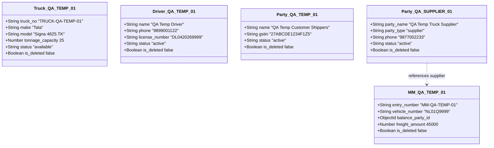
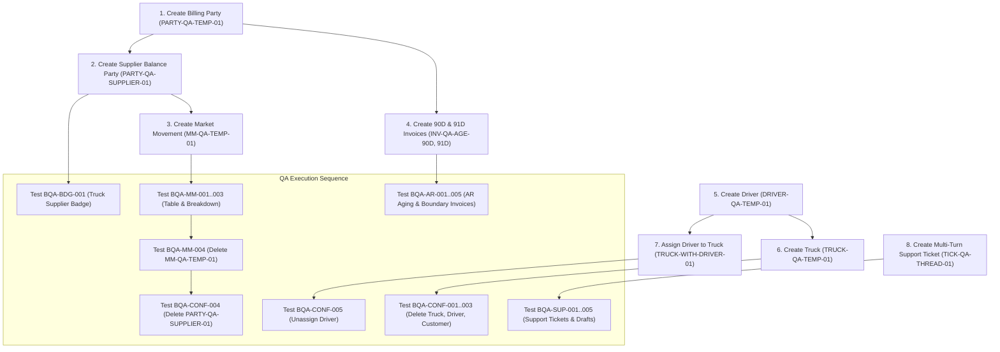

```mermaid
gantt
    title AR Aging Bucket Timeline & Day 90 Boundary Predicates
    dateFormat X
    axisFormat %d d
    section Buckets
    Current (0–30 Days)       :active, 0, 30
    31–60 Days                :crit, 30, 60
    61–90 Days (Day 90 Bound) :done, 60, 90
    > 90 Days Overdue (Day 91+) :crit, 90, 120
```

# Fleet Flow — Staging QA Test Data Preparation Plan (Documentation Only)

**Document Type:** Safe Staging Test Data Preparation & Lifecycle Plan  
**Batch:** H — General UI Polish (Phases H1–H5)  
**References:**  
- Test Checklist: [`docs/testing/audit/BATCH_H_BROWSER_QA_CHECKLIST.md`](BATCH_H_BROWSER_QA_CHECKLIST.md)  
- Readiness Review: [`docs/testing/audit/BATCH_H_BROWSER_QA_READINESS.md`](BATCH_H_BROWSER_QA_READINESS.md)  
- Signoff Reconciliation: [`docs/testing/audit/BATCH_H_FINAL_SIGNOFF_RECONCILIATION.md`](BATCH_H_FINAL_SIGNOFF_RECONCILIATION.md)  
**Project:** Fleet Flow — Transport Management SaaS  
**Corpus Name:** `Vishal-8630/Fleet-Flow`  
**Git Baseline Commit:** `b040e00` (Branch: `main`)  
**Target Environment:** Staging Preview (`http://localhost:5173`)  
**Execution Mode:** **DOCUMENTATION ONLY — ZERO DATA MUTATIONS EXECUTED**  
**Date:** October 17, 2026  
**Author:** Antigravity AI Quality & Architecture Pair  

---

## 1. Purpose, Scope & Strict Safety Governance

### 1.1 Purpose
This document provides a safe, reproducible operational blueprint for provisioning and cleaning up the test data fixtures required to execute the 41 manual browser checks in [`BATCH_H_BROWSER_QA_CHECKLIST.md`](BATCH_H_BROWSER_QA_CHECKLIST.md). It addresses the missing data prerequisites identified in Section 8 of [`BATCH_H_BROWSER_QA_READINESS.md`](BATCH_H_BROWSER_QA_READINESS.md).

### 1.2 Mandatory Safety Restrictions
In strict adherence to the project charter:
1. **No Mutations Executed Now:** This is a documentation-only deliverable. Zero database records, seed scripts, API requests, or database migrations are executed during this step.
2. **Zero Production Data:** No production customer records, commercial freight documents, or real-world credentials may ever be used. All test fixtures are strictly synthetic.
3. **Strict Multi-Tenant Scoping:** All records must be strictly isolated to the designated staging test tenant workspace (e.g. `Farma Logistics`, `company_id: ObjectId`). Cross-tenant sharing or global unscoped records are strictly forbidden.
4. **Accounting & Financial Ledger Invariance:** No real bank transactions, payment gateway sessions, general ledger journal entries, or credit note postings are created. All financial checks utilize inert simulated balances.
5. **No Active Record Sacrifice:** Existing operational staging assets must never be used as disposable targets for deletion tests.
6. **Incognito Instability Ban:** **DO NOT access or test `FF-ISSUE-058` / `QST-014` (Incognito session instability).** It remains strictly reserved as the final post-batch retest.
7. **Read-Only Code & Git Preservation:** Zero changes to application source code, integration test files, issue records, or previous audits.

---

## 2. Disposable Test Records Specification

The following disposable test records are required to safely test the `<ConfirmDialog />` deletion flows (`BQA-CONF-001` through `BQA-CONF-005` and `BQA-MM-004`) and primary badge rendering (`BQA-BDG-001`) without deleting active staging data.



---

### 2.1 Record 1: `TRUCK-QA-TEMP-01` (Disposable Vehicle Asset)
- **Target Test Check:** `BQA-CONF-001` (Vehicle deletion in-app `<ConfirmDialog />` verification).
- **Target View:** `/trucks` (`TruckListPage.tsx`).
- **Model Reference:** `backend/src/models/Truck.ts`.
- **Authorized Tenant Role:** `company_admin`.
- **Field Specifications (Inspected from `Truck.ts`):**
  - `truck_no`: `"TRUCK-QA-TEMP-01"` (String, uppercase, unique per tenant).
  - `make`: `"Tata Motors"` (String, required).
  - `model`: `"Signa 4825.TK"` (String, required).
  - `body_type`: `"Container"` (Enum: `'Open' | 'Container' | 'Trailer' | 'Tanker' | 'Flatbed' | 'Tipper'`).
  - `tonnage_capacity`: `25` (Number, required, $\ge 0$).
  - `current_odometer_kms`: `12500` (Number, $\ge 0$).
  - `status`: `'available'` (Enum: `'available' | 'on_trip' | 'in_maintenance' | 'decommissioned' | 'active'`).
  - `is_deleted`: `false` (Boolean).
- **Dependencies:** None.
- **Safe Creation Method:**
  - *Option A (Staging UI):* Log in as Admin, navigate to `/trucks`, click "Add Vehicle", fill in required fields, click "Save Vehicle".
  - *Option B (Mongoose Seed):* `Truck.create({ company_id, truck_no: 'TRUCK-QA-TEMP-01', make: 'Tata Motors', model: 'Signa 4825.TK', body_type: 'Container', tonnage_capacity: 25, status: 'available' })`.
- **Verification Steps:**
  1. Open `/trucks` in browser.
  2. Verify row `TRUCK-QA-TEMP-01` is visible in the vehicle asset table with status "Available".
- **Cleanup Procedure:**
  - *Via QA Test Execution:* Clicking "Confirm Remove" in `BQA-CONF-001` sets `is_deleted: true` via standard API mutation (`DELETE /api/fleet/trucks/:id`).
  - *Post-QA Verification:* Verify `TRUCK-QA-TEMP-01` disappears from the active vehicle list while audit history remains soft-deleted in database.

---

### 2.2 Record 2: `DRIVER-QA-TEMP-01` (Disposable Commercial Driver)
- **Target Test Check:** `BQA-CONF-002` (Driver roster removal in-app `<ConfirmDialog />`).
- **Target View:** `/fleet/drivers` (`DriverListPage.tsx`).
- **Model Reference:** `backend/src/models/Driver.ts`.
- **Authorized Tenant Role:** `company_admin`.
- **Field Specifications (Inspected from `Driver.ts`):**
  - `name`: `"QA Temp Test Driver"` (String, required).
  - `phone`: `"9899001122"` (String, required, 10 digits).
  - `license_number`: `"DL0420269999"` (String, required, uppercase).
  - `status`: `'active'` (Enum: `'active' | 'on_leave' | 'terminated'`).
  - `running_advance_balance`: `0` (Number, stored in paise).
  - `is_deleted`: `false` (Boolean).
- **Dependencies:** None.
- **Safe Creation Method:**
  - *Option A (Staging UI):* Navigate to `/fleet/drivers`, click "Add Commercial Driver", enter Name, Phone, and License, save record.
  - *Option B (Mongoose Seed):* `Driver.create({ company_id, name: 'QA Temp Test Driver', phone: '9899001122', license_number: 'DL0420269999', status: 'active' })`.
- **Verification Steps:**
  1. Open `/fleet/drivers`.
  2. Confirm `QA Temp Test Driver` appears in the roster with an "Active" badge.
- **Cleanup Procedure:**
  - Clicking "Confirm" in `BQA-CONF-002` deactivates/soft-deletes the driver via `DELETE /api/fleet/drivers/:id`.
  - Confirm driver row is removed from active roster table.

---

### 2.3 Record 3: `PARTY-QA-TEMP-01` (Disposable Customer Billing Party)
- **Target Test Check:** `BQA-CONF-003` (Customer party removal in-app `<ConfirmDialog />`).
- **Target View:** `/parties/billing` (`BillingPartyListPage.tsx`).
- **Model Reference:** `backend/src/models/BillingParty.ts`.
- **Authorized Tenant Role:** `company_admin`.
- **Field Specifications (Inspected from `BillingParty.ts`):**
  - `name`: `"QA Temp Consignor Logistics Pvt Ltd"` (String, required).
  - `gstin`: `"27ABCDE1234F1Z5"` (String, uppercase, matching 15-character GSTIN regex).
  - `phone`: `"9822003344"` (String).
  - `status`: `'active'` (Enum: `'active' | 'inactive'`).
  - `is_deleted`: `false` (Boolean).
- **Dependencies:** None.
- **Safe Creation Method:**
  - *Option A (Staging UI):* Navigate to `/parties/billing`, click "Add Billing Customer", enter legal name and valid test GSTIN, save.
  - *Option B (Mongoose Seed):* `BillingParty.create({ company_id, name: 'QA Temp Consignor Logistics Pvt Ltd', gstin: '27ABCDE1234F1Z5', phone: '9822003344', status: 'active' })`.
- **Verification Steps:**
  1. Open `/parties/billing`.
  2. Confirm party `QA Temp Consignor Logistics Pvt Ltd` appears in the table.
- **Cleanup Procedure:**
  - Clicking "Confirm" in `BQA-CONF-003` soft-deletes the party via `DELETE /api/parties/billing/:id`.
  - Verify party is removed from active customer registry.

---

### 2.4 Record 4: `PARTY-QA-SUPPLIER-01` (Vendor Balance Party / Truck Supplier)
- **Target Test Checks:**
  1. `BQA-BDG-001` (Verify Truck Supplier `.badge-primary` soft blue pill styling).
  2. `BQA-CONF-004` (Vendor / Balance Partner removal in-app `<ConfirmDialog />`).
- **Target View:** `/parties/balance` (`BalancePartyListPage.tsx`).
- **Model Reference:** `backend/src/models/BalanceParty.ts`.
- **Authorized Tenant Role:** `company_admin`.
- **Field Specifications (Inspected from `BalanceParty.ts`):**
  - `party_name`: `"QA Temp Truck Supplier Services"` (String, required).
  - `party_type`: `'supplier'` (Enum: `'supplier' | 'broker' | 'transporter' | 'petrol_pump' | 'other'`).
  - `phone`: `"9877002233"` (String, required).
  - `opening_balance`: `0` (Number).
  - `current_balance`: `0` (Number).
  - `status`: `'active'` (Enum: `'active' | 'inactive'`).
  - `is_deleted`: `false` (Boolean).
- **Dependencies:** None.
- **Critical Visual Invariant:** Setting `party_type: 'supplier'` triggers `case 'supplier'` in `BalancePartyListPage.tsx`, which outputs:
  `<span className="badge badge-primary">Truck Supplier</span>`.
  This allows testing `BQA-BDG-001` first, prior to testing deletion in `BQA-CONF-004`.
- **Safe Creation Method:**
  - *Option A (Staging UI):* Navigate to `/parties/balance`, click "Add Vendor / Partner", select Category "Truck Supplier", enter party name and phone, save.
  - *Option B (Mongoose Seed):* `BalanceParty.create({ company_id, party_name: 'QA Temp Truck Supplier Services', party_type: 'supplier', phone: '9877002233', status: 'active' })`.
- **Verification Steps:**
  1. Open `/parties/balance`.
  2. Verify party displays the blue `.badge-primary` container with text *"Truck Supplier"*.
- **Cleanup Procedure:**
  - Execute `BQA-CONF-004` after `BQA-BDG-001`. Clicking "Confirm" marks `is_deleted: true`.

---

### 2.5 Record 5: `MM-QA-TEMP-01` (Disposable Market Movement Entry)
- **Target Test Check:** `BQA-MM-004` (Market movement deletion in-app `<ConfirmDialog />`).
- **Target View:** `/operations/market-movements` (`VehicleEntryListPage.tsx`).
- **Model Reference:** `backend/src/models/VehicleEntry.ts`.
- **Authorized Tenant Role:** `company_admin` or `dispatcher`.
- **Field Specifications (Inspected from `VehicleEntry.ts`):**
  - `entry_number`: `"MM-QA-TEMP-01"` (String, required, uppercase).
  - `entry_date`: `new Date()` (Date, required).
  - `vehicle_number`: `"NL01Q9999"` (String, required, uppercase).
  - `driver_name`: `"Hired Driver Singh"` (String).
  - `from_location`: `"Mumbai Hub"` (String, required).
  - `to_location`: `"Pune Gateway"` (String, required).
  - `balance_party_id`: `ObjectId` of `PARTY-QA-SUPPLIER-01` (or existing test supplier, required).
  - `freight_amount`: `35000` (Number, required).
  - `driver_cash_advance`: `5000` (Number).
  - `diesel_advance_amount`: `10000` (Number).
  - `dala_charges`: `500` (Number).
  - `kamisan_amount`: `1500` (Number).
  - `status`: `'pending'` (Enum: `'pending' | 'partially_paid' | 'paid'`).
  - `is_deleted`: `false` (Boolean).
- **Dependencies:** Requires an active `BalanceParty` record (`balance_party_id`).
- **Safe Creation Method:**
  - *Option A (Staging UI):* Navigate to `/operations/market-movements`, click "New Market Vehicle", select Supplier, enter Vehicle #, Origin, Destination, Freight, and save.
  - *Option B (Mongoose Seed):* `VehicleEntry.create({ company_id, entry_number: 'MM-QA-TEMP-01', entry_date: new Date(), vehicle_number: 'NL01Q9999', from_location: 'Mumbai Hub', to_location: 'Pune Gateway', balance_party_id: supplier._id, freight_amount: 35000, is_deleted: false })`.
- **Verification Steps:**
  1. Open `/operations/market-movements`.
  2. Confirm `MM-QA-TEMP-01` is visible in the 10-column table.
- **Cleanup Procedure:**
  - Clicking "Confirm" in `BQA-MM-004` executes `DELETE /api/operations/vehicle-entries/:id`.
  - Confirm entry is removed from listing.

---

### 2.6 Record 6: `TRUCK-WITH-DRIVER-01` (Vehicle with Assigned Driver)
- **Target Test Check:** `BQA-CONF-005` (Driver unassignment in-app `<ConfirmDialog />`).
- **Target View:** `/fleet/trucks/:id` (`TruckDetailPage.tsx`).
- **Model Reference:** `backend/src/models/Truck.ts`.
- **Authorized Tenant Role:** `company_admin`.
- **Field Specifications:**
  - An active truck asset where `current_driver_id` points to a valid `Driver._id`.
- **Safe Setup:**
  - Create or select a dedicated non-production vehicle (e.g. `MH29KL23`).
  - Assign a driver via the Truck Detail "Assign Driver" button.
- **Verification Steps:**
  1. Open truck detail view at `/fleet/trucks/:id`.
  2. Confirm driver card displays the driver's name and an "Unassign Driver" button.
- **Cleanup Procedure:**
  - Executing `BQA-CONF-005` confirms unassignment, clearing `current_driver_id` and appending `unassigned_at` to `driver_assignments`.

---

## 3. Accounts Receivable (AR) Aging Boundary Invoices

To verify `BQA-AR-001` through `BQA-AR-005` and rigorously validate the **Day 90 Boundary Behavior** audited in [`BATCH_H_FINAL_SIGNOFF_RECONCILIATION.md`](BATCH_H_FINAL_SIGNOFF_RECONCILIATION.md), two distinct synthetic invoices must be seeded.

### 3.1 Backend Calculation Logic & Predicate Mathematics
In `backend/src/controllers/commercialReportController.ts` (lines 74–98):
```typescript
const invoiceDate = new Date(inv.invoice_date || inv.created_at);
const ageDays = Math.floor((now.getTime() - invoiceDate.getTime()) / (1000 * 60 * 60 * 24));

if (ageDays <= 30) buckets.current_0_30.push(summary);
else if (ageDays <= 60) buckets.days_31_60.push(summary);
else if (ageDays <= 90) buckets.days_61_90.push(summary);   // <-- DAY 90 INCLUDED HERE
else buckets.overdue_90_plus.push(summary);                // <-- AGE >= 91 CAPTURED HERE
```



---

### 3.2 Invoice 1: `INV-QA-AGE-90D` (Exact 90-Day Boundary Test)
- **Purpose:** Verifies that an invoice at **exactly 90 elapsed calendar days** renders in the **`61–90 Days`** bucket and tab, matching the backend predicate `ageDays <= 90`.
- **Target View:** `/commercial/aging` (`AgingReportPage.tsx`).
- **Model Reference:** `backend/src/models/Invoice.ts`.
- **Required Fields & Backdated Issue Date Formula:**
  - Let $T_{\text{now}}$ be the current date/time on the staging server:
    $$T_{\text{invoice}} = T_{\text{now}} - (90 \times 24 \times 60 \times 60 \times 1000\text{ ms}) - (60 \times 1000\text{ ms})$$
    *(Backdated exactly 90 days and 1 minute relative to current time).*
  - `invoice_number`: `"INV-QA-AGE-90D"`
  - `invoice_date`: $T_{\text{invoice}}$
  - `due_date`: $T_{\text{invoice}} + (30 \times 86400000\text{ ms})$
  - `billing_party_id`: `ObjectId` of active customer party
  - `billing_party_snapshot`: `{ name: 'QA Staging Customer', gstin: '27ABCDE1234F1Z5' }`
  - `total_amount`: `10000`
  - `balance_amount`: `10000` (Unpaid balance)
  - `status`: `'issued'` (Eligible for query: `status: { $in: ['issued', 'partially_paid'] }`)
  - `is_deleted`: `false`
- **Expected Bucket Placement:**
  $$\frac{T_{\text{now}} - T_{\text{invoice}}}{86400000} = 90.00069 \implies \text{Math.floor}(90.00069) = 90.$$
  Since $90 \le 90$, the invoice **MUST be categorized in `days_61_90` ("61–90 Days")**.
- **Non-Destructive Financial Safeguard:**
  - Stored purely as an issued invoice.
  - Zero journal entries, general ledger updates, or GST credit notes are created.
- **Cleanup Procedure:**
  - After QA signoff, soft-delete record: `Invoice.updateOne({ invoice_number: 'INV-QA-AGE-90D' }, { $set: { is_deleted: true } })`.

---

### 3.3 Invoice 2: `INV-QA-AGE-91D` (Overdue Boundary Test)
- **Purpose:** Verifies that an invoice at **91 elapsed calendar days** renders in the **`> 90 Days (Overdue)`** bucket and tab, matching the backend predicate `else` (`ageDays > 90`).
- **Target View:** `/commercial/aging` (`AgingReportPage.tsx`).
- **Model Reference:** `backend/src/models/Invoice.ts`.
- **Required Fields & Backdated Issue Date Formula:**
  - Let $T_{\text{now}}$ be the current date/time on the staging server:
    $$T_{\text{invoice}} = T_{\text{now}} - (91 \times 24 \times 60 \times 60 \times 1000\text{ ms}) - (60 \times 1000\text{ ms})$$
    *(Backdated exactly 91 days and 1 minute relative to current time).*
  - `invoice_number`: `"INV-QA-AGE-91D"`
  - `invoice_date`: $T_{\text{invoice}}$
  - `due_date`: $T_{\text{invoice}} + (30 \times 86400000\text{ ms})$
  - `billing_party_id`: `ObjectId` of active customer party
  - `billing_party_snapshot`: `{ name: 'QA Staging Customer', gstin: '27ABCDE1234F1Z5' }`
  - `total_amount`: `15000`
  - `balance_amount`: `15000` (Unpaid balance)
  - `status`: `'issued'`
  - `is_deleted`: `false`
- **Expected Bucket Placement:**
  $$\frac{T_{\text{now}} - T_{\text{invoice}}}{86400000} = 91.00069 \implies \text{Math.floor}(91.00069) = 91.$$
  Since $91 > 90$, the invoice **MUST be categorized in `overdue_90_plus` ("> 90 Days (Overdue)")**.
- **Cleanup Procedure:**
  - After QA signoff, soft-delete record: `Invoice.updateOne({ invoice_number: 'INV-QA-AGE-91D' }, { $set: { is_deleted: true } })`.

---

## 4. Multi-Turn Support Ticket Test Fixture

To verify `BQA-SUP-003` (two-pane thread width), `BQA-SUP-004` (unsent draft reply persistence), and `BQA-SUP-005` (narrow viewport layout) without exposing other tenants or contacting real customers:

### 4.1 Schema & Field Requirements (`SupportTicket.ts`)
- **Collection:** `support_tickets`
- **Model Reference:** `backend/src/models/SupportTicket.ts`.
- **Authorized Tenant:** Confined strictly to test tenant `company_id`.
- **Record Attributes:**
  - `ticket_no`: `"TICK-QA-THREAD-01"` (String, unique).
  - `subject`: `"Staging QA Multi-State E-Way Bill Inquiry"` (String).
  - `category`: `'compliance'` (Enum: `'billing' | 'dispatch' | 'compliance' | 'bug' | 'feature_request' | 'other'`).
  - `priority`: `'high'` (Enum: `'low' | 'medium' | 'high' | 'critical'`).
  - `status`: `'in_review'` (Enum: `'open' | 'in_review' | 'waiting_customer' | 'resolved' | 'closed'`).
  - `messages`: An array of `ITicketMessage` containing both `sender_role: 'user'` and `sender_role: 'support'` entries:
    ```typescript
    messages: [
      {
        sender_id: testUser._id,
        sender_name: "Operations Dispatcher",
        sender_role: "user",
        message: "Can we reassign vehicle assets on an active journey without voiding the active consignment e-way bill?",
        sent_at: new Date(Date.now() - 3600000) // 1 hour ago
      },
      {
        sender_id: new Types.ObjectId(),
        sender_name: "Fleet Flow Support",
        sender_role: "support",
        message: "Yes! Navigate to Fleet Operations > Journeys > select the journey record and click 'Update Vehicle'. Part-B will automatically re-link.",
        sent_at: new Date(Date.now() - 1800000) // 30 mins ago
      }
    ]
    ```

### 4.2 Safe Provisioning Procedure Without External Communication
1. **Isolated Data Path:**
   - The ticket is inserted with `company_id: testTenant._id`.
   - The support response message is generated with `sender_role: 'support'` within the ticket's embedded `messages` array.
2. **Zero Notification Dispatch:**
   - Because the record is seeded directly into the staging database fixture, no email webhooks, SMS gateways, or Twilio notifications are fired to external numbers.
3. **Verification Steps:**
   1. Log in as test user and navigate to `/support`.
   2. Click on ticket `TICK-QA-THREAD-01`.
   3. Verify that the user message renders aligned right with blue primary background (`var(--color-primary-600)`).
   4. Verify that the support reply renders aligned left with subtle grey background (`var(--bg-subtle)`) and label `"Fleet Flow Support (Support)"`.
   5. Verify that the conversation header renders with subject, ticket ID, category, and "Close" button.
4. **Cleanup Procedure:**
   - Soft-delete or remove test ticket: `SupportTicket.deleteOne({ ticket_no: 'TICK-QA-THREAD-01' })`.

---

## 5. Execution Order & Dependency Graph

To prevent data dependency failures (e.g. attempting to delete a supplier that is currently attached to a market movement), test data provisioning and testing must follow this topological sequence:



> [!IMPORTANT]
> **Dependency Rule:** Always execute `BQA-MM-004` (deleting `MM-QA-TEMP-01`) **BEFORE** executing `BQA-CONF-004` (deleting `PARTY-QA-SUPPLIER-01`), because `MM-QA-TEMP-01` holds a foreign key reference to `PARTY-QA-SUPPLIER-01`.

---

## 6. Traceability Matrix: Inspected Facts vs. Assumptions Requiring Confirmation

| Item | Inspected Fact from Codebase | Assumption / Requirement for Staging Confirmation |
| :--- | :--- | :--- |
| **Truck Schema** | `truck_no` is uppercase, required, unique per company. `make`, `model`, `tonnage_capacity` required. Soft-deleted via `is_deleted: true`. | Staging database has at least one active company tenant provisioned. |
| **Driver Schema** | `name`, `phone`, `license_number` required. Masked Aadhaar virtual supported. | Staging database permits test license number `DL0420269999` without colliding with existing driver. |
| **Supplier Badge Mapping** | In `BalancePartyListPage.tsx`, `case 'supplier'` maps to `.badge-primary` with text `"Truck Supplier"`. | Setting `party_type: 'supplier'` will immediately trigger the badge without additional configuration. |
| **Market Movement Formula** | Net Due = Freight - Cash Advance - Diesel Advance - Dala - Kamisan + Halting. Verified in `VehicleEntry.ts`. | Table renders 10 columns; Dala/Commission moved to 1-click modal. Verified in `VehicleEntryListPage.tsx`. |
| **AR Aging Predicate** | Controller uses `Math.floor()` from `invoice_date || created_at`. Day 90 is strictly in `days_61_90`; Day 91+ is in `overdue_90_plus`. | Server clock and database clock are in synchronization (UTC). |
| **Support Thread Roles** | `SupportTicketsPage.tsx` checks `msg.sender_role === 'user'` for right alignment and `!== 'user'` for left alignment. | Seeded message with `sender_role: 'support'` will render as left-aligned support bubble with "(Support)" badge. |

---

## 7. Unresolved Blockers & Authorizations Required

### 7.1 Blockers
- **Zero Technical Blockers:** The schemas, formulas, controllers, and components are fully implemented, verified by 68 automated Vitest integration tests, and compiled cleanly in the frontend production bundle.

### 7.2 Explicit Staging Authorizations Required Before Execution
Prior to altering any staging records or running manual QA:
1. **Approval of Test Plan:** Explicit signoff on this test data preparation plan (`BATCH_H_STAGING_TEST_DATA_PLAN.md`).
2. **Designation of Staging Tenant:** Confirmation of the target staging company workspace (e.g. `Farma Logistics`) and user credentials for QA.
3. **Authorization to Seed Synthetic Test Fixtures:** Authorization to create the 6 disposable master registry records, 2 backdated invoices, and 1 multi-turn support ticket as documented above.

---

## 8. Stop Condition Adherence

In strict adherence to instructions:
- **No data mutations were performed.**
- **No database connections, seed scripts, or migrations were run.**
- **No application code, tests, issue files, or existing audit reports were altered.**
- **`FF-ISSUE-058 / QST-014` remains strictly unexecuted and reserved for the final workstream.**
- **Git status remains completely preserved.**

Execution is paused. Awaiting explicit user instruction.
