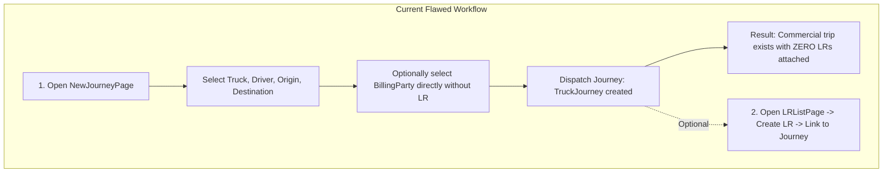
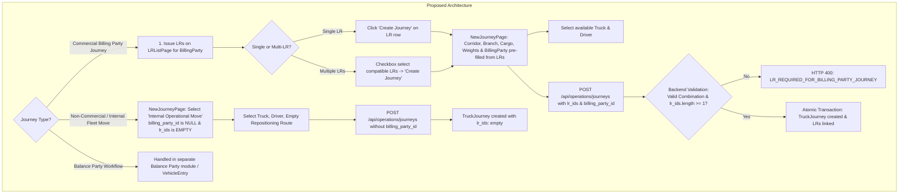

# Fleet Flow — Billing Party LR-to-Journey Workflow: Pre-Implementation Design

**Document Type:** Architectural Design Document & Pre-Implementation Specification  
**Project:** Fleet Flow — Enterprise Transport & Fleet Management SaaS  
**Target Path:** `docs/testing/audit/BILLING_PARTY_LR_JOURNEY_WORKFLOW_DESIGN.md`  
**Date:** October 2026  
**Status:** Design Proposal (Documentation Only — No Code Implemented)  
**Related Issues:** [`FF-ISSUE-041`](../issues/trip-lifecycle/FF-ISSUE-041-customer-billing-party-field-linkage-unclear.md), [`FF-ISSUE-045`](../issues/financial-accounting/FF-ISSUE-045-credit-limit-balance-semantics.md), [`DEC-004`](../decisions/DEC-004-freight-invoice-eligibility.md), [`DEC-005`](../decisions/DEC-005-invoice-creation-dual-paths.md), [`DEC-007`](../decisions/DEC-007-credit-limit-warning-and-override.md), [`DEC-009`](../decisions/DEC-009-lr-trip-workflow-architecture.md), [`DEC-010`](../decisions/DEC-010-branches-hubs-operational-model.md)

---

## A. Purpose and Scope

### 1. Business Problem
In commercial Indian road logistics, transport operations for corporate billing customers (`BillingParty`) begin with a legal contract of carriage: the Lorry Receipt (LR / Bilty) issued under the Carriage by Road Act. Once one or more consignments are booked, an operational transport journey (`TruckJourney`) is assembled to transport those goods using an available commercial vehicle asset and driver.

In Fleet Flow's current implementation, this operational relationship is inverted and poorly constrained:
- A user must first create a `TruckJourney` in isolation on `NewJourneyPage.tsx`.
- Only *after* a journey exists can an operator open `LRListPage.tsx` and optionally attach an LR to the pre-existing journey via a dropdown.
- There is no capability to select one or multiple existing LRs and assemble a journey from them.
- Worse, the system currently permits users to create a commercial journey with a `BillingParty` directly without any LR, creating orphaned commercial journeys that bypass consignment documentation and distort billing pipelines.
- `TruckJourney` does not maintain an explicit reference to its carried LRs; the relationship is strictly stored as a one-way pointer on `Entry.journey_id`.

### 2. Confirmed Core Business Rules
The following rules have been confirmed by the product owner:
1. **Compulsory LR for Every Billing Party Journey:** An LR is **strictly mandatory** for every Billing Party journey. A Billing Party journey must be created from one or more eligible LRs. The user must not be able to create a Billing Party journey directly without an LR.
2. **Strict Backend Enforcement on All Combinations (Anti-Bypass Invariant):** The mandatory-LR rule must be enforced server-side in the backend API controller (`journeyController.ts`), rather than relying solely on frontend UI disablement. Every combination of `journey_type`, `billing_party_id`, and `lr_ids` must be strictly defined and validated so that changing or omitting the journey type cannot bypass the mandatory-LR rule under any circumstance.
3. **Mandatory Customer Derivation & Consistency on Commercial Journeys:** When `lr_ids` is supplied without `billing_party_id`, the backend must derive the commercial customer from the selected LRs and validate customer consistency across all LRs. If the LRs do not identify exactly one consistent valid customer (e.g. unassigned consignments or multiple different customers), the request is strictly rejected (`HTTP 400`). Under no circumstance is a commercial journey permitted with LRs but no validated customer.
4. **Backward Compatibility via Sensible Inference for Legacy Clients:** When existing or legacy API clients omit `journey_type`:
   - If `billing_party_id` is supplied, the system infers a commercial journey and **strictly requires `lr_ids.length >= 1`** (blocking any legacy attempt to create an LR-free customer journey with HTTP 400 `LR_REQUIRED_FOR_BILLING_PARTY_JOURNEY`).
   - If `lr_ids` is supplied (without `billing_party_id`), the system infers a commercial journey, derives the customer from the LRs, validates customer consistency, and links the consignments.
   - If neither `billing_party_id` nor `lr_ids` are supplied, the system infers an internal operational journey (`internal_repositioning`), preserving legacy direct non-commercial dispatches without weakening the mandatory-LR rule.
5. **Multiple Compatible LRs per Journey:** One LR can create a journey, and one journey can carry multiple compatible LRs for the same customer along the same corridor.
6. **Legitimate Direct Journey Scenarios Preserved:** Direct journey creation without an LR must remain available **only** for workflows that legitimately require it:
   - The separately handled **Balance Party workflow** (inter-transporter brokerage, market hire, and counterparty settlements).
   - Confirmed **internal / non-commercial operational journeys** (e.g., empty truck repositioning, yard-to-yard vehicle relocation, workshop/maintenance transit) where there is no customer billing party (`billing_party_id` is null).
   - *Direct journeys must not all be assumed to be Balance Party journeys; internal non-commercial fleet moves are distinct.*
7. **Schema Default Decoupled from API Inference (Preserving Historical LR-Free Records):** In `TruckJourneySchema`, `journey_type` is an optional field with **no schema-level default of `'commercial'`**. Persisted-record schema defaults are strictly decoupled from API request inference. When Mongoose hydrates historical records that lack `journey_type`, the property hydrates as `undefined`. Unrelated operational updates to historical records will never implicitly persist `journey_type: 'commercial'` or trigger creation-time LR validation.
8. **Future Request Validation Strategy (Two-Tier Model):**
   - **Future Create Requests (`POST /api/operations/journeys`):** Must strictly adhere to the exhaustive validation matrix, preventing any new commercial journey from being dispatched without LRs or without a validated customer.
   - **Future Operational Update Requests on Existing Records:** En-route logging (`milestones`, `delays`, `diesel`, `expenses`), driver reassignment (`swap-driver`), proof-of-delivery closeout (`pod`), draft dispatch (`dispatch`), and trip cancellation (`cancel`) validate only action-specific payloads and state-machine transitions without retroactively demanding LRs on legitimate historical records.
   - **Future Structural Update Requests:** Any request modifying core journey attributes cannot bypass the mandatory-LR rule (e.g., cannot add a customer or switch type to commercial without LRs, and cannot strip LRs from a commercial journey).
9. **Customer Invoicing Downstream:** Invoicing occurs downstream of transport and delivery. An invoice can bundle multiple delivered LRs for the same `BillingParty` at month-end. Customer advances are not part of this workflow.

### 3. Explicitly Out of Scope
The following areas are intentionally preserved as-is and excluded from this task:
- **Balance Party Workflow Implementation:** Direct LR-free journey creation for Balance Parties, market vehicle movements (`VehicleEntry`), and reciprocal payables/receivables when third parties hire our trucks are deferred to a separate future task.
- **Model Merging:** No merging of `BillingParty` and `BalanceParty`, and no merging of `TruckJourney` and `VehicleEntry`.
- **Accounting Redesign:** No alterations to double-entry general ledger mechanics (`Ledger.ts`), TDS rules, or GST tax calculations.
- **Incognito/Session Retest (`FF-ISSUE-058 / QST-014`):** Strictly reserved for final execution after all development batches are complete.

---

## B. Current versus Proposed Workflow

### 1. Current Inverted and Unconstrained Workflow
Today, journeys can be created with or without a Billing Party and with zero LRs attached:



### 2. Proposed Workflow: Compulsory LR for Billing Party Journeys
The proposed workflow strictly gates commercial customer journeys behind consignment generation, while preserving direct dispatches for internal non-commercial runs:



### 3. Customer Invoicing Workflow (Post-Delivery Placement)
Invoicing remains downstream of transport execution, bundling completed LRs for a billing customer:

```mermaid
flowchart TD
    subgraph Downstream Customer Invoicing
        JComp[TruckJourney Completed & POD Uploaded] --> LRDelivered[LRs marked Delivered / In Transit]
        LRDelivered --> MonthEnd[Month-End Billing Cycle Close]
        MonthEnd --> OpenInv[Open InvoiceListPage -> Create Invoice]
        OpenInv --> SelCust[Select BillingParty]
        SelCust --> FetchLRs[API loads all active unbilled LRs for customer]
        FetchLRs --> SelectBatch[Finance selects multiple LRs for consolidated bill]
        SelectBatch --> PostInv[POST /api/invoices]
        PostInv --> LockLRs[LR status updated: invoiced with invoice_id]
        LockLRs --> TrackRec[Track Receivables, Aging, & Record Customer Payments]
    end
```



---

## C. Current Implementation and Data Relationships

### 1. Model Definitions & Current Linkages

#### `Entry` (Lorry Receipt / Consignment) — [`backend/src/models/Entry.ts`](file:///c:/Users/vishh/OneDrive/Desktop/Work/TransportManagement/backend/src/models/Entry.ts)
- **Primary Identifier:** `lr_no` (e.g., `MUM-LR-0001`, unique per tenant company).
- **Customer Reference:** `billing_party_id: { type: ObjectId, ref: 'BillingParty' }` (optional in schema, standard in commercial consignments).
- **Consignor / Consignee:** Inline entities capturing sender/receiver names, addresses, GSTINs, and phone numbers.
- **Corridor:** `from_location: string`, `to_location: string`.
- **Specifications:** `actual_weight_tonnes`, `chargeable_weight_tonnes`, `cbm_volume`, `package_count`, `goods_description`.
- **Financial Terms:** `freight_terms: 'to_be_billed' | 'paid' | 'to_pay'`, `freight_amount: number`, `rate_per_tonne: number`.
- **Current Linkages:**
  - `branch_id?: ObjectId` (Originating regional branch).
  - `journey_id?: ObjectId` (Pointer to `TruckJourney`, indexed).
  - `invoice_id?: ObjectId` (Pointer to `Invoice`, set when invoiced).
- **Status Enum:** `status: 'active' | 'invoiced' | 'cancelled'`.

#### `TruckJourney` (Trip Dispatch) — [`backend/src/models/TruckJourney.ts`](file:///c:/Users/vishh/OneDrive/Desktop/Work/TransportManagement/backend/src/models/TruckJourney.ts)
- **Primary Identifier:** `journey_number` (e.g., `JRN-0001`, unique per tenant company).
- **Resources:** `truck_id: ObjectId` (from `Truck`), `driver_id: ObjectId` (from `Driver`).
- **Commercial Association:** `billing_party_id?: ObjectId` (Ref to `BillingParty`).
- **Branch Association:** `branch_id?: ObjectId` (Ref to `Branch`).
- **Route & Corridor:** `from_location: { city, state, hub_name }`, `to_location: { city, state, hub_name }`, `route_checkpoints: IRouteCheckpoint[]`.
- **Payload & Odometer:** `loaded_weight_tonnes`, `cbm_volume`, `cargo_description`, `start_odometer_kms`, `end_odometer_kms`.
- **Financial Parameters:** `freight_rate: number`, `starting_cash_advance: number` (driver cash advance).
- **Status Lifecycle:** `status: 'draft' | 'active' | 'completed' | 'delayed' | 'cancelled'`, `delivery_status: 'pending' | 'delivered' | 'rejected'`.
- **Current Critical Defect:** Does *not* maintain an array of associated `lr_ids` and allows `billing_party_id` to be stored without any associated LRs.

#### `Invoice` (GST Freight Tax Invoice) — [`backend/src/models/Invoice.ts`](file:///c:/Users/vishh/OneDrive/Desktop/Work/TransportManagement/backend/src/models/Invoice.ts)
- **Primary Identifier:** `invoice_number` (e.g., `INV-MUM-0001`).
- **Customer Reference:** `billing_party_id: ObjectId` (Required, with customer snapshot).
- **LR Aggregation:** `lr_ids: ObjectId[]` (Ref to `Entry`). Supports 1-to-many consignment aggregation out of the box.
- **Line Items:** `items: IInvoiceItem[]` auto-populated from `Entry` fields (`lr_no`, `from_location`, `to_location`, `chargeable_weight`, `amount`).
- **Financials:** `subtotal`, `tax_type`, `is_rcm`, `cgst_amount`, `sgst_amount`, `igst_amount`, `total_amount`, `paid_amount`, `balance_amount`.
- **Status Enum:** `status: 'draft' | 'issued' | 'partially_paid' | 'paid' | 'cancelled'`.

### 2. Multi-LR Support Today
The data model today already supports multiple LRs pointing to the same `journey_id` because `Entry.journey_id` is a non-unique indexed field. However:
- The backend `TruckJourney` controller does not query, expose, or validate associated LRs during trip creation or lifecycle updates.
- The frontend `JourneyDetailPage.tsx` displays trip details, driver expenses, and fuel logs, but completely omits a table or summary of associated LRs.
- There is no automated aggregation of cargo weights, package counts, or freight revenues from attached LRs into the journey record.

### 3. Tenant and Branch Enforcements
- **Tenant Scoping:** Both `Entry` and `TruckJourney` use `tenantPlugin` to auto-filter queries by `company_id`. Anti-IDOR validation via `validateTenantOwnership` verifies all foreign keys belong to the active company workspace.
- **Branch Relationships (`DEC-010`):** Both models store `branch_id`.

### 4. Status Separation
Delivery status and billing status are decoupled across distinct fields:
- `TruckJourney.delivery_status` (`pending` / `delivered` / `rejected`) tracks physical proof of delivery.
- `TruckJourney.status` (`draft` / `active` / `completed` / `delayed` / `cancelled`) tracks vehicle movement.
- `Entry.status` (`active` / `invoiced` / `cancelled`) tracks commercial billing progression.
- `Invoice.status` (`draft` / `issued` / `partially_paid` / `paid` / `cancelled`) tracks payment collections.

---

## D. Proposed Behavior

### 1. Starting Journey Creation from LR(s)
Operators will have two standard user entry points on [`LRListPage.tsx`](file:///c:/Users/vishh/OneDrive/Desktop/Work/TransportManagement/frontend/src/pages/commercial/LRListPage.tsx):
1. **Single-LR Row Action:** A "Create Journey" action button on each unassigned active LR row.
2. **Multi-LR Bulk Action:** Checkboxes on each unassigned active LR row, with a top-bar action: `"Create Journey with Selected (N)"`.

Both actions navigate to `/operations/journeys/new` passing the selected LR IDs via route navigation state (`location.state = { lr_ids: [...] }`) and query string parameters (`/operations/journeys/new?lr_ids=id1,id2`).

### 2. Mandatory LR Gating on `NewJourneyPage.tsx`
To enforce that a user **cannot create a Billing Party journey directly without an LR**:
- **Commercial Billing Party Mode:**
  - When accessed via LR selection, the page operates in **Billing Party Consignment Mode**.
  - The customer `billing_party_id` is locked/pre-filled from the selected LRs.
  - The attached LRs are prominently rendered in an **"Attached Consignments (LRs)"** card displaying LR numbers, consignor, consignee, package count, weight, and volume.
- **Direct Journey Creation (Without LRs):**
  - If a user navigates to `/operations/journeys/new` directly without pre-selecting LRs:
    - The page defaults to **"Internal / Operational Move"** mode (e.g., Empty Truck Repositioning, Maintenance Run).
    - The **Customer Billing Party dropdown is disabled or removed** from this mode.
    - A clear visual callout is displayed: *"To create a journey for a Customer Billing Party, create or select Lorry Receipts first from the Lorry Receipts registry."*
    - This UI gating guarantees users cannot initiate direct commercial journeys.

### 3. Form Field Inheritance and Aggregation
When `NewJourneyPage.tsx` loads with `lr_ids`:
- **Origin & Destination:**
  - *Single LR:* Inherits `from_location` and `to_location` directly.
  - *Multiple LRs:* If all LRs share the same origin and destination cities, pre-fills them. If destinations vary along a corridor (e.g., Mumbai to Surat, Mumbai to Ahmedabad), sets the farthest destination as `to_location` and adds intermediate drop points as `route_checkpoints`.
- **Payload Aggregation:**
  - `loaded_weight_tonnes`: Auto-sum of `actual_weight_tonnes` across all selected LRs.
  - `cbm_volume`: Auto-sum of `cbm_volume` across all selected LRs.
  - `cargo_description`: Concatenation of consignment descriptions (e.g., `"Consignment 1 (Steel Rods), Consignment 2 (Hardware)"`).
- **Commercial & Branch Linkage:**
  - `branch_id`: Inherited if all LRs share the same branch.
  - `billing_party_id`: Pre-filled from the selected LRs.
- **Fields Preserved as LR-Specific:**
  - Consignor and consignee names/addresses/GSTINs.
  - Declared goods values, risk categories, packaging types, and bill numbers.
  - Individual commercial freight charges (`rate_per_tonne`, `freight_amount`).

### 4. Operational Compatibility Safeguards
When multiple LRs are selected together:
1. **Tenant Isolation:** All LRs must belong to the active company workspace.
2. **Lifecycle State:** All selected LRs must be `status === 'active'` and `is_deleted === false`. Invoiced or cancelled LRs cannot be selected.
3. **Assignment Lock:** Selected LRs must not already be linked to an active, delayed, or completed journey (`journey_id` must be null/empty).
4. **Strict Customer Consistency & Mandatory Commercial Customer:** Every commercial journey requires an identified, validated billing customer. All selected LRs must belong to the exact same `billing_party_id`. When `lr_ids` is supplied without `billing_party_id`, the backend automatically derives the customer from the LRs and validates that 100% of the selected LRs belong to that single customer. If LRs have unassigned customers or belong to multiple different customers, the dispatch is strictly rejected (`HTTP 400`). Under no circumstance is a commercial journey permitted with LRs but no validated customer.
5. **Branch Alignment:** Selected LRs must belong to the same regional originating branch (or unassigned/Head Office).
6. **Payload Capacity Warning:** If the assigned truck's `tonnage_capacity` is less than the aggregated `loaded_weight_tonnes`, the UI displays a clear visual warning banner.

### 5. Exhaustive Parameter Validation Matrix & Anti-Bypass Invariants
To ensure that changing the journey type, omitting parameters, or submitting unexpected inputs **cannot bypass the mandatory-LR rule**, every combination of `(journey_type, billing_party_id, lr_ids)` is explicitly defined and enforced server-side.

The Cartesian product of all possible parameter states maps deterministically to either an accepted dispatch (`HTTP 201`) or a specific, actionable client rejection (`HTTP 400` / `HTTP 404` / `HTTP 409`):

| Row | `journey_type` Parameter | `billing_party_id` Parameter | `lr_ids` Parameter | Validation Result | HTTP Code & Error Code | Rationale & Anti-Bypass Guarantee |
| :---: | :--- | :--- | :--- | :---: | :---: | :--- |
| **1** | `'commercial'` | Present (Valid ID) | Non-empty ($\ge 1$, Matching Customer) | **VALID** | **HTTP 201 Created** | Standard Billing Party Commercial Journey. Pre-requisite LRs linked atomically. |
| **2** | `'commercial'` | Present (Valid ID) | Non-empty ($\ge 1$, Mismatched Customer) | **REJECTED** | **HTTP 400 (`CUSTOMER_MISMATCH`)** | LRs belong to a customer different from `billing_party_id`. |
| **3** | `'commercial'` | Present (Valid ID) | Empty / Omitted | **REJECTED** | **HTTP 400 (`LR_REQUIRED_FOR_BILLING_PARTY_JOURNEY`)** | **Mandatory LR Invariant:** A commercial customer journey cannot exist without one or more LRs. |
| **4a** | `'commercial'` | Omitted / Null | Non-empty ($\ge 1$, Single Customer) | **VALID** | **HTTP 201 Created** | **Customer Derived:** Backend derives and assigns `journey.billing_party_id` from LRs. |
| **4b** | `'commercial'` | Omitted / Null | Non-empty ($\ge 1$, Multi/Unassigned) | **REJECTED** | **HTTP 400 (`CUSTOMER_MISMATCH` / `CUSTOMER_REQUIRED_FOR_COMMERCIAL_JOURNEY`)** | **Mandatory Customer Rule:** Selected LRs must identify one valid customer. Customerless commercial journeys are strictly prohibited. |
| **5** | `'commercial'` | Omitted / Null | Empty / Omitted | **REJECTED** | **HTTP 400 (`COMMERCIAL_JOURNEY_REQUIRES_LRS`)** | **Anti-Bypass Invariant:** Omitting `billing_party_id` cannot be used to dispatch a commercial cargo trip without LRs. |
| **6** | `'internal_repositioning'` | Present (Valid ID) | Non-empty ($\ge 1$) | **REJECTED** | **HTTP 400 (`INTERNAL_JOURNEY_CANNOT_HAVE_BILLING_PARTY`)** | **Anti-Bypass Invariant:** Internal fleet moves cannot bill a customer. |
| **7** | `'internal_repositioning'` | Present (Valid ID) | Empty / Omitted | **REJECTED** | **HTTP 400 (`INTERNAL_JOURNEY_CANNOT_HAVE_BILLING_PARTY`)** | **Anti-Bypass Invariant:** Changing type to internal cannot bypass the mandatory LR rule for a customer. |
| **8** | `'internal_repositioning'` | Omitted / Null | Non-empty ($\ge 1$) | **REJECTED** | **HTTP 400 (`INTERNAL_JOURNEY_CANNOT_HAVE_LRS`)** | **Consistency Invariant:** An empty truck repositioning run cannot carry commercial cargo LRs. |
| **9** | `'internal_repositioning'` | Omitted / Null | Empty / Omitted | **VALID** | **HTTP 201 Created** | Legitimate direct non-commercial dispatch: Empty vehicle repositioning / depot rebalancing. |
| **10** | `'maintenance'` | Present (Valid ID) | Non-empty ($\ge 1$) | **REJECTED** | **HTTP 400 (`INTERNAL_JOURNEY_CANNOT_HAVE_BILLING_PARTY`)** | **Anti-Bypass Invariant:** Workshop transit cannot tag a commercial billing customer. |
| **11** | `'maintenance'` | Present (Valid ID) | Empty / Omitted | **REJECTED** | **HTTP 400 (`INTERNAL_JOURNEY_CANNOT_HAVE_BILLING_PARTY`)** | **Anti-Bypass Invariant:** Changing type to maintenance cannot bypass mandatory LRs for a customer. |
| **12** | `'maintenance'` | Omitted / Null | Non-empty ($\ge 1$) | **REJECTED** | **HTTP 400 (`INTERNAL_JOURNEY_CANNOT_HAVE_LRS`)** | **Consistency Invariant:** Workshop/repair transit cannot carry commercial cargo LRs. |
| **13** | `'maintenance'` | Omitted / Null | Empty / Omitted | **VALID** | **HTTP 201 Created** | Legitimate direct non-commercial dispatch: Transit to workshop, garage, or bodybuilder. |
| **14** | **Omitted / Undefined** *(Legacy client)* | Present (Valid ID) | Non-empty ($\ge 1$, Matching Customer) | **VALID** | **HTTP 201 Created** | **Sensible Inference:** Infers `commercial`. Valid customer trip created with linked LRs. |
| **15** | **Omitted / Undefined** *(Legacy client)* | Present (Valid ID) | Empty / Omitted | **REJECTED** | **HTTP 400 (`LR_REQUIRED_FOR_BILLING_PARTY_JOURNEY`)** | **Sensible Inference:** Infers `commercial`. Strictly rejects customer trip lacking LRs. |
| **16a** | **Omitted / Undefined** *(Legacy client)* | Omitted / Null | Non-empty ($\ge 1$, Single Customer) | **VALID** | **HTTP 201 Created** | **Sensible Inference:** Infers `commercial`. Backend derives and sets `billing_party_id` from LRs. |
| **16b** | **Omitted / Undefined** *(Legacy client)* | Omitted / Null | Non-empty ($\ge 1$, Multi/Unassigned) | **REJECTED** | **HTTP 400 (`CUSTOMER_MISMATCH` / `CUSTOMER_REQUIRED_FOR_COMMERCIAL_JOURNEY`)** | **Sensible Inference:** Infers `commercial`. Rejected because LRs do not identify one consistent customer. |
| **17** | **Omitted / Undefined** *(Legacy client)* | Omitted / Null | Empty / Omitted | **VALID** | **HTTP 201 Created** | **Sensible Inference:** Infers `internal_repositioning`. Preserves legacy direct empty runs. |
| **18** | *Invalid Enum String (e.g. 'other', 'third_party')* | Any | Any | **REJECTED** | **HTTP 400 (`INVALID_JOURNEY_TYPE`)** | Schema validation fails. Unsupported journey classification rejected. |

#### Core Anti-Bypass Principles
1. **Changing Journey Type Cannot Bypass Mandatory LRs:** If a request contains a `billing_party_id`, the only allowable `journey_type` is `'commercial'` (or omitted, which infers `'commercial'`). Attempting to set `journey_type` to `'internal_repositioning'` or `'maintenance'` while passing a customer is strictly rejected with `HTTP 400 (INTERNAL_JOURNEY_CANNOT_HAVE_BILLING_PARTY)`.
2. **Omitting Customer Cannot Bypass Mandatory LRs:** An operator cannot bypass the LR requirement by selecting `'commercial'` and leaving `billing_party_id` blank with zero LRs. The controller detects `journey_type === 'commercial'` and strictly requires `lr_ids.length >= 1` (`HTTP 400 COMMERCIAL_JOURNEY_REQUIRES_LRS`).
3. **Sensible Inference for Legacy Clients Preserves Both Safety and Compatibility:**
   - Legacy automated scripts or integrations omitting `journey_type` cannot dispatch a customer journey without an LR: if `billing_party_id` is passed, the system infers `commercial` and immediately halts with `HTTP 400 (LR_REQUIRED_FOR_BILLING_PARTY_JOURNEY)` unless `lr_ids` is present.
   - Conversely, legacy scripts creating non-commercial internal truck repositionings (omitting both customer and LRs) continue working seamlessly without modification, inferred as `internal_repositioning` (`HTTP 201`).
4. **No Commercial Journey Permitted Without a Validated Customer:** If `billing_party_id` is omitted while `lr_ids` is provided, the backend derives the customer from the LRs and strictly enforces that every selected LR belongs to that identical customer. If any LR lacks a customer or belongs to a different customer, the request is rejected with `HTTP 400`. The resulting journey is always saved with a non-null, validated `billing_party_id`. Under no circumstance can a commercial journey exist without a validated customer.

---

### 6. Existing Stored Journeys & Future Create/Update Validation Specification

#### 6.1 Status of Existing Stored Journeys (No Invalidation, No Migration)
- **Historical Invariant:** Existing `TruckJourney` records already persisted in the database (across all statuses: `draft`, `active`, `completed`, `delayed`, `cancelled`) that were created without LRs are **neither corrupted nor invalidated**. They remain 100% legitimate historical records.
- **Why Historical Journeys Lack Direct LRs:** Prior to this design, Fleet Flow's schema did not maintain an `lr_ids` array on `TruckJourney`; commercial relationships were optionally tracked only via a reverse pointer on `Entry.journey_id` or left unassigned. Many legitimate commercial trips were completed, delivered, billed, and settled in past months under that architecture.
- **No Data Migration or Synthetic Records:**
  - Absolutely no database migration script will be executed to mutate existing records, delete historical trips, or synthesize fake/dummy LRs.
  - In MongoDB, existing `TruckJourney` documents will simply lack `journey_type` and `lr_ids` properties.
- **Safe Backward-Compatible Schema Definition (No Schema Default on `journey_type`):**
  - In `TruckJourneySchema`, `journey_type` is defined as an optional string field (`required: false`) **without any schema-level default value** (i.e., NO `default: 'commercial'`).
  - **Decoupling Schema Hydration from API Request Inference:**
    - On existing historical records in MongoDB, `journey_type` is absent. When Mongoose hydrates these documents into memory, `journey.journey_type` remains `undefined`.
    - Because there is no schema default, Mongoose never implicitly turns historical LR-free journeys into commercial journeys in memory during schema hydration.
    - Unrelated operational updates to historical records (such as logging milestones, recording delays, logging diesel stops, recording cash expenses, or completing POD closeout via `save()` or `findByIdAndUpdate()`) will never write `journey_type: 'commercial'` to the database or trigger creation-time LR validation.
    - Read queries, listings, and dashboard aggregations continue to handle historical records cleanly without error.
    - Conversely, API request inference operates strictly at the controller layer during *new* journey creation (`POST /api/operations/journeys`), ensuring that all *newly* created journeys have an explicit `journey_type` persisted.

#### 6.2 Validation of Future CREATE Requests (`POST /api/operations/journeys`)
- Every new journey creation request is evaluated against the exhaustive parameter validation matrix (Section D.5).
- If `journey_type` is omitted by an existing or legacy API client, sensible inference rules apply:
  - If `billing_party_id` is supplied $\to$ inferred as `commercial` $\to$ **strictly requires `lr_ids.length >= 1`**; rejected with `HTTP 400 (LR_REQUIRED_FOR_BILLING_PARTY_JOURNEY)` if omitted/empty.
  - If `lr_ids` is supplied $\to$ inferred as `commercial` $\to$ backend derives the customer from the LRs, verifies that all LRs belong to that single customer, and sets `billing_party_id`. If LRs belong to multiple customers or lack a customer, rejected with `HTTP 400`.
  - If neither `billing_party_id` nor `lr_ids` is supplied $\to$ inferred as `internal_repositioning` $\to$ accepted with `HTTP 201`, preserving legacy automated non-commercial dispatches.
- Any attempt to set `journey_type` to `internal_repositioning` or `maintenance` while supplying a customer or LRs is rejected.
- Direct creation of a commercial Billing Party journey without an LR is 100% eliminated for all future creation requests.

#### 6.3 Validation of Future OPERATIONAL UPDATE Requests on Existing Journeys
A transport journey is a long-running operational entity that receives numerous en-route updates over days or weeks. To avoid breaking legitimate in-flight or historical records that were created before this rule:
- **Operational Subdocument & Lifecycle Endpoints:**
  - `PUT /api/operations/journeys/:id/dispatch` (transitioning `draft` $\to$ `active`)
  - `POST /api/operations/journeys/:id/milestones` (logging transit checkpoints)
  - `POST /api/operations/journeys/:id/delays` (logging transit delays)
  - `POST /api/operations/journeys/:id/diesel` & `PUT /:id/diesel/:dieselId` (fuel stops)
  - `POST /api/operations/journeys/:id/expenses` & `PUT /:id/expenses/:expenseId` (driver cash advances/expenses)
  - `POST /api/operations/journeys/:id/pod` (POD document upload & delivery completion)
  - `PUT /api/operations/journeys/:id/swap-driver` (mid-trip driver handover)
  - `PUT /api/operations/journeys/:id/cancel` (trip cancellation & conditional LR release)
  - `POST /api/operations/journeys/:id/adjustments` (DEC-008 completed-trip financial adjustments)
- **Validation Rule:** These endpoints validate **only** their action-specific payload (e.g., valid milestone location, positive diesel liters, valid driver ID, valid POD file, valid expense category) and trip lifecycle state transitions (e.g., cannot add milestone to a cancelled trip). They **do NOT** execute creation-time LR validation or require `lr_ids.length >= 1` on the target journey document.
- **Draft Dispatch Behavior (`dispatchJourney`):** If an existing draft journey created before this release has a `billing_party_id` but lacks LRs, `dispatchJourney` continues to validate vehicle availability, driver status, statutory compliance, and credit limits, but does not block dispatch due to missing LRs. Newly created drafts already possess LRs because `createJourney` strictly enforced it at inception.
- **Cancellation Rollback (`cancelJourney`):** Uses conditional unlinking (`if (journey.lr_ids && journey.lr_ids.length > 0)` or `Entry.updateMany({ journey_id: journey._id })`), which safely unlinks LRs when present and cleanly no-ops when cancelling a historical journey that has zero LRs.
- **Outcome:** Pre-existing in-flight journeys created prior to this feature can complete their trips, log milestones, record diesel/expenses, upload PODs, and close out without being blocked or breaking operations.

#### 6.4 Validation of Future STRUCTURAL / METADATA UPDATE Requests (Anti-Bypass Guard)
If a future administrative route or endpoint allows editing core journey metadata (such as modifying `from_location`, `to_location`, `billing_party_id`, `journey_type`, or `lr_ids`):
- **Preservation of Legitimate Historical Records:**
  - Updating non-commercial operational metadata (e.g., updating notes, route checkpoints, odometer readings, or estimated duration) on a historical journey that lacks LRs is permitted without demanding retroactive LRs.
- **Anti-Bypass Validation on Journey Mutation:**
  - An update request cannot be used to circumvent the mandatory-LR rule:
    1. **Cannot convert an LR-free journey into a Customer Journey:** If an update request supplies a `billing_party_id` on a journey that previously had no customer, the request MUST simultaneously supply valid `lr_ids` ($\ge 1$); otherwise rejected (`HTTP 400 LR_REQUIRED_FOR_BILLING_PARTY_JOURNEY`).
    2. **Cannot change `journey_type` to `'commercial'` without LRs:** Changing `journey_type` to `'commercial'` requires `lr_ids.length >= 1` either in the update payload or already present on the record; otherwise rejected (`HTTP 400 COMMERCIAL_JOURNEY_REQUIRES_LRS`).
    3. **Cannot strip LRs from a Commercial Journey:** An update request cannot set `lr_ids: []` or unset `lr_ids` on a commercial journey or any journey tagged with `billing_party_id`; rejected (`HTTP 400 COMMERCIAL_JOURNEY_REQUIRES_LRS`).
    4. **Cannot convert a Commercial Journey into an Internal Move to retain a Customer:** Changing `journey_type` to `'internal_repositioning'` or `'maintenance'` while the journey has an active `billing_party_id` or attached LRs is rejected (`HTTP 400 INTERNAL_JOURNEY_CANNOT_HAVE_BILLING_PARTY` / `INTERNAL_JOURNEY_CANNOT_HAVE_LRS`).
- **Outcome:** Existing records are preserved for normal operations, while any attempt to alter a journey's commercial status is strictly bound by the mandatory-LR invariant.

---

## E. Data Model and API Changes

### 1. Minimal Safe Architecture Evaluation

Two options were analyzed:

| Architecture Option | Mechanism | Pros | Cons / Risks | Recommendation |
| :--- | :--- | :--- | :--- | :--- |
| **Option 1: Single Source of Truth via `Entry.journey_id`** | Keep `Entry.journey_id` as the only relationship. No field added to `TruckJourney`. Use virtual populate `TruckJourney.virtual('lrs')`. | Zero schema redundancy; impossible for journey and LR to fall out of sync. | Requires database lookups (`$lookup` or populate) to see LR counts/details on journey listings. | Clean, but lacks direct fast querying on trip documents. |
| **Option 2: Bidirectional Association (Recommended)** | Add `lr_ids: [{ type: ObjectId, ref: 'Entry' }]` on `TruckJourney`, while maintaining `Entry.journey_id`. | Fast retrieval, explicit serialization in trip APIs, instant indexing, clear OpenAPI contracts. | Requires bidirectional synchronization in an atomic transaction during trip creation and cancellation. | **Recommended.** Matches existing established pattern between `Invoice` and `Entry` (`Invoice.lr_ids` $\leftrightarrow$ `Entry.invoice_id`). |

### 2. Schema Specification (Smallest Safe Change)

#### Modification to `TruckJourney.ts`:
```typescript
// backend/src/models/TruckJourney.ts
export type JourneyType = 'commercial' | 'internal_repositioning' | 'maintenance';

export interface ITruckJourney extends Document {
  // Existing fields...
  lr_ids?: Types.ObjectId[]; // Associated Lorry Receipts carried on this trip
  journey_type?: JourneyType; // Classification: commercial customer trip vs internal move
  // ...
}

// In TruckJourneySchema:
lr_ids: [
  {
    type: Schema.Types.ObjectId,
    ref: 'Entry',
    index: true,
  },
],
journey_type: {
  type: String,
  enum: ['commercial', 'internal_repositioning', 'maintenance'],
  required: false, // Optional on schema: preserves historical records without mutation
  index: true,
  // CRITICAL ARCHITECTURAL DECISION:
  // Strictly NO schema-level default! Do NOT set default: 'commercial' on TruckJourneySchema.
  // Persisted-record schema defaults are decoupled from API request inference.
  // If a schema default were set, Mongoose hydration would inject 'commercial' onto historical
  // LR-free trips in memory, causing subsequent updates (e.g. diesel/milestones) to write
  // 'commercial' to MongoDB and trigger false LR validation violations.
  // Instead, API request inference defaults 'commercial' or 'internal_repositioning' strictly
  // at the controller level during new POST creation requests.
},
```

#### No Schema Breaking Changes to `Entry.ts`:
`Entry.journey_id` already exists:
```typescript
journey_id: {
  type: Schema.Types.ObjectId,
  ref: 'TruckJourney',
  index: true,
},
```

### 3. Backend API Validation & Contract Updates

#### A. Enhanced `POST /api/operations/journeys` — Mandatory-LR Rule & Exhaustive Validation
The backend controller [`journeyController.ts:createJourney`](file:///c:/Users/vishh\OneDrive\Desktop\Work\TransportManagement\backend\src\controllers\journeyController.ts#L218) enforces the validation truth table:

```typescript
// Strict Server-Side Validation Invariant in journeyController.ts:
let { billing_party_id, lr_ids = [], journey_type } = req.body;

// 1. Resolve Omitted journey_type (Sensible Backward-Compatible Inference)
if (!journey_type) {
  if (billing_party_id || (Array.isArray(lr_ids) && lr_ids.length > 0)) {
    journey_type = 'commercial';
  } else {
    journey_type = 'internal_repositioning';
  }
}

// 2. Validate journey_type Enum
const VALID_JOURNEY_TYPES = ['commercial', 'internal_repositioning', 'maintenance'];
if (!VALID_JOURNEY_TYPES.includes(journey_type)) {
  return res.status(400).json({
    code: 'INVALID_JOURNEY_TYPE',
    error: `Invalid journey_type: '${journey_type}'. Allowed types: ${VALID_JOURNEY_TYPES.join(', ')}.`,
  });
}

// 3. Reject Incompatible Internal / Non-Commercial Moves
if (journey_type === 'internal_repositioning' || journey_type === 'maintenance') {
  if (billing_party_id) {
    return res.status(400).json({
      code: 'INTERNAL_JOURNEY_CANNOT_HAVE_BILLING_PARTY',
      error: `An internal ${journey_type} journey cannot be assigned to a Customer Billing Party.`,
    });
  }
  if (Array.isArray(lr_ids) && lr_ids.length > 0) {
    return res.status(400).json({
      code: 'INTERNAL_JOURNEY_CANNOT_HAVE_LRS',
      error: `An internal ${journey_type} journey cannot carry commercial Lorry Receipts.`,
    });
  }
}

// 4. Enforce Mandatory-LR Rule for Commercial Journeys
if (journey_type === 'commercial') {
  if (!Array.isArray(lr_ids) || lr_ids.length === 0) {
    return res.status(400).json({
      code: billing_party_id ? 'LR_REQUIRED_FOR_BILLING_PARTY_JOURNEY' : 'COMMERCIAL_JOURNEY_REQUIRES_LRS',
      error: billing_party_id
        ? 'An LR is compulsory for every Billing Party journey. A Billing Party journey must be created from one or more eligible LRs.'
        : 'A commercial cargo journey requires one or more eligible Lorry Receipts.',
    });
  }

  // 5. Fetch and Validate all provided LRs
  const entries = await Entry.find({
    _id: { $in: lr_ids },
    company_id: companyId,
    is_deleted: false,
  });

  if (entries.length !== lr_ids.length) {
    return res.status(404).json({
      code: 'LR_NOT_FOUND',
      error: 'One or more selected Lorry Receipts were not found in your workspace.',
    });
  }

  // 6. Verify status and prevent duplicate / conflict assignment
  for (const entry of entries) {
    if (entry.status === 'invoiced') {
      return res.status(400).json({
        code: 'INVOICED_LR_INELIGIBLE',
        error: `Lorry Receipt '${entry.lr_no}' is already invoiced and cannot be assigned to a new journey.`,
      });
    }
    if (entry.journey_id) {
      return res.status(409).json({
        code: 'LR_ALREADY_ASSIGNED',
        error: `Conflict: Lorry Receipt '${entry.lr_no}' is already assigned to journey '${entry.journey_id}'.`,
      });
    }
  }

  // 7. Mandatory Commercial Customer Derivation & Consistency Validation
  if (!billing_party_id) {
    // Derive customer from the first LR
    const firstCustomer = entries[0].billing_party_id;
    if (!firstCustomer) {
      return res.status(400).json({
        code: 'CUSTOMER_REQUIRED_FOR_COMMERCIAL_JOURNEY',
        error: `Lorry Receipt '${entries[0].lr_no}' does not have an assigned Billing Party. Commercial journeys require consignments with an identified billing customer.`,
      });
    }

    // Validate customer consistency: all LRs must belong to the exact same customer
    const hasInconsistentCustomer = entries.some(
      (e) => !e.billing_party_id || String(e.billing_party_id) !== String(firstCustomer)
    );
    if (hasInconsistentCustomer) {
      return res.status(400).json({
        code: 'CUSTOMER_MISMATCH',
        error: 'Selected Lorry Receipts belong to multiple different Billing Parties or contain unassigned consignments. A commercial journey must carry consignments for exactly one consistent billing customer.',
      });
    }

    // Derive and assign billing_party_id to journey
    billing_party_id = firstCustomer;
  } else {
    // If billing_party_id was explicitly provided, verify every LR belongs to it
    for (const entry of entries) {
      if (!entry.billing_party_id || String(entry.billing_party_id) !== String(billing_party_id)) {
        return res.status(400).json({
          code: 'CUSTOMER_MISMATCH',
          error: `Lorry Receipt '${entry.lr_no}' does not belong to the selected Billing Party.`,
        });
      }
    }
  }
}
```

**Atomic Transaction Execution:**
Inside MongoDB `runInTransaction`:
1. Save `TruckJourney` document with `lr_ids` array and resolved `journey_type`.
2. If `lr_ids.length > 0`:
   `await Entry.updateMany({ _id: { $in: lr_ids }, company_id }, { $set: { journey_id: journey._id } }, { session });`
3. If `status === 'active'`:
   Update `Truck.status = 'on_trip'` and `Truck.current_driver_id`.

#### B. Enhanced `GET /api/commercial/entries`
Support filtering for dispatchable unassigned LRs:
- Query parameter: `?unassigned=true` (translates to `{ journey_id: { $in: [null, undefined] }, status: 'active', is_deleted: false }`).
- Facilitates the "Select LRs for Dispatch" picker modal and table filtering.

#### C. Trip Cancellation Rollback (`journeyController.ts:cancelJourney`)
When a journey is cancelled:
- Safe conditional unlinking executed inside transaction:
  ```typescript
  if (Array.isArray(journey.lr_ids) && journey.lr_ids.length > 0) {
    await Entry.updateMany(
      { journey_id: journey._id, company_id },
      { $unset: { journey_id: 1 } },
      { session }
    );
  }
  ```
- **Historical Record Safety:** If cancelling a historical journey with no LRs, the query cleanly matches 0 documents and no-ops safely.
- **LR Pool Restored:** If cancelling an LR-linked journey, the customer's booked consignments return to the active unassigned pool for re-dispatch.

#### D. Draft Journey Dispatch (`journeyController.ts:dispatchJourney`)
When transitioning a draft journey to `active` (`PUT /api/operations/journeys/:id/dispatch`):
- Re-verifies vehicle and driver availability and prevents resource assignment conflicts.
- Checks vehicle statutory compliance (fitness, insurance, permit).
- Evaluates customer credit limit exposure (if `journey.billing_party_id` is present).
- **Historical Record Safety:** Does **not** validate `lr_ids.length > 0` during dispatch. Pre-existing draft journeys created prior to this update can be dispatched to `active` without error. Newly created drafts already have LRs validated at creation time.

#### E. Operational Subdocument Updates (Uninterrupted In-Flight Lifecycle)
Endpoints for milestones, delays, fuel stops, driver expenses, and POD upload:
- `POST /:id/milestones`, `POST /:id/delays`, `POST /:id/diesel`, `PUT /:id/diesel/:dieselId`, `POST /:id/expenses`, `PUT /:id/expenses/:expenseId`, `POST /:id/pod`, `PUT /:id/swap-driver`, `POST /:id/adjustments`.
- Validate **only** the subdocument payload parameters and state machine constraints (e.g. valid liters, positive amount, valid attachment, non-cancelled trip).
- **Historical Record Safety:** None of these endpoints inspect or enforce `lr_ids` on the parent trip document, guaranteeing seamless operational continuation for all existing records.

#### F. Future Structural Update Validation (Anti-Bypass Guard)
If a future administrative route or endpoint allows updating core journey header fields:
```typescript
// Proposed update guard in journeyController.ts (if updating journey header):
const existingJourney = await TruckJourney.findById(id);

// 1. Block converting LR-free trip into a Customer trip without LRs
if (req.body.billing_party_id && !existingJourney.billing_party_id) {
  const updatedLrIds = req.body.lr_ids || existingJourney.lr_ids || [];
  if (!Array.isArray(updatedLrIds) || updatedLrIds.length === 0) {
    return res.status(400).json({
      code: 'LR_REQUIRED_FOR_BILLING_PARTY_JOURNEY',
      error: 'Cannot assign a Billing Party to an existing journey without linking one or more eligible LRs.',
    });
  }
}

// 2. Block stripping LRs from an existing commercial journey
if (existingJourney.journey_type === 'commercial' || existingJourney.billing_party_id) {
  if (req.body.lr_ids !== undefined && (!Array.isArray(req.body.lr_ids) || req.body.lr_ids.length === 0)) {
    return res.status(400).json({
      code: 'COMMERCIAL_JOURNEY_REQUIRES_LRS',
      error: 'Cannot remove all Lorry Receipts from a commercial customer journey.',
    });
  }
}

// 3. Block switching journey_type to internal if customer or LRs exist
if (req.body.journey_type === 'internal_repositioning' || req.body.journey_type === 'maintenance') {
  const customerId = req.body.billing_party_id || existingJourney.billing_party_id;
  if (customerId) {
    return res.status(400).json({
      code: 'INTERNAL_JOURNEY_CANNOT_HAVE_BILLING_PARTY',
      error: `Cannot convert journey with an active Billing Party into an internal ${req.body.journey_type} journey.`,
    });
  }
}
```
This ensures that core updates on historical records (e.g., correcting route notes or checkpoints) remain valid, while closing any attempt to mutate a journey's commercial status without LRs.

---

## F. Financial and Operational Safeguards

1. **Strict Server-Side Anti-Bypass Enforcement & Mandatory Customer Derivation:**
   - The backend controller (`journeyController.ts`) acts as the authoritative gatekeeper.
   - Changing `journey_type` to `internal_repositioning` or `maintenance` while supplying a customer is explicitly caught and rejected with `HTTP 400 (INTERNAL_JOURNEY_CANNOT_HAVE_BILLING_PARTY)`.
   - Passing `journey_type: 'commercial'` without LRs is caught and rejected (`HTTP 400 LR_REQUIRED_FOR_BILLING_PARTY_JOURNEY` or `COMMERCIAL_JOURNEY_REQUIRES_LRS`).
   - When `lr_ids` is supplied without `billing_party_id`, the backend derives the customer from the LRs and strictly verifies customer consistency across all selected LRs. Batches with multiple customers or unassigned customers are rejected with `HTTP 400`. No commercial journey is ever created without a validated `billing_party_id`.
   - Tampering with payloads by omitting `journey_type` resolves to sensible backward-compatible defaults that strictly prevent creating a customer trip without LRs.

2. **Historical Data Non-Invalidation & Schema Default Decoupling:**
   - Pre-existing journeys created before this design are not invalidated, altered, deleted, or forced to migrate.
   - `TruckJourneySchema` explicitly defines `journey_type` as optional with **strictly NO schema-level default of `'commercial'`**.
   - Decoupling persisted schema defaults from API request inference guarantees that when Mongoose hydrates historical records, `journey.journey_type` remains `undefined` in memory.
   - Unrelated operational updates to historical records (such as logging milestones, recording delays, logging fuel stops, or recording driver expenses) will never write `journey_type: 'commercial'` to MongoDB or trigger creation-time LR validation.
   - Read queries, financial audits, vehicle tracking logs, and analytical dashboards continue to operate seamlessly on historical data.

3. **Dual-Track Future Request Validation Strategy:**
   - **Creation Track (`POST`):** All new journey creations must strictly satisfy the 18-row parameter validation matrix. Every newly created commercial journey is guaranteed to have both linked LRs and a validated `billing_party_id`.
   - **Operational Track (`PUT` / `POST` on subdocuments):** Lifecycle progression (`dispatch`, `milestones`, `delays`, `diesel`, `expenses`, `pod`, `swap-driver`, `cancel`, `adjustments`) validates action-specific payloads and state-machine transitions only; it **never** retroactively demands LRs on pre-existing records.
   - **Structural Mutation Track:** Any future endpoint updating core journey metadata prevents bypass attempts (cannot add a customer without LRs, cannot strip LRs from commercial trips, cannot convert a customer trip to an internal move), while preserving edits to non-commercial operational metadata on legitimate historical records.

4. **No Automatic Invoicing:**
   - Creating a journey with LRs must **never** trigger automatic invoice creation.
   - Invoicing remains strictly manual or scheduled via `POST /api/invoices`, allowing month-end billing consolidation.

5. **No Premature Ledger Postings:**
   - Linking an LR to a journey is an operational dispatch event, not an accounting recognition event.
   - General Ledger postings only occur on financial transactions: invoice payments, driver wage settlements, and fuel disbursements.

6. **Credit Exposure Deduplication (`creditExposureService.ts`):**
   - In [`creditExposureService.ts:177-195`](file:///c:/Users/vishh/OneDrive/Desktop/Work/TransportManagement/backend/src/services/creditExposureService.ts#L177-L195), customer credit exposure already deduplicates unbilled LRs from unbilled journeys via `activeEntryJourneyIds`.
   - Safeguard: Freight amount for an LR-linked journey is counted strictly once (through `Entry.freight_amount`), preventing double-counting of credit exposure when a journey is dispatched.

7. **Multi-Branch and Counter Numbering Integrity (`DEC-010`):**
   - LR numbering (`LR-0001` or `BOM-LR-0001`) and Journey numbering (`JRN-0001`) use atomic, concurrency-safe counter increments on `Branch` or `Company`. Linking an LR to a journey preserves both numbering sequences without interference.

8. **Atomicity and Transaction Safety:**
   - Multi-document updates (`TruckJourney` creation + `Entry.updateMany` + `Truck` status update) must execute inside `runInTransaction` with automatic retry on transient write conflicts.

---

## G. Focused Test Cases

| Test Suite / Area | Test Case Description | Expected Result |
| :--- | :--- | :--- |
| **Mandatory LR (Billing Party)** | `POST /api/operations/journeys` with `journey_type: 'commercial'`, `billing_party_id`, and `lr_ids: []`. | **Rejected HTTP 400** (`LR_REQUIRED_FOR_BILLING_PARTY_JOURNEY`). |
| **Mandatory LR (Omitted `lr_ids`)** | `POST /api/operations/journeys` with `journey_type: 'commercial'`, `billing_party_id`, and omitted `lr_ids`. | **Rejected HTTP 400** (`LR_REQUIRED_FOR_BILLING_PARTY_JOURNEY`). |
| **Mandatory LR (No Customer, Empty LRs)** | `POST /api/operations/journeys` with `journey_type: 'commercial'`, omitted customer, and `lr_ids: []`. | **Rejected HTTP 400** (`COMMERCIAL_JOURNEY_REQUIRES_LRS`). |
| **Bypass Attempt via Internal Move (Empty LRs)** | `POST /api/operations/journeys` with `journey_type: 'internal_repositioning'`, `billing_party_id`, and `lr_ids: []`. | **Rejected HTTP 400** (`INTERNAL_JOURNEY_CANNOT_HAVE_BILLING_PARTY`). |
| **Bypass Attempt via Internal Move (With LRs)** | `POST /api/operations/journeys` with `journey_type: 'internal_repositioning'`, `billing_party_id`, and `lr_ids: [lr._id]`. | **Rejected HTTP 400** (`INTERNAL_JOURNEY_CANNOT_HAVE_BILLING_PARTY`). |
| **Bypass Attempt via Internal Move (Cargo LRs)** | `POST /api/operations/journeys` with `journey_type: 'internal_repositioning'`, no customer, and `lr_ids: [lr._id]`. | **Rejected HTTP 400** (`INTERNAL_JOURNEY_CANNOT_HAVE_LRS`). |
| **Bypass Attempt via Maintenance (Customer)** | `POST /api/operations/journeys` with `journey_type: 'maintenance'`, `billing_party_id`, and `lr_ids: []`. | **Rejected HTTP 400** (`INTERNAL_JOURNEY_CANNOT_HAVE_BILLING_PARTY`). |
| **Bypass Attempt via Maintenance (Cargo LRs)** | `POST /api/operations/journeys` with `journey_type: 'maintenance'`, no customer, and `lr_ids: [lr._id]`. | **Rejected HTTP 400** (`INTERNAL_JOURNEY_CANNOT_HAVE_LRS`). |
| **Invalid Enum String** | `POST /api/operations/journeys` with `journey_type: 'unknown_type'`. | **Rejected HTTP 400** (`INVALID_JOURNEY_TYPE`). |
| **Customer Derivation (Single Customer LRs)** | Omit `billing_party_id`, pass `lr_ids: [lr1, lr2]` where both LRs belong to Customer A. | **Accepted HTTP 201**; infers `commercial`; derives and sets `journey.billing_party_id = Customer A`. |
| **Customer Derivation Rejection (Multi-Customer LRs)** | Omit `billing_party_id`, pass `lr_ids: [lrA, lrB]` where LRs belong to different customers. | **Rejected HTTP 400** (`CUSTOMER_MISMATCH`). Commercial journey must identify exactly one customer. |
| **Customer Derivation Rejection (Unassigned LRs)** | Omit `billing_party_id`, pass `lr_ids: [lr1]` where LR has no `billing_party_id`. | **Rejected HTTP 400** (`CUSTOMER_REQUIRED_FOR_COMMERCIAL_JOURNEY`). |
| **Legacy Client (Customer + LRs)** | Omit `journey_type`, pass `billing_party_id` and `lr_ids: [lr._id]`. | **Accepted HTTP 201**; infers `commercial`; links LRs. |
| **Legacy Client (Customer Direct Block)** | Omit `journey_type`, pass `billing_party_id` and omit `lr_ids`. | **Rejected HTTP 400** (`LR_REQUIRED_FOR_BILLING_PARTY_JOURNEY`). |
| **Legacy Client (LRs without Customer)** | Omit `journey_type`, omit `billing_party_id`, pass `lr_ids: [lr._id]` (valid customer). | **Accepted HTTP 201**; infers `commercial`; derives customer; links LRs. |
| **Legacy Client (Empty Direct Dispatch)** | Omit `journey_type`, omit `billing_party_id`, and omit `lr_ids`. | **Accepted HTTP 201**; infers `internal_repositioning`; creates direct empty run. |
| **Legitimate Internal Dispatch** | `POST /api/operations/journeys` with `journey_type: 'internal_repositioning'`, no customer, no LRs. | **Accepted HTTP 201**; creates direct internal vehicle repositioning run. |
| **Legitimate Maintenance Dispatch** | `POST /api/operations/journeys` with `journey_type: 'maintenance'`, no customer, no LRs. | **Accepted HTTP 201**; creates direct workshop/repair transit run. |
| **Single LR Dispatch** | Create 1 standalone LR $\to$ dispatch journey referencing `lr_ids: [lr._id]` and matching `billing_party_id`. | **Accepted HTTP 201**; Journey created with `lr_ids = [lr._id]`; LR updated with `journey_id = journey._id`. |
| **Multi-LR Dispatch** | Select 3 active LRs for the same customer and corridor $\to$ create journey with `lr_ids: [lr1, lr2, lr3]`. | **Accepted HTTP 201**; Journey created; all 3 LRs link to `journey._id`; payload weights sum correctly. |
| **Historical Journey Read** | Read/query pre-existing journey that has no `lr_ids` array. | **Accepted HTTP 200**; hydrates cleanly without schema or validation error. |
| **Historical Schema Hydration Safety** | Hydrate historical record in memory lacking `journey_type` $\to$ save diesel stop. | **Accepted HTTP 200**; `journey_type` remains `undefined`; does not convert to commercial or demand LRs. |
| **Historical Draft Dispatch** | Dispatch (`PUT /:id/dispatch`) a pre-existing draft journey that has no LRs. | **Accepted HTTP 200**; transitions to active without requiring retroactive LRs. |
| **Historical In-Flight Updates** | Add milestone, delay, diesel stop, or driver expense to pre-existing journey lacking LRs. | **Accepted HTTP 200**; subdocument updates applied without demanding retroactive LRs. |
| **Historical POD Closeout** | Upload POD and mark delivery complete on pre-existing journey lacking LRs. | **Accepted HTTP 200**; completed normally without validation error. |
| **Historical Cancellation Rollback** | Cancel pre-existing journey lacking LRs (`PUT /:id/cancel`). | **Accepted HTTP 200**; journey cancelled cleanly; LR unlinking query safely no-ops. |
| **Structural Update Bypass: Add Customer** | Attempt to update existing LR-free journey to add `billing_party_id` without supplying LRs. | **Rejected HTTP 400** (`LR_REQUIRED_FOR_BILLING_PARTY_JOURNEY`). |
| **Structural Update Bypass: Strip LRs** | Attempt to update commercial journey setting `lr_ids: []`. | **Rejected HTTP 400** (`COMMERCIAL_JOURNEY_REQUIRES_LRS`). |
| **Structural Update Bypass: Switch to Internal** | Attempt to update journey changing `journey_type` to `internal_repositioning` while customer attached. | **Rejected HTTP 400** (`INTERNAL_JOURNEY_CANNOT_HAVE_BILLING_PARTY`). |
| **Structural Update: Historical Metadata** | Update notes or route checkpoints on pre-existing journey lacking LRs. | **Accepted HTTP 200**; updates applied without demanding retroactive LRs. |
| **Incompatible Customer Rejection** | Attempt to bundle an LR from Customer A into a journey explicitly tagged for Customer B. | **Rejected HTTP 400** (`CUSTOMER_MISMATCH`). |
| **Incompatible Branch Rejection** | Attempt to bundle an LR from Branch A with an LR from Branch B into one journey. | **Rejected HTTP 400** (`BRANCH_MISMATCH`). |
| **Already-Assigned LR Conflict** | Attempt to create a journey using an LR that already has an active `journey_id`. | **Rejected HTTP 409** (`LR_ALREADY_ASSIGNED`). |
| **Invoiced LR Rejection** | Attempt to create a journey using an LR with `status: 'invoiced'`. | **Rejected HTTP 400** (`INVOICED_LR_INELIGIBLE`). |
| **Cross-Tenant Anti-IDOR** | Attempt to link Tenant B's LR to Tenant A's journey. | **Rejected HTTP 404/403** (`TenantOwnershipError`). |
| **Trip Cancellation Unlinking** | Cancel an active journey with 2 attached LRs. | Truck/driver released; both LRs have `journey_id` cleared and return to dispatch pool. |
| **Credit Exposure Accuracy** | Evaluate credit exposure before and after linking an LR to a journey. | Customer exposure remains identical (no double-counting of planned freight). |
| **Downstream Invoicing** | Complete journey $\to$ open Invoice creation $\to$ select customer LRs. | Invoices continue to bundle completed LRs normally; marks LRs `status: 'invoiced'`. |

---

## H. Risks, Dependencies and Confirmed Decisions

### 1. Architectural Dependencies
- **Dependency on `runInTransaction`:** Requires MongoDB replica sets (enforced by `DEC-002`) for multi-document atomicity across `TruckJourney` and `Entry`.
- **Dependency on `creditExposureService.ts`:** Changes must preserve the existing credit evaluation formula for customer credit limit warnings (`DEC-007`).

### 2. Confirmed & Recommended Design Decisions

| Decision ID | Decision Topic | Status | Confirmed / Recommended Rule & Rationale |
| :--- | :--- | :--- | :--- |
| **PDEC-001** | **Mandatory LR for Billing Party Journeys** | **CONFIRMED BUSINESS RULE** | **Rule:** An LR is strictly compulsory for every Billing Party journey. Direct creation of a customer journey without an LR is blocked in both UI and backend controller. |
| **PDEC-002** | **Scope of Direct Journeys (No LRs)** | **CONFIRMED BUSINESS RULE** | **Rule:** Direct journey creation without LRs is restricted strictly to non-commercial / internal operational dispatches (`billing_party_id: null`) and the separately managed Balance Party workflow. |
| **PDEC-003** | **Anti-Bypass Validation Matrix & Customer Derivation** | **CONFIRMED BUSINESS RULE** | **Rule:** Every combination of `(journey_type, billing_party_id, lr_ids)` is strictly defined (18-row Cartesian matrix). When `lr_ids` is provided without `billing_party_id`, the backend must derive the customer from the LRs and enforce customer consistency across all LRs. A commercial journey without a validated customer is strictly prohibited. |
| **PDEC-004** | **Omitted `journey_type` Sensible Inference** | **CONFIRMED BUSINESS RULE** | **Rule:** If `journey_type` is omitted, infers `'commercial'` if `billing_party_id` or `lr_ids` is present (strictly requiring LRs and customer consistency) and `'internal_repositioning'` if both `billing_party_id` and `lr_ids` are omitted. |
| **PDEC-005** | **Historical Record Non-Invalidation & Schema Default Decoupling** | **CONFIRMED BUSINESS RULE** | **Rule:** In `TruckJourneySchema`, `journey_type` is optional with strictly NO schema-level default of `'commercial'`, ensuring that Mongoose hydration does not inject `'commercial'` onto historical LR-free journeys. Operational update routes validate only action payloads without retroactively demanding LRs. Structural updates prevent bypass attempts. |
| **PDEC-006** | **Commercial Freight Rate on Multi-LR Journeys** | **RECOMMENDED DEFAULT** | **Rule:** Individual commercial freight charges reside strictly on each LR. `TruckJourney.freight_rate` serves as an optional operational trip rate or is left 0. Invoicing occurs per LR. |
| **PDEC-007** | **Unlinking LRs on Journey Cancellation** | **RECOMMENDED DEFAULT** | **Rule:** When a journey is cancelled, clear `journey_id` on attached LRs so the customer's booked consignments return to the pool for dispatch on another vehicle. |

---

## I. Implementation Sequence

The proposed change is partitioned into 4 minimal, non-breaking phases:

```
[Phase 1: Backend Data Model & Query Layer]
   - Add optional `lr_ids` array and `journey_type` enum (optional, NO schema default) to `TruckJourney.ts`.
   - Add `unassigned` query filter to `entryController.ts:getEntries`.

[Phase 2: Controller Validation & Dispatch Transaction]
   - Implement strict server-side validation matrix in `journeyController.ts:createJourney`:
     * Execute full 18-row validation truth table across `journey_type`, `billing_party_id`, and `lr_ids`.
     * Require commercial customer derivation and strict customer consistency when `billing_party_id` is omitted with `lr_ids`.
     * Infer sensible defaults for legacy API clients omitting `journey_type`.
     * Reject any attempt to bypass mandatory LRs via parameter tampering.
     * Ensure in-flight operational update routes (milestones, delays, fuel, expenses, POD, dispatch) do not demand LRs on historical records.
     * Implement anti-bypass validation guards for structural journey updates.
     * Execute `TruckJourney` creation and `Entry.updateMany` inside `runInTransaction`.
   - Update `journeyController.ts:cancelJourney` to conditionally unset `journey_id` on linked LRs.
   - Verify `creditExposureService.ts` deduplication logic.

[Phase 3: Frontend UI Gating & Dispatch Portal]
   - In `LRListPage.tsx`: Add row action and multi-select checkboxes for "Create Journey".
   - In `NewJourneyPage.tsx`:
     * When loaded with `lr_ids`: lock Billing Party mode, pre-fill corridor/weights, render attached LRs card.
     * When loaded directly without LRs: disable Customer Billing Party dropdown, enforce Internal Move mode.
   - In `JourneyDetailPage.tsx`: Display attached LRs table with links to printable LRs.

[Phase 4: Automated Integration Testing]
   - Execute integration test suite verifying 18-row validation truth table, compulsory-LR rejection, customer derivation and consistency rejection, schema hydration safety (no implicit 'commercial' conversion), anti-bypass combinations, legacy client inferences, historical record read & lifecycle updates, 1-to-1 dispatch, multi-LR dispatch, internal move direct dispatch, structural update anti-bypass guards, and cancellation rollback.
```

---
*End of Design Document. Implementation remains strictly blocked pending product owner review and authorization.*

