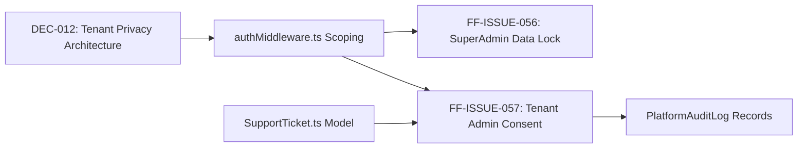
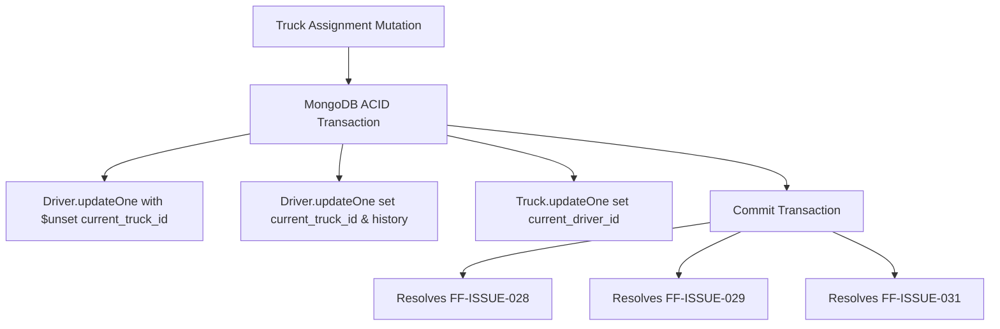

# Fleet Flow — Architectural Dependency Map & Issue Cluster Analysis

**Document Type:** Technical Relationship & Dependency Topology  
**Project:** Fleet Flow — Transport Management SaaS  
**Audit Reference:** [`ISSUE_AUDIT_REPORT.md`](ISSUE_AUDIT_REPORT.md)  
**Implementation Plan Reference:** [`IMPLEMENTATION_BATCH_PLAN.md`](IMPLEMENTATION_BATCH_PLAN.md)  
**Last Updated:** 15 October 2026  

---

## 1. High-Level Batch Dependency Graph

The implementation workflow must progress through seven sequenced batches to preserve data boundaries and prevent regressions. The intermittent Incognito authentication issue (`FF-ISSUE-058` / `QST-014`) is quarantined as the final runtime verification step.

```mermaid
flowchart TD
    classDef security fill:#fee2e2,stroke:#ef4444,stroke-width:2px,color:#991b1b;
    classDef finance fill:#fef3c7,stroke:#f59e0b,stroke-width:2px,color:#92400e;
    classDef fleet fill:#dbeafe,stroke:#3b82f6,stroke-width:2px,color:#1e40af;
    classDef subs fill:#ede9fe,stroke:#8b5cf6,stroke-width:2px,color:#5b21b6;
    classDef ops fill:#e0f2fe,stroke:#0284c7,stroke-width:2px,color:#0369a1;
    classDef hub fill:#ccfbf1,stroke:#14b8a6,stroke-width:2px,color:#115e59;
    classDef ui fill:#f3f4f6,stroke:#6b7280,stroke-width:2px,color:#1f2937;
    classDef finalTest fill:#dcfce7,stroke:#22c55e,stroke-width:2px,color:#166534;

    A[Batch A: Security & Tenant Isolation<br>DEC-012, ISSUES: 056, 057, QST-003]:::security
    B[Batch B: Financial Correctness & Ledger<br>DEC-004, 006, 007, ISSUES: 042, 043, 044, 045, 050, QST-009]:::finance
    C[Batch C: Fleet Assignments & Trip Locks<br>DEC-008, 009, ISSUES: 017, 018, 028-032, 035-039, 041, QST-008, 011, 013]:::fleet
    D[Batch D: Subscriptions & Approvals<br>DEC-001, ISSUES: 002, 012, 023-027, 059, QST-001, 002, 005, 007]:::subs
    E[Batch E: Notifications & Support Ops<br>DEC-011, ISSUES: 020, 021, 022, 054, 055, QST-004, 006]:::ops
    F[Batch F: Regional Branches & Hubs<br>DEC-010, ISSUES: 051, 052, 053, QST-012]:::hub
    G[Batch G: Design System & UI Consistency<br>ISSUES: 001, 003-011, 013-016, 019, 033, 034, 040, 046-049, 060, QST-010]:::ui
    H[Final Retest: Incognito Session Stability<br>ISSUE-058, QST-014 (STRICTLY LAST)]:::finalTest

    A --> B
    B --> C
    C --> D
    A --> E
    D --> E
    C --> F
    D --> F
    A --> G
    B --> G
    C --> G
    D --> G
    E --> G
    F --> G
    G --> H
```

---

## 2. Core Functional & Data Clusters

### 2.1 Cluster 1: Super-Admin & Support Governance (Batch A & DEC-012)
- **Shared Code Areas:** `superAdminController.ts`, `authMiddleware.ts`, `PlatformAuditLog.ts`, `ImpersonationBanner.tsx`, `SupportTicket.ts`
- **Relationships:**
  - `FF-ISSUE-056` (Unscoped Super-Admin data access) is the security vulnerability underlying `FF-ISSUE-057` (Lack of workspace-admin consent).
  - Resolving `DEC-012` requires refactoring `authMiddleware.ts` to enforce tenant scope even when an operator holds a platform super-admin role.
  - Proposed Policy D introduces a model dependency on `SupportTicket`: Batch A validates ticket existence directly against MongoDB, independent of Batch E's central support inbox UI (`FF-ISSUE-022` / `QST-004`).
  - Fix provides the secure substrate for `QST-003` and platform support ticketing (`QST-004`).



---

### 2.2 Cluster 2: Financial Invariants & Advance Reconciliation (Batch B)
- **Shared Code Areas:** `settlementController.ts`, `partyController.ts`, `VehicleEntry.ts`, `ledgerController.ts`
- **Relationships:**
  - `FF-ISSUE-043` (Driver cash advance not credited for cash diesel) directly impacts `Settlement.ts` net wage calculation.
  - `FF-ISSUE-050` (Market Movement ₹3,000 calculation mystery) was resolved as an interface omission where `dala_charges` and `kamisan_amount` were computed in `VehicleEntry.ts` pre-save hook but hidden from `VehicleEntryListPage.tsx`.
  - `FF-ISSUE-044` (Fuel payment mode accounting) connects `TruckJourney.diesel_expenses` to `Ledger.ts` double-entry postings.

```mermaid
flowchart TD
    FuelStop[addDieselStop Entry] --> ModeCheck{Payment Mode?}
    ModeCheck -- "cash" --> AdvanceDeduct[FF-ISSUE-043: Deduct from Driver Advance]
    ModeCheck -- "credit" --> VendorPayable[FF-ISSUE-044: Post to BalanceParty Payable]
    ModeCheck -- "fuel_card" --> CardLiability[FF-ISSUE-044: Post to Fuel Card Account]
    AdvanceDeduct --> SettlementCalc[Settlement Net Payable]
    
    MarketEntry[VehicleEntry.pre('save')] --> MathFormula[Net = Freight - Cash - Diesel - Dala - Kamisan + Halting]
    MathFormula --> Fix050[FF-ISSUE-050: Expose Dala & Kamisan Columns in UI]
```

---

### 2.3 Cluster 3: Fleet Assignment Integrity & Concurrency (Batch C)
- **Shared Code Areas:** `truckController.ts`, `journeyController.ts`, `Driver.ts`, `Truck.ts`
- **Relationships:**
  - `FF-ISSUE-028` (Stale current driver display) and `FF-ISSUE-029` (Dual drivers holding active vehicle) stem from the identical root cause: `truckController.ts` passes `{ current_truck_id: undefined }` without `$unset`, causing Mongoose to skip the update in MongoDB.
  - `FF-ISSUE-031` (Driver assignment history missing) is caused by `journeyController.ts` updating only the `Truck` document upon dispatch while ignoring the `Driver` document.
  - Fixing this cluster requires an atomic MongoDB transaction updating `Truck.current_driver_id`, `Driver.current_truck_id`, and `Driver.assignment_history` concurrently.



---

### 2.4 Cluster 4: Trip Lifecycle State Machine & Immutability (Batch C & DEC-008)
- **Shared Code Areas:** `journeyController.ts` (`addMilestone`, `addDieselStop`, `addDriverExpense`), `TruckJourney.ts`
- **Relationships:**
  - `FF-ISSUE-035` (Draft trips exposing routine actions) and `FF-ISSUE-037` (Completed trips editable via routine actions) share the lack of status precondition guards in `journeyController.ts`.
  - Enforcing `DEC-008` locks all operational sub-resources once `journey.status === 'completed'`.
  - `FF-ISSUE-038` and `FF-ISSUE-039` provide audited correction endpoints to replace accidental or inaccurate entries.

---

### 2.5 Cluster 5: Subscription Billing & Feature Gating (Batch D & DEC-001)
- **Shared Code Areas:** `authController.ts`, `billingRoutes.ts`, `idempotencyMiddleware.ts`, `BillingPage.tsx`, `FeatureGate.tsx`
- **Relationships:**
  - `FF-ISSUE-023` (14-day vs 7-day trial) is a hardcoded constant discrepancy in `authController.ts`.
  - `FF-ISSUE-026` (Plan change failing due to missing idempotency header) occurs because `BillingPage.tsx` omits `x-idempotency-key` when calling `api/billing/verify-payment`.
  - `FF-ISSUE-025` (PRO modules accessible despite lock badge) requires client-side route guards in `App.tsx` backed by `<FeatureGate>` components.

---

### 2.6 Cluster 6: Design System, Toasts, Modals & Numeric Trapping (Batch G)
- **Shared Code Areas:** `modals.css`, `toasts.css`, `forms.css`, `NewJourneyPage.tsx`, `SettlementListPage.tsx`
- **Relationships:**
  - `FF-ISSUE-012` (Toast obscured behind modal) is caused by `modals.css` declaring `z-index: 1100` while `toasts.css` uses `var(--z-toast, 1000)`. Raising toast z-index to `1200` resolves this globally.
  - `FF-ISSUE-017`, `FF-ISSUE-018`, `FF-ISSUE-040`, and `FF-ISSUE-046` share the same numeric input trapping bug: React controlled inputs casting `""` to `0` via `Number(e.target.value)`.
  - `FF-ISSUE-010` (Native `window.confirm`) spans four separate roster and detail pages; all can be replaced with a single reusable `ConfirmModal` component.

---

## 3. Shared Component & Infrastructure Topology

| Component / Utility | File Path | Dependent Issues | Root-Cause Influence |
| :--- | :--- | :--- | :--- |
| **Toast Notification Container** | `frontend/src/styles/components/toasts.css`<br>`frontend/src/components/common/ToastContainer.tsx` | `FF-ISSUE-012` | Z-index hierarchy and auto-dismiss timeout |
| **Modal Dialog Container** | `frontend/src/styles/components/modals.css`<br>`frontend/src/components/common/Modal.tsx` | `FF-ISSUE-010`, `FF-ISSUE-012` | Modal z-index and native `confirm()` replacement |
| **Numeric Form Input Handler** | `frontend/src/pages/operations/NewJourneyPage.tsx`<br>`frontend/src/pages/commercial/SettlementListPage.tsx` | `FF-ISSUE-017`, `FF-ISSUE-018`, `FF-ISSUE-040`, `FF-ISSUE-046` | Controlled state backspace casting `""` to `0` |
| **Driver Assignment Controller** | `backend/src/controllers/truckController.ts` | `FF-ISSUE-028`, `FF-ISSUE-029` | Missing `$unset` in Mongoose updates |
| **Trip Dispatch Lifecycle** | `backend/src/controllers/journeyController.ts` | `FF-ISSUE-031`, `FF-ISSUE-035`, `FF-ISSUE-037`, `FF-ISSUE-059` | Status precondition checks and driver state updates |
| **Super-Admin Impersonation** | `backend/src/controllers/superAdminController.ts` | `FF-ISSUE-056`, `FF-ISSUE-057`, `DEC-012` | Unscoped JWT creation without tenant approval |
| **Market Movement Ledger Formula** | `backend/src/models/VehicleEntry.ts`<br>`frontend/src/pages/operations/VehicleEntryListPage.tsx` | `FF-ISSUE-048`, `FF-ISSUE-049`, `FF-ISSUE-050` | Hidden `dala` and `kamisan` deduction columns |
| **Driver Settlement Accounting** | `backend/src/controllers/settlementController.ts` | `FF-ISSUE-043`, `FF-ISSUE-044` | Omission of cash-funded diesel from advances |
| **Regional Branch Linkage** | `backend/src/models/Branch.ts`<br>`backend/src/models/TruckJourney.ts`<br>`backend/src/models/Invoice.ts` | `FF-ISSUE-051`, `FF-ISSUE-052`, `FF-ISSUE-053`, `DEC-010` | Missing foreign keys and document numbering prefixing |
